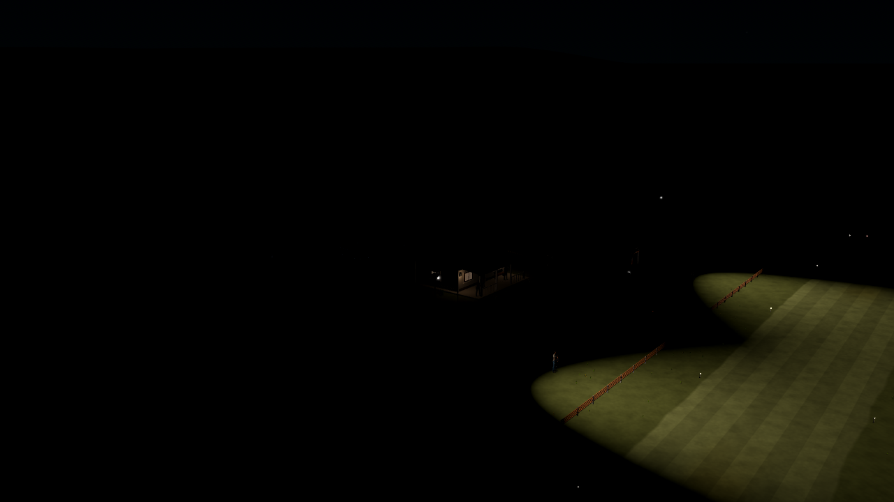
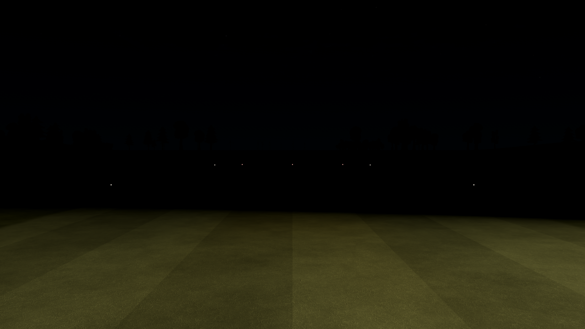

# FW-66: night-lighting planning research

2026-10-13, America/Bogota · **Research and starting composition only.** This record supports the [night landscape plan](../../../plans/night-landscape-lighting.md), which owns FW-66–75 status. No new runtime lighting, fire, preference or physics behavior was installed.

## Visual baseline

A successful native capture of the current production world produced three 1280 × 720 night views. [stdout](stdout.log) records completion; [stderr](stderr.log) is empty. [Raw report](report.json) records Godot **4.7.2.stable.official.ed1daf0bf**, Compatibility/OpenGL and NVIDIA RTX 3090 / driver 610.88 (driver recorded in stdout). [Capture manifest](capture-manifest.json) identifies the retained bytes.

The [pilot view](pilot_north.png) is also retained. Inspection finds useful texture in lit ground and appropriately small markers, but isolated pools, little mast detail from the wide view and a dark gap toward the social area. These are qualitative art observations, not a statement that all dark areas must be illuminated.

The command used `capture_landscape_upgrade.gd`, `--time_of_day=night`, `--cases=postcard_club,runway_inside,pilot_north`, `--frames=4`, `--width=1280`, `--height=720`; the report preserves the absolute scratch output argument. Exact reusable commands are in the plan and [landscape tools](../../../../tools/landscape/README.md).

**Evidence limits:** this was a live working tree with other tracks changing aircraft imports. There is no immutable source snapshot for these images. The harness warmed each view, but only four timing samples were requested and other Godot processes existed; do not use its timing numbers as performance qualification. A second direct capture attempt encountered an aircraft model-binding SHA-256 mismatch and a subsequent missing `root` dictionary error in the capture harness. It did not replace the successful first report. That process was stopped; aircraft files were not changed to make this research pass. Capture a fresh isolated source baseline before implementing or benchmarking this plan.

## Code observations

Graph discovery located the field-light/world modules. Its stored ranges lagged current additions, so the corresponding current files and LU evidence were inspected before writing the plan.

| Observation | Current source / significance |
| --- | --- |
| Two tall floods plus one low windsock flood; 19 marker points | [Field-light data](../../../../app/data/fields/lights.json). New work must deliberately distinguish one physical mast from multiple emitters. |
| `MAX_FLOODS = 4`, one pole built per flood | [FieldLights](../../../../app/render/world/field_lights.gd). The proposed four mast heads plus windsock cannot be added by duplicating today's flood records unchanged. |
| Analytic adaptation evaluates inverse-square light, while SpotLight distance attenuation is not assigned in the builder | Same source, `illuminance_point()` and `build()`. Probe the installed engine and reconcile both laws before photometric tuning. |
| Hardware, dusk gain, display caps and veranda lights are layered over FW | [AirfieldLighting](../../../../app/render/landscape_upgrade/airfield_lighting.gd). Avoid a second uncontrolled light controller; its flood role currently depends on a name prefix. |
| Red/green end direction and soft core/halo already exist | [Runway marker shader](../../../../app/render/landscape_upgrade/runway_marker.gdshader). Extend profiles; preserve depth occlusion and view-dependent sizing. |
| Flood records also create collision capsules | [Collision world](../../../../app/scenery/collision_world.gd). Migration needs one physical mast proxy, not one per head. |
| GPU smoke is already verified on native Compatibility | [SM-00–09](../../smoke-investigations/SM-00-09/README.md). Reuse its presentation-clock principles; this does not prove a new fire atlas/material works. |

## Resource comparison

Four selected assets and the campfire's required texture are preserved under [night-lighting sources](../../../../assets/landscape/night-lighting/README.md), totaling **716,564 bytes**. [PROVENANCE.json](../../../../assets/landscape/night-lighting/PROVENANCE.json) records URLs, file hashes and exact archive entries. [License evidence](../../../../assets/landscape/night-lighting/LICENSES.md) accompanies them. Downloads were inspected as data; no downloaded code was executed. Godot import and in-scene acceptance remain pending.

| Candidate | Retrieved evidence | Evaluation and plan role |
| --- | --- | --- |
| [Innerscene Security – Motion Floodlight](https://www.innerscene.com/tools/library/3d-parts/security-motion-floodlight-d771cce2) | CC0 original; 253,564-byte GLB; 6,944 triangles, 21 meshes, 4 materials; transformed bounds approximately 0.4032 × 0.2835 × 0.2295 m (X/Y/Z). Images embedded. | Preferred modular source: two separately named housings/lenses/arms. Duplicate the unit for four heads on the retained mast. Remove irrelevant sensor/backplate by source adaptation. The model has emissive material but supplies no Godot flood illumination. |
| [Innerscene Path – Stake Path Light](https://www.innerscene.com/tools/library/3d-parts/path-stake-path-light-132d4aa2) | CC0 original; 120,092-byte GLB; 1,656 triangles, 3 meshes, 2 materials; approximately 0.238 × 0.557 × 0.238 m. Images embedded. | Optional detailed near lamp, bronze and opal appearance. Not evidence of a solar-powered fixture. Preserve current stakes if the change adds cost without a visible benefit. |
| [Kenney Survival Kit 2.0](https://kenney.nl/assets/survival-kit) | Downloaded 1,948,174-byte official ZIP. Extracted `Models/GLB format/campfire-pit.glb`: 26,468 bytes, 305 triangles, 2 meshes, 1 material, approximately 0.2778 × 0.1091 × 0.2692 m. CC0 archive license retained. | Preferred small log/base source; scale/palette need review. No animation or flame node in this specific model. The GLB references `Textures/colormap.png`; that 7,440-byte archive member is preserved beside it. |
| [Animated flame texture](https://opengameart.org/content/animated-flame-texture), tauran | CC0; retrieved 309,000-byte 1024 × 512 RGBA PNG; 72-frame 12 × 6 layout. Lead inspected the sheet. | Candidate flame effect, with baked isometric perspective. Cell dimensions are fractional; verify edge bleed and viewing angle before selecting it as final art. |
| [Campfire – Branches](https://opengameart.org/content/campfire-branches), TinyWorlds | CC0; downloaded 370,169-byte ZIP with three OBJ variants, JPEGs, preview and PDF. All OBJ files reference `campfire_branches1c.mtl`, absent from the ZIP. | Alternate logs only; less reliable intake than the Kenney pair. Kept in ignored scratch, not included as a selected source. Archive SHA-256: `dd447be84813ca2c370b1c6890aa145a5d178208efe74c1439c6ff479f135633`. |
| [Four lamp floodlight mast](https://3dassets.dev/assets/football-soccer-club-grounds-floodlight-mast-282b2db3), 3D Assets | Catalog says CC0, AI-assisted, 168 triangles, 3 materials, 12.35 m tall, four heads, no emission. **Not downloaded**: download request returned 503 and local CDN DNS resolution failed. | A complete-mast fallback only. Catalog detail is very low for a close hero prop; do not call it imported or verified. Existing shaft reuse plus downloaded heads is currently more concrete. |
| [Runway Edge Light](https://3dassets.dev/assets/battle-royale-town-and-airfield-runway-light-stalk-7383474e), 3D Assets | Catalog says CC0, AI-assisted, 620 triangles, amber emission, 0.955 m high. **Not downloaded**, same CDN failure. | No priority over existing low markers or the retrieved Innerscene source; its full scale is larger than current 0.35 m stakes. |

Counts/bounds above come from GLB JSON/accessor/node inspection, not a Godot import or triangle-count claim about optimized runtime output. The Innerscene floodlight includes double-sided materials and a transmission extension on its sensor plastic; a Compatibility-specific material pass and surface batching are required. Two unoptimized copies would have 42 mesh nodes, so their raw node count cannot be mistaken for the plan's draw budget.

The download/parse audit was delegated to a Luna Max agent with read-only repository scope and one scratch directory. The lead checked the retained files, texture dependencies, flame/base previews and current scene captures. Source originals are unchanged.

## Godot and airfield references

Primary documentation was checked on 2026-10-13; Context7 resolved the Godot documentation's 4.7 branch. Online documentation can move and is not proof of pinned-binary behavior. Each resulting implementation must pass a native 4.7.2 probe.

| Primary source | Decision supported |
| --- | --- |
| [Godot 4.7 renderer comparison](https://docs.godotengine.org/en/4.7/tutorials/rendering/renderers.html) | Stay within Compatibility capabilities and per-mesh lights; no dependency on volumetric fog, PCSS for local lights, or projector textures. |
| [SpotLight3D](https://docs.godotengine.org/en/4.7/classes/class_spotlight3d.html) | Explicit half-angle, range, distance and angular attenuation; test actual behavior against the analytic exposure estimate. |
| [Environment and post-processing](https://docs.godotengine.org/en/4.7/tutorials/3d/environment_and_post_processing.html) | Compatibility glow exists with fewer controls. Keep scripted exposure and compare glow against local halos without requiring it. |
| [3D rendering limitations](https://docs.godotengine.org/en/4.7/tutorials/3d/3d_rendering_limitations.html) | Inspect LDR banding and transparent sorting; preserve opaque housing/depth occlusion and bounded flame overdraw. |
| [3D formats](https://docs.godotengine.org/en/4.7/tutorials/assets_pipeline/importing_3d_scenes/available_formats.html) | Prefer glTF/GLB, preserving all external images; test exported resources without authoring tools. |
| [Particle properties](https://docs.godotengine.org/en/4.7/tutorials/3d/particles/properties.html), [CPUParticles3D](https://docs.godotengine.org/en/4.7/classes/class_cpuparticles3d.html) | Bound amount/lifetime/AABB and verify pause, sorting and deterministic reconstruction; retain a CPU fallback if the specific GPU effect fails qualification. |
| [FAA AIM 2-1-4 / 2-1-10](https://www.faa.gov/air_traffic/publications/atpubs/aim_html/chap2_section_1.html) | White runway edges, green approach/red inward end cues, blue only for actual taxiway edges. Color inspiration, not a full-size installation or compliance claim. |

No recommendation here depends on paid assets, generating artwork, importing a third-party runtime addon, changing flight physics or moving to another renderer.
