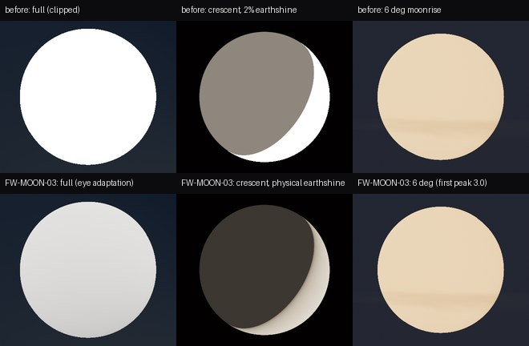

# FW-MOON-03: photometric moon disc, eye adaptation and moon shadows

**Status:** engineering-verified 2026-10-19 on llvmpipe. This is a declared night-visual change: night captures differ from FW-23/FW-84. The calibrated Day scene, day sun shadows and physics are unchanged.

- Code: [sky_state.gd](../../../../app/render/world/sky_state.gd), [moon_disc.gdshaderinc](../../../../app/render/world/moon_disc.gdshaderinc) (the sky shader includes it), [atmosphere.gd](../../../../app/render/atmosphere.gd), [ephemeris.gd](../../../../app/render/world/ephemeris.gd) (`sky()` now carries the place).
- Seams with other owners:
  - `main.gd` and `home_scene.gd` (one line each): the planar pilot shadow in field-world mode uses the moon's strength.
- Test: [test_world_moon_sky.gd](../../../../app/tests/test_world_moon_sky.gd).
- Plan: [moon plan](../../../plans/moon.md).

## What changed

1. **The Lunar state drives the moon.** When the sky carries a place, `SkyState` calls `Lunar.at_jd`. That supplies the exact phase angle, the distance (KS91 flux × (d̄/d)², so a perigee full moon is ~25 % brighter than an apogee one), the topocentric angular size, the direction from the moon to the sun, and earthshine. Hand-built test skies without a place keep the original path byte for byte (`test_landscape_twilight`: 394 checks unchanged).
2. **Disc photometry.**
   - Per-pixel brightness is now lunar-Lambert (McEwen 1991) normalised by K(α) so the disc-integrated flux equals the KS91 phase law. Numerical integration of the shader formula matches KS91 within 1 % at 0–150°.
   - The full moon is flat, and the terminator comes from μ₀ rather than a smoothstep.
   - The old disc applied disc-integrated flux per pixel, which made a crescent about 15× too dim per pixel.
3. **Earthshine.** Earth geometric albedo × Lambert phase × (R⊕/d)², with a bluish tint (ΔB−V −0.15). It replaces the constant 2 %; it is brightest on the crescent and fades toward full moon.
4. **Horizon colour.** The sky table's direct beam at the moon's elevation, relative to the 45° anchor, colours the disc, so the moon reddens exactly like the sun.
5. **Eye adaptation to the disc.** At night the full moon is 10⁴–10⁵ times brighter than the scene the exposure serves, so the physical disc clipped to white.
   - When the unattenuated full moon would exceed `MOON_DISPLAY_PEAK` on the display, the disc is scaled there and its illumination compressed with γ.
   - This models the dark-adapted eye looking at the moon (estimate, labelled in code). By day the disc stays physical.
   - Peak 0.7 and γ 0.55 were tuned against Godot 4.7.2's AgX (allenwp curve, white 1.0 → AgX clip at 2.0). The resulting levels are listed in [FW-MOON-05](../FW-MOON-05/README.md).
   - The first version used a peak of 3.0 and normalised the *attenuated* moon. That clipped and washed out a low moon: the reference must be the moon outside the atmosphere.
6. **Moon shadows fade with the phase.** Strength = smoothstep(0.15, 0.5) of the light's direct share relative to the 45° sun's share. Measured on the test cases: full moon 1.0, 60 % gibbous 1.0, 19 % crescent 0.11.
   - It drives the engine's PSSM (off at 0), field-projected and scenery shadows, and the planar pilot shadow.
   - The sun keeps strength 1.0, unchanged.

Top row: before (physical disc clipped, crescent with a grey 2 % earthshine). Bottom row: FW-MOON-03 with the first, later corrected, adaptation peak. The final look, with texture and the tuned peak, is in [FW-MOON-05](../FW-MOON-05/README.md).

## Verification

| Check | Result |
| --- | --- |
| `test_world_moon_sky.gd` | 62/62. Covers: KS91 normalisation at 0–150°; disc radius = asin(R/d); perigee disc > 1.10 × apogee; low moon redder and dimmer; earthshine order crescent > quarter > full and bluish; shadow strengths; day disc physical, night disc at the peak; orientation (FW-MOON-05); hand-built skies unchanged. |
| Existing world tests, clean worktree (HEAD + moon changes only) | `test_world_sky` 38/38, `test_world_flow` 26/26, `test_world_stars` 22/22, `test_landscape_twilight` 394/394, `test_sky_render` 30/30, `test_world_presentation_context` 17/17, `test_world_field_lights` 86/86. |
| Captures | [tools/world/moon_capture.gd](../../../../tools/world/moon_capture.gd), llvmpipe 1280×720, close-ups at 1.2° field of view. Images compare only with the same machine. |

## Corrections to the audit

The first FW-MOON-00 audit was wrong on two points, now corrected there:
- Night clouds already followed the moon: the sky shader's `sun_dir` is the active light.
- Moonlight already ramped in through the sky table between −0.5° and 0°.

The storm bank has no light direction at all, day or night; that is an FW-84 matter.

## Limits

- The disc is still drawn in the sky's radiance cubemap pass; the render-path decision comes from [FW-MOON-01](../FW-MOON-01/README.md).
- Peak and γ are display judgements, made on llvmpipe; they need owner review on real monitors (FW-MOON-14).
- The sun↔moon light hand-off (direction flip at twilight) is FW-MOON-06.
