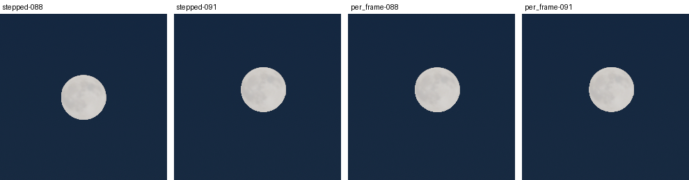

# FW-MOON-03b: the moon and the stars move every frame

**Status:** engineering-verified 2026-10-19 on llvmpipe. It implements the [FW-MOON-01](../FW-MOON-01/README.md) decision (sky-shader disc, moved every frame). This is a declared night-visual change for sessions with time flowing; at every 30 s sky step the picture is unchanged. Frozen times, the calibrated Day scene and physics are unchanged.

- Code: [world.gd](../../../../app/render/world/world.gd) (`flow_frame`, `radiance_unused`, the look-ahead state in `_flow_state`), [sky.gdshader](../../../../app/render/sky.gdshader) (one guard; VQ/Landscape-owned file).
- Test: [test_world_moon_flow.gd](../../../../app/tests/test_world_moon_flow.gd).
- Capture tool: [research/field-world/fw-moon-03b/](../../../../research/field-world/fw-moon-03b/) (`track.gd`, `analyze.py`).
- Plan: [moon plan](../../../plans/moon.md).

## What changed

1. **Per-frame motion.** `World.update` calls `flow_frame(clock_s)` after `flow_to`. Between two sky steps it interpolates, from the current step's state toward the next step's:
   - the moon's direction (float64, from the two states' azimuth and elevation);
   - the disc's orientation (`moon_render_to_body`, slerp);
   - the stars' sidereal turn.

   The values are a pure function of the simulation clock and equal the stepped state at every step. Light colour, sky colours, exposure and the moonlight's direction keep the step cadence.
2. **Look-ahead state.** `flow_frame` computes the next step's `SkyState` once and keeps it. `flow_to` uses it when the clock reaches that step, keyed by step, start time and moon choices. One `SkyState` per step, as before; only the first frame computes one extra.
3. **Radiance guard.** Sky uniforms are written per frame only while `radiance_unused(env)`: no ambient or reflections from the sky. The field-world environment always qualifies.
4. **No disc in the cubemap pass.** `sky.gdshader` adds the disc only when `!AT_CUBEMAP_PASS`. No route that uses the radiance draws a moon today, so no picture changes. Reflection probes (the lake) draw the background pass and still see the disc.

## Verification

| Check | Result |
| --- | --- |
| `test_world_moon_flow.gd` | 23/23. Radiance gate for six environment combinations; shader guard; over 4.5 s at ×20 and 60 fps, the moon moves one step's arc per step with the largest per-frame motion ≤ 1.5× the mean; stars and face turn without jumps; at a step instant the uniforms equal the stepped state; the reused look-ahead equals a fresh `SkyState`; mid-step halfway along the arc; replay byte-identical; pause, sky-radiance routes and "no moon" write nothing; frozen sessions never move. |
| Mutation (`flow_frame` disabled, disposable copy) | 8 of 23 checks fail: per-frame jumps of 0.118° (moon), 0.125° (stars) and 0.121° (face). |
| Production render, [track.gd](../../../../research/field-world/fw-moon-03b/track.gd) | Fixed 6° camera (the pilot auto-zoom floor), 1280×720, clear sky, 2026-10-25 21:00 at ×20, 271 frames ([summary.json](summary.json), [track.json](track.json)). See the table below. |
| Existing tests (working tree) | `test_world_flow` 26/26, `test_world_moon_sky` 62/62, `test_world_moon_config` 47/47, `test_world_moon_lunar` 1102/1102, `test_world_moon_presets` 23/23, `test_world_moon_assets` 21/21, `test_world_sky` 38/38, `test_world_stars` 22/22, `test_world_ephemeris` 29/29, `test_landscape_twilight` 394/394, `test_landscape_horizon` 37/37, `test_sky_render` 30/30, `test_world_presentation_context` 17/17, `test_world_field_lights` 86/86, `test_ui_moon_controls` 13/13. |
| Smoke | `--quick-flight --start=airborne --date=2026-10-25 --time=21:00 --time_scale=20`, 600 rendered frames: no errors. |
| Cost (llvmpipe, loaded VM) | `flow_frame` 24 µs per frame; `SkyState` 324 µs once per step (unchanged count). |

Disc centroid per frame (brightness-weighted, 119.9 px/deg):

| Mode | Total path | Median per-frame motion | Max per-frame motion | Frames moving > 1 px | Frames not moving |
| --- | --- | --- | --- | --- | --- |
| Stepped (before) | 42.3 px (0.353°) | 0.000 px | 14.10 px | 3 | 267 |
| Per frame (now) | 42.4 px (0.353°) | 0.155 px | 0.21 px | 0 | 0 |

At the step instants the two modes are identical (0.000 px).

Frames 88 and 91 around the step at frame 90. The stepped disc jumps 14 px; the per-frame disc has already moved there.

`test_world_moon_sky` needed one fix: its apogee comparison read the "night" preset, which FW-MOON-11 retargeted to an in-view full moon. That check already failed at HEAD, independently of this change. It now names the former preset's date (2026-06-30 01:15, near apogee) and passes.

## Limits

- The lake's reflection probe refreshes on the light's signature, at step cadence, so the moon road may lag the disc by up to one step (0.12°). It is checked in FW-MOON-08.
- The sun disc in flowing daytime sessions still steps (2–21 px at the same zooms). It is outside the moon plan; the same interpolation would apply.
- A route that keeps sky ambient or reflections gets no per-frame motion (by design). Today such routes have no moon; FW-MOON-09 (M-D7) decides how night reaches them.
