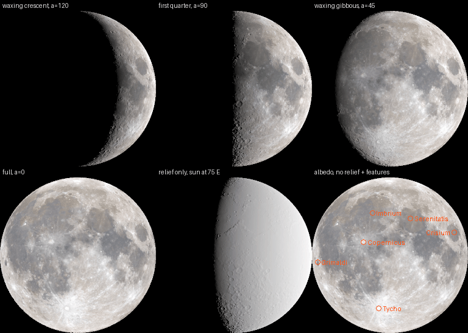

# FW-MOON-04: moon texture intake

**Status:** delivered 2026-10-19, uncommitted. This step only takes in the textures; no renderer reads them yet (that is FW-MOON-05). It implements the [moon plan](../../../plans/moon.md) §4 Assets with the M-D6 default: SVS 2k colour and a 1k normal map. Sources come from the [FW-MOON-00 research](../FW-MOON-00/README.md).

## Sources

All files come from the NASA SVS CGI Moon Kit, <https://svs.gsfc.nasa.gov/4720> (released 2019-09-06, updated 2026-01-09). They were retrieved on 2026-10-19 into `assets/sky/moon/source/` and are recorded in [PROVENANCE.json](../../../../assets/sky/moon/PROVENANCE.json). They are unmodified.

| File | URL | Bytes | SHA-256 | Content |
| --- | --- | --- | --- | --- |
| `lroc_color_2k.jpg` | <https://svs.gsfc.nasa.gov/vis/a000000/a004700/a004720/lroc_color_2k.jpg> | 457,942 | `f7130a1822681fa7512d7dcfd40db8c10b9ba4f06777910348698260ed7a2170` | 2025 LROC WAC colour (server Last-Modified 2025-12-03). JPEG 2048×1024 RGB, 4:4:4, ICC sRGB IEC61966-2.1. Identical to the FW-MOON-00 copy. |
| `ldem_4_uint.tif` | <https://svs.gsfc.nasa.gov/vis/a000000/a004700/a004720/ldem_4_uint.tif> | 2,076,866 | `e6668bec27fc9b8fbb02d198c7ddfb08eedeeb790167b494f95e6b34201da05e` | LOLA elevation at 4 px/deg (Last-Modified 2019-06-05). Uncompressed TIFF, 1440×720 `I;16`, values 2243…41008. |

**Choice of elevation file.** The page offers `ldem_4.tif` and `ldem_4_uint.tif`. Both hold the same half-metre data, but the float file is 4.0 MB and the uint file 2.0 MB, and Pillow reads `I;16` natively. Decoding follows the page: elevation_m = (value − 20000) × 0.5 above the 1737.4 km sphere. The decoded range is −8878.5 m to +10504 m.

**Credit and terms.**
- Credit: "NASA's Scientific Visualization Studio". Visualizer Ernie Wright (USRA); scientist Noah Petro (NASA/GSFC). LROC WAC data from Arizona State University.
- [NASA media guidelines](https://www.nasa.gov/nasa-brand-center/images-and-media/): NASA material is "generally not subject to copyright in the United States", NASA "should be acknowledged as the source", and use must not imply endorsement. No insignia is used.
- The SVS page warns that the maps are "optimized for aesthetics, not science".
- `app/assets/sky/moon/LICENSE.md` carries the credit.

### Orientation

The page says: "The map is centered on 0° longitude", and calls the LOLA grids "global cylindrical projections". It does not state the edges or north-up, so both were measured:

- **LDEM.** The minimum, −8878.5 m, is at 70.4° S 172.4° W (Antoniadi, inside South Pole–Aitken). The maximum, +10504 m, is at 5.4° N 158.6° W (the Selenean summit). The near side is lower on average (−1.0 km vs −0.04 km on the far side).
- **Colour.** The near side is darker (mean 0.708 vs 0.754). Tycho measures 0.918 at 43.3° S 11.2° W but 0.756 at the east–west mirror point.

**Convention:** equirectangular, with planetocentric latitude and east longitude. The left edge is 180° W, the centre 0° and the right edge 180° E, with east increasing to the right. Row 0 is at 90° N, so north is up. The texel centre of (col, row) is at lon = −180 + (col + 0.5)·360/W and lat = 90 − (row + 0.5)·180/H.

## Mapping for shaders (FW-MOON-05)

Use the Moon-fixed axes: X points to the mean sub-Earth point (0°, 0°), Y to 90° E and Z to the IAU north pole. For a unit vector p = (x, y, z):

```
lon = atan2(y, x)    lat = asin(z)
u = lon / (2π) + 0.5        v = 0.5 − lat / π        (v = 0 is the top row, north)
```

The seam is at u = 0/1 (180°, far side). Sample with `textureGrad` or an explicit LOD (plan §4 step 6).

**Albedo.** Bind it with `source_color` (sRGB → linear).

**Normal map.** Bind it as plain linear data, without `hint_normal`, and decode n = 2·rgb − 1. Renormalise the result: 8-bit quantisation is ±1/255 per component, and mipmaps are not renormalised. The components are local:

```
N = n.r·ê + n.g·n̂ + n.b·p
ê = (−sin lon, cos lon, 0)
n̂ = (−sin lat·cos lon, −sin lat·sin lon, cos lat)
```

IAU east, towards Mare Crisium, appears on the right in a north-up view from Earth.

## Pipeline

[`tools/world/moon_texture.py`](../../../../tools/world/moon_texture.py) runs with numpy 2.5.3 and Pillow 12.3.0 from the pinned `"$(app/tests/visual-env.sh)"`. This is an explicit exception to the stdlib-only rule in tools/world. The build has no network access and checks the source hashes.

- `moon_albedo_2k.jpg`: a byte-for-byte copy.
- `moon_normal_1k.png`, built in four steps:
  1. **Slopes on the 1440×720 source grid.** Use central differences, with longitude wrapping and one-sided differences in the edge rows:
     - ∂h/∂x = (∂h/∂λ) / ((R + h)·cos φ)
     - ∂h/∂y = (∂h/∂φ) / (R + h)
     - R = 1737.4 km
  2. **Area-average both slopes to 1024×512.** The box overlaps are exact integers; latitude weights are sin φ_top − sin φ_bottom, summed in a fixed order.
  3. **Fade to straight up at the poles.** The fade is a smoothstep between 86° and 88°: there the 1/cos φ metric turns sub-kilometre noise into spurious slopes.
  4. **Form and encode the normal.** n = normalise(−∂h/∂x, −∂h/∂y, 1), with `RELIEF_EXAGGERATION = 1.0` (physical relief), encoded as ⌊(0.5 + 0.5·n)·255 + 0.5⌋.
- `LICENSE.md`: credit, terms, generator and hashes.

**Order of operations.** Slopes are taken first and then averaged, because the mean slope over a texel's footprint is what mipmapping and filtering assume. Averaging slopes is linear, whereas averaging unit normals is not. The 1.40625:1 box also removes detail above the output Nyquist limit, so nothing aliases. Taking gradients after resampling would widen the kernel to about two output texels.

**PNG encoding.** The PNG is written with the standard-library `zlib` at level 9, using the "Average" filter on every row. That was the smallest fixed filter: 707,536 B, against 710,893–762,565 B for the others. The encoder's bytes therefore do not depend on Pillow.

```
$ "$(app/tests/visual-env.sh)" tools/world/moon_texture.py
moon_albedo_2k.jpg: 457942 bytes sha256 f7130a1822681fa7512d7dcfd40db8c10b9ba4f06777910348698260ed7a2170
moon_normal_1k.png: 707915 bytes sha256 2777b027249ed3e8905d8d80b294e4094189f496094b24d5e9fc71197d8f7b0d
LICENSE.md: 1735 bytes sha256 40ac1b6387ac6234aa780d6105679dbb79012f38ca18cd75c87b3fc29bae89d8
$ "$(app/tests/visual-env.sh)" tools/world/moon_texture.py --check
moon textures current (3 files)                              # 2.3 s, 119 MB peak
```

The system Python (numpy 1.26.4, Pillow 11.3.0) produces the same bytes; the script prints a warning about the unpinned versions.

**Mutations.** These were run on a disposable copy, and each exits 1:
- PNG re-deflated at level 6: reported "pixels identical; only the compressed stream differs".
- One bit flipped in the albedo.
- `LICENSE.md` deleted.
- One bit flipped in the source TIFF: refused with "size or SHA-256 differs from PROVENANCE.json".

**Normal statistics.**

| Latitude | Mean slope | p99 | Max |
| --- | --- | --- | --- |
| 0–30° | 2.6° | 10.9° | 22.3° |
| 60–80° | 4.0° | 14.9° | 29.7° |
| 84–86° | 5.1° | 20.1° | 31.8° |
| 88–90° | 0° | 0° | 0° |

Polar slopes are higher because the east–west texel spacing shrinks to about 1 km there.

Mean up-component before quantisation: 0.9971. Decoded vector length: 0.995–1.005.

## Godot import

Each `.import` was seeded with the parameters below. To keep memory low (swap was full and several other agents' Godot runs were active), the textures were imported in a disposable project: the textures at the same `res://` paths plus `app/project.godot`, minus the editor plugins and main scene. The command was `--headless --import`; it peaked at 738 MB RSS and took 9.6 s. The generated `.import` files were copied into `app/assets/sky/moon/`. The identical `.ctex`/`.md5` cache files were copied into the gitignored `app/.godot/imported/`, so the app's next `--import` finds them current.

| Parameter | Albedo | Normal | Why |
| --- | --- | --- | --- |
| `compress/mode` | 0 Lossless | 0 Lossless | No VRAM compression (Compatibility; exact texels) |
| `compress/normal_map` | 2 Disabled | 2 Disabled | No RGTC conversion or engine normal handling; the shader decodes |
| `mipmaps/generate`, `mipmaps/limit` | true, −1 | true, −1 | Full chain: 11 and 10 mip levels |
| `detect_3d/compress_to` | 0 Disabled | 0 Disabled | The editor must not switch them to VRAM when it detects 3D use |
| `roughness/mode`, `process/*` | defaults | defaults | Channel remap identity, `size_limit=0`, no premultiplied alpha |

Godot 4 has no sRGB import flag. Colour space is chosen by the sampler hint: `source_color` for the albedo, no hint for the normal map.

## Sizes

| File | On disk | Imported `.ctex` (pack) | VRAM with mipmaps |
| --- | --- | --- | --- |
| Albedo 2048×1024 | 457,942 B | 2,407,388 B (lossless WebP of decoded JPEG) | 8.0 MiB RGB8 (10.7 MiB if the driver pads to RGBA8) |
| Normal 1024×512 | 707,915 B | 760,690 B | 2.0 MiB RGB8 (2.7 MiB padded) |
| Sources (`assets/sky/moon/source/`) | 2,534,808 B | not shipped | none |

## Test

```
$ "$(app/get-godot.sh)" --headless --path app --audio-driver Dummy --script res://tests/test_world_moon_assets.gd
albedo mean (stored sRGB) R 0.7478 G 0.7285 B 0.7163 all 0.7309
normal mean up 0.9976, worst |length - 1| 0.0054 over 131072 texels
21 checks, 0 failed                                           # 1.2 s, 114 MB peak
```

The test runs 21 checks:
- Size, mipmap chain and RGB8 format for each texture.
- Albedo mean 0.72–0.74, against Pillow's 0.7308 on the same grid. The SVS map is range-adjusted, so this is a light grey, not the physical 0.12 albedo.
- Near-neutral colour (R ≥ B).
- Near side darker than far side.
- Tycho brighter than its mirror point.
- Unit normals within 0.01.
- Mean up-component above 0.95.
- Pole texel straight up.
- Tycho's west inner wall tilting east (+0.10) and its east inner wall tilting west (−0.13).

`--check-only` parses the script.

## Visual check



[`contact_sheet.py`](../../../../research/field-world/fw-moon-04/contact_sheet.py) renders the sheet offline with numpy (`"$(app/tests/visual-env.sh)" research/field-world/fw-moon-04/contact_sheet.py`, 157 KB):
- Orthographic view from sub-observer 0°/0°, north up.
- Albedo × lunar-Lambert (McEwen 1991 L(α), clamped ≥ 0), with the normal map applied.
- Each panel exposed to its own 99.5th percentile.

The panels are: waxing crescent α = 120°, first quarter, gibbous α = 45°, full, relief only (uniform albedo, sun at 75° E) and full albedo with feature markers.

**Result:** the placement is correct.
- Mare Imbrium is upper left (NW).
- Mare Crisium is the isolated oval mare at the east (right) limb.
- Tycho and its ray system are in the south.
- Grimaldi is the dark spot at the west limb.
- The markers, placed from approximate IAU Gazetteer centres through the mapping above, land on each feature.
- Waxing phases are lit from the right, as seen from the northern hemisphere.

A 4× zoom of the relief panel near the terminator around Tycho (scratch only) shows the craters as bowls: west inner walls lit, east inner walls shadowed. The crater sign check in the test agrees.

At this 10 km texel scale, physical relief shows only near the terminator, and the full moon looks flat, as intended.

## Limits

- The colour map is SVS's range-adjusted, white-balanced rendering of the Hapke-normalised mosaic, not absolute albedo. FW-MOON-05 normalises photometry with K(α).
- The relief has no cast shadows; a normal map cannot provide them.
- Above 86° latitude the relief is suppressed.
- Mipmap levels are not renormalised.
- Importing as lossless adds about 3.2 MB to the export pack. A smaller lossy import would be an owner choice.
- `--check` is byte-exact only with a classic zlib, as in the pinned environment here; zlib-ng builds produce different bytes.
- Software checks show consistency with the SVS data, not on-GPU appearance or cost (FW-MOON-05/14).
