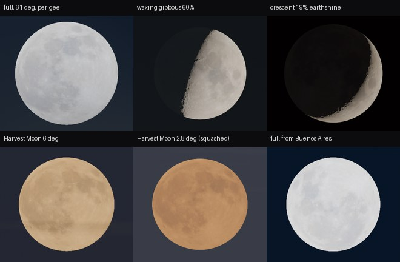
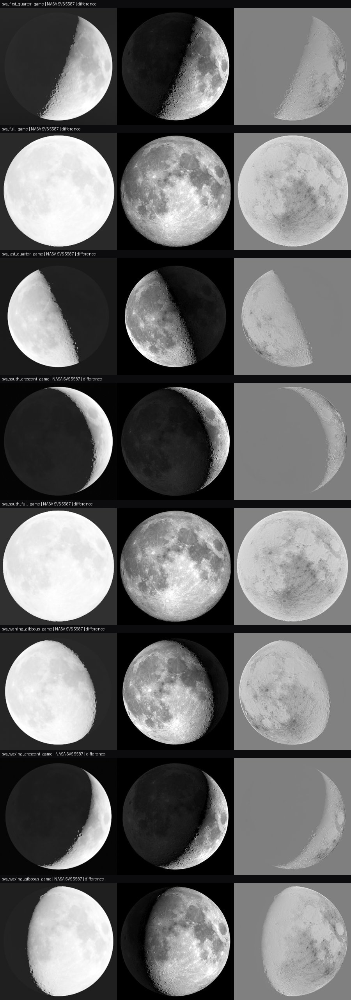

# FW-MOON-05: textured, oriented moon checked against NASA

**Status:** engineering-verified 2026-10-19 on llvmpipe. Owner review on real displays remains (FW-MOON-14).

- Code: [moon_disc.gdshaderinc](../../../../app/render/world/moon_disc.gdshaderinc), [sky_state.gd](../../../../app/render/world/sky_state.gd) (`moon_render_to_body`, `moon_squash`, display peak/γ), [atmosphere.gd](../../../../app/render/atmosphere.gd) (textures and uniforms).
- Assets: [FW-MOON-04](../FW-MOON-04/README.md) (NASA SVS CGI Moon Kit).
- Overlay tool: [overlay_svs.py](../../../../research/field-world/fw-moon-05/overlay_svs.py).
- Plan: [moon plan](../../../plans/moon.md).

## What the disc does

- **Texture and relief.** NASA's LROC albedo map, plus a normal map from LOLA elevation, are sampled on the sphere under each pixel.
- **Orientation.** The sampling goes through `moon_render_to_body`, the IAU rotation from FW-MOON-02. It carries libration, the axis angle and the turning of the face through the night. From the southern hemisphere the face is seen rotated, as in reality.
- **Level of detail.** The mip level is explicit, taken from the disc's size on screen (512·aa texels per pixel at the centre, more toward the foreshortened limb). There is no seam at ±180°, and no shimmer on the 9 px disc of a normal view.
- **Albedo scale.** Texels are divided by the map's near-side mean linear luminance, 0.3967 (projected-area weighted over the near side; the global mean is 0.5075). The textured disc therefore keeps the KS91 brightness of FW-MOON-03.
- **Refraction squash.** A low disc is squashed vertically by 1 + dR/dh (Saemundsson): 0.86 on the horizon, 0.975 at 5°, 1 above about 10° (tested). The Harvest Moon at 2.8° shows it.
- **Display levels.** Godot 4.7.2's AgX was replicated from source (`tonemap_inc.glsl`, `environment_storage.cpp`): contrast 1.25, white 2.0 because the project's white is 1.0. The choice is peak 0.7 and γ 0.55, which gives:

  | Feature | Display (sRGB) |
  | --- | --- |
  | Full-moon maria | 0.60 |
  | Full-moon mean | 0.76 |
  | Full-moon highlands | 0.87 |
  | Crescent earthshine | ~0.035 |
  | Quarter earthshine | ~0.017 |

  Nothing clips.

The six close-ups are at a 1.2° field of view, pilot height, reference field unless noted: full moon at 61° (near perigee), 60 % gibbous, 19 % crescent with earthshine, the Harvest Moon at 6° and at 2.8° (orange, squashed), and a full moon from Buenos Aires.

## Overlay against NASA SVS 5587

[`moon_capture.gd --cases=svs`](../../../../tools/world/moon_capture.gd) renders eight whole UT hours with celestial north up: six phases at the reference field and two from Buenos Aires. [`overlay_svs.py`](../../../../research/field-world/fw-moon-05/overlay_svs.py) resamples each onto the corresponding SVS frame (`moon.NNNN.jpg`, local copies in `references/moon/svs/frames/`).

It reports three measures:
- **Lit-area overlap** (IoU).
- **Albedo-detail correlation** (r): luminance minus a blur of R/12, inside both lit areas away from the terminator.
- **Best in-plane rotation:** the rotation of the game image that maximises r, searched over ±10° in 0.5° steps.

Results: [summary](svs-overlay-summary.json).

| Case (SVS frame) | Lit IoU | Detail r | Best rotation |
| --- | --- | --- | --- |
| Waxing crescent (548) | 0.790 | 0.770 | 0.0° |
| First quarter (596) | 0.788 | 0.809 | 0.0° |
| Waxing gibbous (668) | 0.804 | 0.668 | 0.0° |
| Full (44) | 0.965 | 0.591 | −0.5° |
| Waning gibbous (145) | 0.875 | 0.589 | 0.0° |
| Last quarter (220) | 0.885 | 0.654 | +0.5° |
| Buenos Aires crescent (4055) | 0.807 | 0.722 | −0.5° |
| Buenos Aires full (52) | 0.973 | 0.530 | −0.5° |

**Reading:**
- **Orientation is correct to ±0.5°** in every case, including librations from −5.9° to +7.7° in longitude and the southern hemisphere.
- **Maria and craters land in place** (r 0.53–0.81). r is lower at full moon because full-moon contrast is flat and SVS renders with a different photometric stretch.
- **IoU below 1 on crescents is expected.** The eye-adaptation compression (γ 0.55) lifts the dim part next to the terminator, so the game's lit area is wider than SVS's linear rendering.
- **Ours is softer.** The disc is ~340 px against SVS's ~690 px, and the texture is 2k.

## Limits

- The game is topocentric and SVS geocentric: diurnal libration and parallax shift features by less than 2 % of the radius.
- The terminator has normal-map shading but no cast shadows of crater rims, so long terminator shadows are approximated.
- The 2k texture limits close-ups. A 4k map waits for a telescope-class camera (M-D6).
- The importer stores the textures lossless (~3.2 MB more in the export pack). VRAM compression is an option for owner review.
