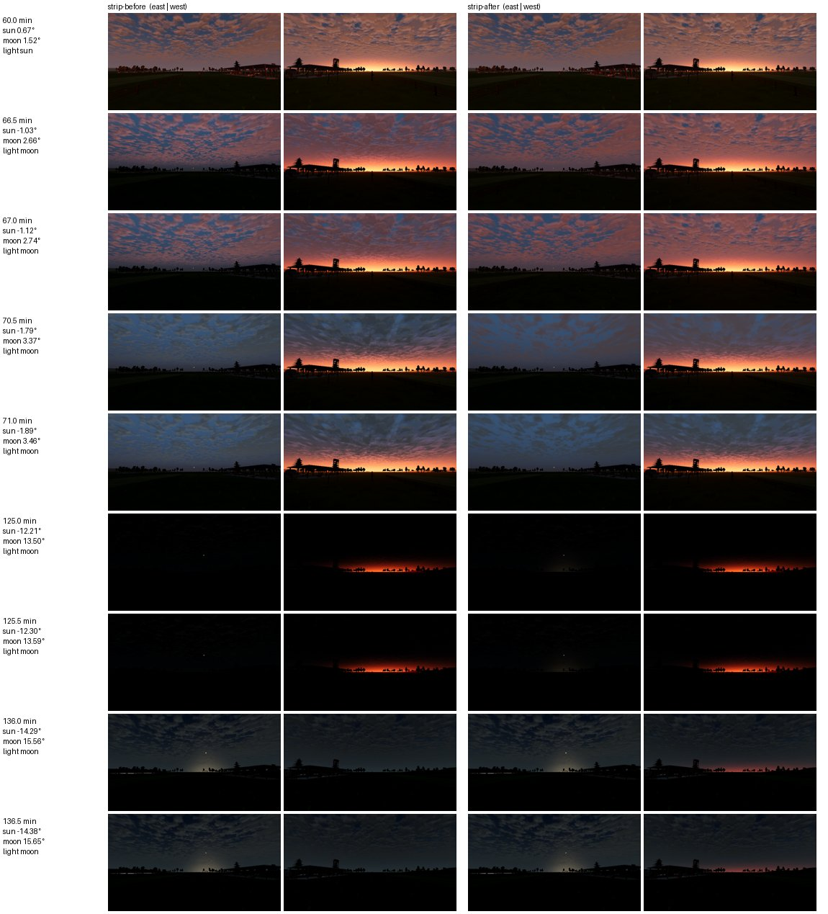

# FW-MOON-06: a continuous twilight hand-over between sun and moon

**Status:** engineering-verified 2026-10-19 on llvmpipe. This is a declared visual change for twilight and night with the sun below 0.5°. With the sun's disc above 0.5° (day, golden hour, the sunset preset), renders are identical to the bit, except 1-of-255 differences while a moon below the horizon is between −3° and −1°. The calibrated Day scene, explicit time-of-day snapshots and physics are unchanged. It covers the plan's continuity and hand-off items. The physical moonlight colour moves to FW-MOON-07, because it is the night-look mapping. Eclipse dimming moves to FW-MOON-10.

- Code:
  - [ephemeris.gd](../../../../app/render/world/ephemeris.gd) (`refraction_deg`);
  - [sky_state.gd](../../../../app/render/world/sky_state.gd) (`sun_shadow_strength`, `cloud_light_weights`, the second lobe);
  - [atmosphere.gd](../../../../app/render/atmosphere.gd) (`_apply_shadow`, sky uniforms) and [sky.gdshader](../../../../app/render/sky.gdshader) (second lobe, two cloud lights). These two are shared with VQ/Landscape; their default uniforms keep every snapshot and day sky byte-identical.
- Test: [test_world_moon_light.gd](../../../../app/tests/test_world_moon_light.gd). The refraction checks are in [test_world_ephemeris.gd](../../../../app/tests/test_world_ephemeris.gd).
- Scripts: [research/field-world/fw-moon-06/](../../../../research/field-world/fw-moon-06/):
  - `light_audit.gd` + `analyze_audit.py`: the state, step by step;
  - `twilight_strip.gd` + `analyze_strip.py`: renders.

## 1. Audit: what jumped at twilight

`light_audit.gd` steps the field-world state every 30 s of sky, as `World.flow_to` does, through four scenes at the reference field:
- the Moonrise preset's evening (2026-09-26, sun and moon opposite);
- a 19 % waxing crescent after sunset (2026-06-18, both on the same side);
- a gibbous moon setting while the sun rises (2026-10-29);
- a full moon high all night (2026-10-25, control).

Results: [before](audit-before.md), [after](audit-after.md).

| Defect (before) | Where | Size |
| --- | --- | --- |
| Refraction cut to zero below a true elevation of −1°, where it is 0.65° | `Ephemeris.refraction_deg` | The sun dropped from −0.30° to −1.03° in one step. The twilight sky, ambient and exposure jumped: displayed lit ground −26 % (\|ln\| 0.296) at every flowing sunset and sunrise. The moon did the same at moonrise and moonset. |
| The light swapped to the brighter direct source with the sun's shadows still at 1.0 | `SkyState.state` | The direction flipped 177° (Moonrise), 50° (crescent) and 137° (dawn), with shadow strength 1 → 0 in one step. The planar pilot shadow, the projected shadows and the PSSM switched with it. |
| Flow steps never switched the engine shadows | `Atmosphere.apply_light` | `shadow_enabled` stayed as built (on at a golden-hour start) through the night. |
| The sky shader's clouds and horizon lobe follow one source | `sky.gdshader` | At the light swap, the clouds' lit side, silver edge and relief flipped while the sun's twilight still lit them. In deep twilight the west glow (2.3× the haze) moved east in one step (−57 % looking west). Later the clouds' direction flipped again when the sun's cloud term in the sky table ended at −1.5°. |

The full-moon control night has no event: per step, the light moves at most 0.12° and the displayed brightness changes by at most 0.17 %.

## 2. What changed

1. **06a: continuous refraction.** Saemundsson's formula is unchanged from −1° up, so every solver and every daytime position is bit-identical. Below −1° it tapers linearly from 0.65° to zero at −3°. The apparent elevation is continuous and monotonic; its rate is at most 1.32× the true rate over those two degrees. The lunar fixtures still pass 1102/1102 against Horizons.
2. **06b: shadows hand over at zero.**
   - The sun's shadow strength is its disc's direct beam relative to the beam at 0.5° (`sun_shadow_strength`): 1 from 0.5° up, 0.40 with the disc on the horizon, 0 from −0.5°, where the table's beam ends. The light then passes to the moon when both strengths are ≤ 0.09.
   - Flow steps now drive the engine shadows (`_apply_shadow`): the switch, and the PSSM opacity equal to the strength. A crescent's or a setting sun's PSSM fades like the projected and planar shadows. The calibrated day and snapshots keep the on/off switch at full opacity.
3. **06c: the sky shows both sources.**
   - **Lobes.** Beside the brighter lobe (still the one the ground's haze uses), the sky draws the other source's lobe. The west glow fades at the sky table's own pace instead of jumping east.
   - **Cloud shading.** Each source's weight in the clouds' directional shading is its share of their direct light. The split is the same 0.8 direct / 0.2 sky as `cloud_lin`, divided by the day's 0.8.
   - While the sun's disc is up, its weight is exactly 1. As the disc sets, the weight blends into the measured share. From a sun at −1.5° until the moon's light on the clouds outgrows the sky's (sun about −8° to −12°, depending on the moon), the clouds are lit by the sky alone and lose their directional shading; then the moon's weight grows.
   - The relief takes the larger weight's direction and the weights' difference as its strength, so it fades instead of flipping.
   - Defaults (1, 0) and a zero second lobe reproduce the previous shader exactly.

**Not changed.** The ground's single directional light still swaps sides, but at that moment both direct terms are ≈ 0 of the ambient (direct/ambient 0.0000 → 0.0000 in all three scenes). A second engine light would have to be taught to the five custom ground shaders (`ground`, `near_grass`, `water`, `bank`, `ridge_haze`), with no visible gain.

## 3. Verification

| Check | Result |
| --- | --- |
| `test_world_moon_light.gd` | 33/33. Refraction continuous and zero at −3°. Sun shadow strength 1 / partial / 0 and monotonic across the horizon. In all three twilight scenes: one light swap; the sun never drops more than 0.15° per step; shadows hand over at ≤ 0.1 and change ≤ 0.15 per step; the clouds' weighted shading direction moves ≤ 0.25 per step; the visible sun-side glow never loses more than 40 % in a step. Day sky exactly (1, 0) with full shadows. Flow steps set PSSM opacity; the day and snapshots keep 1.0. The sky uniforms are written in flow and cleared for a snapshot. |
| Mutations (disposable copy, one at a time) | Hard refraction cut: 13 checks fail (sun drop 0.731°, swap shadow 0.163, glow loss 0.519). Sun shadows always full: 8 fail (1.000). Clouds following the light only: 3 fail (direction jump 1.86–2.00). One lobe: 2 fail (glow loss 1.000). |
| `test_world_ephemeris.gd` | 34/34, with new continuity checks: monotonic apparent elevation from −6° to +2°, and a setting sun dropping ≤ 0.15° per 30 s. |
| Existing tests, working tree | `test_world_flow` 26/26, `test_world_moon_flow` 23/23, `test_world_moon_sky` 62/62, `test_world_moon_config` 53/53, `test_world_moon_lunar` 1102/1102, `test_world_moon_presets` 23/23, `test_world_sky` 38/38, `test_world_stars` 22/22, `test_landscape_twilight` 394/394, `test_landscape_horizon` 37/37, `test_sky_render` 30/30, `test_world_presentation_context` 17/17, `test_world_field_lights` 86/86, `test_ui_moon_controls` 13/13, `test_time_of_day_scenery_update` 25/25, `test_field_projected_shadows` 57/57. |

### Rendered twilight

[twilight_strip.gd](../../../../research/field-world/fw-moon-06/twilight_strip.gd) renders the Moonrise evening under the "broken" sky (two cloud decks) from the pilot's eye. One frame per 30 s sky step from 19:00 for 3 h, 361 steps, looking east (az 88°) and west (az 268°) at 8° pitch, 70° field of view, 480×270, llvmpipe.

[analyze_strip.py](../../../../research/field-world/fw-moon-06/analyze_strip.py) measures each step's relative mean absolute change in the sky (top 55 %) and the ground (bottom 30 %). Its *pop factor* is that change divided by the median of the ten neighbouring steps: about 1 is the twilight's own pace, much more is a jump.

Before and after ran on the same tree, before the owner's 13:10 merge, with only this step's four files differing ([before](strip-before-summary.json), [after](strip-after-summary.json)):

| View, region | Largest pop, before | Largest pop, after |
| --- | --- | --- |
| West sky | 11.2× at sun −1.03° (the refraction drop; 26 % change in one step) | 2.4× at sun −1.40° (the sky table's sunlight leaving the deck) |
| East sky | 8.9× at sun −1.03° | 2.8× at sun −1.53° (same) |
| West ground | 12.5× at sun −1.03° | 11.5× at sun 10.30°, the same frames as before (see findings) |
| East ground | 12.0× at sun −1.03° | 11.9× at sun 11.24°, the same frames as before (see findings) |

Rows are sky steps; columns are before (east, west) and after (east, west).
- 66.5–67 min: the refraction drop darkens the clouds and ground in one step before; after, nothing jumps.
- 125 min (sun −12°): after, the moon's rising glow already shows in the east; before, it appeared only at the lobe swap.
- 136 min (sun −14.3°): before, the west's red arch vanished in one step; after, it fades at its own pace.

**Byte identity with the sun up.** The owner's merge brought other tracks' scenery changes at 13:10. So the final code was checked again with a fresh A/B on the merged tree: a disposable copy restored only this step's four files to `7f0f7ba2`.

| Window | Steps | Result |
| --- | --- | --- |
| 19:00, sun 11.7° → 11.1° | 7 | Identical to the bit, both views. |
| 19:45, sun 3.3° → 2.8° | 7 | At most 1 of 255, from 06a acting on the moon. It is still below the horizon at a true −1.2° to −0.5°, and its faint sky glow now follows the continuous refraction. All the sky uniforms of this step are at their defaults. |
| 19:48:30, sun 2.7° → 0.51° | 26 | Identical to the bit, both views. |
| 20:01:30, sun 0.43° → 0.18° | 4 | Differs as intended: the sun's shadows fade with the setting disc (strength 0.91 → 0.62). |

The day check in `test_world_moon_light.gd` also requires the exact default uniforms with the sun up: weights (1, 0) and no second lobe. A second lobe below 10⁻⁴ of the first is dropped. The first after-render showed 1-of-255 differences from a 10⁻⁶ moon lobe by day, which this removes.

## Findings for other steps

- **Twilight brightness steps (FW-61).** Between sun −4° and −10° the sky falls about 10 % per 30 s step. At ×20 that is a visible step every 1.5 s. The exposure goal follows the brighter lobe and adapts toward dark at 0.35/s, so it compensates late.
  - The same steps move the ground's cloud shadows: `ground.gdshader` projects them along `sun_dir`, so at a sun of 10–11° one step shifts them about 90 m. The lit ground jumps ±8–10 % (pop 11–12× in both renders, identical before and after this step).
  - Interpolating the slow sky terms and the light direction per frame would remove both (as FW-MOON-03b does for the moon's position; FW-MOON-01 showed sky uniforms are free in field-world mode). The ground's haze materials and ambient colour would have to follow too.
- **Scenery shadows frozen during flow (FW-61 with SC).** `Scenery.update_lighting` runs only for explicit snapshots. In a flowing session the trees' directional shadows keep their build-time direction and full opacity all night: Moonrise preset, sun −7.4°, state strength 0, decal alpha 1.0. A full update costs 9–23 ms headless per call, so it needs a thresholded or incremental refresh in the scenery code, not one per sky step.
- **Ground haze lobe.** The ground and grass shaders still take only the brighter lobe, so their faint aerial-perspective tint changes sides at the lobe crossover (sun ≈ −14°). The sky itself no longer does.
- **Owner question.** Physically, a sun below about 10° casts faint ground shadows: its direct share on horizontal ground is a few percent at 1°. Today's full-strength sunset shadows are kept by design (accepted looks). Fading them with the share, as the moon's do, would be a separate look decision.
