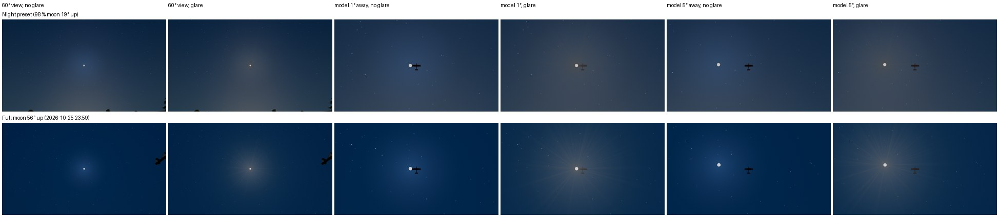

# FW-MOON-08: the moon in the atmosphere (aureole, glare; star washout analysis)

**Status:** partial, engineering-verified 2026-10-19 on llvmpipe.
- **08a**, the aureole, is delivered. It is a declared night-visual change; day skies, explicit snapshots and physics are unchanged.
- **08b**, star washout, was analysed: no per-star threshold is added (§3).
- **08c**, moon glare, is delivered (§4): the eye's straylight around the moon in the pilot view, through SUN's glare overlay. It is a declared night-visual change; with the sun's disc on, the sun stays the source. It also fixes the overlay's colour encoding (shared with SUN).
- Open: thin-cloud transmission and corona, the 22° halo and the lake's moon road.

Plan: [moon plan](../../../plans/moon.md) §4 "In the atmosphere".

- Code:
  - [sky_state.gd](../../../../app/render/world/sky_state.gd) `moon_aureole`;
  - [atmosphere.gd](../../../../app/render/atmosphere.gd) `aureole_aerosol_factor`;
  - [sky.gdshader](../../../../app/render/sky.gdshader) `moon_aureole` (shared with VQ/Landscape; a zero uniform leaves the shader byte-identical);
  - [world.gd](../../../../app/render/world/world.gd) (the aureole interpolates per frame with FW-MOON-06d);
  - 08c: [moon_glare.gd](../../../../app/render/world/moon_glare.gd), with SUN's [sun_glare.gd](../../../../app/render/landscape_upgrade/sun_glare.gd) and [sun_glare.gdshader](../../../../app/render/landscape_upgrade/sun_glare.gdshader) (the moon branch of `source()`, `kappa`, the colour encoding and the disc exclusion).
- Tests: [test_world_moon_aureole.gd](../../../../app/tests/test_world_moon_aureole.gd), [test_world_moon_glare.gd](../../../../app/tests/test_world_moon_glare.gd).
- Scripts: [research/field-world/fw-moon-08/](../../../../research/field-world/fw-moon-08/):
  - `aureole_profile.gd`: rendered profile and weather gallery;
  - `star_limit.py`: star limits under moonlight;
  - `moon_glare_capture.gd`: SUN-02's contrast cases toward the moon (analysed by `tools/landscape/glare_contrast.py`), plus the display-space kappa;
  - `glare_sheet.py`: the glare sheet.
- Sources: Krisciunas & Schaefer 1991 (PASP 103:1033) and Crumey 2014 (MNRAS 442:2600, arXiv 1405.4209). Both were downloaded and checked in the original; they are listed in the [moon source manifest](../FW-MOON-00/sources.json).

## 1. The model (08a)

Krisciunas & Schaefer give the moon's scattered sky brightness as f(ρ)·I*·10^(−0.4·k·X_moon)·(1 − 10^(−0.4·k·X)).
- **Scattering function.** A Rayleigh part 10^5.36·(1.06 + cos²ρ) plus an aerosol part 10^(6.15 − ρ/40) (eq. 21). Within 10° the aerosol part is 6.2·10⁷·ρ⁻² instead (eq. 19, "this small angle scattering forms the aureole"). ρ is in degrees; X = (1 − 0.96·sin²Z)^−½ (eq. 3).
- **Anchoring.** The sky table already draws the moonlit zenith. KS91 puts that zenith at f(Z_moon)·I*·…·(1 − 10^(−0.4k)), so the ratio fixes the render scale. I* and the moon's extinction cancel: coefficient = moon zenith × 10^6.15 / f(Z_moon) (`SkyState.moon_aureole`).
- **Only the forward peak.** The table's moonlit sky and horizon lobe already carry the moon's diffuse scattering. The shader adds the aerosol term above its value at 45°: zero from 45° on, and therefore at the zenith anchor whenever the moon is below 45°.
  - The first version added the whole aerosol term. It brightened the sky by 9–23 % even 40–60° from the moon: double counting.
- **Joining eqs. 19 and 21.** The larger of the two within 30°. They meet at 8.4°, so the join is continuous and monotonic. KS91 switch at 10° with a 28 % step, and a smooth blend over 8–12° was not monotonic.
- **Aerosols.** The term scales with the air's aerosol optical depth over KS91's clean sites (`aureole_aerosol_factor`). τ_a = (β·haze − β_Rayleigh)·1.2 km, against 0.10 at their sites (estimates, labelled in code). Clamped to [0.25, 4]:

  | Air | Aerosol factor |
  | --- | --- |
  | 23 km default without a profile | 1.9 |
  | classic | 1.3 |
  | clear | 1.0 |
  | electrical storm | 3.6 |

- **What the eye sees.** The disc is drawn as the eye adapted to the moon sees it (FW-MOON-03). The aureole gets the same local adaptation over the sky behind it: shown = background × ((1 + aureole/background)^γ − 1), with the disc's γ (0.55 at night, 1 = physical by day). Physically the glow would be ~340× the sky at 1° (a white blob).
  - On the Night preset, over the zenith sky and before the knee below: ×26.5 at 1°, ×4.6 at 5°, ×1.9 at 20°, unchanged from 45°.
- **The knee.** A soft limit, shown·k/(k + shown), keeps the glow below the disc as shown. At the limb KS91 put the glow at ~0.5 % of the disc's radiance, which the disc's γ shows as k = 0.005^γ of the displayed disc (5 % at night).
  - Without it, 1.2° close-ups washed out the limb.
  - A first, arbitrary limit (a quarter of the disc) left a flat blue field around the moon and was replaced by this derived one.
  - The bright core people see around the moon is mostly the eye's own straylight, the glare veil (open item).
  - In an eclipse the knee follows the eclipsed disc ([FW-MOON-10](../FW-MOON-10/README.md)).
- **By day** the coefficient is ~10⁻⁶ of the sky and dropped below 10⁻⁴, so the uniform stays zero and day skies stay byte-identical. Without a moon, or with it below the horizon, it is zero too.

## 2. Verification

| Check | Result |
| --- | --- |
| `test_world_moon_aureole.gd` | 23/23. Coefficient equals KS91's ratio at 30°, 60° and 85° moons. A moonlit night has an aureole; day, no moon and a moon below the horizon have none. Aerosols: default 1.9, clear < classic < storm, within the clamp. The KS91 shape is monotonic and continuous from the disc to 180° (≤ 6 % per 0.5 % of angle), eq. 19 near and eq. 21 far, the two forms meeting between 8° and 9°. The added peak is over 85 % of KS91's within 10° and zero from 45°. The night preset's glow stays under 60× at 1°, is clearly brighter within 5°, and adds nothing at 90°. Flow skies write the uniform with the aerosols; snapshots clear it. |
| Rendered profile, [aureole_profile.gd](../../../../research/field-world/fw-moon-08/aureole_profile.gd) | Night preset, clear sky, a 70° view on the moon, linear tonemap at 10× exposure. The aureole is rendered on and off, and a uniform-sky calibration frame measures the actual radiance-to-display scale (0.996 of the tonemap exposure). The prediction includes the knee. Rendered/predicted brightening along the row and column through the moon ([data](aureole-profile.json)): **1.01** (p10–p90 0.97–1.03) from 5° to 10°, **1.01** (0.99–1.04) from 10° to 30°, 1.02 from 30° to 45°, and exactly 0 from 45° (47 samples). The rendered brightening over the sky is ×1.57 at 6°, ×1.37 at 10°, ×1.36 at 16°, ×1.20 at 25° and ×1.05 at 40°. |
| Weather gallery | The Night preset as played (AgX), without and with the aureole, for all nine sky profiles (below). |
| Existing tests | `test_world_moon_light` 33/33, `test_world_flow` 26/26, `test_world_moon_flow` 31/31, `test_world_moon_sky` 62/62, `test_world_moon_config` 53/53, `test_world_moon_presets` 23/23, `test_world_sky` 38/38, `test_world_stars` 22/22, `test_landscape_twilight` 394/394, `test_sky_render` 30/30, `test_world_presentation_context` 17/17, `test_ui_moon_controls` 13/13, `test_landscape_horizon` 37/37, `test_atmosphere` 47/47. |
| Cost | A handful of ALU operations per sky pixel (one `acos`, three `pow`), and nothing while the uniform is zero. Target-GPU cost is for FW-MOON-14. |

The glow is compact and bluish (it takes the moonlit sky's cinematic tint until FW-MOON-07). It shows through gaps in broken and pre-storm decks and is hidden under overcast and storm skies. The clouds lie in front of it, and their own corona and thin-cloud glow are the next 08 items.

**Measurement note.** The first profile runs showed the rendered aureole at 0.1× the prediction near the horizon. The cause was per-channel saturation in the measurement, not the shader: at a raised exposure the bluish sky's blue channel clips before its luminance does, which a luminance-only clip test misses. Rejecting any channel at 250/255 and lowering the gain gave 1.01.

## 3. Star washout (08b): analysis, no per-star threshold

[star_limit.py](../../../../research/field-world/fw-moon-08/star_limit.py) combines KS91's moonlit sky with Crumey's naked-eye point-source threshold, ΔI = F·(6.505·10⁻⁴·B^¼ − 8.461·10⁻⁴·B^½)² lux (eq. 53, scotopic, 10⁻⁵–3.4·10⁻² cd/m²). With F = 2 it reproduces the paper's 6.18 mag for a 21.83 mag/arcsec² sky ([table](star-limit.md)).

| Night preset (98 % moon 19° up) | 5° | 10° | 20° | 45° | 90° | Moonless |
| --- | --- | --- | --- | --- | --- | --- |
| Sky, mag/arcsec² | 15.5 | 16.7 | 17.3 | 18.5 | 19.4 | 21.8 |
| Limit, whole moonlit sky | 4.81* | 4.78 | 4.81 | 5.04 | 5.28 | 6.18 |
| Drop caused by the aureole's peak | 0.05* | 0.11 | 0.12 | 0 | 0 | – |

\* Beyond eq. 53's scotopic range.

- Under a bright moon the limit falls from 6.2 to ~4.8–5.3 mag across the whole sky. FW-24's display calibration already targets that: "V ≈ 5 under a full moon", `stars.gd` `DISPLAY_GAIN`.
- The extra drop from the forward peak is at most 0.12 mag where the model is valid (beyond ~8°). A per-star threshold for it would change nothing visible.
- Within ~5° the sky leaves the scotopic range. There, Crumey's photopic branch would be needed. The aureole drawn in §1 is ×5–25 the sky there and already dominates the picture.
- So 08b adds no code. The plan's "star count vs angle" proof is replaced by this table. Revisit if the night look (FW-MOON-07) changes the stars' display calibration.

## 4. Moon glare (08c)

The pilot's eye scatters the moon's light as it scatters the sun's. SUN-02 draws that straylight as a CIE 146 veil over everything near the source ([SUN-01…05](../../sun/SUN-01-05/README.md)). While the sun's disc is off, `SunGlare.source()` now returns the moon ([moon_glare.gd](../../../../app/render/world/moon_glare.gd)). The overlay, its occlusion, the clouds, the skyline and the lens optics stay SUN's.

**The source.**
- **Illuminance from the disc as drawn:** E = mean radiance × solid angle, i.e. `moon_lin` × the phase law's flux × the eclipse's dimming × 2π(1 − cos r), read from the live sky uniforms.
  - It is 0.72 of the engine's moonlight, consistent with FW-MOON-03's photometry.
  - E is ~10⁻⁶ of the day sun's: a 10 s stare leaves no afterimage.
- **E/B against the live sky around the moon**, as for the sun.
  - Night preset: 4.1 sr. KS91 gives 14.5 for that moon without the aureole's peak; the sky table brightens the sky around a low moon, so the veil is conservative.
  - Full moon 56° up: 10–15.
  - Twilight (Moonrise preset) < 0.01, and totality 0.09 (FW-MOON-10): no glare.
- **The veil's level** is the CIE veil at the limb, 4.2 % of the disc's radiance, shown with the disc's own γ: 17 % of the displayed disc at night, so the glow stays below the disc (like the aureole's knee).
  - It is grey: the dark-adapted eye sees the faint glow without colour. Moonlight's warm hue turned brown at that level.
  - The veil is not drawn on the source's own disc where the sky shows it. A model in front of the disc keeps its veil.
- **kappa**, the background's display level over the veil's (SunOptics.KAPPA's meaning), comes from the live sky and exposure instead of the day's 0.75.
  - The overlay blends in sRGB code values, so both levels are sRGB-encoded. AgX's toe is not mirrored.
  - Measured on the render, the display-space kappa is 0.57–0.86 on the Night preset against 0.64 used; the linear ratio, 0.42, made the veil ~30 % too weak.
- **`halo` off** removes the glare with the aureole (MoonConfig; [FW-MOON-12](../FW-MOON-12-13/README.md)).

**Fixed in the shared overlay** (`sun_glare.gdshader`; agreed with SUN):
- **Colour encoding.** Compatibility linearises every `ALBEDO` with the engine's sRGB cubic ([learning](../../../LEARNINGS.md)), and the overlay did not encode its colour. The moon's veil colour (~10⁻⁶ before exposure) became black: the first captures showed the "glare" darkening the sky and the disc.
  - Encoding it changes the sun's evidence little ([data](glare-encode-sun-impact.json)). Day: 21 of 22 images identical; the lens case differs by ≤ 2 levels; retained contrast is unchanged. Golden hour: 0.761 → 0.766. Sunset: identical.
  - It exposed a pre-existing sun defect: at golden hour the veil darkened part of the sky (9 k → 28 k pixels, ≤ 15 levels). SUN fixed it with a veil colour never below the sky around the source.
- **Disc exclusion.** Without it, the veil painted over the moon disc.

**Verification.**

| Check | Result |
| --- | --- |
| `test_world_moon_glare.gd` | 20/20. Night: the source is the moon; E/B below KS91's but the same order; the disc's illuminance agrees with the moonlight; no bleaching; the limb share; a grey veil; kappa is the display ratio; contrast falls off with the angle; a high moon veils more. Twilight, totality, no moon and halo off: no glare, and halo off also removes the aureole. The day keeps the sun with KAPPA. The real glare node shows toward the moon and writes its kappa. The overlay encodes its colour. |
| Mutations (disposable copies) | 9 of 9 caught: no moon branch (10 checks fail); kappa not written; the veil without the disc's γ; halo ignored by the aureole; halo ignored by the glare; eclipse dimming ignored (totality E/B 777); the overlay unencoded; linear kappa; exposure not passed. |
| Contrast on a model, [moon_glare_capture.gd](../../../../research/field-world/fw-moon-08/moon_glare_capture.gd) + `glare_contrast.py` | The Stik 60 m away, 1–20° from the moon, belly on (SUN-02's geometry). Retained display contrast against the model's 1/(1 + r): Night preset 0.33 / 0.45 / 0.64 / 0.87 / 0.95 at 1° / 2° / 5° / 12° / 20° (model 0.29 / 0.41 / 0.61 / 0.87 / 0.95); full moon 56° up 0.23 / 0.33 / 0.44 / 0.73 / 0.88 (model 0.17 / 0.26 / 0.42 / 0.74 / 0.89). Within 0.06 everywhere; "veil follows the model" passes in both ([night](moon-glare-contrast-night.json), [high](moon-glare-contrast-high.json); capture reports beside them). |
| Cost | `source()`: 15–21 µs per frame for the moon against 9–14 µs for the sun (CPU, llvmpipe VM). The shader adds one depth fetch inside the source's disc. |

On the Night preset the glow is a soft grey halo a few degrees across, and the model beside the moon loses contrast. Around the full moon high in a dark sky, the ciliary corona's needles (SUN-02's eye model) show as fine radial streaks, as around a bright light at night.

## 5. Limits and next items

- The aureole sits behind the clouds. Moonlit thin cloud, the corona (J₁(x)/x)² and the 22° halo by profile are the next 08 items, with the lake's moon road.
- Moon glare: kappa is one value per frame, while the displayed background varies across the view (measured 0.57–0.86). Verified on field-world skies only (the photometric moon); snapshot nights were not checked. The grey veil and the γ display are display judgements for owner review (FW-MOON-14), with the night look (FW-MOON-07).
- The aerosol factor's constants (1.2 km aerosol height, 0.10 at KS91's sites) are estimates. A measured local aerosol optical depth would replace them.
- The γ local adaptation is FW-MOON-03's display judgement, made on llvmpipe; owner review on real monitors is part of FW-MOON-14.
