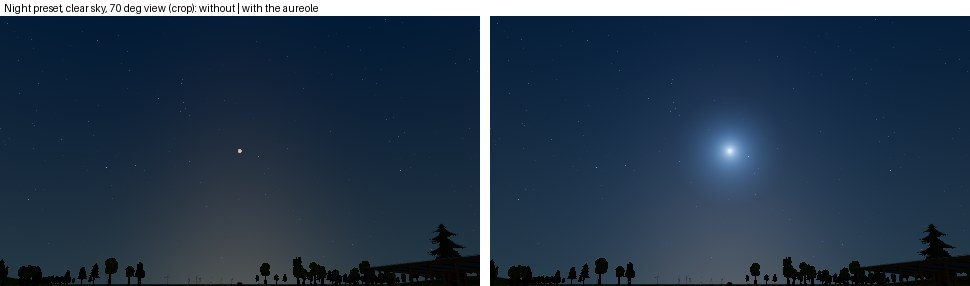
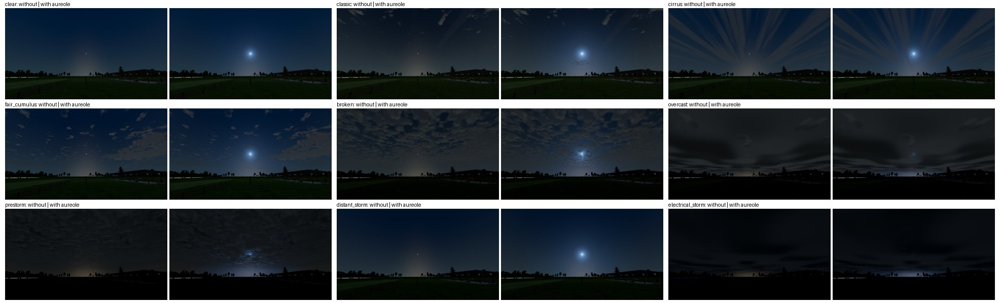

# FW-MOON-08: the moon in the atmosphere (aureole; star washout analysis)

**Status:** partial, engineering-verified 2026-10-19 on llvmpipe.
- **08a**, the aureole, is delivered. It is a declared night-visual change; day skies, explicit snapshots and physics are unchanged.
- **08b**, star washout, was analysed: no per-star threshold is added (§3).
- Open: thin-cloud transmission and corona, the 22° halo, moon glare and the lake's moon road.

Plan: [moon plan](../../../plans/moon.md) §4 "In the atmosphere".

- Code:
  - [sky_state.gd](../../../../app/render/world/sky_state.gd) `moon_aureole`;
  - [atmosphere.gd](../../../../app/render/atmosphere.gd) `aureole_aerosol_factor`;
  - [sky.gdshader](../../../../app/render/sky.gdshader) `moon_aureole` (shared with VQ/Landscape; a zero uniform leaves the shader byte-identical);
  - [world.gd](../../../../app/render/world/world.gd) (the aureole interpolates per frame with FW-MOON-06d).
- Test: [test_world_moon_aureole.gd](../../../../app/tests/test_world_moon_aureole.gd).
- Scripts: [research/field-world/fw-moon-08/](../../../../research/field-world/fw-moon-08/):
  - `aureole_profile.gd`: rendered profile and weather gallery;
  - `star_limit.py`: star limits under moonlight.
- Sources: Krisciunas & Schaefer 1991 (PASP 103:1033) and Crumey 2014 (MNRAS 442:2600, arXiv 1405.4209). Both were downloaded and checked in the original; they are listed in the [moon source manifest](../FW-MOON-00/sources.json).

## 1. The model (08a)

Krisciunas & Schaefer give the moon's scattered sky brightness as f(ρ)·I*·10^(−0.4·k·X_moon)·(1 − 10^(−0.4·k·X)).
- **Scattering function.** A Rayleigh part 10^5.36·(1.06 + cos²ρ) plus an aerosol part 10^(6.15 − ρ/40) (eq. 21). Within 10° the aerosol part is 6.2·10⁷·ρ⁻² instead (eq. 19, "this small angle scattering forms the aureole"). ρ is in degrees; X = (1 − 0.96·sin²Z)^−½ (eq. 3).
- **Anchoring.** The sky table already draws the moonlit zenith. KS91 puts that zenith at f(Z_moon)·I*·…·(1 − 10^(−0.4k)), so the ratio fixes the render scale. I* and the moon's extinction cancel: coefficient = moon zenith × 10^6.15 / f(Z_moon) (`SkyState.moon_aureole`).
- **Only the forward peak.** The table's moonlit sky and horizon lobe already carry the moon's diffuse scattering. The shader adds the aerosol term above its value at 45°: zero from 45° on, and therefore at the zenith anchor whenever the moon is below 45°.
  - The first version added the whole aerosol term. It brightened the sky by 9–23 % even 40–60° from the moon: double counting.
- **Joining eqs. 19 and 21.** The larger of the two within 30°. They meet at 8.4°, so the join is continuous and monotonic. KS91 switch at 10° with a 28 % step, and a smooth blend over 8–12° was not monotonic.
- **Aerosols.** The term scales with the air's aerosol optical depth over KS91's clean sites (`aureole_aerosol_factor`). τ_a = (β·haze − β_Rayleigh)·1.2 km, against 0.10 at their sites (estimates, labelled in code). Clamped to [0.25, 4]:

  | Air | Aerosol factor |
  | --- | --- |
  | 23 km default without a profile | 1.9 |
  | classic | 1.3 |
  | clear | 1.0 |
  | electrical storm | 3.6 |

- **What the eye sees.** The disc is drawn as the eye adapted to the moon sees it (FW-MOON-03). The aureole gets the same local adaptation over the sky behind it: shown = background × ((1 + aureole/background)^γ − 1), with the disc's γ (0.55 at night, 1 = physical by day). Physically the glow would be ~340× the sky at 1° (a white blob).
  - On the Night preset, over the zenith sky: ×26.5 at 1°, ×4.6 at 5°, ×1.9 at 20°, unchanged from 45°.
- **By day** the coefficient is ~10⁻⁶ of the sky and dropped below 10⁻⁴, so the uniform stays zero and day skies stay byte-identical. Without a moon, or with it below the horizon, it is zero too.

## 2. Verification

| Check | Result |
| --- | --- |
| `test_world_moon_aureole.gd` | 23/23. Coefficient equals KS91's ratio at 30°, 60° and 85° moons. A moonlit night has an aureole; day, no moon and a moon below the horizon have none. Aerosols: default 1.9, clear < classic < storm, within the clamp. The KS91 shape is monotonic and continuous from the disc to 180° (≤ 6 % per 0.5 % of angle), eq. 19 near and eq. 21 far, the two forms meeting between 8° and 9°. The added peak is over 85 % of KS91's within 10° and zero from 45°. The night preset's glow stays under 60× at 1°, is clearly brighter within 5°, and adds nothing at 90°. Flow skies write the uniform with the aerosols; snapshots clear it. |
| Rendered profile, [aureole_profile.gd](../../../../research/field-world/fw-moon-08/aureole_profile.gd) | Night preset, clear sky, a 70° view on the moon, linear tonemap at 10× exposure. The aureole is rendered on and off, and a uniform-sky calibration frame measures the actual radiance-to-display scale (0.996 of the tonemap exposure). Rendered/predicted brightening along the row and column through the moon ([data](aureole-profile.json)): **1.01** (p10–p90 0.98–1.04) from 10° to 30°, 1.00 at 40°, and exactly 0 from 45° (47 samples). |
| Weather gallery | The Night preset as played (AgX), without and with the aureole, for all nine sky profiles (below). |
| Existing tests | `test_world_moon_light` 33/33, `test_world_flow` 26/26, `test_world_moon_flow` 31/31, `test_world_moon_sky` 62/62, `test_world_moon_config` 53/53, `test_world_moon_presets` 23/23, `test_world_sky` 38/38, `test_world_stars` 22/22, `test_landscape_twilight` 394/394, `test_sky_render` 30/30, `test_world_presentation_context` 17/17, `test_ui_moon_controls` 13/13, `test_landscape_horizon` 37/37, `test_atmosphere` 47/47. |
| Cost | A handful of ALU operations per sky pixel (one `acos`, three `pow`), and nothing while the uniform is zero. Target-GPU cost is for FW-MOON-14. |

The glow is compact and bluish (it takes the moonlit sky's cinematic tint until FW-MOON-07). It shows through gaps in broken and pre-storm decks and is hidden under overcast and storm skies. The clouds lie in front of it, and their own corona and thin-cloud glow are the next 08 items.

**Measurement note.** The first profile runs showed the rendered aureole at 0.1× the prediction near the horizon. The cause was per-channel saturation in the measurement, not the shader: at a raised exposure the bluish sky's blue channel clips before its luminance does, which a luminance-only clip test misses. Rejecting any channel at 250/255 and lowering the gain gave 1.01.

## 3. Star washout (08b): analysis, no per-star threshold

[star_limit.py](../../../../research/field-world/fw-moon-08/star_limit.py) combines KS91's moonlit sky with Crumey's naked-eye point-source threshold, ΔI = F·(6.505·10⁻⁴·B^¼ − 8.461·10⁻⁴·B^½)² lux (eq. 53, scotopic, 10⁻⁵–3.4·10⁻² cd/m²). With F = 2 it reproduces the paper's 6.18 mag for a 21.83 mag/arcsec² sky ([table](star-limit.md)).

| Night preset (98 % moon 19° up) | 5° | 10° | 20° | 45° | 90° | Moonless |
| --- | --- | --- | --- | --- | --- | --- |
| Sky, mag/arcsec² | 15.5 | 16.7 | 17.3 | 18.5 | 19.4 | 21.8 |
| Limit, whole moonlit sky | 4.81* | 4.78 | 4.81 | 5.04 | 5.28 | 6.18 |
| Drop caused by the aureole's peak | 0.05* | 0.11 | 0.12 | 0 | 0 | – |

\* Beyond eq. 53's scotopic range.

- Under a bright moon the limit falls from 6.2 to ~4.8–5.3 mag across the whole sky. FW-24's display calibration already targets that: "V ≈ 5 under a full moon", `stars.gd` `DISPLAY_GAIN`.
- The extra drop from the forward peak is at most 0.12 mag where the model is valid (beyond ~8°). A per-star threshold for it would change nothing visible.
- Within ~5° the sky leaves the scotopic range. There, Crumey's photopic branch would be needed. The aureole drawn in §1 is ×5–25 the sky there and already dominates the picture.
- So 08b adds no code. The plan's "star count vs angle" proof is replaced by this table. Revisit if the night look (FW-MOON-07) changes the stars' display calibration.

## 4. Limits and next items

- The aureole sits behind the clouds. Moonlit thin cloud, the corona (J₁(x)/x)² and the 22° halo by profile are the next 08 items. So are moon glare (`sun_glare.gd`, LU) and the lake's moon road.
- The aerosol factor's constants (1.2 km aerosol height, 0.10 at KS91's sites) are estimates. A measured local aerosol optical depth would replace them.
- The γ local adaptation is FW-MOON-03's display judgement, made on llvmpipe; owner review on real monitors is part of FW-MOON-14.
