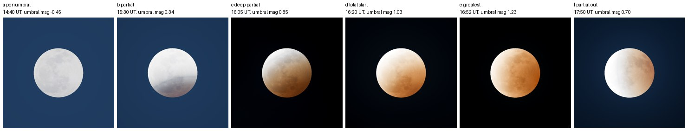
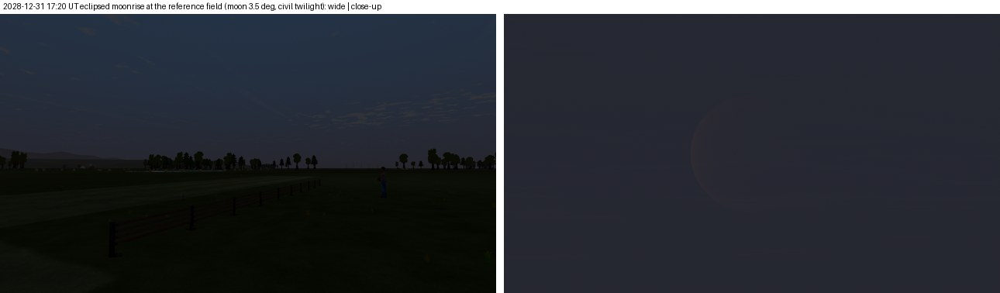
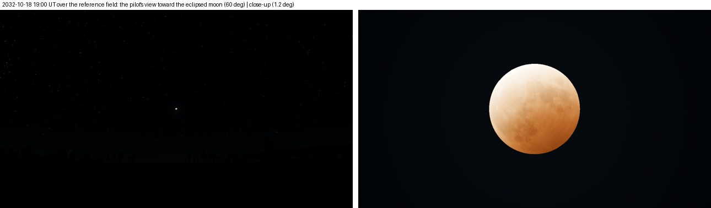

# FW-MOON-10: lunar eclipses

**Status:** engineering-verified 2026-10-19 on llvmpipe. This is a declared visual change while the moon is in Earth's penumbra. Other nights, day skies, explicit snapshots and physics are unchanged. Without an eclipse the uniform `moon_eclipse` is off and every factor is exactly 1. The knee fix (§1) was checked A/B: Night preset renders are identical to the bit to HEAD before it.

Plan: [moon plan](../../../plans/moon.md), FW-MOON-10.

- Code:
  - [lunar.gd](../../../../app/render/world/lunar.gd): `_eclipse` (shadow geometry), `eclipse_transmission`, `eclipse_disc_factor`;
  - [sky_state.gd](../../../../app/render/world/sky_state.gd): light, sky, aureole and display dimming, `moon_eclipse*` keys;
  - [moon_disc.gdshaderinc](../../../../app/render/world/moon_disc.gdshaderinc): the shadow on the disc per pixel;
  - [sky.gdshader](../../../../app/render/sky.gdshader): the aureole's knee follows the eclipsed disc;
  - [atmosphere.gd](../../../../app/render/atmosphere.gd): uniforms;
  - [world.gd](../../../../app/render/world/world.gd): the shadow edge interpolates per frame.
  - `sky.gdshader` and `atmosphere.gd` are shared with VQ/Landscape and SUN. Their default uniforms keep other skies byte-identical.
- Test: [test_world_moon_eclipse.gd](../../../../app/tests/test_world_moon_eclipse.gd).
- Scripts: [research/field-world/fw-moon-10/](../../../../research/field-world/fw-moon-10/):
  - `event_scan.gd`: total eclipses seen from the reference field;
  - `sheets.py`: assembles the capture sheets from `tools/world/moon_capture.gd --cases=eclipse`.
- Sources: all are listed in the [moon source manifest](../FW-MOON-00/sources.json).
  - Ugolnikov, Maslov & Korotkiy 2011 (arXiv 1106.6178), downloaded.
  - Espenak, "Lunar Eclipses: 2021–2030" (NASA GSFC).
  - Vital, "Total Lunar Eclipse on May 15-16, 2022: Preliminary Findings".

## 1. The model

- **Shadow.** Geocentric cones from Earth's shadow-casting radius (6371 + 88 km of opaque air, as in astronomy-engine). Umbra and penumbra radii are taken at the moon's distance, in moon radii (FW-MOON-02 geometry).
- **Penumbra.** The visible fraction of the solar disc behind Earth's nearly straight limb: f = (π − acos t + t√(1 − t²))/π. Solar limb darkening is ignored.
- **Umbra.** Ugolnikov et al.'s measured relative brightness at 677 and 503 nm against the distance from the umbra's centre, from the deep 2011-06-15 eclipse.
  - Each channel (~612, 550 and 465 nm) is interpolated in log brightness. The deepest 503 nm parts (~10⁻⁶) come from the paper's text.
  - The larger of the penumbra and umbra laws joins them continuously at the umbra's edge.
- **Disc and light.**
  - The disc shader applies the same law per pixel: the shadow edge, the copper umbra and the grey penumbra.
  - SkyState averages the law over the disc (area-weighted, 24 rings × 48 spokes) and dims by that average:
    - the moon's light and its sky, by the average's luminance;
    - the aureole, by the same amount and tinted copper with the average's colour;
    - the eye's compression of the disc: the eye opens to the dim disc, so in totality the disc is shown less compressed.
  - Stars follow the darker sky and exposure without their own code.
- **Per frame.** The shadow's offset and axis interpolate between 30 s sky steps (lerp and slerp), and the disc average with the colour keys (FW-MOON-06d), so the edge moves smoothly.
- **Aureole knee (fixed here).** FW-MOON-08's knee limits the glow to 0.005^γ of the disc as shown. It used the uneclipsed disc, but the eye-adapted display keeps the eclipsed disc at its usual level (0.65–0.74 display units through the whole eclipse). So the limit grew as 1/f: ×6 at umbral magnitude 0.34 and ×940 in totality. The glow then showed at about twice its limit at 1° in partial phases.
  - `moon_eclipse_dim`, the disc average's luminance, now scales the knee. Without an eclipse it is exactly 1.

## 2. Verification

| Check | Result |
| --- | --- |
| `test_world_moon_eclipse.gd` | 27/27, covering the transmission law, the contacts against Espenak, the 2022 totality brightness, SkyState dimming and the knee uniform. Law: 1 outside the penumbra, continuous at both edges, monotonic outward in every channel, red in the umbra, on the measured curve at u = 0.62. SkyState: totality carries the eclipse, the moon's light falls below 10⁻³ of its pre-eclipse value, and the eye opens more than 10×. Knee uniform: equals the disc average in totality and the partial phase, 1 on an ordinary night and on snapshots. |
| Umbral contacts against Espenak (below) | Partial phase within 0.7 min for the three total eclipses and 4.6 min for the 0.36-magnitude 2028-07-06 eclipse; totality within 2.9 min. The shallow 2028-01-12 eclipse is 8.9 min short. Its chord is short, so FW-MOON-02's 0.02 magnitude offset moves its contacts more; the test allows 12 min below magnitude 0.1. |
| 2022-05-16 mid-totality | V −1.67 against the measured −0.8 ± 0.3 (Vital's observers; his clean-stratosphere fit gives −1.23 and Tonga aerosols darkened it). The model is one eclipse's air (2011), so the tolerance is one Danjon step, ±1 mag. Colour G/R 0.35, B/R 0.09 (copper). |
| Mutations (disposable copies) | Dimming removed from SkyState: "totality: the moon no longer lights the field" fails. `moon_eclipse_dim` write removed from atmosphere.gd: both knee checks fail. Knee without `moon_eclipse_dim` in sky.gdshader: the render check below shows the glow 1.30× its limit at 2–5° and 1.10× at 5–10°. |
| Rendered knee, [knee-check.json](knee-check.json) | `aureole_profile.gd`, 2028-12-31 15:30 UT partial phase, rendered/predicted brightening: 1.00–1.01 (p10–p90 0.94–1.05) from 0.8° to 30°. On the Night preset the linear renders are identical to the bit to HEAD before the fix. |
| Regression battery | 19 suites green: `test_world_moon_eclipse` 27, `_aureole` 23, `_light` 33, `_sky` 62, `_config` 53, `_presets` 23, `_lunar` 1102, `_flow` 31, `test_world_sky` 38, `test_landscape_twilight` 394, `test_world_flow` 26, `test_sky_render` 30, `test_world_stars` 22, `test_world_presentation_context` 17, `test_atmosphere` 47, `test_ui_moon_controls` 13, `test_sun_optics` 95, `test_landscape_horizon` 37, `test_world_field_lights` 86. |
| Cost | CPU: the disc average costs 2.4–3.1 ms per sky state during an eclipse, against 0.2–0.3 ms otherwise. It runs once per 30 s sky step, never per frame. Fewer samples were measured: 12 × 24 costs 0.6 ms but errs 4.4 % near contacts (24 × 48: 0.7 %). The grid is kept, since a flow step already costs 9–23 ms of shadow update (FW-61). GPU: one transmission per disc pixel, only while `moon_eclipse` is on. Target-hardware cost is part of FW-MOON-14. |

| Eclipse (Espenak, TD) | Umbral magnitude, model / Espenak | Partial phase, min | Totality, min |
| --- | --- | --- | --- |
| 2026-03-03 11:34:52 | 1.131 / 1.151 | 206.3 / 207 | 55.1 / 58 |
| 2026-08-28 04:14:04 | 0.928 / 0.930 | 198.2 / 198 | – |
| 2028-01-12 04:14:13 | 0.045 / 0.066 | 47.1 / 56 | – |
| 2028-07-06 18:20:57 | 0.358 / 0.389 | 136.4 / 141 | – |
| 2028-12-31 16:53:15 | 1.234 / 1.246 | 208.3 / 209 | 70.0 / 71 |
| 2022-05-16 04:12:42 | 1.398 / 1.414 | 207.5 / 207 | 84.2 / 85 |

The 2028-12-31 phases are rendered below from 30° N 90° E, where the moon is high. They are 1.2° close-ups with the eye adapted, as `moon_capture.gd` renders them.

- **Penumbral (a).** A faint shading only.
- **Partial (b).** A dark grey-mauve bite. Next to the bright crescent, the eye-adapted display holds the umbral part's colour down.
- **Deep partial and totality (c–e).** Copper, brighter toward the umbra's edge.
- **Leaving (f).** Copper beside a white limb.
- **Exposure.** The eye reaches its dark-adaptation limit (exposure 9·10⁴) from the partial phase on. The sky behind turns black in totality.

## 3. At the reference field: the eclipse event

`event_scan.gd`, 2026–2033. The reference field is at 40° N 3.7° W; the pilot faces north ± 100°. "Seen" means minutes of totality with the moon ≥ 10° up in that cone and the sun ≤ −12°.

| Greatest (UT) | Umbral magnitude | Moon elevation | Moon azimuth | Sun elevation | Totality seen |
| --- | --- | --- | --- | --- | --- |
| 2026-03-03 11:35 | 1.13 | −42.8° | 342.8° | 41.8° | 0 min |
| 2028-12-31 16:50 | 1.23 | −1.0° | 58.3° | 1.1° | 0 min |
| 2029-06-26 03:25 | 1.83 | 12.2° | 223.4° | −13.1° | 0 min (behind the pilot) |
| 2029-12-20 22:40 | 1.10 | 63.8° | 124.0° | −64.4° | 0 min (behind the pilot) |
| 2032-04-25 15:15 | 1.24 | −43.0° | 69.9° | 42.2° | 0 min |
| 2032-10-18 19:05 | 1.09 | 18.3° | 92.4° | −18.9° | 45 min |
| 2033-04-14 19:15 | 1.05 | 4.4° | 106.8° | −5.0° | 0 min |
| 2033-10-08 11:00 | 1.40 | −42.7° | 338.8° | 41.7° | 0 min |

**The plan's event, 2028-12-31, is not a good event at this field.**
- The moon rises during totality, but the sky is still in civil twilight.
- At 17:20 UT the moon is 3.5° up, and totality ends a few minutes later. The copper disc barely stands out from the twilight sky. That is physically right for an eclipsed moon 10⁻⁴–10⁻³ as bright as usual, low in a twilight sky, but it is not a showcase.

**2032-10-18 is the only total eclipse in these eight years that the pilot sees in full darkness.**
- At 19:00 UT the moon is 17.4° up at azimuth 91.7°, inside the pilot's cone, with the sun at −18°.
- The field goes dark and stars come out around the copper moon.
- FW-MOON-11 proposes it as the eclipse event (owner choice).

## 4. Limits

- **One eclipse's air.** Real eclipses range over Danjon L 0–4 with the stratosphere's aerosols. The 2011 curves give one eclipse's darkness, 0.9 mag brighter than the measured 2022 eclipse. A per-eclipse darkness parameter is not exposed.
- **Light colour.** The field's moonlight dims by the disc average's luminance, keeping the moonlit colour. At 10⁻⁴ of full-moon light the field is scotopic, so its copper colour would not be seen. The light-colour mapping belongs to FW-MOON-07.
- **Umbral magnitude.** It is 0.002–0.031 below Espenak's (FW-MOON-02), so contacts come slightly late and short.
- **Not modelled.** Solar limb darkening in the penumbra, and the ozone turquoise band at the umbra's edge.
- **Display review.** Partial-phase colour is FW-MOON-03's eye-adapted display judgement. Owner review on real monitors is part of FW-MOON-14.
