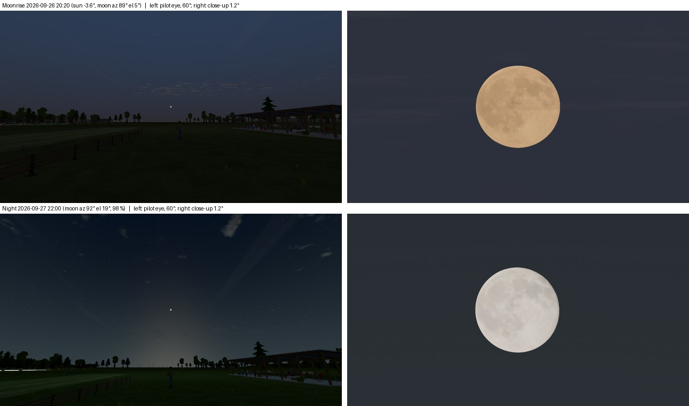

# FW-MOON-11: moon presets in front of the pilot

**Status:** engineering-verified 2026-10-19 (partial step). The code was delivered earlier on 2026-10-19, without this record. This record was written afterwards from the code, the tests and new captures. Open: the eclipse event (after FW-MOON-10) and the owner's choice (M-D3). Plan: [moon plan](../../../plans/moon.md) §6.

## What exists

[conditions.gd](../../../../app/render/world/conditions.gd) solves moon presets like the sun presets, so they stay valid at another place.

- `solve_moon_view(when, view)` scans forward from the preset's reference date (21 June) for up to 400 days, on a fixed grid of local hours.
- It returns the first moment that meets every constraint of `MOON_VIEWS[view]`, with the moon's azimuth within ±100° of the pilot's forward direction. The forward direction is north on the default field, where the pilot faces the east–west runway.
- The search is deterministic, and the result is cached per place, date and view.

| View | Sun | Moon height | Illuminated | Scan |
| --- | --- | --- | --- | --- |
| `moonrise` | −4° to −2° | 0.5° to 12° | ≥ 97 % | 16:00–23:00 every 10 min |
| `night` | ≤ −18° | 18° to 30° | ≥ 97 % | 19:00–05:00 every 20 min |

**Presets:**
- `moonrise`: the moonrise moment.
- `moonrise_golden`: the same day at golden hour (sun 6°, setting), the start of the flowing evening.
- `night`: the retargeted "Night, full moon". It replaces the 2026-06-29 preset, which hid an apogee moon behind the pilot.

**Home:** "Moonrise, time passing" (between Evening and Night) flows at ×20 from `moonrise_golden`. Its Spanish label is in es.po.

## Resolved at the reference field (40° N, 3.7° W, UTC+2)

| Preset | Local time | Sun | Moon azimuth / elevation | Lit |
| --- | --- | --- | --- | --- |
| `moonrise` (the Harvest Moon) | 2026-09-26 20:20 | −3.6° | 89.1° / 5.1° | 99.9 % |
| `moonrise_golden` (flow start) | 2026-09-26 19:30 | 6.0° | 81.6° / −4.4° (below the horizon) | 99.9 % |
| `night` | 2026-09-27 22:00 | −22.8° | 92.1° / 19.1° | 98.3 % |
| `moonrise` at Buenos Aires (UTC−3) | 2026-08-27 18:40 | −2.3° | 99.3° / 4.9° | 99.9 % |

The plan's survey candidates (2026-10-25, 2026-12-23) are later matches. The solver takes the first night that meets the constraints, the one after the Harvest Moon. FW-MOON-06's continuous refraction resolves every preset to the same moment as before; the Moonrise sun at −3.6° lies outside the taper.

## Captures

Production renders on llvmpipe, 1280×720 ([moon_capture.gd](../../../../tools/world/moon_capture.gd) `--cases=moonrise_preset,night_preset --views=wide,close`; [manifest](capture-manifest.json)). Left: from the pilot's eye (1.7 m) toward the moon, 60° field of view. Right: close-ups at 1.2°.

- At the Moonrise moment the disc sits just above the treeline, east of the runway, orange from the atmosphere's extinction (FW-MOON-03/05).
- On the Night preset it is 19° up among the stars, with its glow on the horizon.

Images compare only with the same machine.

## Verification

| Check | Result |
| --- | --- |
| [test_world_moon_presets.gd](../../../../app/tests/test_world_moon_presets.gd) | 23/23. Moonrise is the Harvest Moon; sun, height, phase and in-view constraints hold for moonrise and night, and at Buenos Aires. The golden-hour start is the same day, sun 6°, before the rise. Night is after the reference date. Home flows at ×20 and orders the choices; Spanish label. Solve 192 ms the first time, 0.2 ms cached (loaded VM). |

## Limits

- The forward cone is tied to the default field's layout (`PILOT_FORWARD_AZIMUTH_DEG`). A field with another runway orientation needs that value from its data.
- The 2028-12-31 eclipse event waits for FW-MOON-10's eclipse rendering.
- Retargeting "Night, full moon" changes the FW-23/FW-84 night captures (visual only). The owner's acceptance (M-D3) is pending.
