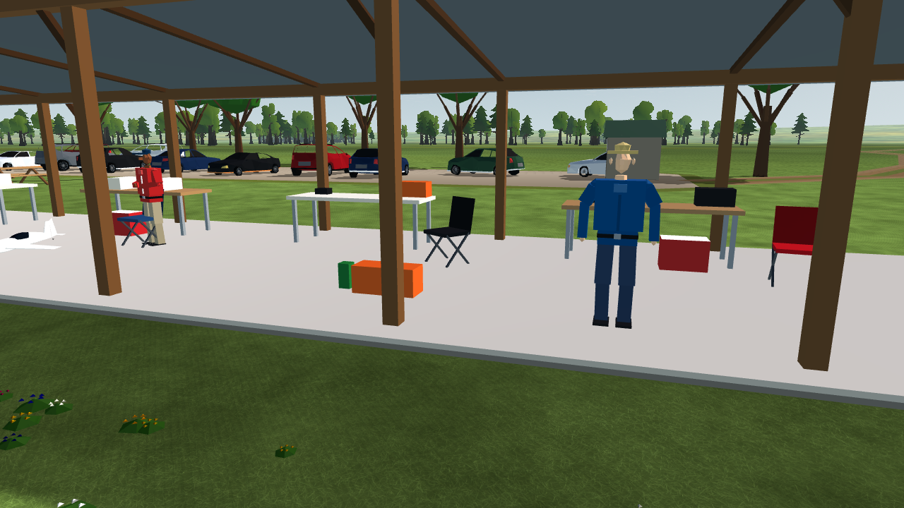
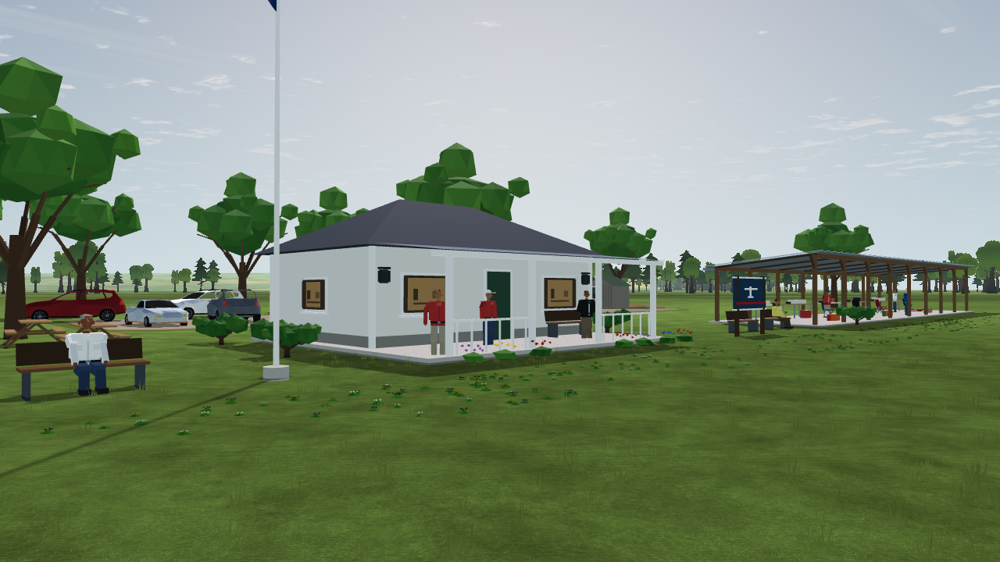
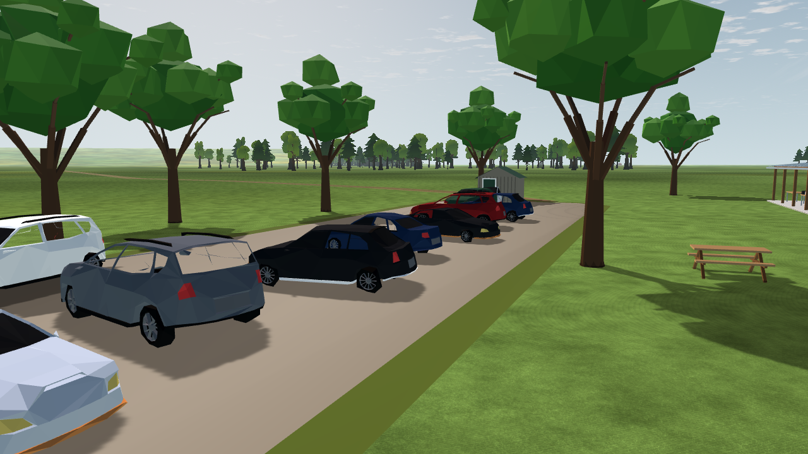

# LU-02 — People, parking and parked fleet

Date: **2026-10-11**. **Status: implementation and local proof complete.** Step: LU-02.

The field population now has adult-scale bodies with layered clothes, segmented legs, varied relaxed arms and seated/pilot poses. The procedural models remain deliberately low-poly. Thirteen people stay in the layout; seven selected people use a small deterministic arm sway from the shared `sim_clock` shader, with no per-person process callback. The standing, seated and pilot geometry is built from original repository primitives in [people.gd](../../../../app/scenery/people.gd), dispatched by [prefabs.gd](../../../../app/scenery/prefabs.gd).

Shade trees now use visible trunks, first-order limbs and irregular overlapping crown lobes. Shrubs use short stems and clustered foliage. Static geometry remains in spatial cells; one small mode-3 mesh per tree or shrub carries bounded wind motion. The shader uses `sim_clock` and `wind_vec`; maximum crown travel is 0.06 m at the shader's clamped upper wind. Ten tree crowns and six shrub tips add 16 moving draws.

Parking retains eleven vehicles and all four existing Quaternius styles. The layout has an offset main row and four canted spaces. The generator mirrors the loader's deterministic model selection and checks each rotated vehicle footprint against every other footprint. Its exact polygon-distance check reports a minimum pair gap of **1.240 m**, above the 0.30 m placement requirement. The adjacent gravel patch was extended to cover the shifted end spaces.

The parked aircraft list is now generated from the flight catalog and checked against `Models.FLEET`; it contains exactly the four menu IDs in menu order: `jensen-das-ugly-stik-60`, `gp-extra-300s-60`, `p51d-mustang-120`, and `sebart-avanti-s-a200-p100rx`. The focused test loads every baked source and checks this exact set. `bake_fleet.gd -- --check` also passes for all four current builders. The gear-up Avanti sits on two padded trestles: its model base is raised by 0.48 m, leaving approximately 2.5 mm between the cradle top and the lowest baked vertex. The support is original procedural geometry; no aircraft builder or snapshot source was edited in this step.

The full high-quality build contains 48 cell-batched static meshes and 28 moving meshes: the original four rotors and flag, ten tree crowns, six shrub tips and seven person arms. The incremental moving-mesh count is 23 over the previous five, below the 40-draw scenery increment. The build contains about 149k triangles and remains under the existing 250k scenery triangle check. These are budgets, not GPU timing evidence.

Native capture used Godot 4.7.2 Compatibility/OpenGL on an NVIDIA RTX 3090 at 1280×720. All 19 views passed `check_views.py`: two on-runs were byte-identical and every view had zero shadow-pass draws. The pilot views added at most **31 draws** and **61,952 primitives**, within the SC-03 limits of 40 draws and 150,000 primitives. Total captured on-scene maxima were 85 draws and 415,994 primitives, within the landscape targets of 300 draws and 1 million primitives. Human readability and low-end GPU performance remain open acceptance questions.

The final integration additionally moved the end car clear of the shed and added a generator check against the shed's rotated footprint. The images below preserve this step's intermediate review; [LU-06](../LU-06/README.md) contains the final parking and full-field captures.

## Native evidence







The captures show the current low-poly style at close range. Human bodies and plant crowns are still procedural silhouettes rather than rigged people or detailed botanical assets.

## Checks

Run from the repository root:

```powershell
python tools/scenery/place.py --check
.tools/Godot_v4.7.2-stable_win64_console.exe --headless --path app --editor --quit
.tools/Godot_v4.7.2-stable_win64_console.exe --headless --path app --script res://tests/test_landscape_population.gd
.tools/Godot_v4.7.2-stable_win64_console.exe --headless --path app --script res://tests/test_scenery_build.gd
.tools/Godot_v4.7.2-stable_win64_console.exe --headless --path app --script res://tests/test_scenery_loader.gd
.tools/Godot_v4.7.2-stable_win64_console.exe --headless --path app --script $PWD/tools/scenery/bake_fleet.gd -- --check
```

All six commands passed on the implementation tree. The captures used `res://scenery/capture_views.gd` with `--scenery=on`, `--scenery_audio=off`, `--scenery_birds=off`, and repeated native runs checked by `tools/scenery/check_views.py`.
