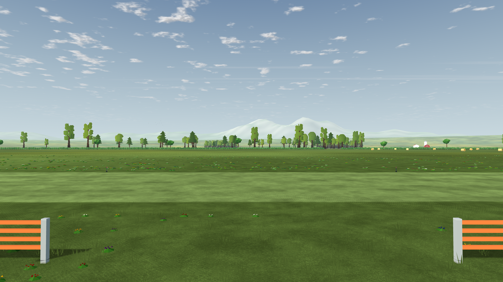
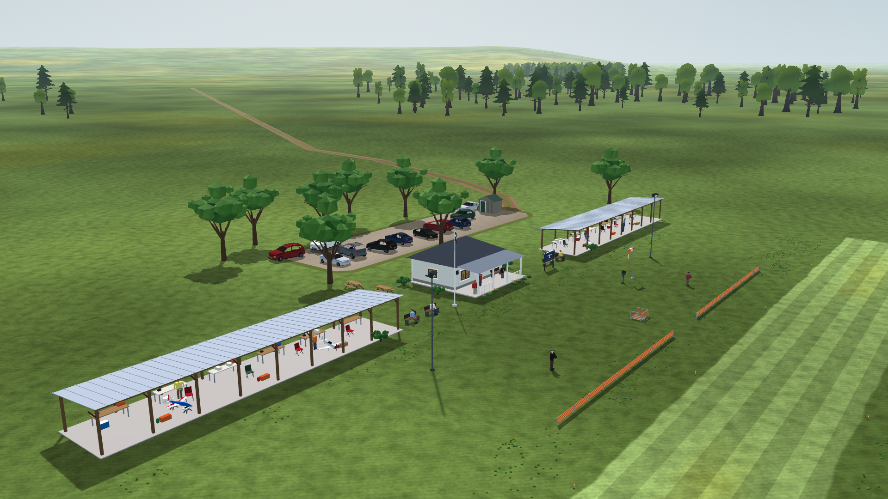
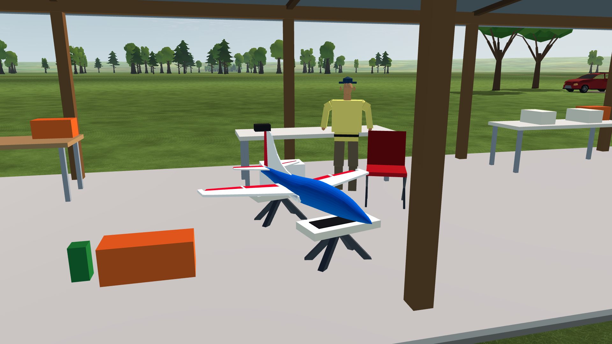
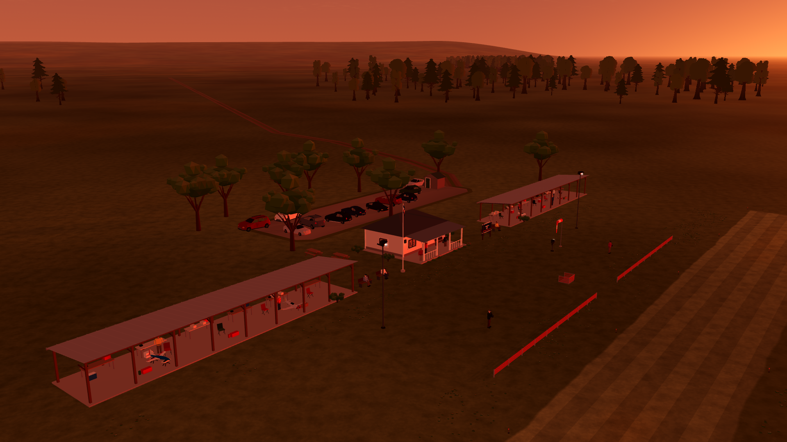
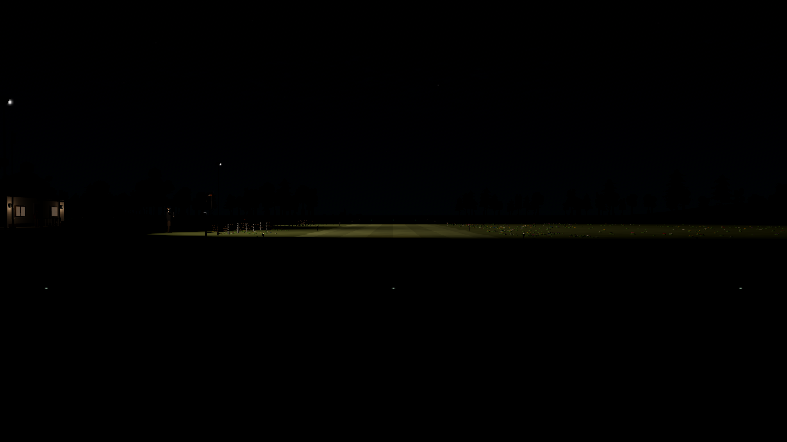
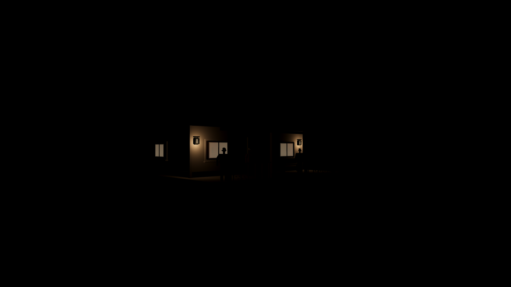

# LU-06 — Integrated landscape validation

Status: implementation and verification delivered, with the explicit regression/performance qualifications below. Date: **2026-10-11**. This report owns final integrated evidence and supersedes intermediate LU-02/03 images where parking, people or window details differ.

## Delivered behavior

The complete field now includes four atmospheric ridge chunks, irregular near trees and shrubs, proportioned clothed people with quiet arm motion, varied parking, and a catalog-checked display of all four aircraft. The Avanti has a support cradle. Existing turf, grass, distant tree cards, sky, fog and world clock remain the foundation. Fixture hardware stays visible by day; runway lighting, warm windows and veranda lights fade through dusk without disappearing geometry. Both FW time and explicit TOD snapshots drive the same helper.

Sun glare follows the actual solar disc, viewing angle and exposure. Nine depth samples attenuate it behind opaque geometry, including the flown aircraft; the shared cloud field attenuates it behind cloud. The effect has one draw, bounded veiling opacity, and a `--sun-glare=0..2` control (`off` also works). `--landscape-upgrade=off` disables the added ridge/glare/light helper and scenery collision integration; it does **not** undo the population asset refinements. `--scenery=off` removes population visuals and their collision proxies together, retaining field trees and lamps.

Scenery flight contacts use scalar float64 swept hull probes, stable obstacle IDs and a frozen spatial index. Type/severity responses feed the existing crash effects. Wreck fragments have nearby Godot collision shapes on their isolated layer. Soft foliage does not become a solid wreck wall. Reset removes these temporary bodies and restores flight without rebuilding or losing the world identity. Checkpoint v7 wraps the existing v1–v6 physics payload with the collision identity; paired visual checkpoints preserve this context.

## Native screenshots

Forty PNGs captured directly by the installed engine, without image retouching. See [image hashes](image-sha256.json). The final geometry pass closed neck/chin gaps and placed shoe soles on the ground. Day/club/fleet/night views were recaptured with 30 timing frames for visual review; the separate 600/1,200-frame runs below own performance acceptance. Mesh and draw counts did not change. Final capture metadata: [day](polish-day-metrics.json), [FW night](polish-night-metrics.json), [dusk](polish-dusk-metrics.json), [explicit TOD](polish-tod-metrics.json).













Additional views: [people](day-1080-postcard_pavilion.png), [parking](day-1080-car_park.png), [FW night club](night-1080-postcard_club.png), [vehicle impact](collision_vehicle.png), [building](collision_building.png), [tree](collision_tree_trunk.png), [lamp](collision_lamp.png), [parked aircraft](collision_parked_aircraft.png).

Every parked model was also inspected from inside the shelter to avoid the foreground posts: [Ugly Stik](parked_stik.png), [Extra 300S](parked_extra.png), [P-51D](parked_p51.png), [Avanti S](parked_avanti.png). These four detail views have 30 timing samples and are visual evidence only; the longer runs below own performance acceptance.

The [production night-flight capture](night-flight.png) shows the active Ugly Stik at 30 m altitude and simulation time 1.5 s, with existing aircraft lights against the adapted sky. The capture route pauses at the requested instant. It confirms native night rendering and usable silhouette/light cues in this view; it is not a human attitude-recognition score. Reproduce with the normal app's `-- --capture --time_of_day=night --t=1.5 --out=<absolute-png> --soundscape=off`.

## Glare checks

All **10 matched-image checks pass** at 1280×720. Camera, clock, cloud state and geometry are held fixed for each effect-on/off pair. Mean RGB difference on the 0–255 scale is 1.1895 with clear sun, 0 with a full blocker, 0.4049 with partial occlusion, and 0.2572 with the aircraft centered on the sun (**78.4% lower than clear**). Glare recovers to 1.1933 on either side of the transit. Off-axis, night and the dense-cloud fixture produce zero difference. Lower exposure gives 0.3906; half intensity gives 0.5964.

[Checks and measured differences](glare-checks.json), [raw case metrics](glare-clean-metrics.json), [clear](glare-clean-glare_clear.png), [off](glare-clean-glare_off.png), [aircraft across the sun](glare-clean-glare_aircraft.png), [aircraft control](glare-clean-glare_aircraft_off.png). All 21 source PNGs for the checks are retained in this folder and can be renamed/copied to the capture filenames to rerun the checker.

This validates the implemented occlusion behavior, not lens calibration or pilot recognition. Transparent canopies do not write the opaque depth texture. Nine disc samples can step during a small-object transit. Glare is an artistic optical approximation, with maximum overlay alpha 0.30.

## Performance

Native Windows, **NVIDIA GeForce RTX 3090**, OpenGL 3.3 / driver **610.88**, **Godot 4.7.2.stable.official.ed1daf0bf**, Compatibility renderer, vsync off. World captures warm up 60 frames and measure 600 frames per view; the 1080p glare pair measures 1,200 per case. No other landscape capture/benchmark was run concurrently. Other user applications remained open. These are wall-frame measurements, not isolated GPU timer results or low-end acceptance.

| Run | Median | p95 | p99 | Visible draws / primitives |
| --- | ---: | ---: | ---: | --- |
| 1080p pilot north | 1.942 ms | 2.442 ms | 2.873 ms | 54 / 350,825 |
| 1080p populated club | 2.628 ms | 3.132 ms | 3.808 ms | 74 / 396,716 |
| 1080p aerial overview | 3.039 ms | 3.894 ms | 4.457 ms | 85 / 409,642 |
| 1080p FW night runway | 2.226 ms | 3.238 ms | 3.730 ms | 71 / 415,874 |
| 1080p live flight, active aircraft and 240 Hz physics | 2.589 ms | 3.896 ms | 4.940 ms | total draws p95 128; primitives p95 213,583 |

All measured frame p95 values meet the **16.67 ms** target. The 720p populated overview was the slowest 720p case at **4.093 ms p95**. Glare adds exactly one draw: p95 2.415 ms on versus 2.295 ms off at 1080p (**+0.120 ms**); the 720p pair adds +0.094 ms. Both meet the incremental 1 ms target, within host scheduling variability.

Static field captures exclude the active aircraft and record **zero directional shadow-pass draws**; scenery uses existing batched contact shadows. The live-flight result includes the active aircraft and engine shadows, but its logger reports total passes rather than splitting visible/shadow counts. Peak captured field video memory is about **160 MiB**, including all existing assets and render targets. New landscape code adds no texture files or runtime dependency; four ridge chunks contain 12,288 triangles. Scenery adds 16 moving foliage meshes and seven subtle person-arm meshes; all other static geometry remains cell-batched. The local lighting count is three existing shadowless spotlights and two added shadowless omnis, below the planned limits.

The **100 μs collision query target remains missed near dense scenery**: severe 16 m production-hull swept segments measured first-hit p95 1,054 μs near cars and 795 μs near trees; empty-air full query p95 was 25 μs. A separate [80 m/s measurement at the actual 240 Hz rate](collision-speed-benchmark.md) gives 28 μs empty, 470 μs near a car and 431 μs near a shade-tree crown. That short-sweep run shared the CPU with the Linux suite and is explicitly not isolated acceptance. The live-flight logger's smoothed whole-tick cost had median 562 μs and p95 645 μs; this also leaves the older 500 μs physics target open. Neither miss is hidden by the frame-rate pass. See [collision methodology and limits](../LU-05/collision-report.md).

Raw measurements: [720p day](day-720-metrics.json), [1080p day](day-1080-metrics.json), [FW night](night-1080-metrics.json), [sunset](dusk-final-metrics.json), [explicit TOD night](tod-night-final-metrics.json), [1080p glare](glare-1080-metrics.json), [live flight](live-flight-1080.json). Render-only capture timing excludes flight physics and audio; live flight includes physics with soundscape disabled. The live run stayed unpaused, fault-free and advanced 2,857 physics ticks including warmup.

## Functional and regression checks

- Actual production Main, flown at 80 m/s into a vehicle, clubhouse, tree trunk, lamp and parked P-51: **56 checks, 0 failures**, headless and native. Checks cover object identity, time-of-impact height/normal, existing crash director, real Godot secondary shape queries, pause, reset, restored aircraft and unchanged inventory identity. [Structured result](runtime-checks.json), [native log](collision-native-final.log).
- Swept detector: **51/0**, including a 180° attitude regression and a staging-only mutation that fails with the old under-sized angular padding; session/state/trace/checkpoint tests: **25/0**; visibility/quality-to-collision setup: **22/0**; lighting: **45/0**; landscape paired checkpoint: **18/0**. Existing visual checkpoint **40/0**, TOD paired checkpoint **48/0**, TOD v2 **36/0**. Full-suite results below are the final authority after integration.
- Population generation matches the committed layout; fleet coverage is the four current catalog entries. Ten scenery derivative hashes match provenance after canonical LF normalization. Parking has no vehicle/vehicle or vehicle/shed footprint overlap.
- The combined Linux result is **207 of 208 GDScript tests passing**. All later shell gates pass, including math mutation sensitivity, model contracts, CLI weather/TOD/shaft checks, all four trimmed flights, 30/60/144 fps equality, and E5a/E5b ground refinement. [Combined result](regression-summary.json), [initial run](full-suite-initial.log), [initial continuation](regression-initial-summary.json), [final targeted reruns](regression-final-summary.json).
- The unresolved test is `test_atmosphere_flight.gd`: Linux fails the extreme-density re-trim at residual **0.16638981173064932** after 50 iterations, then accesses an empty checkpoint. Current and `HEAD` simulation/session variants reproduce that exact result; both Windows variants pass **140/140**. The comparison excludes the collision hooks as the cause; it does not diagnose the platform difference. [Baseline evidence](atmosphere-baseline.md). **Full `app/test.sh` is not a pass.**
- Final fixes address real integration and fixture assumptions: the implicit layout requires matching field geometry; explicit invalid scenery remains rejected (**7/0** new checks). Projected-shadow and legacy-sky fixtures pin their intended mode (**53/0**, **38/0**). Scenery trace parity now checks differing obstacle identities and identical unobstructed samples, plus the legacy opt-out path (**10/0**). The validation snapshot initially lacked a Git HEAD, which broke replay provenance and the E5a report writer; preserving the real source HEAD fixes both without changing their tests.
- A **16,342,272-byte Windows resource pack** was exported and checked from an empty project. Credits match their source SHA-256, all four fleet files and new landscape resources are present, and the packed app produces a finite 60-tick trimmed flight at 30 m and 15 m/s. [Pack checks/hash](pack-check.json), [resource log](pack-check.log), [flight trace](pack-flight.csv). This manual evidence pack carries `export-manual`, with the expected missing-release-build-variable warning in the [export log](export-pack.log). All three export presets include the credits and MIT permission notice; desktop executables/installers and macOS execution remain outside this check.

The final [runtime source manifest](validated-runtime-source-sha256.json) records original Windows bytes, before LF normalization in the disposable Linux copy. [Final source delta](validation-final-source-delta.json) identifies corrections after the first run. All original failure logs remain under [initial regression logs](regression-initial-logs/); corrected runs are under [final regression logs](regression-final-logs/). The exact continuation scripts are retained as [run_remaining.py](run_remaining.py) and [final_regression.py](final_regression.py), executed from `.tools/landscape-upgrade/` so their repository-relative root resolves correctly. No live developer files were line-ending-normalized.

The final [delivery audit](delivery-audit.json) verifies all 40 image hashes, runtime source hashes, ten canonical scenery derivative hashes, local document links, and credit inclusion in all three export filters. The corrected snapshot tool also completed a fresh 7,459-file copy with a real source HEAD ([log](snapshot-toolcheck.log)); this verifies the isolation tool, not a second full-suite pass.

## Reproduction

Run from the repository root. Native captures need a display; no external asset download is needed.

```powershell
$godot = '.tools/Godot_v4.7.2-stable_win64_console.exe'
& $godot --path app --script res://tests/capture_landscape_upgrade.gd -- --out=<absolute-output> --cases=pilot_north,postcard_club,fleet_close --frames=600 --width=1920 --height=1080
# Add --time_of_day=night or --time_of_day=sunset for FW; --time-of-day=00:00 for explicit TOD.
& $godot --path app --script res://tests/test_landscape_runtime.gd -- --soundscape=off --out=<absolute-output>
& $godot --path app --windowed --resolution 1920x1080 --disable-vsync -- --quick-flight --frametimes=<absolute-json> --warmup=2 --t=10 --soundscape=off
python tools/landscape/verify_glare.py <capture-folder>
python tools/landscape/make_validation_snapshot.py <new-snapshot-directory>
# Run bash app/test.sh inside that snapshot with the pinned Linux engine under WSL.
```

The exact glare case list and capture arguments are embedded in the metric JSON. [Tool instructions](../../../../tools/landscape/README.md) describe controls and artifact collection.

## Remaining limits

The people, near crowns and building interiors are improved low-poly procedural models, not scanned or fully rigged assets. Arm and vegetation motion are small shader motions, not behavioral animation. Mountains are distant visual relief at 3.5–10.5 km and **do not collide**; authoritative nearby ground contours remain the existing terrain sampler. Static scenery does not break, bend or retain damage. Aircraft collision coverage is its existing discrete hull probes, so narrow gaps between probes remain possible. Material thresholds are uncalibrated gameplay estimates; nonterminal contact commits the contact-time body state and the already-integrated auxiliary state, without reintegrating the remaining tick fraction. Night illumination is intentionally localized and uses exposure-dependent artistic caps; it is not a surveyed airfield lighting installation. Low-end GPUs, desktop release packages, pilot attitude recognition and independent structural-impact calibration remain unverified.

Assets and redistribution: [source/license audit](../LU-00/resources.md), [credits](../../../../app/assets/landscape/UPGRADE_CREDITS.md), [exact scenery package provenance](../../../../assets/scenery/PROVENANCE.json), [tree package provenance](../../../../assets/landscape/PROVENANCE.json).

Pre-upgrade checkpoints without a collision-world identity require the legacy `--landscape-upgrade=off` configuration. Collision-enabled restores deliberately reject a different layout or quality inventory instead of silently replaying against changed obstacles.
