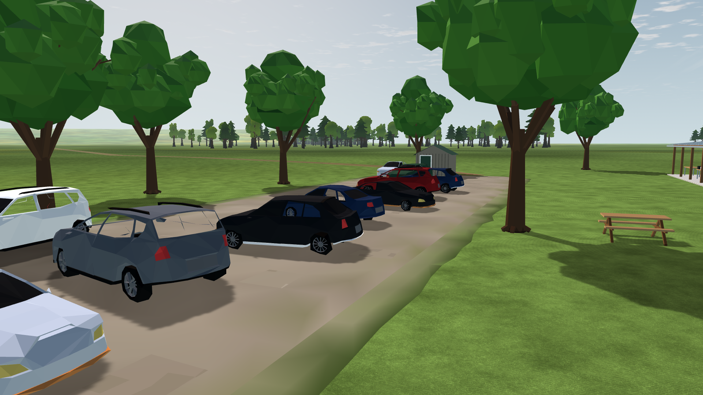
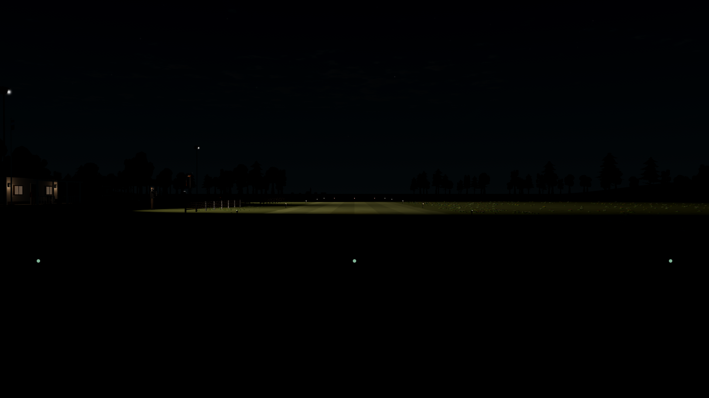

# LU-07–10 — Continued landscape refinement

Status: implemented, reviewed and validated, 2026-10-12. Starting source: clean `df36b44`. The root [plan](../../../plans/landscape-upgrade.md#continued-refinement--2026-10-12) was extended before application edits. LU-06 remains the historical integration evidence. Cost and human/hardware limits remain explicit below.

## Audit and choices

The lead inspected native LU-06 parking, club, pilot and night runway images, code and earlier resource research; three Luna max agents independently audited scenery, collision queries and lighting. Fresh 1920×1080 day/night baselines were captured with the production world, 60 warmup frames and 600 measured frames per camera. The exact binary is `4.7.2.stable.official.ed1daf0bf`, Compatibility/OpenGL 3.3, RTX 3090, NVIDIA 610.88.

- Ground: the apron is a flat colored polygon with a straight, constant-width grass ring. Improve surface variation and a broken shoulder in its existing batch. Maintain the clear parking and flying areas.
- Trees: high exposed forks and detached-looking crown tips create repeated umbrella silhouettes. Build connected layered crowns with upright/spreading habits, denser sprays and root flares inside the existing 8 × 10.5 × 8 m envelope. The same ten placements and one moving crown per tree remain authoritative.
- Pits: furniture already fills the shelters. Add only small recognizable RC-service items on existing tables.
- Night: the grass light pools exist, but stake cores are hard to distinguish and both runway ends display green from every direction. Improve screen-size handling and directional end cues within the existing two MultiMesh rows; retain all fixture positions and actual light counts.
- Collision: the detector repeats a full-sweep broadphase lookup in each attitude segment, then constructs/sorts all events for a first-hit consumer. Remove redundant work and validate any additional optimization against the committed baseline before accepting it.

New independent P-51 realism edits appeared after this pass began. Their aircraft data, envelope test, research and documentation are outside this work and are preserved. No new third-party media, dependency, plugin or texture is required. All new code/geometry is original MIT project content; existing exact-package CC0 evidence stays authoritative.

## Research checked 2026-10-12

| Primary source | Finding and decision |
| --- | --- |
| [Godot 4.7 MultiMesh optimization](https://docs.godotengine.org/en/4.7/tutorials/performance/using_multimesh.html) | Individual instances cannot be culled independently. Retain current spatial cells and two existing marker rows. The page flags incomplete 4.7 updates, so verify on installed 4.7.2. |
| [Godot 4.7 rendering limitations](https://docs.godotengine.org/en/4.7/tutorials/3d/3d_rendering_limitations.html) | Compatibility lacks internal HDR. Use bounded local sprite optics rather than depend on bloom; keep opaque batched ground/vegetation. |
| [Godot rendering architecture](https://docs.godotengine.org/en/4.7/engine_details/architecture/internal_rendering_architecture.html#light-decal-and-reflection-probe-rendering) | Local shadowed lights add passes. Keep three spots and two omnis; no new shadowed lights in this pass. |
| [FAA AIM 2-1-4](https://www.faa.gov/air_traffic/publications/aim_html/chap2_section_1.html) | White runway edges, outward green threshold and inward red end cues. Borrow those recognizable colors for the RC field; no compliance or calibrated photometry claim. No FAA image/text asset is redistributed. |
| [FAA AC 150/5340-30 record](https://www.faa.gov/airports/resources/advisory_circulars/index.cfm/go/document.current/documentNumber/150_5340-30) | Agent confirmed revision J listed active; reference for context only, no full-size installation imported into the club. |
| [AMA club-airfield example](https://amablog.modelaircraft.org/blog/amaair-may2026/) | Agent reviewed grass strip, pilot stations, pits, wind indication and shade structures as scale/context references; no downloaded image incorporated. |
| [ambientCG license](https://docs.ambientcg.com/license/) | CC0 candidate retained from LU-00. No texture downloaded; a new material system would exceed this bounded pass without solving the immediate silhouette/edge issues. |

New tree dimensions, colors, wear density and lamp optical sizes are art estimates. They are not botanical scans, surveyed wear or measured luminaire optics.

## Delivered appearance

The apron uses clipped 1.1 m cells with sparse smaller aggregate cells and a feathered irregular shoulder. The first draft produced elongated shading streaks and was rejected in native review. The final geometry stays on the original ground layers. Trees have upright/spreading habits, connected lower/upper masses, terminating forks, root flares and overlapping outer sprays. Ten existing trees retain one wind mesh each. [Before parking](before-day/car_park.png), [after club](day/postcard_club.png), [before club](before-day/postcard_club.png), [pit charger and battery](day/pit_service.png), [aerial](day/aerial_overview.png), [pilot flying area](day/pilot_north.png).

Markers reuse the two existing MultiMesh rows. Their optical core scales from the active projection/viewport, threshold lenses show green outward and red inward, and the neutral physical cap stays visible by day. Near cap occlusion and double attenuation were caught during review and corrected. Final emission is capped after size compensation, with dusk-aware caps and a separate 300–600 m range fade. This adds no lights or draws. [Before night](before-night/runway_threshold.png), [west approach](night/runway_west.png), [far approach](night/runway_east_far.png), [red end from inside runway](night/runway_inside.png), [sunset club](dusk/postcard_club.png), [explicit TOD night](tod-night/runway_threshold.png), [house windows](tod-night/postcard_pavilion.png).

The ledgers in [ground details](ground-details.md) and [shipped credits](../../../../app/assets/landscape/UPGRADE_CREDITS.md) record original MIT content and unchanged exact-package CC0 assets. No downloads, textures, runtime plugins or new external dependencies entered this pass.

## Functional and rendered checks

- **23/23 focused native headless scripts pass.** They cover population/catalog, mesh bounds/determinism, ground geometry, lighting/binding/fades, collision/session/setup/world, checkpoints, trace behavior and time-of-day integration. [Machine-readable summary](checks/summary.json). The initial run found a stale expectation in the TOD render-update test: its runway is deliberately moved to 25 km, which makes implicit bundled scenery ineligible. Only that final assertion was corrected; all 93 other checks remain. Final result **94/0 with scenery on and off**; original failure and rerun logs are retained.
- **56/0 native real-flight crash/reset checks:** 80 m/s approaches into a vehicle, building, tree trunk, lamp and parked P-51. The existing crash director, contact pose/normal, secondary Godot shape queries, pause and reset all work; inventory identity survives reset. [Structured result](runtime-checks.json).
- **326/0 differential detector checks:** 160 mixed high-speed/rotating sweeps against a frozen SHA-pinned pre-refinement detector, with 53 exact event matches in 41 contact cases. All contact fields/states match; a candidate-removal mutation is detected. The optimized broadphase queries once per hull sweep and rejects irrelevant proxy AABBs before testing individual probes. It changes no world identity or response constants. [Oracle and benchmark evidence](collision-performance.md).
- **8/8 native marker pixel checks:** visible core, intermediate fade, exact off/opaque-occlusion zero, held exposure, outward green and inward red, including the far approach. [Pixel results](night/marker-checks.json). The four `marker_` cases hold sky/exposure fixed and override only the lamp's solar-elevation input; they are controlled optical tests, not different astronomical hours. Half-factor encoded RGB is lower than full factor, not expected to be half because exposure/encoding are nonlinear. [Clear](night/marker_clear.png), [half](night/marker_half.png), [off](night/marker_off.png), [opaque blocker](night/marker_occluded.png).
- **10/10 native sun-glare checks pass** with the same measured values as LU-06, including 78.4% attenuation by the centered opaque aircraft, full blocker/cloud/off-axis/night zero, and recovery either side. [Results](glare/glare-checks.json), [actual aircraft transit](glare/glare_aircraft.png), [clear](glare/glare_clear.png). Glare code is unchanged; these remain controlled optical fixtures, not human flight-readability scores.
- Tree check: **192 seed/theme builds**, exact deterministic replay, finite vertices and bounds including ±6 cm wind: maximum 7.629 × 9.993 × 7.670 m, at most 1,131 static triangles per tree. Ten production trees change from 5,410 to 11,058 static triangles and 1,600 to 2,160 moving triangles. Total +6,208 exceeds the provisional tree allocation by 208 triangles; static increase stays below 6k. No additional moving nodes. Whole scenery is **158,387 triangles / 48 merged cells / 28 motion parts**, within 250k and 40-part limits. [Counts](checks/tree-triangle-delta.log), [build checks](checks/test_scenery_build.log).

## Performance

Native Windows, Godot **4.7.2.stable.official.ed1daf0bf**, Compatibility/OpenGL 3.3, **RTX 3090 / NVIDIA 610.88**, vsync off. Each day/night view records 600 frames after 60 warmups at 1920×1080. Measurements are wall-frame intervals, not isolated GPU timestamps. Landscape agents stopped competing captures/benchmarks; unrelated user applications and developers remained active. Do not interpret the lower night-before/after values as a reliable optimization gain.

| Final view | Median ms | p95 ms | p99 ms | Visible draws / primitives |
| --- | ---: | ---: | ---: | --- |
| Day parking | 2.128 | 3.067 | 3.768 | 31 / 336,599 |
| Day club | 2.624 | 3.839 | 4.157 | 74 / 405,507 |
| Day pilot | 1.934 | 3.084 | 3.574 | 54 / 350,825 |
| Aerial overview | 3.069 | 4.332 | 4.691 | 85 / 419,079 |
| Night east threshold | 2.161 | 3.365 | 4.053 | 71 / 423,149 |
| Night far approach | 2.379 | 3.581 | 3.915 | 89 / 436,912 |
| Night west approach | 2.260 | 3.409 | 3.898 | 114 / 436,052 |

All final 600-frame views meet the 16.67 ms p95 target. Maximum visible count is 114 draws / 436,912 primitives, below 300 / 1M. All matching baseline cameras retain exactly their draw counts; day club gains 8,791 primitives. Matching day p95 deltas range from −0.117 to +0.184 ms; pilot primitives are unchanged. Field captures record zero shadow-pass draws and use the existing projected/contact shadows. Peak report video memory is about 172.75 MiB including existing targets/assets; there are no new texture files. Three spots and two omnis are unchanged. [Final day raw samples](day/report.json), [night](night/report.json), [before day](before-day/report.json), [before night](before-night/report.json). Dusk, explicit TOD and glare have 30 measured frames and are visual regression evidence, not performance acceptance.

Collision paired timings use the production eight-point hull, 3,867 proxies / 950 bins, 20 warmups and 200 calls per method, alternating baseline/candidate order. At 80 m/s / 240 Hz, near-car/tree p95 improves **393/470 →297/289 μs** (24%/39%); p50 **241/245 →172/172 μs**. The **100 μs target remains missed**. A separate first-hit shortcut was rejected because full-contact collection had similar measured cost and more complex pruning risk. [Raw log and method](collision-performance.md). These are query timings, not complete 240 Hz simulation-tick costs.

## Reproduce and remaining limits

Use [landscape commands](../../../../tools/landscape/README.md) with an absolute `--out`, no `--headless` for visual captures, and the case/size/frame arguments retained in every report. `verify_markers.py` and `verify_glare.py` use the existing pinned Pillow 12.3.0 offline evidence dependency. [Source manifest](source-sha256.json) and [raw PNG hashes](image-sha256.json) bind the final result.

This continuation ran the focused checks above, not a new complete Linux `app/test.sh` or release-installer campaign. The earlier **207/208 Linux result and extreme-atmosphere trim discrepancy remain qualified** in [LU-06](../LU-06/README.md); no fix is claimed here. Concurrent aircraft data/research/test-runner/documentation work is preserved and excluded from this pass's ownership.

The landscape remains procedural low-poly art. The apron has no scanned gravel normal map; its shoulder remains distinguishable from textured turf. Tabletop accessories are decorative within existing shelter geometry, with no individual damage bodies. Trees keep conservative existing collision proxies and estimated foliage response. Distant ridges remain visual-only. Night brightness and optical gain are artistic controls; this is not measured photometry. Transparent materials do not provide the glare pass's opaque-depth occlusion. Low-end GPU acceptance, human aircraft readability, rigged people, improved sunset color grading and physical damage calibration remain separate work. No release installer or active-aircraft performance measurement was redone in this refinement pass.
