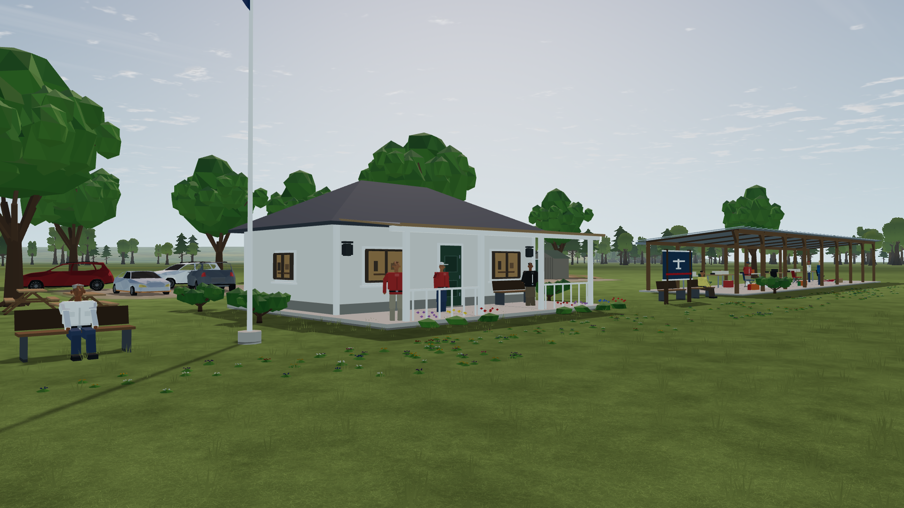
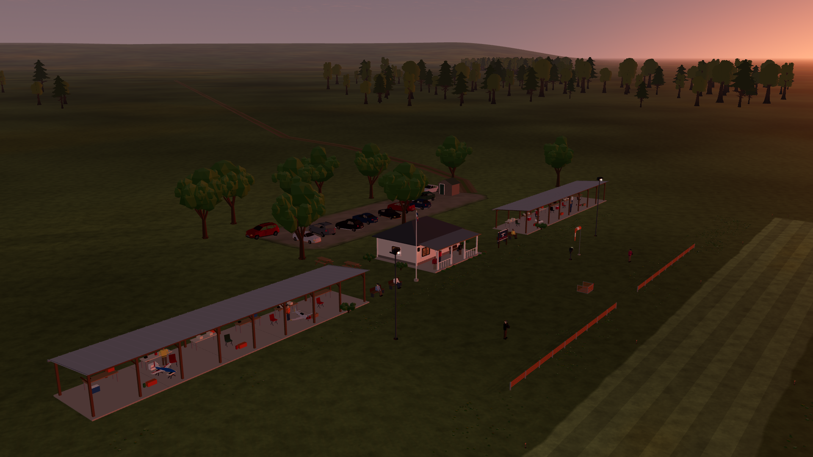

# LU-11–14 — materials, architecture and collision coverage

Status: implemented, reviewed and validated, 2026-10-12. Nearby collision-query cost, low-end hardware and human flight acceptance remain open. Target: Godot **4.7.2.stable.official.ed1daf0bf**, **Compatibility / OpenGL 3.3**, Windows, NVIDIA RTX 3090 / driver 610.88. Baseline: `8b2020f`. [Owning plan](../../../../LANDSCAPE_UPGRADE_PLAN.md).

The plan and ownership boundaries preceded application edits. Three Luna max agents reviewed resources, architecture and collision coverage; the lead reviewed their contributions, corrected the initial missing tree-card frame scale, integrated the changes and ran native verification. Concurrent aircraft, UI and other developers' changes were preserved. Source hashes identify this delivery independently of concurrent commits.

## What changed

- **Gravel:** a deterministic, opaque world-space material adds fine aggregate color and shallow normal detail to the existing ground batch. Vertex alpha selects only gravel and feathers its shoulder. Two spatial frequencies fade with screen footprint; the distant view becomes pixel-identical to detail-off. No added geometry, draw, texture or runtime dependency. The rejected polynomial-hash trial produced directional corrugation; the retained shader uses the existing integer cloud hash. Review also removed undefined nested derivatives. [Material checks](materials.md).
- **Buildings:** door panels/hinges, window transoms, thresholds, slab joints, eaves, fascia, roof-end caps, gutter returns and rear downpipes. One pavilion and two shelters add **566 triangles**, below the 3,000 cap, with unchanged bounds, cells, materials and motion counts. Existing lit window inserts partly cover the new transoms. [Architecture review](architecture.md).
- **Twilight:** a bounded artistic diffuse-color correction replaces the pervasive orange cast with cooler upper sky/shadows and a warm solar horizon. It preserves linear luminance, direct light, astronomy and exposure input; fixed daylight and deep night take an exact unchanged path. The explicit static TOD route remains separate. [Palette and regression details](twilight.md).
- **Collision coverage:** tree crowns now use occupied atlas width, actual frame scale and bounded wind lean. Eleven pavilion structural volumes cover the veranda/slab/roofs while keeping central openings clear. Responses still flow through the existing flexible foliage, solid structure and crash/session systems. [Coverage, identity and approximation limits](collision-coverage.md).

The full current scenery remains **158,953 triangles in 48 static cells**, with **28 moving parts**. The four catalog aircraft remain present in the pits; population and build regressions pass. This pass adds zero lights. Existing marker batches, local-light caps, restrained wind and distant-scene detail ranges remain in place.

## Native views

All images are unedited engine PNGs. The package contains **76 images**, baseline/comparator views and five actual crash/reset views included; [raw image hashes](image-sha256.json). Earlier LU-06/07 evidence is unchanged.

| View | Before | Final |
| --- | --- | --- |
| Pavilion construction | [Day baseline](before-day/postcard_pavilion.png) | [Day](after-day/postcard_pavilion.png), [shadows enabled](shadows-day/postcard_pavilion.png) |
| Gravel parking | [Baseline](before-day/car_park.png) | [Parking](after-day/car_park.png), [close](after-day/gravel_close.png), [distant](after-day/gravel_far.png) |
| Club at sunset | [Baseline](before-sunset/postcard_club.png) | [Final](after-sunset/postcard_club.png), [pilot view](after-sunset/pilot_north.png) |
| Twilight range | — | [Dawn](dawn/postcard_pavilion.png), [golden hour](golden-hour/postcard_pavilion.png), [blue hour](blue-hour/postcard_pavilion.png) |
| Night | [Pavilion baseline](before-night/postcard_pavilion.png) | [Pavilion](after-night/postcard_pavilion.png), [threshold](after-night/runway_threshold.png), [static TOD](tod-night/runway_threshold.png) |
| Aircraft visibility | [Before](before-aircraft/twilight_aircraft.png) | [After](after-sunset/twilight_aircraft.png), [sun crossing](glare/glare_aircraft.png) |

## Measured budgets

The main native timing sets use **600 measured frame intervals after 60 warmup frames**, 1920 × 1080, scenery on, soundscape off. They build the production renderer with a static fixture; they are **wall-clock render-loop intervals, not isolated GPU timestamps or full flight-physics timings**. Root and agents did not run other engine work during the final adjacent material pair or shadow sample. Other desktop applications were not controlled. Raw intervals, engine/adapter, arguments, exposure, memory and draw counters remain in each `report.json`.

| Final view | Median / p95 / p99 (ms) | Reported visible draws | Primitives |
| --- | ---: | ---: | ---: |
| [Parking](after-day/report.json) | 2.153 / 2.661 / 3.191 | 29 | 167,245 |
| [Close gravel](after-day/report.json) | 1.946 / 2.436 / 2.789 | 14 | 136,685 |
| [Club daylight](after-day/report.json) | 2.722 / 3.812 / 4.387 | 69 | 235,865 |
| [Sunset aircraft](after-sunset/report.json) | 2.140 / 2.648 / 2.943 | 144 | 249,986 |
| [Night threshold](after-night/report.json) | 2.183 / 2.652 / 3.620 | 66 | 253,507 |
| [Pavilion, shadows on](shadows-day/report.json) | 2.919 / 3.664 / 4.103 | 51 | 367,135 |
| [Aircraft, shadows on](shadows-day/report.json) | 2.691 / 3.901 / 4.517 | 244 | 456,584 |

Final 600-frame scenes meet the **16.67 ms p95 / 300 draws / 1M primitives** targets on this host. The Compatibility shadow counter reports zero even with shadows enabled; retain that raw result without claiming independent shadow-pass accounting. Shadow-enabled primitive and total-draw increases are visible in the reports. Golden/blue-hour/dawn/static-TOD/glare captures use 30 samples and serve as visual checks, not robust timing benchmarks; the highest p95 among those 1080p short views is 5.426 ms at the blue-hour pavilion.

For the material cost, adjacent [legacy-material](legacy-day/report.json) and [new-material](paired-day/report.json) runs give p95 deltas of **+0.039 ms close, +0.065 ms parking, +0.074 ms club**, below the **0.5 ms** increment target; draw counts match. The [detail-off comparator](flat-day/report.json) still executes the shader and is used only for pixels. Before/after sessions have timing variance, so the entire difference from an earlier baseline is not attributed to the new material.

The current collision world has **3,877 proxies / 1,039 bins**, identity `488c101fb9a4cb58cf8a281ca1be1f3e1438046979e1f613df9577e05ea075d9`. [Actual-rate benchmark](checks/root-benchmark-collision-80mps.log): at **80 m/s, 240 Hz, 0.333 m/tick**, first-hit p95 is **29 μs empty / 370 μs near car / 364 μs near shade tree**. World build was 142.378 ms. The harness alternates the historical pre-LU-10 detector and the current detector on the **same current world**; it does not isolate the cost of widened crown geometry. The **100 μs nearby-query target remains open**. The separate 1,920 m/s stress test is explicitly distinguished in the coverage report.

## Verification

- [28/28 focused scripts pass](checks/root-suite.json), with per-script raw logs in [checks](checks/): scenery build/population/bounds, new architecture/gravel/twilight/coverage, detector/oracle, session/reset/checkpoint identity, lighting, world flow, both TOD update paths and trace behavior. `app/test.sh` discovers all `test_*.gd`, so the new tests enter its normal loop without editing the shared runner.
- [39/39 image checks](materials-checks.json): nearby grain visible, far grain fully attenuated, unchanged paired draws/exposure; matched twilight aircraft contrast **57.4529 → 66.6877 encoded luma units (+16.1%)** over 78/79 detected pixels. This is a controlled screen metric, not pilot recognition or physical luminance.
- [8/8 marker checks](after-night/marker-checks.json), [10/10 glare checks](glare/glare-checks.json): directional cues, fade, opaque occlusion, full/partial sun occlusion, actual aircraft transit, angular falloff, cloud/exposure/intensity response and dark/off-axis zero.
- [56/56 native crash/reset checks](runtime-final/runtime.json), [raw log](runtime-final.log): five actual 80 m/s aircraft approaches into a vehicle, building, trunk, lamp and parked P-51; wreck/secondary collision shapes, pause and reset. The first run retained a stale selector for the former single pavilion proxy and failed to choose a target. [Original result](checks/runtime-stale-fixture.json) is preserved; changing the selector to `pavilion_main` restored the intended building case without weakening assertions.
- Isolated script/editor checks preceded installation. Native captures compile the final shader without engine errors. Agent float64/transcendental checks passed; the injected-call self-test required WSL because of the existing Windows path-separator limitation.

Reproduce capture arguments from [capture-commands.json](capture-commands.json), using the pinned engine and no `--headless`. Image checkers and fixture provenance are documented in [tools](../../../../tools/landscape/README.md). [Source hashes](source-sha256.json) normalize only CRLF→LF for text hashing; live source files were not normalized.

## Resources and remaining limits

[Research](resources.md) covers maintained ambientCG/Poly Haven gravel, exact CC0 permissions and primary Godot/atmospheric sources. No candidate asset was downloaded or adopted. Original additions remain MIT; retained tree/car assets keep their exact-package CC0 provenance. [Shipped credit record](../../../../app/assets/landscape/UPGRADE_CREDITS.md) remains explicitly included in all three export presets. No new runtime plugin, texture allocation or external dependency.

The landscape is still deliberately stylized. Twilight is an artistic approximation, tree OBBs fill gaps between card planes and roofs use conservative boxes; neither foliage geometry nor damage severity is physically calibrated. Distant ridges remain visual scenery. Low-end hardware, human flight recognition and full-flight performance acceptance remain open. This continuation did **not** rerun the full Linux suite or release installers: the earlier [207/208 result and atmosphere-trim qualification](../LU-06/README.md) still apply.
