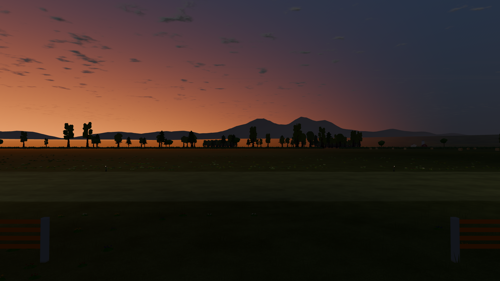
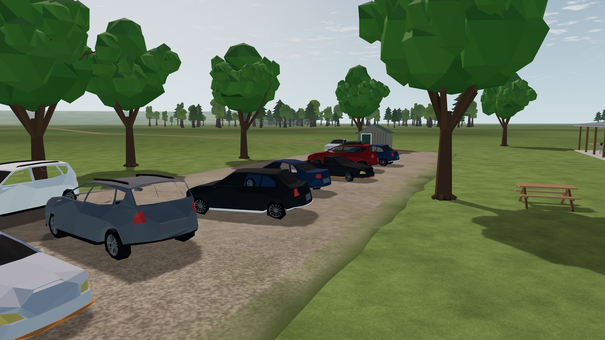

# LU-15 — image review and next upgrade selection

Status: review complete; next implementation steps selected, 2026-10-12. Owner: environment integration lead. [Owning plan](../../../../LANDSCAPE_UPGRADE_PLAN.md). This pass changes documentation only.

## Decision

Start with the **dusk horizon seam**, then **near vegetation**, then **ground transitions and field use**. These occupy large parts of the actual pilot and club views. The current buildings, parked fleet and service equipment establish a recognizable RC club, but the vegetation, ground and background do not yet share a convincing level of detail. More small props would have less visual impact at this stage.

The lead personally inspected 14 raw LU-11 captures: daytime pilot, club, pavilion, parking, close gravel and pits; shadow-enabled pavilion; sunset pilot and aircraft; blue-hour pilot; nighttime pavilion, runway inside and threshold; and the aircraft sun-crossing fixture. The original images and hashes remain in [LU-11](../LU-11/README.md). A bounded Luna max review independently inspected the dusk band and its source integration; it made no edits or engine runs. Static images cannot establish animation quality, camera-motion shimmer or pilot recognition.

## Ranked findings

| Priority | Image evidence and diagnosis | Selected change |
| --- | --- | --- |
| 1 — LU-16 | [Sunset](../LU-11/after-sunset/pilot_north.png) and [blue hour](../LU-11/blue-hour/pilot_north.png): a bright horizontal strip runs below the dark mountain base, particularly left of the central peaks. It makes the background read as disconnected layers. Daytime mountains are much less legible. | Diagnose and unify the ground/ridge haze transition first; then give the middle-distance foothills coherent overlap and restrained value separation. Preserve the open flight corridor. |
| 2 — LU-17 | [Parking](../LU-11/after-day/car_park.png) and [pavilion](../LU-11/after-day/postcard_pavilion.png): nearby crowns are large, solid, sharply faceted lumps. Similar branch forks and green values repeat. Near bushes and flower cushions resemble small polygon mounds. The existing distant trees have a different visual character. | Rework the three existing crown habits with smoother broad shading, asymmetric branching, smaller edge sprays and selected gaps. Replace exposed flower mound bases with restrained stem/leaf clusters; distribute flowers by habitat. Keep the existing tree positions and conservative collision envelopes. |
| 3 — LU-18 | [Pilot view](../LU-11/after-day/pilot_north.png), [club overview](../LU-11/after-day/postcard_club.png) and [parking](../LU-11/after-day/car_park.png): the field is readable but still looks like a broad repeated surface. Gravel has a conspicuous olive border. The access track bends abruptly, and the club lacks visible worn connections between parking, door and pits. | Improve the spatial pattern: irregular rough-grass patches, modest dry/worn areas, flatter gravel/grass blending, softened access-track turns and subtle pedestrian wear. Retain the useful runway mowing pattern and its exact physical surface. Diagnose existing anti-tiling/filtering before adding shader complexity. |
| 4 — LU-19 | [Pavilion](../LU-11/after-day/postcard_pavilion.png), [pits](../LU-11/after-day/postcard_pits.png) and [close cars](../LU-11/after-day/gravel_close.png): walls, slab and timber lack material separation; windows resemble brown panels, and some car glazing reads as open holes or dark sheets. People remain visibly rigid. | Improve existing material roles and contact shading, then glazing depth/reflection cues. Audit car mesh/glass/culling before choosing a fix. Refine the few nearest people's shoulder/elbow/knee poses within the existing animation interface. |
| 5 — LU-19, bounded lighting review | [Night threshold](../LU-11/after-night/runway_threshold.png) and [inside runway](../LU-11/after-night/runway_inside.png): threshold cues are visible, but runway edge continuity is harder to follow between light pools. [Clubhouse](../LU-11/after-night/postcard_pavilion.png) has warm windows but little readable entry approach. Darkness alone is not a defect. | Review fixture spacing/direction and ground pools at operational camera heights. Establish a continuous useful runway outline and a modest entrance pool within the existing local-light budget. Retain dark surroundings and capped glare. |

## Horizon diagnosis before artwork

The image symptom is certain; its cause is not yet isolated. Source inspection identifies a plausible mismatch:

- `ground.gdshader` adds custom exponential haze and a full-haze rim from 4.8–6 km.
- `horizon.gd` constructs relief to its outer profile ring at 6 km, then a flat outer annulus.
- `landscape_upgrade/ridges.gd` adds a separate 3.5–10.5 km backdrop using `StandardMaterial3D`, without the ground shader's custom rim treatment.

Keep camera, sky time and exposure fixed. Capture the normal view, a view with only the rim contribution suppressed, and a view with only the ridges hidden. Inspect geometry/depth if the result is ambiguous. The orange hue may be intended atmospheric scattering; do not remove warm twilight merely to hide a spatial seam. Sunset and blue-hour exposures differ, so their brightness is not an A/B measurement.

Candidate ownership: lead owns `render/landscape_upgrade/ridges.gd` and diagnostics; coordinate narrow `render/field.gd`, `horizon.gd`, `ground.gdshader` and shared haze edits with the visual/world tracks. Do not turn the visual foothills into physical terrain or alter the runway contact sampler in this step.

## Implementation constraints and acceptance

These are **planned engineering budgets**, not new measurements. The LU-11 results remain the baseline.

| Step | Bounded ownership / budget | Acceptance |
| --- | --- | --- |
| LU-16 | Lead: ridge/haze integration and capture controls. Reuse four ridge chunks; target zero added draws/lights and ≤0.25 ms paired p95 cost. | No continuous detached bright band at the ridge base in matched dawn/sunset/blue-hour views at pilot height and two raised views. Preserve a warm horizon and test the actual aircraft across both sky and ridge backgrounds. |
| LU-17 | Bounded scenery task: `vegetation.gd`, `flowers.gd`/shader, placement generator; lead integrates shared scenery hook. Retain 48 static cells and 28 moving parts. Total scenery ≤180k triangles, ≤4 added visible draws; existing opaque geometry first. | Three recognizable crown habits without exposed polygon mound flower bases in 5/15/40 m views. Wind and repeat-build determinism retained; no expanded tree collision envelope, new per-tree callbacks or vegetation in operational clear areas. Check 720p/1080p camera motion for shimmer and LOD changes. |
| LU-18 | Lead: `grass_surface.gdshaderinc`, `ground_features.gd`, existing ground material and bounded placement edits. Target no added draw/texture allocation; reuse existing noise/filtering. | Matched near/oblique/raised views: gravel shoulder loses the continuous raised-border appearance, paths connect existing destinations, and broad grass variation follows use. Keep runway geometry, friction, mowing readability and distant-detail filtering. |
| LU-19 | Split sequentially between scenery/material and lighting owners; reserve shared `prefabs.gd` for one writer. Reuse window inserts and car meshes; no replacement asset pack selected. | Readable material differences at matched exposure; glazing no longer looks like absent geometry or opaque wall panels. Night edge cues and entrance usable from relevant cameras, with marker occlusion and glare caps intact. Maximum 6 spots/2 omnis, ≤2 shadowed local lights. Near-person pose changes must preserve collisions and animation bounds. |
| LU-20 | Lead: integration, collision coverage and performance review, all raw evidence. Aggregate added frame p95 target ≤1.5 ms; retain overall 16.67 ms / 300 draws / 1M primitives. | 600-frame adjacent native comparisons, day/night/shadows/aircraft-transit captures, populated views, camera motion, high-speed collision/pause/reset, source/asset hashes and focused regressions. Contrast screen ≥95% of each matching LU-11 baseline; human flight acceptance remains separate. |

Nearby collision-query cost is still above its 100 μs target. Avoid increasing proxy count during these visual passes; if a visible shape must exceed an existing proxy, coordinate that change and remeasure instead of accepting a mismatch.

## Asset and technical choices

Retain the existing MIT geometry/code and exact-package CC0 assets. No additional runtime asset, plugin or renderer migration is selected. For foliage, first prototype better geometry/normals and coverage using the current batches. If a cutout leaf atlas later proves necessary, record exact provenance, source/derivative hashes and redistribution terms before integrating it, with a proposed ≤4 MiB GPU allocation. Do not treat an existing whole-tree atlas as a ready-made leaf-cluster texture.

The [Godot 4.7 material reference](https://docs.godotengine.org/en/4.7/tutorials/3d/standard_material_3d.html#transparency) recommends alpha scissor for hard-edged foliage and documents alpha-blend sorting/performance limits. [MultiMesh guidance](https://docs.godotengine.org/en/4.7/tutorials/performance/using_multimesh.html) supports spatial groups because instances are not culled independently. These constrain an optional prototype; native Godot 4.7.2 Compatibility verification remains required. Existing resource/license research is in [LU-11](../LU-11/resources.md).

Cloud shape also needs a later art pass: the current pilot sky contains many similarly sized small patches. Prefer a few larger cloud groups with quiet gaps after the horizon repair; preserve the shared deterministic cloud field, shadows and sun attenuation. Additional vehicles, furniture, larger mountains, global brightness increases and stronger sun flare are lower priorities than the selected repairs. The current fleet coverage, runway mowing, warm interiors, filtered gravel and controlled sun-transit glare are useful foundations to retain.
