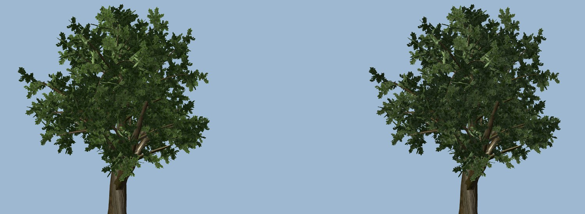

# LU-34 scene budget: from one triangle pool to measured cost

2026-10-21 · Landscape **L** with SC/LU, VQ (shared budgets) and DT (hardware) · Measurement, budget model and a vegetation texture optimization. No simulation, collision or placement change.

The single 725,000 non-fleet source-triangle cap did not predict what the renderer pays for. It counted every model at full detail, wherever it was, and ignored draw calls, shadow passes, texture memory and load time. This step measures those quantities per subsystem and replaces the pool with a budget in the units that cost frame time and memory. It also removes the largest avoidable vegetation cost: lossless-by-default texture imports.

## Why the old limit failed

The cap began as LU-21's 600k, was revised to 650k, and LU-30 raised it to 725k to admit downloaded power lines. Each new asset raised it again or was blocked. It summed `instances × source triangles` before level of detail, for the scenery node only:

| Subsystem | Source triangles | Generated LODs | Drawn primitives, worst pilot view | Worst ground view | Draw calls, worst view |
| --- | ---: | --- | ---: | ---: | ---: |
| People, cars, furniture | 371,573 | yes | 73,734 | 60,025 | 49 |
| Parked fleet | 273,421 | yes | 67,838 | 95,748 | **179** |
| Merged static cells | 168,031 | **no** | 91,773 | 134,369 | 26 |
| Close trees and shrubs | 101,167 | yes | 62,627 | 68,567 | 37 |
| Botanical habitats | 89,655 | yes | 6,844 | 7,760 | 20 |
| Near grass | 49,579 | yes | 1,103 | 1,103 | 3 |
| Ground (field layer, uncounted) | 84,960 | **no** | 84,960 | 84,960 | 1 |
| Lake (field layer, uncounted) | 65,224 | partly | 45,354 | 45,688 | 13 |
| Flightline fence (uncounted) | 81,601 | partly | 39,998 | 39,998 | 6 |

Drawn columns include the shadow pass. [Full per-subsystem table](runs/summary-720.md).

- **Source triangles mispredict drawn cost.** People and cars use 51% of the pool but draw 1,558 primitives in the forward pilot view. Near grass draws 2% of its source. Imported meshes carry generated LODs and cull as batches.
- **Full-detail procedural meshes are the drawn-primitive load,** and several lie outside the counted scenery node: the ground (85k in every view), the fence, the lake, distant ridges and merged cells.
- **Draw calls are the likelier limit in this OpenGL renderer.** The fleet alone issues 179 draws in club views. Roofs use 17 draws for 68 primitives, contact decals 18 for 612. The existing SC-03 per-view check (`capture.sh`: ≤ +40 scenery draws in pilot views) currently fails at +56/+87/+123 while the triangle cap passes.
- **Memory is textures.** Godot's renderer estimate is 489 MiB for textures (after the compression below) and 43.7 MiB for vertex/index buffers. The triangle pool guarded under 9% of GPU memory.
- **The 800 ms build gate is load time.** A second scenery build in the same process takes 1 ms for close vegetation; the cold build took 334–531 ms, almost all of it decoding lossless textures.

## Method

[`tools/scenery/attribute_views.gd`](../../../../tools/scenery/attribute_views.gd) builds the production world (`World.build`: field, scenery, lake, sky, sun) and renders all 20 postcard views at 1280×720, the qualification viewport. For each view it renders the complete world, then the world without each of 28 subsystems, and without the sun's shadow pass. Cost = complete − without. Compatibility's dedicated shadow counter reads zero, but its total counters include shadow-pass draws: removing sun shadows lowers the club view by 20 draws and 29,058 primitives. The parts sum to the total within 2 primitives, and a repeated complete render is identical in every view. The tool also records each subsystem's full-detail and LOD-carrying source triangles, real-time shadow casters and the renderer's memory estimates. [`attribution_report.py`](../../../../tools/scenery/attribution_report.py) reduces a run per view class (pilot 8 views, ground 8, aerial 4) and checks a budget.

Counts are renderer submissions after culling and LOD, measured with Mesa llvmpipe. They are platform-independent workload, not GPU timings, and they do not measure fill-rate or alpha overdraw.

## Results at 1280×720

| View class | Worst view: primitives / draws | Median | Sun shadow pass, worst |
| --- | --- | --- | --- |
| Pilot | 405,301 / 326 (`runway_zoom_300`) | 264,656 / 98 | 40,116 / 22 |
| Ground | 474,905 / 359 (`postcard_pits`, `postcard_club`) | 316,272 / 196 | 44,851 / 24 |
| Aerial | 420,509 / 367 (`aerial_overview`) | 160,501 / 64 | 27,747 / 22 |

The world holds 417,717 full-detail triangles (no generated LODs) and 970,334 LOD-carrying triangles. Only the close trees (101,167), the lake (7,980) and two night-light props cast real-time shadows. [Complete run](runs/attribution-720.json), [summary](runs/summary-720.json).

**At 1920×1080** ([summary](runs/summary-1080.md), [run](runs/attribution-1080.json)) draw calls are identical in every view. Worst-view primitives rise 1.9% (pilot 412,840), 3.8% (ground 492,743) and 4.2% (aerial 438,160), all inside the class totals. Only generated-LOD selection changes: people and cars (+4.6k to +8.7k), the parked fleet (+2.1k to +9.5k), close trees (+2.1k, aerial) and botanicals. Aerial people/cars (43,070) exceed their 720p allocation of 38,000. The texture estimate rises 48.3 MiB, exactly 44 bytes per added pixel: these are viewport render buffers, so about 39 MiB of the 489 MiB at 720p depends on resolution. Budgets therefore stay defined at 1280×720, and the checker rejects other viewports.

For reference, the 2026-10-20 RTX 3090 flights measured about 1.6–1.9 ms viewport CPU and 3.4 ms GPU render time at ~107 draws and ~249k primitives in the pilot view. That host has wide headroom. The proposed M1-class 8 GB floor (DT-01a) is unmeasured, so no absolute frame-time claim follows.

## Budget model

| Gate | Where | Rule |
| --- | --- | --- |
| Drawn cost per view class | [`scene_budget.json`](../../../../tools/scenery/scene_budget.json), [`budget.sh`](../../../../tools/scenery/budget.sh) (native) | Worst view per class ≤ pilot 450k primitives / 360 draws, ground 525k / 395, aerial 465k / 405, shadow pass included. |
| Subsystem allocations | same | Each subsystem's worst drawn cost per class ≤ its allocation; unlisted new subsystems get 1,000 primitives / 2 draws until budgeted. |
| Shadow casters | same | Only close trees, lake and two night props cast real-time shadows; ≤ 160,000 caster triangles. |
| Full-detail meshes | same | A visible mesh over 5,000 triangles without generated LODs fails unless listed. The 19 current meshes are recorded debt. |
| Texture memory | same | Renderer texture estimate ≤ 495 MiB (489 measured): no growth without a matching reduction. |
| Source geometry | [`scene_source_budget.gd`](../../../../app/tests/scene_source_budget.gd), headless tests | Per-subsystem allowances replace the 725k pool: people/cars 380k, fleet 350k, cells 175k, close vegetation 150k, botanical 90k, pit shelters 13k, airfield detail 5k, other 8k. |
| Build time | `test_scenery_build.gd` (unchanged) | Warm scene construction ≤ 800 ms. |

**Why these numbers.** Class totals are the worst measured view +10%, a reserve that new content may use before a reduction is required. Subsystem allocations are each measured maximum +10%. Close vegetation carries a declared +50% primitive / +12 draw growth allowance, about four more downloaded tree species. A new species adds one batch per surface in the visible and shadow passes. Its source allowance rises from 101,167 to 150,000 for the same reason. People, cells and other subsystems keep only small margins, so their growth needs a recorded decision. Source allowances still bound vertex memory and load work, which they do predict.

The values are provisional until DT-01a measures frame time on the named floor hardware. Then the class totals scale to that headroom, and the reductions below lower them. A budget that freezes today's draw-call peak is not a recommendation: the fleet and tiny-draw subsystems are the first reduction targets.

## Optimization applied: GPU-compressed vegetation textures

The downloaded LandscapeLab Quercus and pine maps, the Poly Haven fern and Empodium maps and the Quaternius `Leaves.png` atlas imported lossless only because headless imports never run Godot's 3D detection. The protected clubhouse maple, LOLIPOP grass and the leafy shrub already use the reviewed GPU-compressed policy. The 15 textures now use that policy: S3TC on desktop, ETC2 for Apple Silicon and mobile, normal maps flagged, original mip choice. The test-pinned lossless Quaternius tree atlases and the oak atlas are unchanged.

| Measurement | Lossless | GPU-compressed |
| --- | ---: | ---: |
| Cold load, Quercus / pine | 114–121 / 133–142 ms | 5–8 / 3–5 ms |
| Cold load, fern / Empodium | 67 / 57 ms | 5 / 3 ms |
| Texture memory, two trees / two understory plants / `Leaves.png` | 40 / 26.7 / 16 MiB | 8 / 6.7 / 4 MiB |
| Silhouette IoU, all views | — | ≥ 0.994 |
| Plant-pixel PSNR | — | 25.6–30.7 dB |



Isolated Godot projects measured both variants of each asset in fresh processes with identical renders ([reports](texture-compression/), [fixtures](texture-compression/fixtures/)). In the production world, `Leaves.png` compression changes one pixel at the fence posts, none in the forward pilot view and 0.46% of a close veranda view. `test_imported_vegetation.gd` pins the policy and rejects a reverted or misflagged import.

In the app, three fresh headless processes at low machine load measured the first `Scenery.build` at 924–1,006 ms: close vegetation 55–75 ms, botanical habitats 28–37 ms. A repeated build in the same process takes 553–573 ms. The same script measured 334–531 ms and 104–204 ms for those two stages before the change, but under parallel test load. Only the isolated per-asset loads above are a controlled comparison.

## Reduction plan for owners

| Target | Evidence | Expected effect |
| --- | --- | --- |
| Remaining uncompressed textures | Material textures total 394.5 MiB in 144 textures. GPU compression of the uncompressed ones would recover about 204 MiB. The largest are the radio-tower base colour (21.3 MiB), fence 2K wood maps (16 MiB each) and 2K rock/grass details (12 MiB each). | Memory and cold load; same policy and fidelity checks as above. Owners review deliberate lossless choices first. |
| Parked-fleet draws | 155–179 draws per view: one per surface across 13 aircraft and the shadow pass | Material-level batching or atlasing; CPU frame time in club views |
| Tiny-draw subsystems | Roofs 17 draws / 68 primitives, contact decals 18 / 612, field lights 12 / 432, botanical 20 / 7,760 | Merge or batch by material |
| Full-detail meshes | Cells up to 134k drawn primitives, ground 85k, fence 38k, lake 45k | Generated LODs for standalone meshes (not seam-sharing terrain chunks, see LU-16-R2) |

## Reproduction

```sh
tools/scenery/budget.sh /tmp/scene-budget          # attribution + report + budget check, ~40 min on llvmpipe
python3 tools/scenery/attribution_report.py /tmp/scene-budget/views --budget tools/scenery/scene_budget.json
```

Use a new output folder. `capture.sh` remains the SC-03 scenery-on/off and byte-repeat check.

## Open

- Frame-time calibration on DT-01a hardware, then scaling of the class totals.
- Fill-rate and alpha-overdraw measurement, which counts cannot show.
- The SC-03 per-view draw budget (≤ +40 scenery draws in pilot views) still fails; it now has a measured attribution to act on.
- Higher qualification resolutions: measure there before scaling allocations; at 1080p, LOD growth stayed ≤ 4.2%.
