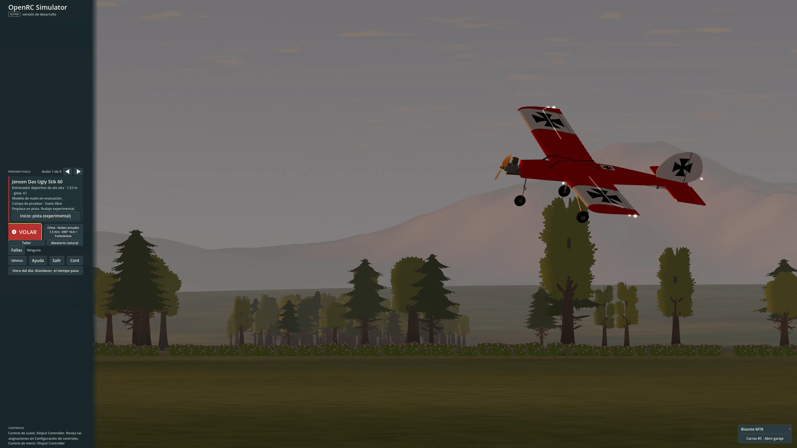
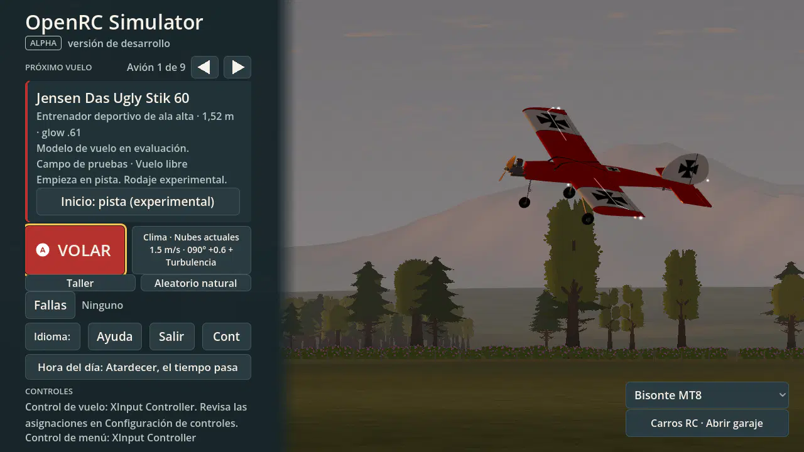
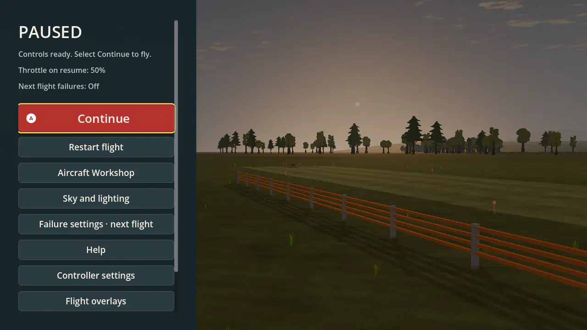
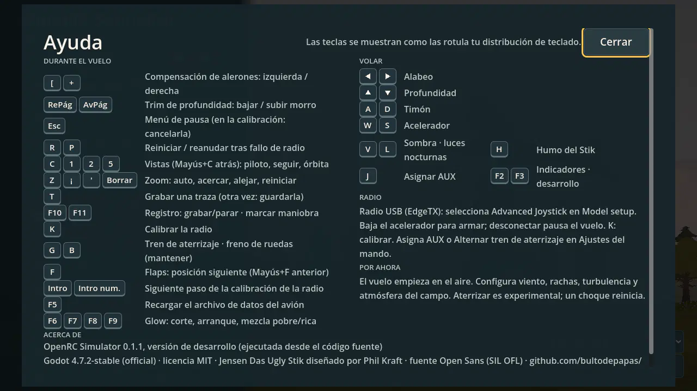

# UI-20-R1 — native menu audit and visual references

**2026-10-15 · Windows · EN/ES · 720p–4K.** Owner: product shell. This is dated evidence for [redesign revision 3](../../../MENU-REDESIGN-PLAN.md), which owns the proposed phases and acceptance gates. No runtime interface, physics, aircraft data or player preferences were edited.

## Result

The interface has a useful foundation: a real aircraft/field background, a distinct primary action, visible amber focus, reusable screen lifecycle and localized controls. Its main limitation is **fixed physical-pixel sizing**. Larger windows reveal more scenery while the controls remain small. Growth in features has also crowded Home and lengthened Pause. More transparency alone would not fix either problem.

The recommended order is scaling/reflow → shared visual system → Settings → Home organization → compact Pause/dense pages → motion → complete qualification. Use the existing game scene, free fonts/icons and controller glyphs; no new artwork is needed for this redesign.

## Capture conditions and reproducibility

| Item | Recorded value |
| --- | --- |
| Source commit | `32ed17e137b3852e9aa72c221d322c52080c3fd6`; dirty P-51 track changes existed before the audit and were preserved |
| Engine | `4.7.2.stable.official.ed1daf0bf` |
| Runtime | Native Windows, OpenGL 3.3 / Compatibility, NVIDIA GeForce RTX 3090, driver 610.88 |
| Monitor | 3840×2160; Godot reported 144 DPI, screen scale 1.0, content scale 1.0 |
| Capture | Borderless window at 0,0; native viewport image, lossless WebP; no OS resolution changes |
| Preferences | Fresh isolated files per size/language under the requested output directory; real interactive route with default Stik/runway/evening conditions |
| Input context | Existing XInput Controller was detected and automatically selected; profile stores were isolated. No physical stick/button qualification |
| Scene timing | Home/menus rendered live; flight held by the actual Pause stack. These are layout observations, not pixel-identical/golden-flight fixtures |
| Audio | Dummy driver; no sound-quality or paused-audio acceptance claim |

[Source hashes](sources.json) identify 1,006 tracked source/config/data files and the worktree state, sampled after the capture run. [Summary](summary.json) contains capture metadata and the 50 flow records. [geometry.json.gz](geometry.json.gz) retains control rectangles, font sizes, text-width candidates and focus paths. [Gallery](GALLERY.md) links every full-resolution image. [audit.log](audit.log) records the successful run; no engine/script errors were logged. The existing aircraft inertia warning and controller failsafe messages remain visible in that log.

Parallel aircraft/physics work continued while this report was written. Final verification found changes since the source snapshot in the P-51 model/data, two aircraft schemas, `aero.gd` and `aircraft_data.gd`; no captured UI source changed. [Verification](verification.json) records both hashes for those six paths. They were preserved, not reverted or incorporated into this audit. The captures describe the observed running application, not acceptance of the subsequently changed physics tree or an exact-replay source fixture.

Run from the repository root, using a fresh output directory and the pinned native engine:

```powershell
& '.tools/Godot_v4.7.2-stable_win64_console.exe' --headless --path app --check-only --script "$PWD/docs/research/menu-investigations/UI-20-R1/audit.gd"
& '.tools/Godot_v4.7.2-stable_win64_console.exe' --path app --borderless --position 0,0 --rendering-driver opengl3 --audio-driver Dummy --script "$PWD/docs/research/menu-investigations/UI-20-R1/audit.gd" -- "--out=$PWD/tmp/menu-audit-new"
& '.tools/Godot_v4.7.2-stable_win64_console.exe' --headless --path app --audio-driver Dummy --script res://tests/test_ui_home_layout.gd
```

The [probe](audit.gd) reuses production routes and `tests/ui_driver.gd`; it lives outside `app/`. It opens screens through their real application methods and injects press/release keyboard events for cancellation. It never saves edited controller/Workshop/weather drafts. Screenshot creation alone is not an interaction test.

A preliminary ordinary decorated-window capture requested 3840×2160 but returned **3840×2130**. It was excluded from the accepted matrix. Borderless capture produced exact 3840×2160 images. An initial probe version attempted Esc after focus loss had already opened Pause, thereby resuming it; the final probe explicitly opens Pause before observation. The failed exploratory run is not counted as a product failure or passing evidence.

## Coverage

| Resolution | EN | ES | Captured states |
| --- | --- | --- | --- |
| 1280×720 | 13 | 13 | Home/top and scroll, Help, Controls/Devices, failures, Natural Random, Workshop, weather wind/turbulence/atmosphere, Pause, Sky/lighting, overlays |
| 1920×1080 | 12 | 12 | Same, excluding extra Home scroll |
| 2560×1440 | 2 | 2 | Home and Pause |
| 3840×2160 | 12 | 12 | Same screens as 1080p, native 4K |
| Total | 39 | 39 | **78 captures** |

All **50 sampled flow records** have true results: six Home child-screen Esc/focus-return checks at each dense-screen case, Pause/session-tick hold checks at all eight size/locale cases, and nested Sky/Overlays return-to-Pause/tick-hold checks at six cases. Routes open by application method; only the cancellation steps use injected key events. This does not prove every control, draft transaction or physical gamepad path.

The existing `test_ui_home_layout.gd` passed: all current catalog aircraft, both languages, reference/default profiles and 720p/1080p. It reported a maximum intentional scroll extent of **164 px** for the Spanish helicopter/default case. [Full test output](home-layout.log). The test's pass demonstrates why rectangle/scroll checks must be supplemented with text-fit and native-scale review.

A separate live 4K inspection using Windows mouse automation opened Help and its Close button successfully, restoring focus to Help. An injected Escape did not visibly dismiss Help in that manual session; the cause was not isolated, so native keyboard acceptance remains open despite passing event-driver checks. The Fly click reached flight initialization in the native log, but the subsequent observation was interrupted when the user stopped Computer Use with physical Escape. No further Windows UI actions were issued. Do not count this interrupted session as an end-to-end pass.

## Measured and visual findings

### F1 — scale is the first blocker (P0)

Home's sidebar is **440 px** at all four sizes: 34.4% of width at 720p, 22.9% at 1080p, 17.2% at 1440p and 11.5% at 4K. Its utility font sizes stay 16/19; Fly stays nominally 26. Pause's Continue remains 340×58 px. Desktop DPI awareness does not supply automatic game UI scaling here.



At 4K, large flexible spacers separate the brand, aircraft setup and input status. This is wasted **composition space**, not a need for more information. Fix the coordinate/scale policy and anchor related content as a group.

### F2 — labels lose meaning at every resolution (P0)

English shows `Languag` and `Cont`; Spanish shows `Idioma:` without the selected language and `Cont`. The four-button utility row always stays inside the same 360 px content width. In Spanish, Language needs approximately **123 px of text** but has **60 px available** after style padding; Controls needs **89 px** and has **50 px**. Measurements identify candidates; the screenshots confirm visible loss. The same controls are clipped at 4K.



Use explicit language/value and full Controls text. Move/reflow the utility row. Making the font smaller or relying on a tooltip would preserve geometry while weakening comprehension.

### F3 — pause has grown beyond its hierarchy (P1)

The captured Pause offers Continue, Restart, Workshop, Sky/lighting, next-flight failure settings, Help, controller settings, overlays, End flight and Quit. At 720p, End occupies y=691…735 and Quit y=747…791 while the inner scroll area ends above them. They are intentionally scrollable, not proven unreachable, but cannot be discovered from the initial frame. Both languages show the same issue.



Keep Resume/Restart/Return distinct, group Session options and Settings, retain current readiness/throttle warnings and leave an obvious exit affordance. A shorter initial pause is more useful than simply squeezing all ten labels.

### F4 — Home mixes destinations and settings (P1)

Fly shares a row with a multi-line weather summary. Workshop and Natural Random share a row despite being different kinds of action. Failure configuration then adds another row. The garage selector/action is detached in the opposite corner and stays visible behind Natural Random, although the lower screen is inactive. The result has several competing attention zones and weak grouping.

Recommended structure: one activity, one next-session summary, one primary launch action, concise settings/help navigation and optional practice/tool destinations. Keep experimental status close to the selected model; full build metadata can move to About.

### F5 — dense screens need shared structure, not just a theme (P1)

| Screen | Observed strength | Concern / next proof |
| --- | --- | --- |
| Controls | Large labelled tabs, explicit Save/Cancel, clear flight/menu device distinction | At 4K, fixed-size central panel becomes small; only Devices was captured. Profile/Axes/AUX/Buttons, calibration/remap/error states need full review |
| Weather | Pinned Cancel/Apply and scrollable body | Default black tabs/numeric fields clash with the shell. Long technical labels consume slider space; Spanish Turbulence seed sits close to the scroll/footer boundary. Test focus on the final field, not only tab entry |
| Sky/lighting | Scoped explanation and primary Apply | Similar environment settings have a different entry point in Pause; default page has substantial empty space and small controls at 4K. Advanced/custom/night/cloud states untested here |
| Workshop | Preview plus configuration, pinned test-flight action | Heavy panel nesting; small preview at 720p; detail competes with core edits. Scroll is useful but must retain trial/save context. Do not alter AE transactions |
| Failures | Title clearly says next flight; explanatory scope and primary Apply | Dense paragraphs, mixed widget styling and secondary availability action. Detail page/error states need coverage |
| Natural Random | Clear scenario summary and single Fly | Very large blank vertical separation at 1080p/4K; lower Home garage remains visible. Keep the briefing/action together |
| Overlays | Actual live preview with clear Done action | Surrounding panels compete with the central editor at 720p. Existing transparency is a useful local reference; shared scaling must include these HUD surfaces |

[Spanish Turbulence](captures/es-720-weather-turbulence.webp), [Workshop](captures/es-720-workshop.webp), [overlays](captures/es-720-overlays.webp), [4K Controls](captures/en-2160-controls.webp).

### F6 — Help needs content correction and task grouping (P1)

Spanish Help is a dense two-column table at 720p, with a long About/license line at the bottom. “The flight starts in the air” conflicts with the default runway selection. Split first-flight, keyboard, controller/radio, recovery and About content; keep controls capability-aware and sourced from the existing shared reference. Short copy must retain the experiment/availability limits.



### F7 — material and consistency are the aesthetic opportunity (P2)

Current palette and amber focus are coherent starting points. The Sidebar uses alpha 0.97 and an edge fade; dense reading surfaces are largely opaque. Default tabs/checks/sliders and many equal-weight bordered buttons weaken the intended game identity. Use stronger type hierarchy, quiet dividers, fewer boxes, a controlled translucent scrim and restrained transitions. Transparency/blur should be measured against bright and dark backgrounds before adoption; the audit did not measure a new material or effect cost.

## External visual references

Research checked on **2026-10-15**. Images below were visually inspected. They remain external links; commercial screenshots were not added as project assets. Free-to-view does not mean licensed for shipping.

| Reference / date | Image and primary context | Visual reading for OpenRC |
| --- | --- | --- |
| Cyberpunk 2077, released 2020; gallery capture date unspecified | [Pause image](https://interfaceingame.com/wp-content/uploads/cyberpunk-2077/cyberpunk-2077-pause-500x281.png), [main menu image](https://interfaceingame.com/wp-content/uploads/cyberpunk-2077/cyberpunk-2077-main-menu-500x281.png), [gallery](https://interfaceingame.com/games/cyberpunk-2077/); [official accessibility update, 2023-12-01](https://www.cyberpunk.net/en/news/49591/update-2-1-accessibility-features) | A compact lateral list, scene depth, strong brand and bottom prompts. The inspected thumbnail has small low-salience red labels: borrow atmosphere/hierarchy, not its text size. Official options for larger text/HUD and background opacity support configurability |
| Microsoft Flight Simulator 2024, released 2024-11-19; inspected launch-period menu | [Full menu image](https://www.helisimmer.com/media/22734/msfs-2024-07.jpg), [article](https://www.helisimmer.com/articles/initial-impressions-msfs-2024-not-impressed), [official release announcement](https://www.flightsimulator.com/microsoft-flight-simulator-2024-release-date-announcement/); [2026-01-12 review/menu](https://mgronline.com/game/detail/9690000003361) | Globe/world dominates; illustrated activity groups explain destinations. OpenRC can retain an aircraft/field hero and clearer activities without importing six large competing tiles or storefront density |
| Forza Horizon 6, 2026 | [Menu image](https://storage.ghost.io/c/b9/32/b9320fa4-9d41-450c-82d4-f517eadd2af7/content/images/2026/05/image-2668954224-1.png), [2026-06-03 accessibility review](https://caniplaythat.com/2026/06/03/forza-horizon-6-accessibility-review/), [official 2026-05-04 features](https://forza.net/news/forza-horizon-6-radio) | Vehicle context, large destination text and unmistakable selection outline. The inspected tutorial image includes an editorial red arrow; it is not game UI. Avoid copying its bright tile mosaic and notification density |
| Gran Turismo 7, manual page undated | [Pause image](https://www.gran-turismo.com/images/c/i1FSTm5vMIdzsz.jpg), [official pause manual](https://www.gran-turismo.com/us/gt7/manual/race/05) | Four clear actions, retained race context, restrained dimming. Adapt the compact hierarchy; permit vertical wrapping in Spanish/large-text modes |

MSFS 2024 is the current product reference found in this research; the screenshots above are not asserted to depict its October 2026 patch UI. A searched Sim Update 7 forum page was not consistently fetchable, so no exact latest-patch claim is needed for this design decision. Older screenshots are explicitly dated rather than relabelled as 2026 examples.

### Guidance supporting the proposed gates

- [XAG 101: text](https://learn.microsoft.com/en-us/xbox/accessibility/xbox-accessibility-guidelines/101), updated 2026-03-04: distinguish PC minima (18/36 px at 1080p/4K) from console (26/52); allow 200% resizing and measure actual letter height. The plan deliberately selects distance-friendly targets. Its 720p/1440p values are interpolated project targets, not quoted requirements.
- [XAG 102: contrast](https://learn.microsoft.com/en-us/xbox/accessibility/xbox-accessibility-guidelines/102): test text/controls against their backgrounds and offer solid or adjustable-opacity reading surfaces. This supports controlled transparency, not transparent text over arbitrary scenery.
- [XAG 112: navigation](https://learn.microsoft.com/en-us/xbox/accessibility/xbox-accessibility-guidelines/112), [XAG 113: focus](https://learn.microsoft.com/en-us/xbox/accessibility/xbox-accessibility-guidelines/113): predictable navigation and visible location underpin keyboard/controller review.
- [XAG 117: visual distractions](https://learn.microsoft.com/en-us/xbox/accessibility/xbox-accessibility-guidelines/117): provide control over unnecessary motion. Motion/blur are optional enhancements after readable static screens.
- [Godot multiple resolutions](https://docs.godotengine.org/en/stable/tutorials/rendering/multiple_resolutions.html): use an explicit scale policy for high-DPI game UI. Stable documentation can change; the proposed `canvas_items`/`expand` configuration must be verified on the repository's pinned engine.

The observed pattern is scene-led composition, clear input focus and configurable readability across these specific products. It is a design synthesis, not a statistical claim about all 2026 games.

## What remains unverified

No redesigned UI has been implemented or accepted. No OS DPI changes, ultrawide/16:10, accessibility 150/200%, screen reader, physical controller journey, other-platform/export, performance or audio qualification occurred here. The dense-screen matrix covers default pages and three weather tabs, not every tab/error/popup. The normal interactive flight used Stik; helicopter/garage/crash/trial-return interfaces need their own visual cases. The existing layout test covers other catalog Home geometry, not those live activities.

Use the [plan's matrix and phase gates](../../../MENU-REDESIGN-PLAN.md#10-acceptance-and-completion) to close these gaps. Preserve the distinction between observed defects, proposed design values and pending validation.
