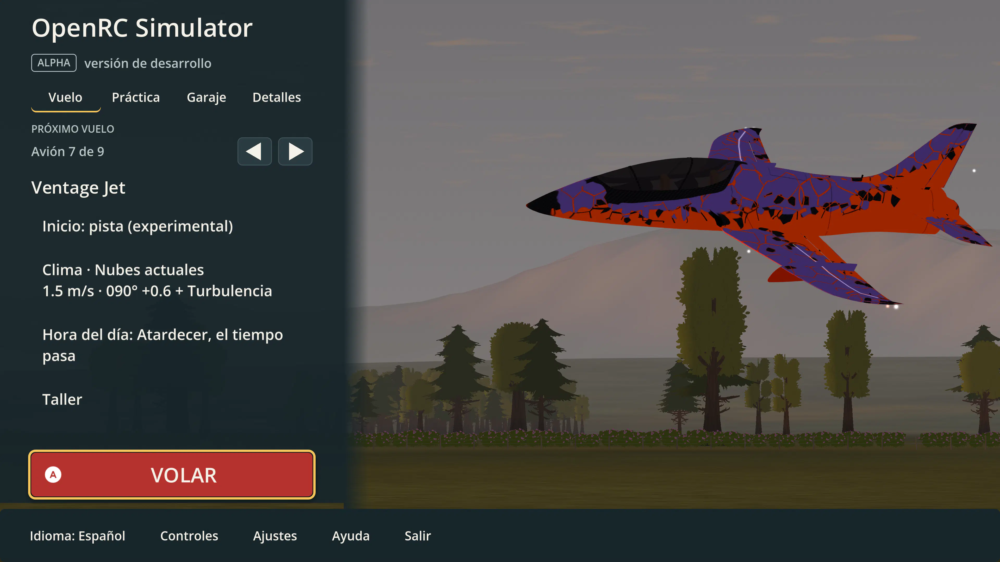

# UI-20-R2 — cinematic menu direction and implementation research

2026-10-15 · Product shell · Research and proposal; no runtime changes in this revision.

The owner rejected the oversized Home/sidebar and Settings controls, including fullscreen 4K. The later direction asks for a stronger relationship between the interface, aircraft, runway and club scenery. The authoritative delivery plan is [MENU-REDESIGN-PLAN](../../../MENU-REDESIGN-PLAN.md). This report records the evidence and source selection behind it.

## What the current evidence actually shows

This is an existing application capture, **not a mockup of the proposed design**. Its [capture manifest](../UI-22-26-R1/home-refinement/audit.json) records 3840×2160 fullscreen, Compatibility and the target Windows GPU. The sectioning repair removes default Flight scrolling, but the visual composition still has problems:

- The 440-unit sidebar consumes about 34% of a 1280-unit canvas. At 4K it becomes approximately 1320 physical pixels; scaling preserves the oversized proportion.
- A full-width bottom panel adds another strong surface. The aircraft is large, but runway and buildings are not legible features of the composition.
- The fixed airborne pose reads as a floating product cutout. In this sunset capture, the canopy and fuselage are too dark to show much material detail.
- Long weather/time phrases compete with the aircraft identity. The red Fly block and amber focus frame dominate the scene.
- Passing navigation/layout tests establishes behavior; it does not establish an attractive composition. The owner's rejection remains the visual acceptance signal.

Read directly in current source: [home_scene.gd](../../../../app/ui/home_scene.gd) uses a **12° vertical FOV**, a fixed low-pass pose and a fixed shader clock. [ui_scale.gd](../../../../app/ui/ui_scale.gd) uses a 1280×720 base with 1×/1.5×/2×/3× scaling at 720p/1080p/1440p/4K. [project.godot](../../../../app/project.godot) selects Compatibility and limits the reflection atlas to two probes. The code graph was useful for discovery but returned stale source ranges; current files were checked before deriving these findings.

The field is not empty. [SC-03 postcards](../../scenery-implementation/SC-03/README.md) show the pavilion, shelters, parked cars and runway. [postcards.gd](../../../../app/scenery/postcards.gd) already contains club/pits/pavilion views with vertical FOVs of 38°, 42° and 46°. These are starting points for camera studies, not ready-made aircraft/menu compositions. The postcard captures are historical and do not establish current close-up material quality.

## Reference interpretation

The supplied concept references are art-direction inputs, not tested game screens. The airfield direction discussed around references 7–8 is the preferred basis: grounded aircraft, diagonal runway, recognizable buildings, a clear sky/land hierarchy and limited translucent navigation. The wider arrangement discussed around reference 6 can inform use of horizontal space, but its supporting modules should be reduced. The neon/fantasy alternatives inform contrast and depth rather than the literal RC setting. This report does not assert a commercial origin or implementation feasibility for those concept images.

Three commercial screens were separately downloaded to ignored scratch storage and visually inspected. They remain external references; their pixels, logos and layouts are not bundled in the application.

| Inspected reference | Observed visual pattern | Application to OpenRC |
| --- | --- | --- |
| [Cyberpunk 2077: Phantom Liberty main menu](https://www.notebookcheck.biz/fileadmin/Notebooks/Sonstiges/Games/PhantomLiberty/Settings__1_.jpg), version 2.01 visible | Strong brand, short left list, one focused row, large quiet area on the right; technical ornament around the perimeter | Use deliberate alignment, a recognizable wordmark and one clear selected state. Do not copy small red text, decorative data or the game's branding. |
| [Forza Motorsport garage menu](https://images.squarespace-cdn.com/content/v1/59a2574903596e3462d0bd19/a2591e31-92a8-4856-94ed-6915dfb4186f/Forza%2BMotorsport-2023_10_23-13_55_58.jpeg), from [Analog Stick Gaming's October 2023 review](https://www.analogstickgaming.com/game-reviews/2023/10/30/forza-motorsport-2023) | Grounded vehicle dominates a coherent space; translucent narrow navigation; material highlights and shadows convey depth | The closest structural reference. Put the RC aircraft in a believable club environment and reserve negative space for navigation. A dry RC apron does not need a mirror floor. |
| [MSFS 2024 aircraft selector](https://www.apollomaniacs.com/flight/msfs2024_worldmap_003_en.png), from [the illustrated Free Flight guide](https://www.apollomaniacs.com/flight_msfs_init_firstflight_freeflight2024_en.htm) | Recognizable thumbnails, a selected aircraft's data at left, filter categories and persistent input prompts | Use real model thumbnails and separate selection from detail. OpenRC's small catalog does not need marketplace categories or horizontal page scrolling. |

The [official MSFS 2024 page](https://www.flightsimulator.com/microsoft-flight-simulator-2024/) was checked for current product context. Historical commercial captures do not prove what every 2026 build looks like. The direction is a design synthesis assessed in October 2026, not a claim that a universal “2026 trend” requires glass, neon or animated backgrounds. The earlier [UI-20-R1 references](../UI-20-R1/README.md#external-visual-references) remain useful, including GT7's concise pause structure.

## Godot feasibility, checked against 4.7 documentation

| Capability | Finding and implication |
| --- | --- |
| UI | Keep native Controls, Containers and Theme resources. The existing Screen/ScreenStack own input, focus and session holds; visual restyling does not justify replacing those contracts. [Multiple-resolution guidance](https://docs.godotengine.org/en/4.7/tutorials/rendering/multiple_resolutions.html). |
| Framing | Camera3D exposes FOV/aspect controls and world-to-screen projection. Use projected aircraft bounds to fit the free image area across aspect ratios. Camera position, angle and lens must be adjusted together. [Camera3D](https://docs.godotengine.org/en/4.7/classes/class_camera3d.html). |
| Baseline renderer | The 4.7 feature table lists Compatibility support for reflection probes, fog, tonemapping, SSAO and glow. It excludes SSR, volumetric fog, depth-of-field blur and CompositorEffects. These are documented capabilities, not measurements of this project or a promise of identical results across renderers. [Renderer comparison](https://docs.godotengine.org/en/4.7/tutorials/rendering/renderers.html). |
| Reflections | Prefer a bounded, infrequently updated probe where it improves aircraft highlights. Account for the existing lake and two-slot atlas before adding another probe. [Reflection-probe guidance](https://docs.godotengine.org/en/4.7/tutorials/3d/global_illumination/reflection_probes.html). |
| Glass | A CanvasItem screen-reading shader can blur the scene behind a panel. The first screen read copies the back buffer; overlapping readers need intentional ordering, and region reads must remain inside the copied area. One shared backdrop pass is the starting experiment. [Screen-reading shaders](https://docs.godotengine.org/en/4.7/tutorials/shaders/screen-reading_shaders.html). |
| Fallback | Opaque panels and reduced motion must retain the same hierarchy, focus and content. Blur is optional; transparent aircraft canopies and glass panels need separate render-order checks. |

Do not globally switch the renderer as a menu styling operation. A Forward+ comparison, if pursued, is an isolated visual/performance experiment coordinated with the world/performance owners. Flight materials, clouds, projected shadows, sky, water and exports need their own regression checks.

## Free resources and GitHub candidates

Availability and licenses were reviewed on 2026-10-15. No new package was installed. Before implementation, pin the exact release/commit, record a SHA-256, retain the license/attribution and run the candidate on the pinned engine. A README's compatibility statement is not native Windows qualification.

| Candidate / primary source | License / evidence | Decision for this project |
| --- | --- | --- |
| [Godot native UI and official demos](https://github.com/godotengine/godot-demo-projects) | Official source examples; retain relevant license notices if copying | Preferred foundation together with the existing shell. Reference individual patterns, not a second navigation system. |
| [Maaack's Menus Template](https://github.com/maaack/Godot-Menus-Template) | MIT; README advertises Godot 4.7, 4.4+ compatibility, menus/options/pause and scene loading | Useful comparison for options, focus and input prompts. Do not import its whole scene loader/settings/input ownership over OpenRC's existing contracts. |
| [Crystal Bit game template](https://github.com/crystal-bit/godot-game-template) | Inspect the selected tag and notices before any reuse | Secondary architectural reference. No demonstrated need to replace this application's foundation. |
| [Phantom Camera](https://github.com/ramokz/phantom-camera) | MIT; documents Camera3D framing, look-at, priorities and transitions | Optional if several authored shots make native Camera3D/Tween cumbersome. A two-shot prototype should first use the existing camera. No flight-camera migration. |
| [Kenney Input Prompts](https://kenney.nl/assets/input-prompts) | CC0 on the asset page | Reuse the already integrated prompts; download only missing variants. Pair glyphs with translated actions. |
| [Lucide](https://lucide.dev/license), [source](https://github.com/lucide-icons/lucide) | ISC, with upstream notices described in the license | Small consistent SVG subset for settings/back/weather/info. Native Godot SVG import; no web/React dependency. Keep labels. |
| [Atkinson Hyperlegible Next](https://github.com/googlefonts/atkinson-hyperlegible-next), [Braille Institute](https://www.brailleinstitute.org/freefont/) | SIL Open Font License in the font source | Compare 400/600/700 against the current font in real EN/ES screenshots. Use one family if it meets both identity and reading goals; no unnecessary font dependency. |
| [Poly Haven](https://polyhaven.com/license) | Assets are CC0; website/API terms are separate | Candidate for a restrained outdoor HDRI and asphalt/concrete/paint/metal PBR maps. Select assets after the camera study; preserve the real field's light/time meaning. |
| [ambientCG](https://docs.ambientcg.com/license/) | Assets offered under CC0 | Alternative for gravel, worn concrete, asphalt and wood. Prefer a small matching material set over many unrelated packs. |
| Existing [scenery provenance](../../../../assets/scenery/PROVENANCE.json) | Per-source records already live with the assets | First choice for buildings, cars, benches, vegetation and shelters. Repair one close-up asset through its source pipeline only if the shot demonstrates a deficiency. |

A downloadable “glass menu” does not solve framing, text hierarchy or oversized proportions. Prefer the documented screen-reading approach; do not add an unverified blur addon merely for its screenshot. Never derive license permission from a GitHub star count, a search thumbnail or the word “free.”

## Evidence required next

The next deliverable is a native visual slice, not another collection of themed buttons: the same aircraft shown in three camera/scene candidates at 1080p and fullscreen 4K, then the selected scene with a narrow Home overlay. Capture the user-reported jet plus a conventional trainer and helicopter; include runway/pavilion visibility and aircraft-ground contact.

Assess the scene without UI first, then the full composition at actual display size. Compare default text and EN/ES. Keep the [prior functional evidence](../UI-22-26-R1/README.md) as regression evidence, not aesthetic approval of the new direction. No new screenshot, performance result or implementation completion is claimed by this planning report.
