# UI-40 — Auditoría de experiencia de menús y plan de mejora

2026-11-26 · fuente `main` en `00382efdd`, con cambios locales sin confirmar de otra sesión en el núcleo nativo (ver §2). Auditoría de diseño de juego hecha como jugador: menú principal, submenús, Taller, Ajustes, Controles, Ayuda, Condiciones, skins, vuelo, Pausa y accidente. Revisa lo que sigue abierto de [UI-30](../UI-30/README.md) y añade el análisis de flujos, el orden, la facilidad de encontrar cada opción, los textos de ayuda y la coherencia con el estilo de cristal verde radiactivo. El [plan activo de menús](../../../plans/menu-redesign.md#11-ui-30-audit-repairs) enlaza los pasos UI-40 de [§9](#9-plan-de-mejora). La especificación del rediseño (menú principal, botón principal, submenús, opciones y textos de ayuda) está en [redesign.md](redesign.md).

Las etiquetas de la interfaz se citan en inglés, que es el idioma fuente, con el español entre paréntesis cuando ayuda. Las referencias de código son relativas a `app/`.

## 1. Veredicto

La base es sólida: escala, pila de pantallas, congelación en pausa y botones primarios de cristal verde funcionan. Desde UI-30 se arreglaron bien varias cosas: **Change aircraft** está en el primer nivel de la Pausa, la Pausa muestra avión y campo, R reinicia y vuelve a volar al instante después de un choque, Conditions abre en el preset correcto y Natural Random muestra el avión sorteado.

Lo que más afecta hoy al jugador:

1. **La Pausa no contesta "qué pasó y cómo sigo".** Oculta todos los datos del vuelo, muestra un diagnóstico interno de física con una ruta de archivo, mezcla en *Session options* cosas de este vuelo, del próximo vuelo y de la aplicación, y al abrir ese grupo aparece una barra de desplazamiento a 1080p. No se puede cambiar el viento ni la skin, ni relanzar en el aire.
2. **Después de un choque, el foco va a "Inspect wreck", no a reiniciar.** "Restart flight" es secundario, no muestra la tecla R y la tarjeta no ofrece cambiar de avión ni volver al inicio.
3. **La skin cambia de sitio según la página** (abajo a la derecha en Flight, arriba del riel en Vehicles, oculta en Practice), no existe en la Pausa ni en el Taller, y el selector tapa el avión y no previsualiza: se elige a ciegas.
4. **Texto de desarrollo visible al jugador**: notas de validación en el catálogo ("R02 yaw damping acceptance remain pending"), diagnóstico del SDK de Reflex en Gráficos, la ruta `app/sim/native/stage_config.gd` en la Pausa (sin traducir en español), "Phoenix", "#RRGGBBAA".
5. **El cristal verde no es un sistema único todavía**: cinco estilos de pestaña, tres de casilla, una ventana gris nativa de Godot (Import scenery), tres maneras de cerrar y guardar, y botones primarios usados para acciones secundarias.
6. **Opciones en lugares inesperados**: idioma en dos sitios, Controles en tres, unidades solo dentro de *Flight overlays*, "RC circuit" en Pantalla, efectos de lente bajo "Lighting", Import scenery en mitad de la preparación del vuelo.
7. **Faltan textos de ayuda breves** justo donde hay jerga: ráfagas, reconstrucción 3D, "Constant wing loading", "More travel", parámetros de humo. Ayuda es un muro de teclas.
8. **El menú principal mezcla navegación y formulario.** El riel izquierdo junta pestañas, un editor, el formulario de preparación y el catálogo, y no escala: caben 2 de 13 vehículos, y con 50 aviones el catálogo mediría unas diez alturas de riel. El Creador ya puede importar los 214 modelos del corpus de ClearView ([§5.13](#513-segunda-pasada-menú-principal-catálogo-radio-y-opciones-avanzadas)).
9. **La radio, lo más usado de un simulador RC después del avión, está escondida**: un botón pequeño de utilidades en Home, dentro de un grupo plegado en la Pausa, y la calibración y el asistente ocultos hasta elegir un dispositivo.

| Área | Estado | Resumen |
| --- | --- | --- |
| Home (Flight) | Bueno | Avión al frente, FLY enfocado, resumen claro. Falta ordenar filas secundarias. |
| Catálogo (Vehicles) | Débil | 2 de 13 vehículos visibles a 1080p; estadísticas y skin empujan la lista. |
| Skins | Débil | Ubicación cambiante, selector ciego, sin acceso desde Pausa ni Taller. |
| Pausa | Regular | Identidad correcta; sin datos de vuelo, con diagnóstico técnico y grupos mezclados. |
| Recuperación | Regular | R funciona en un paso, pero no se enseña; la tarjeta de accidente prioriza inspeccionar. |
| Ajustes | Regular | Completo, pero categorías mezcladas y opciones "Unavailable" a la vista. |
| Menú principal (estructura) | Débil | Destinos en tres zonas; el riel hace de menú, de formulario y de catálogo. |
| Radio (acceso) | Débil | Funciones completas, pero escondidas en Home y en la Pausa; sin estado visible. |
| Controles (interior) | Bueno | Entrada en vivo excelente; pestañas vacías con teclado y opciones avanzadas demasiado visibles. |
| Gráficos | Regular | 19 opciones sin preset arriba; "Details +" abre fuera de la vista. |
| Ayuda | Débil | Lista plana, filas desalineadas, sin pestañas por tarea. |
| Taller y Creador | Regular | Potente; vocabulario técnico, presets ambiguos, pintura por código hex. |
| Coherencia visual | Regular | Botones primarios coherentes; pestañas, casillas, diálogos y paneles no. |

## 2. Método y alcance

- **Aplicación real.** Windows 11, Godot 4.8-beta2 oficial, ventana renderizada de 1920×1080, sin sonido, perfil aislado, manejada con el [puente de depuración](../../../../tools/debug/README.md) usando teclado y ratón. Recorrido completo en inglés; Home, Pausa, Cielo e iluminación e Indicadores también en español. Dos pasadas el mismo día: la segunda cubrió las cinco pestañas de Controles, Gráficos con "Details +", el catálogo con coche y dron, Compañeros, Trim, Estadísticas, todas las páginas del Taller y su Biblioteca, y la Pausa del vuelo de prueba. Las capturas se conservan en [captures/](captures/) como JPEG.
- **Código.** Tres revisiones delegadas de solo lectura (menús de vuelo; Taller y sistema visual; radio y controles) más lectura directa de `ui/home.gd`, `ui/pause_menu.gd`, `ui/accident_report.gd`, `ui/settings_screen.gd`, `ui/workshop.gd`, `ui/workshop_thumbnail.gd`, `ui/landscape_import.gd`, `app_state/aircraft_catalog.gd` y `input/controller_service.gd`.
- **Otros simuladores.** Una búsqueda web acotada de manuales y guías de simuladores RC y de vuelo ([§5.14](#514-comparación-con-otros-simuladores)). Se extraen convenciones, no diseños.
- **Revisión independiente.** Un crítico de solo lectura revisó el [rediseño](redesign.md) contra el código. Se integraron sus objeciones:
  - campo y viento siguen siendo selectores de un paso en Home;
  - la Pausa reutiliza solo los centros seguros a mitad de vuelo, y cambiar de avión o de campo termina el vuelo con la transacción de salida actual;
  - las filas de la Pausa tienen un destino provisional hasta que exista su centro;
  - el Hangar se construye por fases;
  - las pestañas de Controles ya entregadas no se renombran y se mantiene el botón de recuperación;
  - "Radio y controles" sustituye a "Radio y mandos";
  - se quitaron los estados y botones que dependían de datos o planes no entregados.
- **Física compatible.** El árbol tenía cambios locales en `app/sim/native/` de otro trabajo en curso, por eso la Pausa dice "Physics: compatibility…". Un build limpio con el núcleo nativo calificado diría "Physics: native". El hallazgo P-2 no depende de eso: ambos textos son diagnósticos internos.
- **No cubierto:** radios y mandos físicos (el menú por radio y la calibración se evaluaron solo en el código; la herramienta de depuración no simula una radio conectada), el vuelo de helicóptero, coche, dron y dirigible (sí su selección en Home), 720p, 1440p, 4K y texto al 150–200 %. No es una prueba de rendimiento ni una prueba con usuarios.

## 3. Mapa actual de pantallas y orden

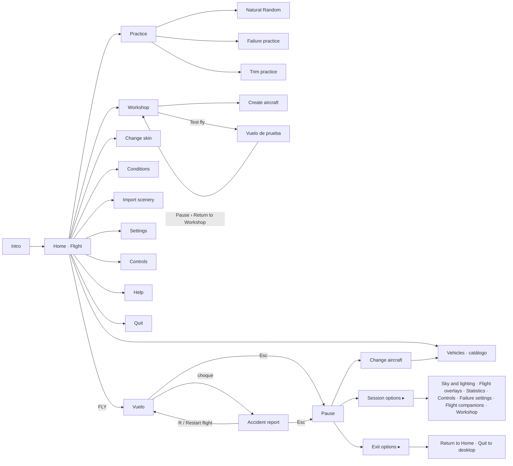

| Pantalla | Orden actual (arriba → abajo) | Código |
| --- | --- | --- |
| Home, riel | Flight · Vehicles · Practice · Workshop › | `ui/home.gd:317-332` |
| Home · Flight | NEXT FLIGHT 1/13 ◀ ▶ · tarjeta (nombre, estado, Start ‹›) · Landscape ‹› · Import scenery › · Conditions › · Time of day ‹› · Flight input · More flight details · **FLY** · Controls · Help · Quit. Cabecera: Language · Settings. Change skin abajo a la derecha | `ui/home.gd:559-564,1087-1098` |
| Home · Vehicles | Change skin · VEHICLE CATALOG · introducción · estadísticas · Aircraft statistics · 13 entradas · Next flight · **FLY** | `ui/home.gd:545-556` |
| Home · Practice | estadísticas · Statistics · Pilot total · Natural Random › · Failure practice › · Trim practice › · **FLY** | — |
| Pause | PAUSED · avión · campo · Physics… · Next flight failures · **Resume** · Restart flight · Session options ▸ · Review active alerts · Settings · Help · Change aircraft · Exit options ▸ | `ui/pause_menu.gd:128-228`; visibilidad en `app_root.gd:3696-3730` |
| Accident report | Inspect wreck (primario, enfocado) · Show damage breakdown · Restart flight · DIY estimate · Include shop labor · Purchase plan | `ui/accident_report.gd:470-523` |
| Settings | Display · Interface · Sound · Graphics · Camera · Lighting | `ui/settings_screen.gd` |
| Workshop | Appearance · Lighting · Smoke · Mechanical audio · **Flight setup** (abre por defecto) · Compare | `ui/workshop.gd:23,436-440` |

### Dónde está cada opción

| Opción | Dónde está hoy | Pasos | Dónde la busca un jugador |
| --- | --- | ---: | --- |
| Unidades (m/s, mph) | Pausa › Session options › Flight overlays › Units | 4 | Ajustes › Interfaz |
| Idioma | Cabecera de Home **y** Ajustes › Interface | 1 | Ajustes (la cabecera puede quedarse como atajo) |
| Tamaño de texto | Ajustes › Display | 2 | Ajustes › Accesibilidad |
| Reducir destellos (fotosensibilidad) | Ajustes › Lighting | 2 | Ajustes › Accesibilidad |
| Efectos de impacto y lente | Ajustes › Lighting | 2 | Ajustes › Efectos |
| Pista de coches RC ("RC circuit") | Ajustes › Display | 2 | Paisaje / campo |
| Controles | Pie de Home, enlace en Ajustes › Interface, Pausa › Session options, botón de recuperación | 1–2 | Una sola casa: Ajustes › Controles, más el atajo |
| Viento | Solo Home › Conditions | 7 desde vuelo | Pausa › Condiciones |
| Hora y cielo | Fila de Home, pestaña de Conditions, Pausa › Session options › Sky and lighting | 1–3 | Un solo nombre: Condiciones |
| Estadísticas | Vehicles (Aircraft statistics), Practice (Pilot total), Pausa › Session options | 1–2 | Una "Bitácora" |
| Skin | Solo Home (dos posiciones) | 2 | Junto al avión, también en Pausa y Taller |
| Importar escenario | Home › Flight, entre Landscape y Conditions | 1 | Dentro del selector de Paisaje |

## 4. Flujos del jugador

### 4.1 Pasos por tarea

| # | Tarea | Hoy | Objetivo |
| --- | --- | --- | --- |
| T1 | Volar el avión guardado | 1 (FLY) | 1 |
| T2 | Elegir otro avión en Home | 3 (Vehicles → entrada → FLY), o flechas en Flight | 2–3 |
| T3 | Cambiar de avión en vuelo | 4 (Esc → Change aircraft → entrada → FLY) | 3–4 |
| T4 | Cambiar la skin antes de volar | 2, sin vista previa | 2, con vista previa |
| T5 | Cambiar la skin en vuelo | Imposible sin terminar el vuelo (≈6 pasos) | 3 (Esc → Change skin → elegir) |
| T6 | Reiniciar un vuelo malo | 1 (R), no se anuncia; 2 por Pausa | 1, con la tecla visible |
| T7 | Reiniciar tras un choque | 1 (R, no se anuncia) o 2–3 con el ratón o el teclado | 1, foco en Restart |
| T8 | Saltar el despegue (relanzar en el aire) | 5 (Esc → Exit options → Return to Home → Start ‹› → FLY) | 2 (Esc → Relaunch in the air) |
| T9 | Cambiar el viento en vuelo | ≈7, termina el vuelo | 4 (Esc → viento → preset → al reiniciar), solo si se verifica que el reinicio aplica el tiempo nuevo (UI-40q) |
| T10 | Cambiar hora o cielo en vuelo | 5 (Esc → Session options → Sky and lighting → editar → Apply) | 4 |
| T11 | Cambiar unidades | 4 en vuelo; no existe en Ajustes | 2 en Ajustes |
| T12 | Salir al escritorio desde vuelo | 3 (Esc → Exit options → Quit) | 2 |
| T13 | Probar un ajuste del Taller y volver | 3 + 2 (Test fly; Esc → Return to Workshop) | Sin cambio |

### 4.2 Cuando pongo pausa, ¿qué quiero ver?

Como piloto, la pausa debe resolver siete necesidades, en este orden:

1. **Por qué está en pausa** y qué hacer: Esc, foco perdido, radio desconectado, palancas sin centrar o choque.
2. **Cómo estaba mi avión**: altura, velocidad, tiempo de vuelo, batería o combustible. Hoy el HUD desaparece ([captura](captures/pause-states.jpg)).
3. **Seguir al instante**: Resume con Esc. Esto ya funciona.
4. **Salvar el vuelo**: reiniciar en la misma salida (R), relanzar en el aire o volver a la pista.
5. **Cambiar algo sin perder la sesión**: skin, hora y cielo (ahora), viento (al reiniciar), cámara e indicadores.
6. **Cambiar de avión** en pocos pasos. Ya está en el primer nivel.
7. **Salir** a Home o al escritorio sin buscar en un grupo plegado.

Hoy se cumplen 3 y 6, y en parte 1 y 7.

## 5. Hallazgos por pantalla

Severidad: **Alta** (flujo principal confuso o largo, o regla del proyecto incumplida), **Media** (inconsistencia o paso extra con alternativa), **Baja** (pulido). [UI-30] marca un hallazgo anterior que sigue abierto.

### 5.1 Home

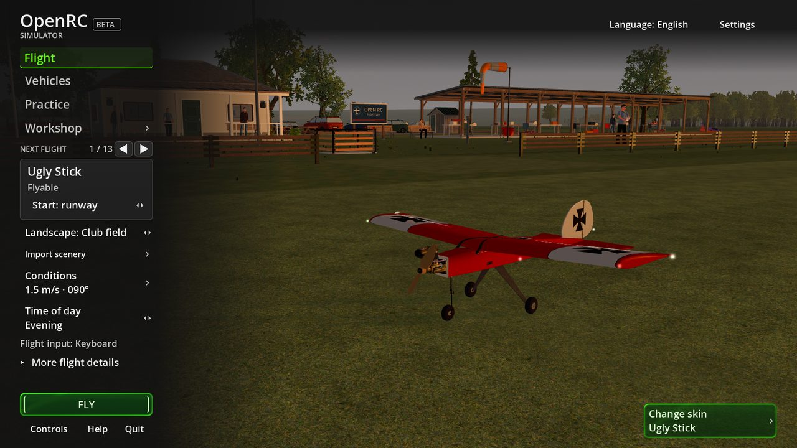

| ID | Sev | Hallazgo | Recomendación |
| --- | --- | --- | --- |
| H-1 | Alta | El catálogo muestra **2 de 13** entradas a 1080p. Las estadísticas, "Aircraft statistics" y el botón de skin ocupan la parte alta del riel ([captura](captures/home-vehicles.jpg)). Incumple la regla "todas las entradas visibles sin desplazamiento a 1080p" del plan. [UI-30 SP-1] | Lista ancha o rejilla con miniatura, nombre, clase y etiqueta de estado. Las estadísticas pasan a la Bitácora (H-4). |
| H-2 | Media | "Import scenery" está entre Landscape y Conditions, en la preparación de cada vuelo, aunque es una tarea rara que abre una ventana técnica (§5.8). | Moverlo dentro de un selector de Paisaje: "Paisaje: Campo del club ›" lista los campos instalados y termina con "Importar escenario…". |
| H-3 | Media | "Flight input: Keyboard" es texto pasivo; no lleva a Controles. | Fila accionable: "Entrada: Teclado · Configurar ›". |
| H-4 | Media | Las estadísticas están en Vehicles, en Practice y en la Pausa, cada una con otro nombre. | Una sola "Bitácora" (Logbook); en las demás pantallas, solo el resumen. |
| H-5 | Media | Practice no explica sus tres modos; solo Natural Random tiene ayuda emergente ([captura](captures/home-practice.jpg)). | Una línea de descripción bajo cada modo (§8). |
| H-6 | Baja | El riel cambia de ancho entre Flight (≈320 px) y Practice (340 px, `ui/home.gd:1081`), y el botón FLY salta. | Ancho fijo para las tres páginas. |
| H-7 | Baja | Quit está pegado a Help, con el mismo estilo, y cierra sin preguntar. [UI-30 HN-4] | Separarlo con un espacio o una línea; confirmar solo si se pierde trabajo. |
| H-8 | Baja | "More flight details" muestra una línea de resumen y "Flight companions: Off · 1": el "· 1" no se entiende. | "Compañeros de vuelo: ninguno". El número solo cuando estén activos ("2 pilotos"). |

### 5.2 Skin (pintura)

| Página | Posición hoy |
| --- | --- |
| Flight | Abajo a la derecha, junto al avión (`ui/home.gd:559-564`, F4U-20-R1) |
| Vehicles | Arriba del riel izquierdo, encima del catálogo (`ui/home.gd:1087-1098`) |
| Practice | Oculto (`ui/home.gd:1696`) |
| Pausa, Taller | No existe |

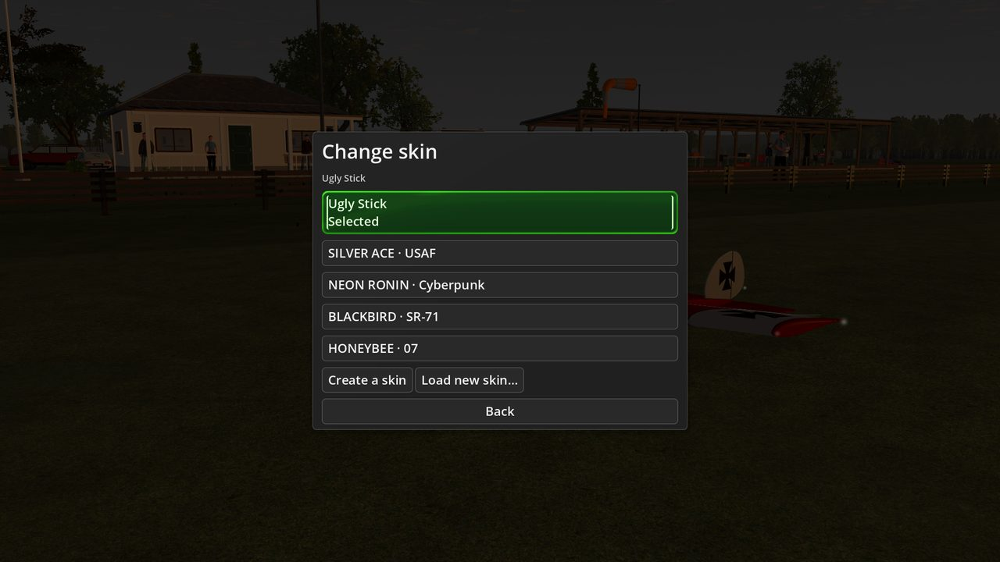

| ID | Sev | Hallazgo | Recomendación |
| --- | --- | --- | --- |
| K-1 | Alta | El control cambia de sitio y de forma al cambiar de página. El jugador tiene que volver a buscarlo. | **Un ancla fija** en todas las páginas de Home. El dueño prefiere abajo a la izquierda: proponemos la esquina inferior izquierda de la escena, junto al riel y a la altura de FLY ("lo que vuelo y cómo se ve" juntos). Ver la decisión D-1. |
| K-2 | Alta | El selector es un modal centrado que tapa el avión. Enfocar otra skin no la muestra; solo se ve después de elegir ([captura](captures/home-after-skin.jpg)). | Panel lateral derecho que deja el avión visible. Enfocar una entrada la muestra en el modelo; Enter confirma; Esc vuelve a la anterior. |
| K-3 | Media | La primera entrada se llama como el avión ("Ugly Stick · Selected") en lugar de "Original"; el resto mezcla mayúsculas ("SILVER ACE · USAF"). | "Original de fábrica" primero; nombres en un solo formato; marca de seleccionado distinta del foco. |
| K-4 | Media | No se puede cambiar la skin desde la Pausa ni desde el Taller. La página Appearance del Taller usa otro sistema (regiones y código hex) sin relación con las skins ([captura](captures/workshop-appearance.jpg)). | "Change skin" en la Pausa (D-3) y una fila "Skin base ›" en Appearance que abre el mismo selector. |

### 5.3 Taller y Creador

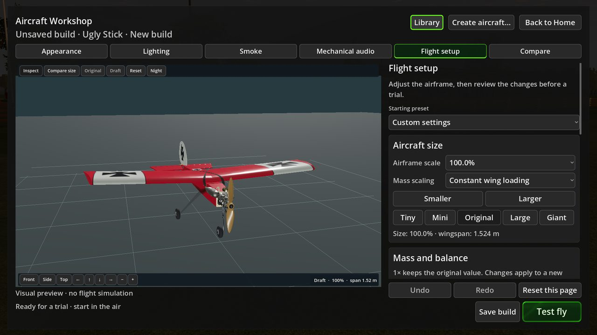

| ID | Sev | Hallazgo | Recomendación |
| --- | --- | --- | --- |
| W-1 | Media | Abre en "Flight setup", la quinta de seis pestañas. El orden no sigue la frecuencia de uso ni la lógica "cómo se ve → cómo vuela → detalles". | Orden: Apariencia · Vuelo · Luces · Humo · Sonido · Comparar. Abrir en la última pestaña usada. |
| W-2 | Media | Hay dos juegos de "Mini/Giant": el preset de arranque (`ui/workshop.gd:38-47`) y los botones de tamaño (Tiny · Mini · Original · Large · Giant). "More power" también sube los mandos un 15 %, y "More travel" cambia la masa a geométrica y la baja un 10 %; nada de eso se dice. | Separar "Tamaño" de "Carácter de vuelo" y mostrar en una línea lo que cambia cada preset (§8). |
| W-3 | Media | La pintura se edita escribiendo `#RRGGBBAA`, y el humo con `#FFFFFFFF` ([captura](captures/workshop-smoke.jpg)). | Muestras de color y un selector visual; el código hex queda como opción avanzada. |
| W-4 | Media | Los parámetros de humo (densidad, puffs/s, flotabilidad, arrastre, dispersión m²/s) y "Constant wing loading / Geometric" no tienen explicación en pantalla. | Ayudas de una línea (§8). |
| W-5 | Baja | La barra de la vista previa (Inspect, Compare size, Original, Draft, Reset, Night, Front, Side, Top) usa texto de ≈12 px. [UI-30 VC-10] | Mínimo 18 px a 1080p, o iconos con nombre accesible. |
| W-6 | Baja | Taller (pestañas arriba) y Creador (pasos a la izquierda, [captura](captures/creator.jpg)) usan dos esquemas de página. | Aceptable, porque el Creador es un asistente. Unificar la cabecera: título, subtítulo y Volver en la misma esquina. |

Lo que funciona: Undo/Redo, "Reset this page", Test fly como acción principal, la guarda de cambios sin guardar con Cancel como opción segura, y la vuelta directa al Taller desde la Pausa del vuelo de prueba.

### 5.4 Ajustes

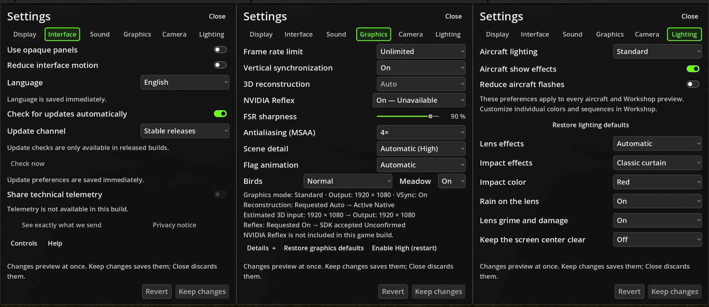

| ID | Sev | Hallazgo | Recomendación |
| --- | --- | --- | --- |
| S-1 | Alta | Gráficos muestra al jugador diagnósticos internos: "Reconstruction: Requested Auto → Active Native", "Reflex: Requested On → SDK accepted Unconfirmed", "NVIDIA Reflex is not included in this game build". El valor por defecto de Reflex es "On — Unavailable". | Ocultar las opciones no disponibles o agruparlas en "No disponible en este equipo"; el diagnóstico va dentro de "Details +". |
| S-2 | Media | Las categorías mezclan conceptos: "RC circuit" está en Display (`ui/settings_screen.gd:344-352`); Text size en Display, mientras paneles opacos y menos movimiento están en Interface; "Reduce aircraft flashes" y los efectos de impacto y lente están en "Lighting". | Reorganizar como en [redesign §10.1](redesign.md#101-categorías). |
| S-3 | Media | Hay tres reglas de guardado en la misma pantalla ([captura](captures/settings-display.jpg)): el idioma y las actualizaciones se guardan al momento, el resto con Keep/Revert, y Close descarta. [UI-30 SC-1, parcial] | Todo pasa por Keep changes; o el idioma sale del borrador con una nota clara. |
| S-4 | Media | Interface contiene enlaces a Controls y Help, además de privacidad y actualizaciones. [UI-30 SC-3] | Controles como categoría propia; Privacidad y actualizaciones aparte. |
| S-5 | Baja | Birds y Meadow comparten fila; el resto usa una fila por opción. | Una fila por opción. |
| S-6 | Baja | Cámara marca "(default)" en cada valor y muestra la tecla ("Auto zoom (Z)"). | **Patrón a copiar** en todas las categorías. |

### 5.5 Controles y menú por radio

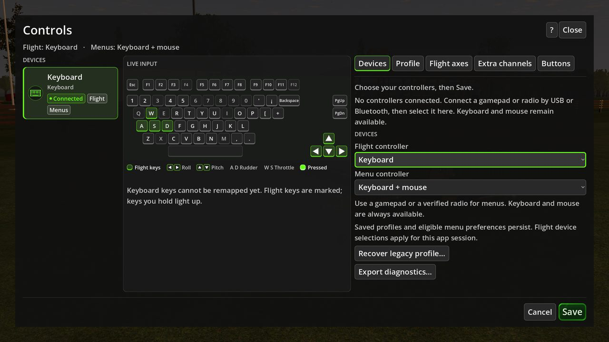

- **Bien:** teclado en vivo con teclas de vuelo marcadas, estado de conexión y separación entre mando de vuelo y mando de menús.
- **C-1 (Media):** "Recover legacy profile…" y "Export diagnostics…" se ven igual que las acciones normales en la primera pestaña. Recomendación: moverlas a un grupo "Avanzado".
- **C-2 (Media):** hay tres maneras de salir de la pantalla (? · Close arriba, Cancel · Save abajo). [UI-30 VC-1] Recomendación: el marco modal común (UI-35a).
- **Menú por radio (solo código, sin radio conectada).** `ui/radio_menu_input.gd` convierte las palancas e interruptores de una radio verificada en navegación de menú: ejes para moverse, con repetición de 0,4 s y luego 0,12 s, y botones para aceptar, volver y pausa. `ui/radio_menu_setup.gd` ("Verify radio menus") prueba esos controles sin cambiar el perfil. Resume exige centrar alabeo y profundidad si la radio de menús es la misma que la de vuelo (`app_root.gd:4968-4972`).
- **C-3 (Media, por verificar con hardware):** la verificación de menús por radio está escondida tras el desplegable "Menu controller". Durante la navegación no se ve qué interruptor es aceptar, volver o pausa. Recomendación: un paso "Usar la radio en los menús" en el asistente de configuración y una leyenda fija abajo ("SA aceptar · SB volver · SH pausa"), con el mismo patrón que las teclas.

### 5.6 Ayuda

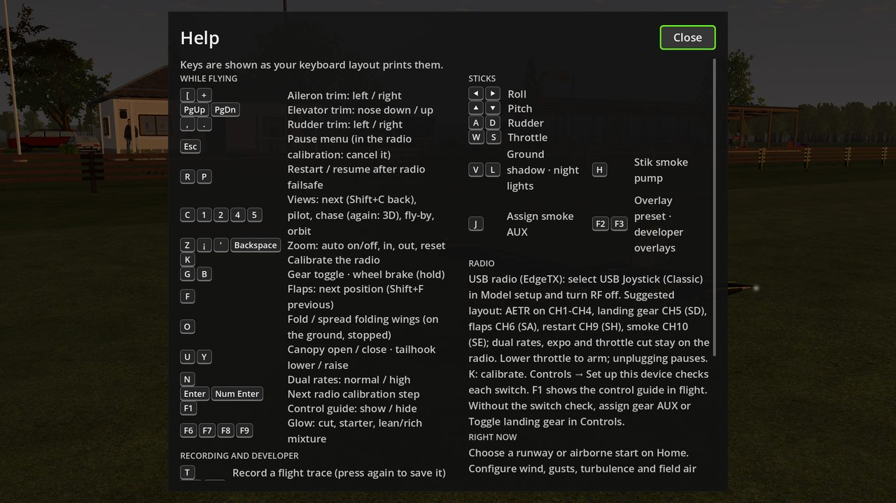

- **A-1 (Alta):** es una lista plana de ≈30 teclas en dos columnas. Las teclas no quedan alineadas con su texto cuando la descripción ocupa dos líneas. Mezcla lo esencial (volar, pausa, reiniciar) con funciones de un solo avión (humo del Stik, glow F6–F9), y el bloque "RADIO" es un párrafo denso. [UI-30 SC-4, parcial]
- **A-2 (Media):** "R / P · Restart / resume after radio failsafe" junta dos acciones distintas en una fila (`ui/controls_reference.gd:20-44`).
- Recomendación: pestañas por tarea ([redesign §11](redesign.md#11-ayuda)).

### 5.7 Condiciones, hora y cielo

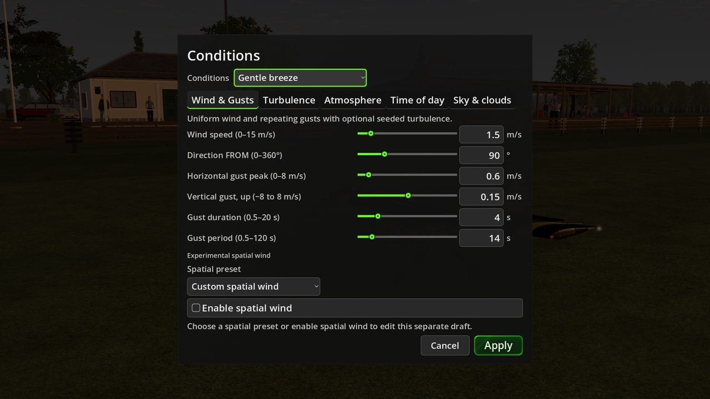

| ID | Sev | Hallazgo | Recomendación |
| --- | --- | --- | --- |
| CO-1 | Media | La hora tiene tres puertas con tres nombres: fila "Time of day" en Home, pestaña "Time of day" en Conditions y "Sky and lighting" en la Pausa ([captura](captures/sky-lighting-es.jpg)). | Un concepto, "Condiciones", con pestañas Viento · Turbulencia · Aire · Hora y cielo, igual en Home y en la Pausa. |
| CO-2 | Media | El viento no se puede cambiar en vuelo. [UI-30 PS-6] | Condiciones en la Pausa: hora y cielo se aplican ya; viento y aire "al reiniciar", y así se indica. |
| CO-3 | Media | Gust period, Vertical gust y Direction FROM no tienen ayuda; la dirección no tiene brújula. | Ayudas (§8) y una brújula pequeña que muestre de dónde viene el viento respecto a la pista. |
| CO-4 | Baja | El selector se llama "Conditions" dentro del diálogo "Conditions". La casilla nativa "Enable spatial wind" no usa los interruptores de Ajustes. | Llamarlo "Preset"; usar el interruptor común. |
| CO-5 | Baja | Cielo e iluminación es un diálogo pequeño que se desplaza por dentro y abre a mitad de su contenido. | Altura según el contenido, hasta ≈88 % de la pantalla (UI-35a). |

### 5.8 Importar escenario

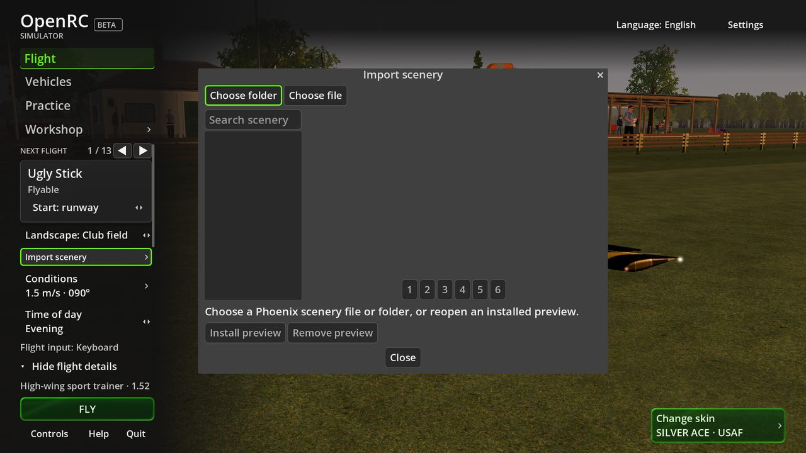

- **I-1 (Alta, coherencia):** es un `AcceptDialog` nativo de Godot (`ui/landscape_import.gd:1`) con el tema gris por defecto, título de ventana y ×, fuera de la pila de pantallas. Es la superficie más alejada del estilo cristal.
- **I-2 (Media):** los botones "1 2 3 4 5 6" no tienen etiqueta, y "Phoenix" es jerga para quien no conoce ese simulador.
- Recomendación: convertirlo en una pantalla del shell con el marco común y explicar los botones ("Vista 1…6" con su ángulo, o miniaturas). Texto propuesto: "Importar un campo de Phoenix RC (archivo o carpeta)".

### 5.9 Vuelo (HUD)

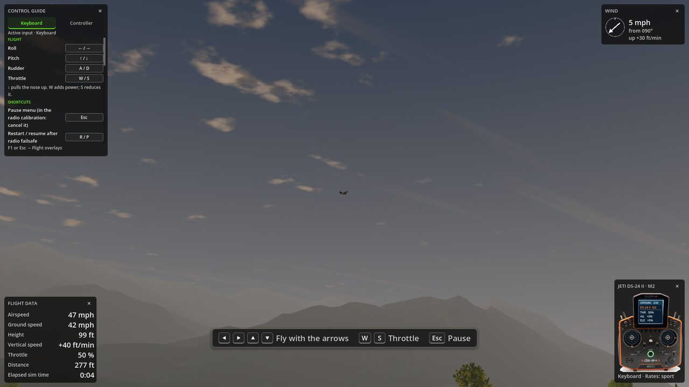

- **F-1 (Media):** en el primer vuelo aparecen cinco superficies a la vez: Control guide, Wind, Flight data, el radio JETI DS-24 y la pista inferior. El dibujo del radio aparece aunque la entrada es el teclado. [UI-30 SC-9]
- **F-2 (Media):** unidades distintas en la misma sesión: Home y Conditions en m/s; el HUD en mph y ft en inglés y en km/h en español. La opción solo existe en *Flight overlays*. [UI-30 SC-7]
- **F-3 (Baja):** el texto del Control guide mide ≈13 px, por debajo del objetivo de 18 px. [UI-30 SP-4]
- Recomendación: una sola ayuda en el primer vuelo (la pista inferior, con teclas más grandes); el dibujo del radio solo cuando la entrada es una radio; Unidades en Ajustes (UI-40f). El HUD es del equipo de indicadores; UI coordina.

### 5.10 Pausa

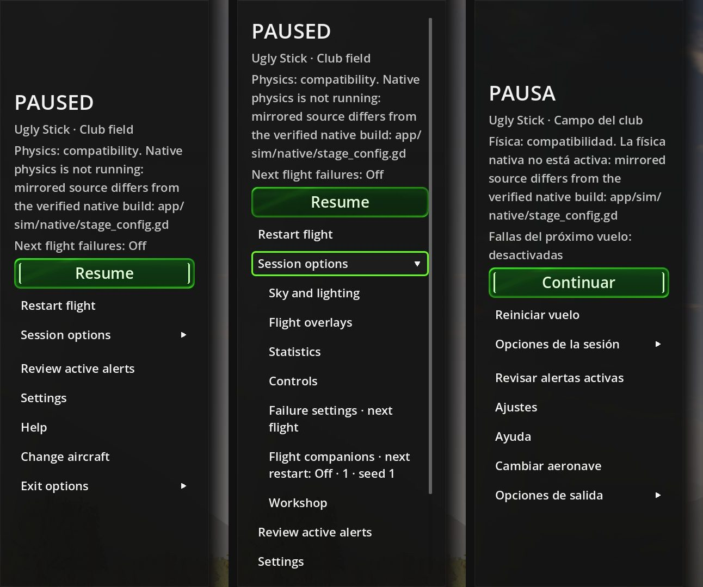

| ID | Sev | Hallazgo | Recomendación |
| --- | --- | --- | --- |
| P-1 | Alta | Al pausar desaparecen todos los paneles del vuelo. No se ve altura, velocidad, tiempo ni batería; desde la vista del piloto el avión es un punto. | Una cabecera con la foto del vuelo: tiempo, altura, velocidad, batería o combustible y el motivo de la pausa. |
| P-2 | Alta | La Pausa muestra un diagnóstico interno: "Physics: compatibility. Native physics is not running: mirrored source differs from the verified native build: app/sim/native/stage_config.gd" (`ui/pause_menu.gd:552-563`). En español la razón queda en inglés. | En builds publicados, nada; en desarrollo, una etiqueta "Física: compatibilidad ⓘ" con el detalle en la ayuda emergente o en Ayuda › Acerca de. |
| P-3 | Alta | *Session options* agrupa siete cosas de tres ámbitos: este vuelo (Sky and lighting, Flight overlays), el próximo vuelo (Failure settings · next flight, Flight companions · next restart) y la aplicación (Statistics, Controls, Workshop). Al abrirlo, la Pausa se desplaza a 1080p (captura central de arriba). [UI-30 VC-4, PS-5 reabiertos] | Filas visibles sin plegar: una sección ESTE VUELO, Ajustes y Ayuda, y las salidas ([redesign §8](redesign.md#8-pausa)). Cabe sin desplazamiento. |
| P-4 | Media | "Restart flight" no muestra R y "Resume" no muestra Esc. | Pistas de tecla a la derecha de cada fila, con el patrón de Cámara ("Auto zoom (Z)"). |
| P-5 | Media | No hay forma de relanzar en el aire ni de volver a la pista sin terminar el vuelo (T8). | "Relanzar en el aire" / "Volver a la pista": un solo paso que cambia la salida de los reinicios de esta sesión. Coordinar con el dueño de `FlightSession`, que ya reconstruye la salida elegida (MENU-PLAN, "Runway selection belongs to FlightSession"). |
| P-6 | Media | "Exit options" esconde Return to Home y Quit detrás de un desplegable; abrirlo cierra Session options. | Las dos salidas siempre visibles al final, separadas por una línea. |
| P-7 | Baja | "Review active alerts" ocupa el primer nivel siempre que el vuelo tenga indicadores, haya o no alertas (`app_root.gd:3721-3722`); en la captura no había ninguna. | Mostrarlo solo cuando haya alertas, con su número ("2 alertas ›"). |
| P-8 | Baja | "Flight companions · next restart: Off · 1 · seed 1": "seed" es jerga. | "Compañeros de vuelo: ninguno · al reiniciar". |

### 5.11 Accidente

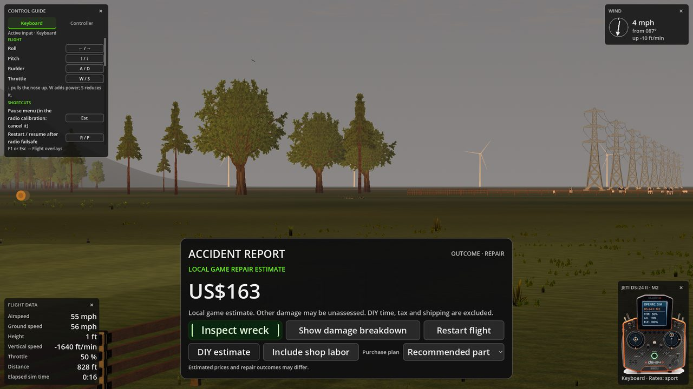

| ID | Sev | Hallazgo | Recomendación |
| --- | --- | --- | --- |
| X-1 | Alta | El foco y el estilo primario van a "Inspect wreck" (`ui/accident_report.gd:476,1370`). "Restart flight" es secundario y no dice "R". Tras un choque, lo que más se quiere es volver a volar. | Restart flight como primario, con foco y "R" visible. |
| X-2 | Media | La tarjeta no ofrece Change aircraft ni Return to Home; hay que pasar por Esc → Pausa. [UI-30 PS-9] | Fila secundaria: Cambiar avión · Volver al inicio. |
| X-3 | Media | Los controles de costes (DIY estimate, Include shop labor, Purchase plan) tienen el mismo peso que la recuperación. | Plegarlos bajo "Costo de reparación US$163 ›". |

R funciona bien: después del choque, una pulsación reinicia y el vuelo continúa sin más pasos.

### 5.12 Textos de desarrollo e idioma

| Dónde | Texto visible hoy | Problema |
| --- | --- | --- |
| Catálogo, ayuda emergente | "Full-rudder sideslip and R02 yaw damping acceptance remain pending." (`app_state/aircraft_catalog.gd:31`) | Identificador interno de un paso; nada útil para el piloto |
| Catálogo y Natural Random | "inferred O.S. MAX-55AX 2-stroke installation…", "NITRO candidate profile", "NTNU flight-identified aerodynamics", "HX-700 visual surrogate", "borrowed propeller data" | Notas de ingeniería en lugar de una frase para el piloto |
| Gráficos | "SDK accepted Unconfirmed", "Requested Auto → Active Native" | Diagnóstico |
| Pausa | Ruta `app/sim/native/stage_config.gd`; sin traducir en español | Diagnóstico |
| Creador | "STL (binary)", "GLB", "+x/-z", "Datum" | Jerga aceptable en el Creador, pero necesita ayuda (§8) |

Recomendación: separar en los datos del catálogo una nota para el piloto (`player_note`, una frase: "Experimental: física estimada, todavía no comparada con el avión real") de la nota técnica, que queda en "Detalles" y en las ayudas para desarrolladores.

### 5.13 Segunda pasada: menú principal, catálogo, radio y opciones avanzadas

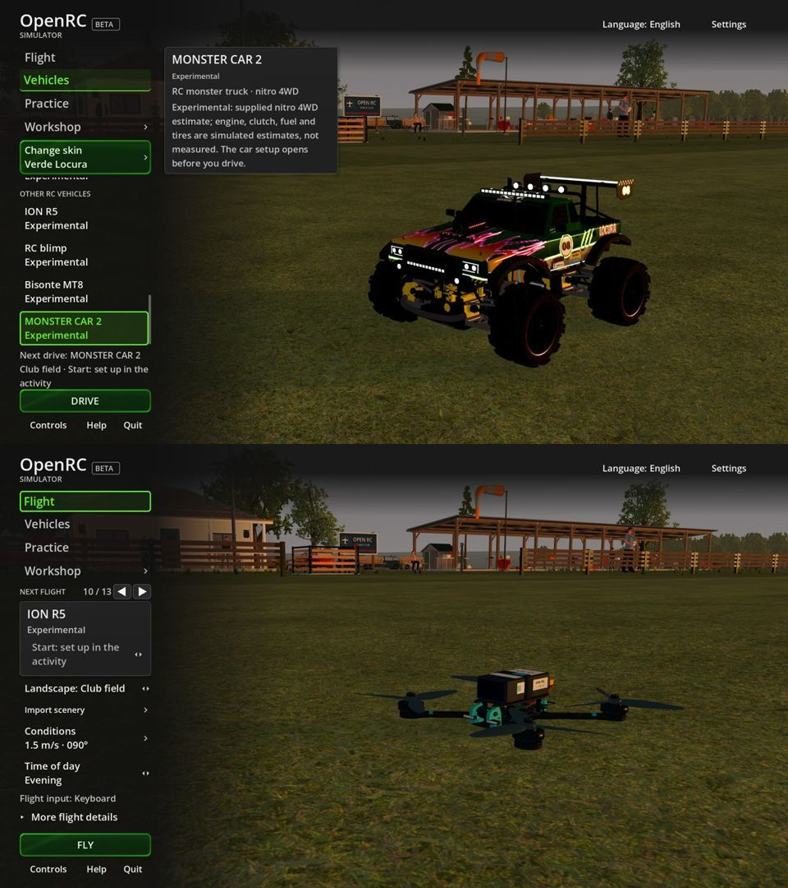

| ID | Sev | Hallazgo | Recomendación |
| --- | --- | --- | --- |
| M-1 | Alta | El riel izquierdo hace tres trabajos: navegación (Flight · Vehicles · Practice, más Workshop, que abre un editor), formulario de preparación y catálogo. Los destinos están repartidos en tres zonas (riel, cabecera y fila inferior). | Menú principal de destinos y tarjeta "Próximo vuelo" ([redesign §3](redesign.md#3-menú-principal)). |
| M-2 | Alta | El catálogo no escala. Cada fila mide ≈89 px; caben 2 a 1080p y como mucho 5 si se quitaran las estadísticas y la skin. 50 entradas serían ≈4.500 px. El catálogo no tiene categorías: la clase va dentro del texto libre `summary` (`app_state/aircraft_catalog.gd:20-40`). Solo el encabezado "OTHER RC VEHICLES" separa aviones de dron, dirigible y coches. Las filas quedan cortadas bajo el botón de skin. | Hangar a pantalla completa con rejilla, filtros, búsqueda, favoritos y miniaturas; campos `category`, `power`, `span_m`, `source` y `player_note` ([redesign §4](redesign.md#4-hangar)). |
| M-3 | Media | Las flechas "Previous/Next aircraft" del menú recorren también el dron y los coches. Con el dron, la fila "Start: set up in the activity" aparece desactivada. | Flechas dentro de la categoría elegida; las filas que no aplican se ocultan. |
| M-4 | Alta | La radio está escondida. Home: un botón "Controls" en la fila de utilidades (`ui/home.gd:743-750`) y el texto pasivo "Flight input". Pausa: dentro de *Session options* plegado (`ui/pause_menu.gd:187`); solo sube al primer nivel cuando la radio falla (`:445-467`). "Set up this device…" y "Calibrate selected radio" no aparecen hasta elegir un dispositivo (`ui/controller_setup.gd:866,874`). | "Radio y controles" como destino del menú principal y fila de primer nivel en la Pausa, con un chip de estado siempre visible ([redesign §5](redesign.md#5-radio-y-controles)). |
| M-5 | Media | Con teclado, Profile, Flight axes, Extra channels y Buttons solo dicen "Keyboard keys cannot be remapped yet" ([captura](captures/controls-keyboard-tabs.jpg)). | Con teclado, una sola página "Teclado" con el mapa de teclas y la guía para conectar una radio. |
| M-6 | Media | Rates, expo y dual rate existen pero están repartidos: zona muerta, expo e inversión en Flight axes; el interruptor de dual rate y quién aplica los rates en Extra channels (`ui/controller_setup.gd:1039-1069,1276-1282`). No hay memoria de modelo por avión (`input/controller_profile_store.gd:8`). | Página "Respuesta" única; memoria por avión como función nueva del dueño de entrada (D-7). |
| M-7 | Media | Gráficos: 19 opciones y 4 botones en un diálogo de 800 px, sin preset arriba ("Scene detail" está en medio). "Details +" despliega 8 opciones por debajo de la parte visible, así que pulsar no parece hacer nada. "Shadow quality: Current" no se explica, y Birds y Meadow comparten fila ([captura](captures/graphics-details.jpg)). | Orden Recomendado · Fluidez · Escena · Sombras · Avanzado · Detalles ([redesign §10.2](redesign.md#102-gráficos-en-profundidad)). |
| M-8 | Media | Hay dos selectores de aviones con nombres distintos: el catálogo de Home ("Extra 300S") y el desplegable "Stock aircraft" de la Biblioteca del Taller ("Great Planes Extra 300S .60"). La Biblioteca es una ventana nativa con barra de título y ×, y elige las variantes guardadas con un desplegable, aunque el Taller ya genera miniaturas ([captura](captures/workshop-pages-library.jpg)). | La Biblioteca como pantalla del shell con rejilla; "Stock aircraft" usa el Hangar. |
| M-9 | Media | Compañeros muestra "Traffic seed" con rango 0–4.294.967.295. Trim practice usa un título en mayúsculas y abre con el foco en Apply, igual que Failure practice ([captura](captures/failure-practice.jpg)) [UI-30 SC-5 sigue abierto] ([captura](captures/companions-trim-statistics.jpg)). | Semilla en "Avanzado"; foco inicial en el primer control; títulos con mayúscula inicial. |
| M-10 | Baja | Estadísticas pone los reinicios y borrados al final del mismo cuerpo desplazable que la consulta. | Sección "Gestionar" propia en la Bitácora. |

Se conserva: la Pausa del vuelo de prueba ("Resume trial · Restart trial · Return to Workshop" en primer nivel, [captura](captures/trial-pause.jpg)) y la etiqueta DRIVE para coches.

### 5.14 Comparación con otros simuladores

Búsqueda web acotada el 2026-11-26 (17 consultas). Los resúmenes salen de manuales y guías, no de capturas propias. RealFlight y Phoenix tienen poca evidencia primaria.

| Convención | Apoyo | Fuentes |
| --- | --- | --- |
| El controlador o radio tiene su propia entrada de primer nivel, separada de Opciones | 3 de 4 (Velocidrone, Aerofly RC 10, Phoenix) | [Velocidrone](https://velocidrone.com/desktop_manual), [Aerofly RC 10](https://www.ikarus.net/en/rc10-manual/), [Phoenix (guía secundaria)](https://www.manualsdir.com/manuals/429010/spektrum-dx6i-phoenix-rc-4-flight-simulator.html) |
| Primera configuración con asistente: tipo de dispositivo → calibración → disposición → modo | 3 (Aerofly, Phoenix, RealFlight) | [Aerofly RC 10](https://www.ikarus.net/en/rc10-manual/), [RealFlight 9.5, índice del manual](https://horizonhobby.com/on/demandware.static/-/Sites-horizon-master/default/Manuals/RealFlight-9.5-Manual.pdf) |
| Interruptores, rates y expo como segunda etapa, por modelo | 2 (Aerofly, Velocidrone por dron) | Mismas fuentes |
| Avión, campo y controlador como entradas separadas del menú principal | 4 | Mismas fuentes |
| Una entrada de "volar ya" arriba del menú | 2 (Velocidrone Quick Start, Aerofly Fly) | [Velocidrone](https://velocidrone.com/desktop_manual) |
| Selector de aviones con filtro por tipo | 3 (Aerofly, FS One, MSFS) | [FS One](https://www.fsone.com/manual/aircraft_selection.html), [foro MSFS](https://forums.flightsimulator.com/t/bring-back-the-fs2020-aircraft-categories/685348) |
| Favoritos con estrella en el selector | 2 (Aerofly; MSFS con quejas de usuarios) | Mismas fuentes |
| Cambio rápido de avión o campo sin salir del vuelo | Aerofly (F2/F3 y menú rápido) y Velocidrone (escenario); MSFS no permite cambiar de avión en pausa | [Aerofly RC 10](https://www.ikarus.net/en/rc10-manual/) |
| Reiniciar es una acción frecuente y directa | 2 (Aerofly, Liftoff) | [Liftoff](https://www.liftoff-game.com/node/203) |
| Gráficos: preset o ajuste automático primero, opciones individuales después | 2 (Aerofly, Velocidrone) | Mismas fuentes |

Qué se adopta en el [rediseño](redesign.md): radio en primer nivel con asistente, Hangar con filtros por tipo y favoritos, cambio de avión y de campo desde la Pausa, reinicio en una tecla visible, y gráficos con preset primero. Nada copia la apariencia, los nombres ni la estructura concreta de esos productos.

## 6. Sistema visual: cristal verde radiactivo

Los botones primarios (FLY, Resume, Apply, Test fly, Save) cumplen bien: cristal verde con borde luminoso, interior oscuro y corchetes de foco. El resto todavía no forma un sistema. Reglas propuestas para que todo sea coherente:

| Regla | Hoy | Corrección |
| --- | --- | --- |
| **V1. Un solo primario por pantalla:** la acción que avanza | "Use player layout" en Indicadores e "Inspect wreck" en el accidente son primarios ([captura](captures/overlays-es.jpg)) | Primario solo para FLY, Resume, Apply, Save, Test fly y Restart en el accidente |
| **V2. Un solo estilo de pestaña** | Cinco: Settings (texto + caja verde), Workshop (cajas grises a todo el ancho), Controls (cajas), Conditions/Sky (subrayado), Overlays (subrayado con flechas que desbordan) | El estilo de Settings en todas, con variación compacta |
| **V3. Un solo interruptor** | Interruptor en Settings, casilla en caja en Conditions y Overlays, casilla nativa en el Taller | Interruptor común (`Widgets`) en todo |
| **V4. Un solo marco modal:** título a la izquierda, cerrar arriba a la derecha, cuerpo con desplazamiento, acciones abajo a la derecha con el primario al final | Close arriba, Close + Revert + Keep, Cancel + Save, Cancel + Apply, Back al final de una pila, Done | UI-35a |
| **V5. Nada de ventanas grises de Godot** | Import scenery, diálogos de la biblioteca del Taller y del Creador con botones OK nativos | Todo dentro del shell, con el mismo marco |
| **V6. Editores a pantalla completa con la misma cabecera** | Workshop, Controls y Creator: paneles opacos con cabeceras distintas | Panel de cristal oscuro común; título, subtítulo y Volver en el mismo sitio |
| **V7. Seleccionado ≠ foco** | Navegación seleccionada = caja verde llena; foco = contorno verde: se parecen | Seleccionado: texto verde y barra lateral; foco: corchetes |
| **V8. Texto esencial ≥ 18 px a 1080p** | Barra del Taller ≈12 px, Control guide ≈13 px | Variación "pequeña" de 18 px |
| **V9. Rojo solo para errores y destrucción; ámbar para precaución** | Se cumple | Mantener |
| **V10. Texto del jugador separado del texto técnico** | §5.12 | `player_note`; diagnóstico solo en "Detalles" |

La causa técnica ya está documentada: `Crystal.attach` decora solo `Button` y algunos `PanelContainer` en `Screen.open()` (`ui/crystal_surface.gd:6-41`, `ui/screen.gd:67`). Las tarjetas creadas después (`_card()` del Taller, `ui/workshop.gd:2359-2370`), las casillas, los campos de texto y los diálogos nativos quedan fuera. Hay ≈138 `Button.new()` y ≈58 paneles creados a mano en `app/ui` (recuento de búsqueda, no todos son defectos). La solución es ampliar `Widgets` (tarjeta, interruptor, pestañas, ayuda) y aplicar V1–V8 con una comprobación automática.

## 7. Propuesta: orden y estructura

La especificación completa está en [redesign.md](redesign.md): modelo de navegación, menú principal, Hangar, Radio y controles, Campo y clima, Práctica, Taller, Bitácora, Pausa, Accidente, Ajustes y Gráficos, Ayuda, tipos de botón, primario por pantalla, textos de ayuda y vocabulario. Resumen:

1. **Lo frecuente arriba**; lo raro, dentro de su contexto.
2. **Cada sección dice su alcance:** Ahora · Al reiniciar · Próximo vuelo.
3. **Una casa por concepto.** Los atajos pueden repetirse, pero abren la misma pantalla con el mismo nombre. Home y la Pausa reutilizan los mismos centros.
4. **Menú principal = destinos** (Hangar · Campo y clima · Radio y controles · Práctica · Taller · Bitácora), con la tarjeta "Próximo vuelo", VOLAR y la skin abajo a la izquierda, y el estado de la radio siempre visible arriba a la derecha ([redesign §3](redesign.md#3-menú-principal)).
5. **Hangar a pantalla completa** con rejilla, filtros por tipo, búsqueda, favoritos y miniaturas, para 50 o 200 aviones ([redesign §4](redesign.md#4-hangar)).
6. **Radio y controles en primer nivel**, en Home y en la Pausa ([redesign §5](redesign.md#5-radio-y-controles)).
7. **Salir siempre a la vista**, al final y separado; **cada tecla útil junto a su acción** (Esc, R, K, Z).
8. **La ayuda vive junto a la opción:** una línea bajo la fila o un panel de descripción ([redesign §13](redesign.md#13-textos-de-ayuda)).

## 8. Textos de ayuda breves

Patrón: una línea de texto secundario bajo la opción, visible al enfocarla o al pasar el ratón, y leída por el lector de pantalla. Se reutiliza el patrón de *Flight overlays*, que ya muestra propósito y límite al enfocar sus 28 interruptores (UI-32-R8), como `Widgets.help()` común. Máximo ≈90 caracteres.

| Pantalla | Opción | EN | ES |
| --- | --- | --- | --- |
| Home | Start | Where the flight begins. R restarts here. | Dónde empieza el vuelo. R reinicia aquí. |
| Home | Landscape | The flying field. Some fields only allow starts in the air. | El campo de vuelo. Algunos solo permiten salir en el aire. |
| Home | Conditions | Wind, gusts, air, time and sky for the next flight. | Viento, ráfagas, aire, hora y cielo del próximo vuelo. |
| Home | Experimental | Estimated physics, not yet compared with the real aircraft. | Física estimada, aún no comparada con el avión real. |
| Home | Battery: finite / ideal | Finite: power fades as the pack drains. Ideal: never runs out. | Finita: la potencia baja al gastarse. Ideal: nunca se acaba. |
| Home | Fuel | Less fuel: shorter flight and a lighter aircraft. | Menos combustible: vuelo más corto y avión más ligero. |
| Home | Flight companions | Other pilots flying at the field. Applies on restart. | Otros pilotos volando en el campo. Se aplica al reiniciar. |
| Practice | Natural Random | Random aircraft, wind and time, to practise adapting. | Avión, viento y hora al azar, para practicar la adaptación. |
| Practice | Failure practice | A random failure (servo, engine…) during the flight. | Una falla al azar (servo, motor…) durante el vuelo. |
| Practice | Trim practice | The aircraft starts out of trim; trim it in flight. | El avión sale descompensado; corrígelo con los trims. |
| Conditions | Wind speed | Average wind. Small trainers struggle above about 6 m/s. | Viento medio. Los entrenadores pequeños sufren por encima de 6 m/s. |
| Conditions | Direction FROM | Where the wind comes from: 090° is from the east. | De dónde viene el viento: 090° es del este. |
| Conditions | Horizontal gust peak | Extra speed of each gust above the average wind. | Velocidad extra de cada ráfaga sobre el viento medio. |
| Conditions | Vertical gust | Rising or sinking air inside each gust. | Aire que sube o baja dentro de cada ráfaga. |
| Conditions | Gust duration / period | How long each gust lasts / time between gusts. | Cuánto dura cada ráfaga / tiempo entre ráfagas. |
| Conditions | Spatial wind | Wind changes across the field (experimental). | El viento cambia de un lugar a otro del campo (experimental). |
| Conditions | Atmosphere | Hot or high air is thinner: less lift and power. | Aire caliente o de altura: menos sustentación y potencia. |
| Settings | 3D render scale | Fewer 3D pixels for more FPS; menus stay sharp. | Menos píxeles 3D para más FPS; los menús siguen nítidos. |
| Settings | 3D reconstruction | Upscales a smaller 3D image. Auto picks what this PC supports. | Reescala una imagen 3D menor. Auto elige lo que admite este PC. |
| Settings | Scene detail | Trees, grass and objects. Lower it if FPS drops. | Árboles, hierba y objetos. Bájalo si caen los FPS. |
| Settings | Antialiasing (MSAA) | Smooths jagged edges. Higher values cost GPU time. | Suaviza bordes dentados. Valores altos cuestan GPU. |
| Settings | RC circuit | Shows the RC car track on the field from the next flight. | Muestra la pista de coches RC desde el próximo vuelo. |
| Settings | Pilot field of view | How much you see from the pilot. Lower: bigger aircraft. | Cuánto ves desde el piloto. Menor: avión más grande. |
| Settings | Auto zoom (Z) | Keeps the aircraft the same size as it flies away. | Mantiene el avión del mismo tamaño al alejarse. |
| Settings | Magnifier | Zoomed inset of the aircraft when it is far away. | Recuadro ampliado del avión cuando está lejos. |
| Settings | Impact effects | What the screen shows after a crash. | Lo que muestra la pantalla tras un choque. |
| Settings | Use opaque panels | Solid menu backgrounds for more contrast. | Fondos de menú sólidos para más contraste. |
| Workshop | Constant wing loading | Weight scales with wing area: flies like the original. | El peso escala con el ala: vuela como el original. |
| Workshop | Geometric | Weight scales with volume: large models get much heavier. | El peso escala con el volumen: los grandes pesan mucho más. |
| Workshop | More power | +20 % power and +15 % control throw. | +20 % de potencia y +15 % de recorrido de mandos. |
| Workshop | More travel | +20 % control throw, 10 % lighter. | +20 % de recorrido de mandos, 10 % más ligero. |
| Workshop | Control multiplier | Control-surface throw. Above 1× is more responsive. | Recorrido de superficies. Más de 1× responde más. |
| Workshop | Smoke density / emission | Thicker smoke / puffs per second. | Humo más denso / bocanadas por segundo. |
| Workshop | Buoyancy / drag | How fast smoke rises / how fast it slows down. | Cuánto sube el humo / cuánto se frena. |
| Pause | Restart flight (R) | Back to the start with the same setup. | Vuelve a la salida con la misma configuración. |
| Pause | Change aircraft | Ends this flight and opens the catalog. | Termina este vuelo y abre el catálogo. |
| Pause | Time and sky | Applies now to this flight. | Se aplica ya a este vuelo. |
| Accident | Purchase plan | Which replacement parts the estimate assumes. | Qué repuestos supone la estimación. |

Los valores de los presets del Taller vienen de `ui/workshop.gd:38-46`. Si cambian, el texto debe generarse a partir de esa tabla y no escribirse a mano.

## 9. Plan de mejora

Cada paso deja la aplicación funcionando y se puede revisar por separado. No hay cambios de física, datos de aviones ni grabaciones de referencia. Estos pasos absorben lo que sigue abierto de UI-33, UI-35 a UI-37 sin duplicar su estado: la columna "Relación" lo indica.

| ID | Prioridad | Trabajo | Relación | Prueba |
| --- | --- | --- | --- | --- |
| UI-40a | P0 | **Pausa útil.** Cabecera con la foto del vuelo, el estado de la radio y el motivo; filas visibles sin desplegables con destinos provisionales hasta que existan sus centros ([redesign §8](redesign.md#8-pausa)); teclas visibles; diagnóstico de física fuera de los builds publicados; sin desplazamiento a 1080p y 100 %. | P-1…P-4, P-6…P-8; cierra UI-30 VC-4 y PS-5 | `test_ui_pause.gd`: orden, ausencia de desplazamiento y rutas de prueba del Taller; capturas EN/ES a 1080p |
| UI-40b | P0 | **Recuperación.** Accidente: Restart primario con foco y R; Cambiar avión y Volver al inicio; costes plegados. Pausa: "Relanzar en el aire / Volver a la pista", coordinado con el dueño de `FlightSession`. | X-1…X-3, P-5; cierra UI-30 PS-9 | Choque → volar en 1 activación; choque → otro avión en ≤3; prueba de reinicio con salida cambiada; comprobación de que el log de vuelo y el trazado no cambian |
| UI-40c | P1 | **Skin.** Ancla fija (D-1), panel lateral con vista previa al enfocar y Esc para revertir, compartido con la ficha del Hangar; entrada en la Pausa (D-3) y en Apariencia del Taller ([redesign §4.5](redesign.md#45-skin)). | K-1…K-4 | Prueba de que el rectángulo del ancla es igual en las tres páginas; vista previa, revertir y persistencia; capturas |
| UI-40d | P1 | **Texto para el jugador.** `player_note` en el catálogo; diagnósticos de Gráficos en "Detalles"; razones dinámicas traducidas; estado del modelo en Natural Random. | S-1, §5.12 | Comprobación por búsqueda: ningún identificador de paso, ruta de archivo ni palabra del SDK en las vistas por defecto; cobertura en `es.po` |
| UI-40e | P1 | **Ayudas breves.** `Widgets.help()` común, panel de descripción, etiquetas de alcance (Ahora · Al reiniciar · Próximo vuelo) y las tablas de §8 y de [redesign §13](redesign.md#13-textos-de-ayuda). | H-5, CO-3, W-2, W-4 | Prueba: cada control listado tiene ayuda no vacía en EN y ES; captura nativa |
| UI-40f | P1 | **Ajustes y Gráficos reorganizados** ([redesign §10](redesign.md#10-ajustes)): Unidades en Interfaz para menús y HUD, "RC circuit" al Campo, accesibilidad agrupada, categoría Radio y controles, una sola regla de guardado; Gráficos con preset primero, opciones no disponibles plegadas y "Avanzado" que se abre en su sitio. | S-2…S-5, F-2, M-7; cierra UI-30 SC-1, SC-3, SC-7 | `test_settings_ui.gd` y `test_ui_settings_integration.gd`; tareas T11 y "encontrar Controles" |
| UI-40g | P1 | **Coherencia del cristal** (V1–V8): un estilo de pestaña, un interruptor, marco modal común, Import scenery dentro del shell, regla de un primario por pantalla, texto de 18 px. | I-1, I-2, C-2, W-5, CO-4; implementa UI-35a/b | `check_contrast.py`; matriz de capturas; comprobación que impida nuevos `AcceptDialog` o `CheckBox` sin tema en `app/ui/` |
| UI-40h | P2 | **Ayuda por pestañas** ([redesign §11](redesign.md#11-ayuda)), contextual por avión. | A-1, A-2; cierra UI-30 SC-4 | `test_ui_help.gd` y `test_controls_reference.gd` sin perder ninguna tecla |
| UI-40i | — | **Home.** Absorbido por UI-40n (estructura) y UI-40o (catálogo). | H-1…H-8 | Ver UI-40n y UI-40o |
| UI-40j | P2 | **Taller:** orden de pestañas, recordar la última, presets separados y explicados, selector de color, Biblioteca como pantalla con rejilla y "Stock aircraft" a través del Hangar. Lo hace el dueño del Taller (AE) con el shell de UI. | W-1…W-4, W-6, M-8 | `test_workshop_*.gd`; captura |
| UI-40k | — | **Condiciones en la Pausa.** Absorbido por UI-40q. | CO-1, CO-2, CO-5 | Ver UI-40q |
| UI-40l | P2 | **Primer vuelo:** una sola ayuda; el radio en el HUD solo con entrada de radio. Lo hace el dueño del HUD. | F-1, F-3; cierra UI-30 SC-9 | Pruebas de overlays; captura del primer vuelo |
| UI-40n | P1 | **Menú principal de destinos** ([redesign §3](redesign.md#3-menú-principal)): seis destinos con ›, tarjeta "Próximo vuelo" con avión ◀ ▶ por categoría, salida y hora, VOLAR y la skin abajo a la izquierda, chip de radio, Idioma, Ajustes y Ayuda en la cabecera, Salir separado; filas que no aplican ocultas. Conserva las señales y rutas públicas de `ui/home.gd`. | M-1, M-3, H-2…H-8; cierra UI-30 HN-4 | `test_ui_home.gd`, `test_home_vehicle_roster.gd`, `test_ui_home_layout.gd`: zonas fijas, sin desplazamiento a 1080p y 100 %, foco inicial en VOLAR; capturas EN/ES a 1080p, luego 1440p y 4K |
| UI-40o | P1 | **Hangar** ([redesign §4](redesign.md#4-hangar)). **o-1:** pantalla completa con lista ancha, filtro por familia (dato de `app_state/vehicle_roster.gd`) y por tipo, búsqueda y ficha con modelo 3D y skin. **o-2:** rejilla con miniaturas (productor del Taller), favoritos, recientes y variantes, cuando el catálogo pase de ≈20 entradas o llegue la integración del Creador con Home. Campos `category`, `power` y `span_m` solo con datos reales. | M-2, H-1, K-2, K-3; cierra UI-30 SP-1 y UI-34d (variantes favoritas) | Pruebas con 13, 50 y 200 entradas sintéticas desde o-1: filtros, foco, "gana la última petición"; medida de apertura y recorrido en el host de referencia a 1080p |
| UI-40p | P1 | **Radio y controles en primer nivel** ([redesign §5](redesign.md#5-radio-y-controles)): destino del menú, chip de estado en Home y en la Pausa con el dispositivo, fila de la Pausa con la tecla K, página Resumen delante de las pestañas entregadas (sin renombrarlas), página Teclado en lugar de pestañas vacías, opciones avanzadas agrupadas, leyenda de menús con radio. El estado "sin configurar o sin calibrar" necesita un dato nuevo de `input/controller_service.gd`. El botón de recuperación actual se mantiene hasta que la fila nueva pase sus pruebas. | M-4, M-5, M-6, C-1, C-3 | `test_controller_pause_recovery.gd` y pruebas de controladores: el chip refleja cada estado; ≤2 activaciones a calibrar desde Home y desde la Pausa; navegación solo con teclado y solo con mando; radio física para la leyenda |
| UI-40q | P2 | **Campo y clima** ([redesign §6](redesign.md#6-campo-y-clima)): un centro para campo (con importación y opciones del campo), salida, viento con presets primero, aire, hora y cielo. Desde la Pausa solo Hora y cielo; cambiar de campo termina el vuelo. Viento "al reiniciar" solo si una prueba demuestra que `session.reset(true)` aplica el tiempo nuevo. | CO-1…CO-5, I-1, I-2, H-2; cierra UI-30 PS-6 | Prueba de reinicio con tiempo cambiado; prueba de que las fallas activas no cambian hasta reiniciar; importación desde el centro; capturas |
| UI-40r | P2 | **Cámara e indicadores**: una pantalla para vista inicial, campo de visión, zoom automático y preajustes de indicadores, hoy repartidos entre Ajustes › Camera y *Flight overlays*. Coordinado con los dueños de cámara (CAM) y HUD. | P-1, F-2 | Pruebas de cámara y overlays; captura desde la Pausa |
| UI-40m | — | **Aceptación:** tareas T1–T13 con al menos tres personas nuevas, objetivo ≥90 % sin ayuda; capturas EN/ES a 1080p, luego 1440p y 4K, y 720p al final; radio y mando físicos para C-3 y la navegación por radio. | Todas | Registro de tareas y revisión visual del dueño |

**Orden recomendado, en tres fases:**

1. **Arreglos rápidos sin reestructurar:** UI-40a y UI-40b (salvar el vuelo), UI-40d (texto para el jugador) y UI-40e (ayudas).
2. **Nueva estructura:** UI-40g (sistema de cristal, base de las pantallas nuevas), UI-40p (radio), UI-40n (menú principal), UI-40o-1 (Hangar en lista) con UI-40c (skin), y UI-40q (campo y clima).
3. **Pulido y aceptación:** UI-40f, UI-40h, UI-40j, UI-40l y UI-40r según la agenda de cada dueño; UI-40o-2 cuando el catálogo lo pida; UI-40m al final.

Cada paso de la fase 2 se puede publicar solo: el menú nuevo puede abrir todavía las pantallas actuales mientras llegan los centros.

### 9.1 Estado de implementación

2026-11-26, árbol de trabajo sobre `a924ecd10` (sin commit). Lo entregado:

| Paso | Entregado | Pendiente |
| --- | --- | --- |
| UI-40a | Pausa por secciones sin grupos plegables: Continuar (Esc) y Reiniciar (R, que ahora funciona en la Pausa) arriba; foto del vuelo (tiempo, altura, velocidad en las unidades de los indicadores); "ESTE VUELO" con Radio y controles · dispositivo, Cambiar avión, Cielo e iluminación, Indicadores, Alertas; fallas y compañeros; Taller · Estadísticas; Ajustes · Ayuda; Volver al inicio y Salir al final. Por debajo de 1000 px lógicos de alto, las filas menos usadas se pliegan bajo "Más opciones" para no desplazar a 720–800 px. La línea de física queda al final. | Etiquetas de alcance, Campo y clima en la Pausa (UI-40q), relanzar en el aire (D-4) |
| UI-40b | Tarjeta de accidente: Reiniciar vuelo primario, con foco y la tecla R; "Más opciones" (Esc) abre la Pausa. Las opciones de coste (bricolaje o taller, plan de compra) se pliegan con el desglose de daños | — |
| UI-40c | Skin fija en la esquina inferior izquierda de la escena, junto a VOLAR, en todas las páginas; se alcanza desde VOLAR con →. La galería es un panel lateral abajo a la izquierda que deja ver el modelo: elegir una pintura la aplica al momento y el panel sigue abierto para comparar; "Listo" o Esc lo cierran | Entrada en la Pausa y en el Taller |
| UI-40d | Una frase para el jugador por estado (`ui/player_notes.gd`, fuera del catálogo porque `app_state/aircraft_catalog.gd` es fuente espejo del núcleo nativo: "Modelo de vuelo de referencia", "Experimental: física estimada…", "Solo el modelo…") en Home, el Hangar, el vuelo aleatorio y las ayudas emergentes; la nota técnica queda bajo "Detalles técnicos" en la ficha y en la ayuda emergente del estado | Diagnósticos restantes fuera de Gráficos (ruta del solucionador en la Pausa) |
| UI-40e | Ajustes muestra en la línea de estado la explicación de la opción enfocada (la misma ayuda que ve el ratón), para teclado y mando | `Widgets.help()` común en las demás pantallas; etiquetas de alcance |
| UI-40f | Gráficos empieza por la calidad (Detalle de escena) con una línea de resumen; Reflex y el diagnóstico de reconstrucción pasan a "Detalles", que se desplaza a la vista al abrirse | Unidades en Interfaz para menús y HUD |
| UI-40g | Un solo estilo de pestaña (el de cristal de Ajustes) en Ayuda, el Hangar, el Taller y Controles; las pestañas de Controles llenan su fila, como las de Ayuda | Interruptor común, marco modal común, Importar escenario como pantalla, regla de un primario |
| UI-40h | Ayuda por tareas en cuatro pestañas: Vuelo (palancas, recuperación, cámara, indicadores y "Ahora mismo"), Avión (trims, tren, flaps, plegado, rates, humo, motor; en helicóptero, armado, retención, entrenador y modo), Radio (K, Intro y los pasos de EdgeTX) y Acerca de (versión, compañeros, grabación y desarrollo). Cada tecla aparece una sola vez; a 100 % ninguna página se desplaza a 1080p ni a 720p; ↑ en lo alto de una página vuelve a su pestaña | Enlace "Abrir Radio y controles" desde la pestaña Radio |
| UI-40j | Pestañas del Taller en orden de tarea: Apariencia · Ajuste de vuelo · Luces · Humo · Sonido mecánico · Comparar; el Taller vuelve a abrir en la última pestaña usada durante la sesión | Presets explicados, selector de color, Biblioteca como pantalla |
| UI-40n | Salir separado de Ayuda en la fila inferior; la línea pasiva "Flight input" se sustituye por el chip; "Vehicles" pasa a llamarse "Hangar". Las flechas ◀ ▶ siguen recorriendo todos los vehículos (decisión UI-39, cubierta por `test_ui_aircraft.gd`): el Hangar ya filtra por familia. "Flight" no pasa a "Next flight" porque desborda el riel compacto de dos columnas en ruso; la página ya se titula "NEXT FLIGHT" | Destinos completos con Ayuda en la cabecera y Salir abajo a la derecha; viento por presets en la tarjeta, que se hará con el centro de Campo y clima (UI-40q) para no duplicar la lógica de aplicar el tiempo |
| UI-40o-1 | Hangar: fuera del texto grande, la lista sale del riel a un panel ancho junto a él, con filtros por familia (Aviones, Helicópteros, Drones, Dirigibles, Coches y camiones; solo las familias presentes), búsqueda por nombre o resumen, contador y aviso sin resultados. A 1080p caben los 13 vehículos en dos columnas sin desplazar; a 720p, unos diez. La ficha queda a su derecha y la skin debajo; el riel conserva las estadísticas del avión elegido. Con texto grande la lista vuelve al riel | Miniaturas, favoritos y variantes (o-2); prueba con 50 y 200 entradas sintéticas |
| UI-40p | "Radio & controls" es destino del riel en escritorio y fila de primer nivel en la Pausa con el dispositivo; chip "● Teclado / ● dispositivo" en la cabecera de Home. En Controles, con el teclado se ocultan las pestañas vacías (Perfil y Canales extra) y Dispositivos muestra tres pasos para conectar una radio o un mando; "Recuperar perfil antiguo" y "Exportar diagnóstico" se pliegan bajo "Avanzado" | Estado "sin configurar o sin calibrar" en el chip (dato nuevo de `input/controller_service.gd`), leyenda de menús con radio |

Sin empezar: UI-40l (el dato del dispositivo de vuelo no llega a los indicadores y `main.gd` está fijado por el manifiesto de compañeros; lo hace el dueño del HUD), UI-40q (el centro de Campo y clima necesita antes la prueba de que reiniciar aplica el tiempo nuevo), UI-40r (con los dueños de cámara y HUD), UI-40o-2 (cuando el catálogo lo pida) y UI-40m (aceptación con personas).

Archivos: `ui/pause_menu.gd`, `ui/accident_report.gd`, `ui/home.gd`, `ui/livery_picker.gd`, `ui/settings_screen.gd`, `ui/help_screen.gd`, `ui/controller_setup.gd`, `ui/workshop.gd`, `ui/natural_random_screen.gd`, el nuevo `ui/player_notes.gd`, `render/overlays/overlay_manager.gd` (`pause_snapshot()`, solo lectura), unas líneas en `app_root.gd` y `main.gd` con sus huellas renovadas en `data/ai/companions/behavior-manifest.json` y el perfil del Stik, los textos nuevos en los ocho catálogos, las pruebas adaptadas y tres escenarios del puente de depuración. `app_state/aircraft_catalog.gd` no cambia: es fuente espejo del núcleo nativo, y la primera versión de UI-40d que lo tocó hacía volar todo con la referencia GDScript ([lección](../../../LEARNINGS.md)). Capturas nativas a 1080p: [Home](captures/after-home.jpg), [Hangar](captures/after-hangar.jpg) ([720p](captures/after-hangar-720p.jpg)), [Pausa](captures/after-pause.jpg), [accidente](captures/after-crash.jpg), [Ayuda](captures/after-help.jpg), [Controles](captures/after-controls.jpg).

Verificación (Godot 4.8-beta2, Windows, sin cabeza, sobre el árbol final): un barrido de 194 pruebas de interfaz (Home, Pausa, Ayuda, Ajustes, Taller, Hangar, idioma, modales, indicadores, fallas, compañeros) y las 70 de controles pasan sin errores de script ni avisos del motor, salvo cinco que fallan igual sin este cambio: cuatro de compañeros por `solver.sha256` tras NK-5g/h (pendiente `tools/companions/rebind.py`) y `test_weather_publication`, porque `sim/flight_session.gd` cambió después de renovar el fixture en NK-5d. El barrido encontró dos pruebas que aún usaban la Pausa antigua y `test_ui_aircraft` con la nota técnica; se corrigieron. Puente de depuración: el recorrido de Home y de la Pausa no da fallos; 19 de 21 escenarios pasan uno a uno (incluidos los tres actualizados), y `controller_capture_scroll` y `controller_field_errors` fallan igual con el `ui/controller_setup.gd` de HEAD en un perfil sin cabeza sin mandos; el mono (140 pasos) y el *soak* fly/Home no encuentran fallos ni crecimiento. Al cerrar el puente, `render/frame_phases.gd:191` (PT1h) registra errores de `remove_child` que no dependen de este cambio. Una revisión independiente del lote encontró que el Hangar podía tapar la skin al cambiar de vehículo y que un filtro podía esconder el avión al volver con Cambiar avión; se corrigieron con pruebas propias, igual que el foco tras filtrar y la tecla ↑ mantenida en la Ayuda. Capturas nativas comprobadas a 1080p y 720p. Después, el pliegue de costes y la memoria de pestaña del Taller pasan las pruebas de accidente, recuperación, Pausa y flujos del Taller; `test_workshop_integration` comprueba que el Taller vuelve a abrir en la última pestaña. No se ejecutó la batería completa ni CI, ni se probó con radio o mando físicos.

## 10. Decisiones pendientes del dueño

| ID | Pregunta | Recomendación |
| --- | --- | --- |
| D-1 | ¿Dónde se ancla la skin? Hoy está abajo a la **derecha** en Flight y arriba del riel en Vehicles. | Abajo a la izquierda de la escena, junto a VOLAR, como pide el dueño. Si se refería a la posición actual (derecha), basta con fijarla ahí en todas las páginas. |
| D-2 | En la Pausa, ¿foto del vuelo en la cabecera o el HUD visible y atenuado? | Foto en la cabecera: no depende del HUD y no tapa la escena. |
| D-3 | ¿La skin cambiada en vuelo se aplica al momento o al reiniciar? | Al momento si el render puede cambiar materiales sin reconstruir; si no, al reiniciar y así se indica. |
| D-4 | ¿"Relanzar en el aire" vale para todos los aviones y campos? | Sí, cuando el avión y el campo admitan esa salida; en otro caso, el botón aparece desactivado con su motivo. |
| D-5 | ¿Confirmar "Salir" en Home? | No; basta con separarlo visualmente (H-7). |
| D-6 | ¿Se adopta el menú principal de destinos ([redesign §3](redesign.md#3-menú-principal)) en lugar del riel con pestañas? | Sí: resuelve M-1, M-2 y M-4 de una vez y sigue la convención de los simuladores RC estudiados (§5.14). Si se prefiere un cambio menor, la "variante mínima" de redesign §3.3 conserva el riel. |
| D-7 | ¿Memoria de radio por avión (rates, interruptores, trims), como en una radio real? | Sí, como función nueva del dueño de entrada (D6), después de UI-40p. |
| D-8 | ¿El Hangar abre en rejilla o en lista? | Rejilla con miniaturas; la lista queda como opción recordada. |
| D-9 | ¿VOLAR sigue abajo a la izquierda? | Sí: conserva la memoria actual del jugador y deja la skin a su lado. |

## 11. Lo que hay que conservar

- FLY enfocado al llegar a Home y después de cada vuelo; la selección solo cambia con una pulsación explícita.
- Change aircraft en el primer nivel de la Pausa con el avión actual enfocado en el catálogo; la identidad "avión · campo" en la Pausa.
- R reinicia y continúa en un paso, también después de un choque.
- Botones primarios de cristal verde, corchetes de foco, sin rojo salvo errores.
- Controles con entrada en vivo; Cámara con valores "(default)" y teclas en la etiqueta.
- Natural Random con el avión sorteado en la escena ([captura](captures/natural-random.jpg)); Conditions que abre en su preset.
- El Creador con pasos numerados y estado por paso; las guardas del Taller con Cancel como opción segura.

## 12. Reproducción

```sh
export OPENRC_TESTQUEUE_ROOT=<raíz de cola local>
python tools/debug/debugctl.py launch --mute --resolution 1920x1080 --profile <perfil aislado>
python tools/debug/debugctl.py look            # controles y orden de cada pantalla
python tools/debug/debugctl.py fly start=airborne
python tools/debug/debugctl.py key name=Escape # Pausa
python tools/debug/debugctl.py screenshot max_width=1920
python tools/debug/debugctl.py stop
```

Las capturas se redujeron a 1280×720 (la columna de la Pausa se recortó a escala nativa y se unió en un montaje) y se guardaron como JPEG con calidad 82. Las imágenes originales a 1920×1080 no se conservan.
