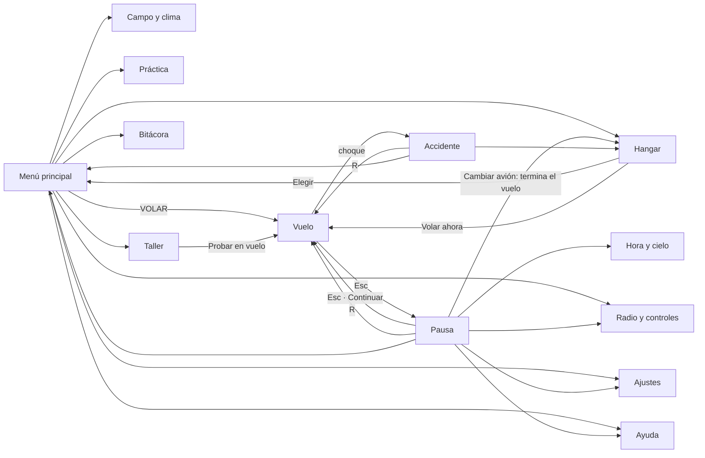

# UI-40 — Rediseño de menús: estructura, botones, submenús, opciones y ayudas

2026-11-26 · Propuesta de diseño derivada de la [auditoría UI-40](README.md). Es la especificación objetivo para los pasos UI-40a…r de [§9 de la auditoría](README.md#9-plan-de-mejora); no describe comportamiento implementado. Las decisiones del dueño están en [§10 de la auditoría](README.md#10-decisiones-pendientes-del-dueño). Etiquetas de la interfaz: español primero y el inglés fuente entre paréntesis cuando es nuevo.

Restricciones que no cambian: física, sesiones, reloj de 240 Hz, pila de pantallas con sus retenciones, transacciones de salida y grabación, datos de aviones y vuelos de referencia. La presentación nunca modifica el estado de la simulación.

## 1. Objetivos como jugador

| Objetivo | Medida |
| --- | --- |
| Volar ya | 1 activación desde Home |
| Cambiar de avión desde cualquier sitio | ≤3 activaciones, también con 200 aviones instalados |
| Saber si la radio está lista | Visible sin abrir nada, en Home y en la Pausa |
| Cualquier acción de radio | ≤2 activaciones desde Home o la Pausa |
| Salvar un vuelo | 1 tecla anunciada en pantalla (R) o 2 activaciones |
| Encontrar una opción | Está donde la buscaría un piloto (tabla de [§3 de la auditoría](README.md#dónde-está-cada-opción)) |
| Entender una opción técnica | Una línea de ayuda junto a ella, sin abrir otra pantalla |
| Estilo único | Mismos botones, pestañas, interruptores y marcos en todas las pantallas |

## 2. Modelo de navegación

Tres capas, siempre iguales:

1. **Menú principal (Home):** una lista de destinos y el botón VOLAR. No contiene formularios largos.
2. **Centros (hubs) a pantalla completa:** Hangar, Campo y clima, Radio y controles, Práctica, Taller, Bitácora, Ajustes, Ayuda. Dejan ver la escena donde aporta (el avión, el campo).
3. **Diálogos pequeños:** confirmaciones, nombres, importaciones.

La Pausa es un menú lateral. Reutiliza solo los centros que son seguros a mitad de vuelo: Radio y controles, Ajustes, Ayuda, Hora y cielo (ya existe, solo aviones) y Cámara e indicadores. Cambiar de avión o de campo **termina el vuelo** con la transacción de salida actual (guardado de trazas incluido) y se dice en la propia fila. El viento y el aire "al reiniciar" solo se ofrecen después de que una prueba demuestre que el reinicio aplica el tiempo nuevo (`session.reset(true)`, `app_root.gd:5023`); hasta entonces se cambian desde Home.

Cada pantalla abierta desde la Pausa registra su retención con nombre, no mueve la cámara del vuelo ni libera la escena congelada, y entra en la lista de pantallas permitidas de `app_root.gd` (hoy Help y Controls solo aceptan Home, Pausa o Ajustes como pantalla superior, `:2395`, `:3748`). Ninguna pantalla enlaza a otra que ya esté debajo en la pila, para evitar bucles.



Reglas de navegación:

- Esc o Atrás vuelve siempre a la pantalla anterior; nunca descarta cambios sin preguntar.
- Cada pantalla tiene **un solo botón primario** (§12).
- Cada fila que abre otra pantalla lleva ›; cada fila que cambia un valor en el sitio lleva ‹ ›.
- Ninguna opción importante vive dentro de un grupo plegado.

## 3. Menú principal

### 3.1 Por qué el riel actual se siente raro

1. **Tres tipos de cosa con el mismo aspecto.** Flight, Vehicles y Practice son pestañas que cambian el contenido del riel; Workshop abre un editor; Settings y Language están arriba a la derecha; Controls, Help y Quit abajo. Los destinos están repartidos en tres zonas.
2. **El riel es a la vez menú y formulario.** Debajo de la navegación hay un formulario de preparación (avión, salida, paisaje, importación, condiciones, hora, entrada, detalles). Por eso se desplaza y corta filas.
3. **"Flight" (pestaña) y "FLY" (botón)** usan casi la misma palabra para cosas distintas.
4. **El catálogo vive en un riel de 320 px:** cada fila mide ≈89 px; caben 2 en Vehicles a 1080p y como mucho 5 si se quitaran las estadísticas y la skin. Con 13 vehículos hay que desplazarse; con 50 serían ≈4.500 px, unas diez alturas de riel. El Creador convierte modelos de ClearView y Phoenix (los 214 del corpus de ClearView pasan su vuelo de prueba); cuando el Creador se integre con Home, el catálogo crecerá con lo que importe cada jugador. Hoy hay 13 entradas, así que el Hangar se construye por fases (§4).
5. **La radio no es un destino.** Solo hay un botón "Controls" pequeño en la fila de utilidades y un texto pasivo "Flight input: Keyboard".
6. **Las páginas cambian de ancho y de contenido fijo**: la skin salta de sitio, FLY se mueve, el resumen cambia de forma.

### 3.2 Composición propuesta (1920×1080)

```text
┌──────────────────────────────────────────────────────────────────────────────────┐
│ OpenRC BETA                    [● Radio EdgeTX · lista]  Idioma  Ajustes  Ayuda  │
│                                                                                  │
│  HANGAR              ›                                                           │
│  CAMPO Y CLIMA       ›                                                           │
│  RADIO Y CONTROLES   ›                 (avión aparcado en el campo, grande)      │
│  PRÁCTICA            ›                                                           │
│  TALLER              ›                                                           │
│  BITÁCORA            ›                                                           │
│                                                                                  │
│  ┌ PRÓXIMO VUELO ──────────────────────┐                                         │
│  │ AVIONES 1/9  ◀ Ugly Stick ▶  Apto   │                                         │
│  │ Salida   ‹ pista ›                  │                                         │
│  │ Campo    ‹ Campo del club ›         │                                         │
│  │ Viento   ‹ Brisa suave · 090° ›     │                                         │
│  │ Hora     ‹ Tarde ›                  │                                         │
│  └─────────────────────────────────────┘                                         │
│  [          VOLAR          ]  [Skin · SILVER ACE ›]                      Salir   │
└──────────────────────────────────────────────────────────────────────────────────┘
```

Zonas fijas: **izquierda arriba** = a dónde ir; **izquierda abajo** = qué voy a volar y el botón para volarlo; **junto a VOLAR** = cómo se ve (skin, D-1); **arriba a la derecha** = estado de la radio y utilidades; **abajo a la derecha** = salir, separado. El resto es escena. Las zonas no cambian al cambiar de vehículo.

### 3.3 Destinos, orden y motivo

| # | Destino (EN) | Abre | Ayuda breve (al enfocar) | Por qué en esa posición |
| ---: | --- | --- | --- | --- |
| 1 | Hangar (Hangar) | Selector de aviones y vehículos (§4) | Elige avión, skin y variante. | Lo que más se cambia antes de volar |
| 2 | Campo y clima (Field & weather) | Campo, salida, viento, aire, hora y cielo (§6) | Dónde y con qué tiempo vuelas. | Segunda decisión de cada sesión |
| 3 | Radio y controles (Radio & controls) | Centro de radio (§5) | Configura, calibra y prueba tu radio o mando. | Lo más usado en un simulador RC tras el avión; 3 de 4 simuladores estudiados lo ponen en primer nivel ([auditoría §5.14](README.md#514-comparación-con-otros-simuladores)) |
| 4 | Práctica (Practice) | Modos de entrenamiento (§7.1) | Ejercicios: vuelo aleatorio, fallas, trim. | Uso frecuente pero no diario |
| 5 | Taller (Workshop) | Editor y creador (§7.2) | Modifica o crea aviones y pruébalos. | Uso avanzado |
| 6 | Bitácora (Logbook) | Estadísticas, historial, accidentes (§7.3) | Tus horas, aterrizajes y choques. | Consulta ocasional |
| — | Ajustes, Ayuda, Idioma | Cabecera | — | Utilidades: en la esquina, como en la mayoría de juegos |
| — | Salir (Quit to desktop) | Cierra | — | Abajo a la derecha, lejos de VOLAR |

**Variante mínima** (si D-6 no se adopta entera): mantener el riel, pero con los destinos como una fila superior y el formulario dentro de la tarjeta "Próximo vuelo"; entregar primero la tarjeta y el chip de radio, y después los destinos.

### 3.4 Tarjeta "Próximo vuelo"

- **Avión** con ◀ ▶ dentro de su familia (aviones, helicópteros, drones, dirigibles, coches), que se ve en la propia tarjeta ("AVIONES 1/9"); así las flechas nunca saltan de un avión a un coche y no dependen de un filtro oculto. Muestra la etiqueta de estado existente (Apto · Experimental · Solo vista: `FLYABLE`, `EXPERIMENTAL`, `PREVIEW` en `app_state/aircraft_catalog.gd:10-12`).
- **Salida** ‹ › solo con las salidas válidas para ese avión y campo. Para dron y coche la fila no aparece (hoy aparece desactivada con "set up in the activity").
- **Campo** ‹ ›, **Viento** ‹ › (presets) y **Hora** ‹ ›: se aplican al momento, como hoy los selectores de Home. El ajuste fino vive en Campo y clima.
- La tarjeta se queda en el mismo sitio en todas las situaciones y no se desplaza. El foco inicial sigue en VOLAR.

| Tarea antes de volar | Hoy | Propuesto |
| --- | ---: | ---: |
| Volar | 1 | 1 |
| Cambiar la salida | 1 | 1 |
| Cambiar el campo | 1 | 1 |
| Elegir un preset de viento | 4 (Conditions › preset › elegir › Apply) | 1 |
| Cambiar la hora | 1 | 1 |
| Cambiar de avión y volar | 3 | 3 (Hangar › tarjeta › Volar ahora) |
| Cambiar la skin | 2, sin vista previa | 2, con vista previa |

### 3.5 Botón primario VOLAR

| Estado | Texto | Debajo |
| --- | --- | --- |
| Normal | VOLAR (FLY) | — (el resumen está en la tarjeta) |
| Coche | CONDUCIR (DRIVE) | — |
| Preparando | Preparando vuelo… | Etapa actual (ya existe) |
| Bloqueado | VOLAR desactivado | Motivo en una línea, enfocable ("Este campo no admite salida en pista") |
| Radio no lista | VOLAR | Aviso "Radio sin calibrar · Calibrar ›". Las reglas actuales de disponibilidad no cambian: si la radio es el mando de vuelo y no está lista, el vuelo empieza en pausa con la recuperación existente |

### 3.6 Chip de estado de la radio (cabecera)

Siempre visible, pulsable (abre Radio y controles). Muestra el dispositivo, no solo la palabra "radio", para que un jugador con teclado o mando se reconozca.

| Estado | Chip | Color | Dato |
| --- | --- | --- | --- |
| Solo teclado | ● Teclado | neutro | Existe (dispositivo de vuelo) |
| Mando listo | ● Mando Xbox · listo | verde | Existe |
| Radio lista | ● Radio EdgeTX · lista | verde | Existe (conectada y armada, `ui/pause_menu.gd:445-467`) |
| Radio sin armar | ● Radio · baja el gas para armar | ámbar | Existe (`:448`) |
| Radio desconectada | ● Radio desconectada | ámbar | Existe (`_controller_lost`) |
| Radio sin configurar o sin calibrar | ● Radio · configurar | ámbar | **Nuevo:** hay que exponerlo desde `input/controller_service.gd` |

### 3.7 Skin

Chip "Skin · SILVER ACE ›" fijo junto a VOLAR (D-1). Abre un panel lateral con vista previa en el avión al enfocar (§4.5). No se oculta nunca, para que la composición no se mueva: con un vehículo de una sola pintura muestra "Skin · Original" desactivado y el motivo al enfocarlo.

### 3.8 Pantallas pequeñas y texto grande

A menos de ≈1500×850 lógicos, los seis destinos pasan a dos columnas y la tarjeta se reduce a avión y salida. Con texto al 150–200 %, la tarjeta se convierte en una sola línea con ›; VOLAR y Salir siguen visibles sin desplazamiento.

## 4. Hangar

### 4.0 Por fases

| Fase | Qué se entrega | Cuándo |
| --- | --- | --- |
| 1 | Pantalla completa con **lista ancha** (nombre, categoría, estado), **filtro por familia y tipo** y **búsqueda**; ficha con el modelo 3D y la skin | Con el menú nuevo (UI-40o-1) |
| 2 | **Rejilla con miniaturas**, favoritos, recientes y orden | Cuando el catálogo pase de ≈20 entradas o llegue la integración del Creador con Home (UI-40o-2) |

Las pruebas con 13, 50 y 200 entradas sintéticas y la regla "gana la última petición" se exigen desde la fase 1.

### 4.1 Composición final (fase 2)

```text
┌──────────────────────────────────────────────────────────────────────────────────┐
│ ‹ Volver   HANGAR                      [Buscar…]      Orden: Recientes ▾   ▦ ☰    │
│ ┌ FILTROS ─────┐ ┌──────────┐┌──────────┐┌──────────┐   ┌ Ugly Stick ──────────┐ │
│ │ Todos     13 │ │ [miniat.]││ [miniat.]││ [miniat.]│   │  (modelo 3D girando)  │ │
│ │ ★ Favoritos 2│ │Ugly Stick││Extra 300S││ P-51D    │   │ Entrenador ala alta   │ │
│ │ Recientes  4 │ │Entrenador││Acrobático││ Warbird  │   │ 1,52 m · glow .61     │ │
│ │ ──────────── │ │ ● Apto ★ ││ ● Exp.   ││ ● Exp.   │   │ ● Apto para volar     │ │
│ │ Entrenadores │ └──────────┘└──────────┘└──────────┘   │ Salidas: pista, aire  │ │
│ │ Acrobáticos  │ ┌──────────┐┌──────────┐┌──────────┐   │ SKIN  ▢ ▢ ▢ ▢ ▢ ›     │ │
│ │ Warbirds     │ │ ...      ││ ...      ││ ...      │   │ VARIANTES  (Taller) › │ │
│ │ Jets         │ └──────────┘└──────────┘└──────────┘   │ [ ELEGIR ] Volar ahora│ │
│ │ Alas / planeo│                                        │ Abrir en el Taller ›  │ │
│ │ Helicópteros │                                        └───────────────────────┘ │
│ │ Drones       │                                                                  │
│ │ Dirigibles   │                                                                  │
│ │ Coches RC    │                                                                  │
│ │ ──────────── │                                                                  │
│ │ De fábrica   │                                                                  │
│ │ Importados   │                                                                  │
│ │ Mis variantes│                                                                  │
│ └──────────────┘                                                                  │
└──────────────────────────────────────────────────────────────────────────────────┘
```

- **Rejilla** de tarjetas de ≈280×220 px: 3–4 columnas y 3 filas visibles a 1080p (9–12 tarjetas). Con 50 aviones son ≈5 filas; con un filtro de tipo casi nunca hay que desplazarse. Modo lista (☰) para quien prefiera filas.
- **Panel derecho** con el modelo 3D (reutiliza el previsualizador actual con su caché y "gana la última petición") y la ficha.
- Las flechas o el mando recorren la rejilla; LB/RB o Re Pág/Av Pág cambian de filtro; Y o F marca favorito; A o Intro elige.

### 4.2 Filtros y datos necesarios

El catálogo de aviones hoy solo tiene `name`, `short_name`, `summary` (texto libre con la clase), `status` y `status_note` (`app_state/aircraft_catalog.gd:20-40`). `app_state/vehicle_roster.gd` ya une los catálogos de avión, coche, dirigible y dron (`:9-18`) y da la familia; es el punto de unión del Hangar, no hace falta otro adaptador. La fase 1 filtra por familia con ese dato. Para filtrar por tipo hacen falta campos estructurados en cada catálogo:

| Campo | Valores | Uso |
| --- | --- | --- |
| `category` | trainer, sport, aerobatic, warbird, jet, glider_wing, helicopter, multirotor, airship, ground | Filtro principal |
| `power` | glow, electric, turbine, none | Filtro y ficha |
| `span_m` | número | Orden por tamaño, ficha |
| `source` | stock, imported, workshop | Filtros De fábrica / Importados / Mis variantes |
| `player_note` | una frase traducible | Ficha (sustituye a `status_note` en pantalla) |
| `starts` | ya derivado (pista, aire, mano, estacionario) | Ficha |

Reglas de datos:

- Los dueños de cada catálogo rellenan `category`, `power` y `span_m` solo para las entradas de fábrica.
- Un avión importado toma la categoría que el jugador elija en el Creador o queda "Sin clasificar". `power` y `span_m` solo se muestran si el Creador ya los tiene; nunca se inventan.
- `source` necesita que el Creador y el Taller marquen la procedencia; hay que comprobar qué existe antes de la fase 2.
- Favoritos y recientes irían en las preferencias como listas de IDs; el dueño de las preferencias debe confirmar que el cambio es aditivo y compatible.

El filtro activo se ve siempre en la cabecera con "Quitar filtros" cuando oculta algo.

### 4.3 Tarjeta y ficha

- **Tarjeta:** miniatura, nombre corto, categoría en una palabra, etiqueta de estado con color y forma (no solo color), ★.
- **Ficha:** nombre completo, categoría · envergadura · motor, nota para el piloto, salidas admitidas, skins (tira de miniaturas), variantes del Taller marcadas como favoritas, y las acciones:
  - **ELEGIR** (primario): vuelve al menú principal con el avión preparado.
  - **Volar ahora**: elige y vuela en un paso.
  - **Abrir en el Taller ›**.
  - "Detalles técnicos ›" para la nota de ingeniería actual.

### 4.4 Miniaturas y rendimiento

- `ui/workshop_thumbnail.gd` ya produce miniaturas aisladas de 320×192 con caché para variantes del Taller. Se propone reutilizar ese productor:
  - para aviones de fábrica, generar las miniaturas al exportar y empaquetarlas (sin coste en el arranque);
  - para importados y variantes, generarlas en segundo plano con el límite actual y guardarlas en caché.
- La rejilla solo construye las tarjetas visibles y unas pocas más; el modelo 3D grande se carga solo para la tarjeta enfocada, con el mismo intermediario de recursos.
- Medir en el host de referencia a 1080p: abrir el Hangar con 50 y con 200 entradas sin bloqueo perceptible; recorrer la rejilla a ritmo de repetición de tecla sin tirones.

### 4.5 Skin

- La tira de skins de la ficha y el chip del menú principal abren el mismo **panel lateral derecho**. El avión queda visible.
- Enfocar una skin la aplica a la vista previa; Intro confirma; Esc vuelve a la anterior.
- La primera entrada es "Original de fábrica"; luego las de fábrica, luego las del jugador. Al final: "Crear una skin" y "Cargar skin…".
- En la Pausa, "Cambiar skin" abre el mismo panel sobre la escena congelada (D-3).

## 5. Radio y controles

### 5.1 Diagnóstico

- **Funciones completas pero escondidas.** Existen asistente de configuración, calibración, mapeo de ejes, zona muerta, expo, inversión, interruptores AUX (humo, flaps, tren, dual rate, armado y modo del dron), acciones de botones, perfiles, presets EdgeTX y JETI, y menús por radio (`ui/controller_setup.gd:822-1550`).
- **Acceso:**
  - Home: un botón "Controls" en la fila de utilidades (`ui/home.gd:743-750`).
  - Pausa: dentro de *Session options* plegado (`ui/pause_menu.gd:187`). Solo aparece en primer nivel cuando la radio falla (`:445-467`).
  - "Set up this device…" y "Calibrate selected radio" están ocultos hasta elegir un dispositivo.
- **Con teclado,** cuatro de las cinco pestañas solo dicen "Keyboard keys cannot be remapped yet" ([captura](captures/controls-keyboard-tabs.jpg)).
- **Sin memoria por avión.** Los perfiles se guardan por dispositivo; no existe un perfil por avión con rates, AUX y trims (`input/controller_profile_store.gd:8`), como sí tiene una radio real.
- **En vuelo,** trims, dual rate (N), calibración (K) y humo (J/H) solo se descubren en Ayuda o en la guía F1.

El interior del espacio de Controles ya se rediseñó en [UI-15-UX-01…08](../../../plans/controls-setup-ux.md); esta propuesta trata el **acceso, el estado y una página de resumen delante**. Las pestañas entregadas (Devices, Profile, Flight axes, Extra channels, Buttons) conservan su nombre y su orden, porque las pruebas y la evidencia de UI-15-UX dependen de ellos.

Nombre: "Radio y controles" (EN: "Radio & controls"). "Mandos" se entiende como "gamepad" sobre todo en España; "controles" sirve en todo el mundo hispanohablante y deja claro que también incluye teclado y mando. Cambiar el texto actual "Controls · Controles" exige migrar `es.po` y los demás idiomas.

### 5.2 Puertas de entrada

| Desde | Puerta | Pasos |
| --- | --- | ---: |
| Menú principal | Destino 3 "Radio y controles" | 1 |
| Menú principal | Chip de estado en la cabecera | 1 |
| Pausa | Fila "Radio y controles · EdgeTX lista ›" en primer nivel, con la pista de tecla K para calibrar | 1 |
| Vuelo | K (calibrar), N (dual rate), trims; con la tecla visible en la guía F1 | 0 |
| Primer arranque con radio conectada | El asistente se ofrece solo una vez, con "Ahora no" | 0 |

### 5.3 Página de resumen ("Mi radio")

```text
┌ RADIO Y CONTROLES ───────────────────────────────────────────────── Cerrar ┐
│ ┌ DISPOSITIVOS ┐  ┌ RADIO EDGETX TX16S ──────────────────────────────────┐ │
│ │ ● TX16S      │  │   [stick izq.]   [stick der.]   SA SB SC SD SE SF    │ │
│ │   Vuelo·Menús│  │   Calibrada · Modo 2 · Perfil "Mi TX16S"              │ │
│ │ ○ Teclado    │  │                                                      │ │
│ └──────────────┘  │ [ ASISTENTE DE CONFIGURACIÓN ]  Calibrar   Probar    │ │
│                   │  Interruptores ›   Rates y expo ›   Menús con radio › │ │
│                   └──────────────────────────────────────────────────────┘ │
│ Resumen · Devices · Profile · Flight axes · Extra channels · Buttons       │
└────────────────────────────────────────────────────────────────────────────┘
```

- **Resumen** (por defecto): el dibujo de la radio en vivo, el estado y las acciones grandes. El primario es "Asistente" si la radio no está configurada; si lo está, "Probar".
- **Pestañas entregadas por UI-15-UX**, sin cambios de nombre ni de orden. Dentro de Devices, "Recover legacy profile…" y "Export diagnostics…" bajan a un grupo "Avanzado" (C-1).
- "Calibrada" solo se muestra si el perfil guarda ese dato; no se añade una fecha que hoy no existe.
- **Con teclado:** no se muestran las pestañas de radio. Aparece una página "Teclado" con el mapa de teclas y una guía "Conecta tu radio por USB" con los pasos de EdgeTX y JETI que hoy están en el párrafo de Ayuda.
- **Menús con radio:** al activarlo, una leyenda fija abajo en todos los menús ("SA aceptar · SB volver · SH pausa"), con el mismo estilo que las teclas.

### 5.4 Memoria de modelo por avión (nueva función)

Una radio real guarda rates, expo, interruptores y trims por modelo. Propuesta para el dueño de entrada (D6), no para UI:

- un perfil puede vincularse a un avión o categoría;
- al elegir el avión en el Hangar se activa su perfil;
- la ficha del Hangar muestra "Radio: perfil Acro".

Es trabajo nuevo de datos con migración; decisión D-7.

## 6. Campo y clima

```text
┌ CAMPO Y CLIMA ───────────────────────────────── aplica: próximo vuelo ── Cerrar ┐
│ Campo · Salida · Viento · Aire · Hora y cielo                                   │
│ ┌ Campo del club ┐ ┌ Green paradise ┐ ┌ + Importar escenario… ┐                │
│ │ [postal]  ●    │ │ [postal]       │ │  Phoenix RC (archivo   │                │
│ │ Pista · aire   │ │ Solo en el aire│ │  o carpeta)            │                │
│ └────────────────┘ └────────────────┘ └────────────────────────┘                │
│ Opciones del campo:  Pista de coches RC ‹ Automática ›   Luces ‹ Club ›         │
│                                                         [ APLICAR ]  Cancelar   │
└─────────────────────────────────────────────────────────────────────────────────┘
```

- **Campo:** tarjetas con la postal del campo (ya existen postales en `scenery/postcards.gd`), las salidas que admite y la importación como última tarjeta. Aquí van la pista de coches RC y las luces del campo.
- **Salida:** pista, aire, mano, estacionario, con una línea de qué significa cada una.
- **Viento:** primero los presets como tarjetas (Calma, Brisa suave, Constante, Cruzado, Racheado, Térmica, Turbulencia); después los deslizadores dentro de "Ajuste fino". Una brújula sobre el campo muestra de dónde viene el viento respecto a la pista.
- **Aire:** presets (Normal, Caluroso y alto, Frío y denso) y luego los valores.
- **Hora y cielo:** presets de hora, nubes, luna, luces.
- **Aplicar:** elegir una tarjeta de campo o un preset se aplica al momento, como hoy los selectores de Home. "APLICAR" solo aparece en el ajuste fino (deslizadores de viento y aire), que es un borrador.
- **Desde la Pausa** solo se abre la pestaña Hora y cielo (se aplica ya; solo aviones, como hoy `app_root.gd:4400-4405`). Cambiar de campo termina el vuelo, igual que cambiar de avión. El viento "al reiniciar" espera a la prueba de §2.
- **Alcance visible** arriba a la derecha: "aplica: próximo vuelo" desde Home; "aplica: ahora" en Hora y cielo desde la Pausa.

## 7. Práctica, Taller y Bitácora

### 7.1 Práctica

Tarjetas grandes con título, una línea de descripción, el estado actual y el botón:

| Modo | Descripción | Estado mostrado |
| --- | --- | --- |
| Vuelo aleatorio natural | Avión, viento y hora al azar para practicar la adaptación. | "Requiere Campo del club" si no aplica |
| Práctica de fallas | Una falla al azar durante el vuelo para entrenar emergencias. | "Próximo vuelo: desactivada / 30 %" |
| Práctica de trim | El avión sale descompensado; corrígelo en vuelo. | "Próximo vuelo: desactivada" |
| Compañeros de vuelo | Otros pilotos volando en el campo. | "Ninguno / 2 pilotos" |

Los diálogos de fallas, trim y compañeros abren con el foco en el primer control, nunca en Aplicar. "Traffic seed" pasa a "Avanzado" con la etiqueta "Repetir el mismo tráfico (semilla)".

### 7.2 Taller

- Pestañas: Apariencia · Vuelo · Luces · Humo · Sonido · Comparar. Abre en la última usada.
- La Biblioteca deja de ser una ventana nativa con desplegables y pasa a ser una pantalla con rejilla de miniaturas, como el Hangar. Su selector "Stock aircraft" usa el Hangar en lugar de un segundo desplegable con nombres distintos ("Great Planes Extra 300S .60" frente a "Extra 300S").
- En Vuelo: "Tamaño" (Tiny…Giant) separado de "Carácter de vuelo" (Más potencia, Más recorrido, Ligero, Pesado), cada uno con su línea de qué cambia.
- Pintura con muestras de color y selector visual; el código hex queda en "Avanzado".
- Barra de la vista previa con texto de 18 px o iconos con nombre.

### 7.3 Bitácora

Une lo que hoy está repartido:

- Resumen: horas, vuelos completados, aterrizajes limpios, choques.
- Por avión: lo de "Aircraft statistics".
- Historial de vuelos: lo de "Flight history".
- Accidentes archivados: lo de "View archived accident report".
- Gestionar: los reinicios y borrados, en una sección propia al final, en rojo y con confirmación (ya la tienen).

## 8. Pausa

```text
┌──────────── PAUSA ─────────────────┐
│ Ugly Stick · Campo del club        │
│ 0:47 · 30 m · 68 km/h · batería 82%│
│ ● Radio EdgeTX lista               │
│ En pausa (Esc)                     │
│                                    │
│ [ CONTINUAR                  Esc ] │
│   Reiniciar vuelo              R   │
│   Relanzar en el aire              │
│ ESTE VUELO                         │
│   Cambiar skin                 ›   │
│   Hora y cielo                 ›   │
│   Cámara e indicadores         ›   │
│   Radio y controles  · K       ›   │
│   Práctica · al reiniciar      ›   │
│   Cambiar avión · termina vuelo ›  │
│ ────────────────────────────────── │
│   Ajustes  ·  Ayuda                │
│   Volver al inicio                 │
│   Salir al escritorio              │
└────────────────────────────────────┘
```

| Estado | Cambio |
| --- | --- |
| Choque | Motivo "Choque: R para reiniciar"; "Reiniciar vuelo" pasa a primario y recibe el foco |
| Radio perdida o sin armar | Se mantiene el botón de recuperación actual en primer nivel con el foco (`ui/pause_menu.gd:445-467`) hasta que la fila nueva pase las mismas pruebas (`test_controller_pause_recovery.gd`) |
| Palancas sin centrar | "Centra alabeo y profundidad para continuar" en el motivo, con el dibujo pequeño de los sticks |
| Prueba del Taller | Cabecera "Prueba del Taller"; "Volver al taller" en lugar de Cambiar avión; sin Práctica |
| Helicóptero, dron, coche | El mismo marco; filas que no aplican se ocultan, no se desactivan |

- Doce filas, un encabezado y la cabecera suman ≈900 px a 1080p con el texto al 100 %; caben sin desplazamiento. Con texto al 150–200 %, la foto del vuelo pasa a una línea y el cuerpo se desplaza, con CONTINUAR fijo arriba y las salidas fijas abajo.
- "Práctica" agrupa fallas y compañeros; la fila dice "al reiniciar".
- "Cambiar avión" va al final de ESTE VUELO, junto a las salidas, porque termina el vuelo; conserva la transacción de salida y la recuperación de trazas actuales (`app_root.gd:5048-5051`). En una prueba del Taller no aparece (`:5049`).
- Cada pantalla abierta desde aquí registra su retención con nombre; Continuar sigue negándose mientras haya otra ventana abierta (`app_root.gd:4991`).

**Mapeo provisional** para que UI-40a no muestre filas sin destino mientras llegan los centros:

| Fila | Hasta que exista su centro abre | Centro definitivo |
| --- | --- | --- |
| Cambiar skin | Oculta | UI-40c |
| Hora y cielo | El diálogo actual "Sky and lighting" | UI-40q |
| Cámara e indicadores | El diálogo actual *Flight overlays* | UI-40r |
| Radio y controles | La pantalla actual de Controles | UI-40p |
| Práctica | Los diálogos actuales de fallas y compañeros | UI-40q |
| Relanzar en el aire | Oculta | UI-40b, tras D-4 y la coordinación con `FlightSession` |
- "Cámara e indicadores" abre una pantalla con la vista inicial, campo de visión, zoom automático y los preajustes de indicadores (hoy repartidos entre Ajustes › Camera y *Flight overlays*).
- La foto del vuelo sale de los datos de sesión que ya usa el HUD; no se dibuja el HUD encima.
- El diagnóstico de física solo aparece en builds de desarrollo, como etiqueta pequeña con detalle en Ayuda › Acerca de.

## 9. Accidente

```text
ACCIDENTE · Ugly Stick · Campo del club            Reparación estimada US$163 ›
[ REINICIAR VUELO   R ]    Cambiar avión ›    Volver al inicio
Ver los restos  ·  Desglose de daños
```

- Foco inicial en Reiniciar.
- La estimación de coste y sus opciones (bricolaje, mano de obra de taller, plan de compra) se abren desde "Reparación estimada ›".
- La tarjeta se convierte en pantalla del shell [UI-30 PS-9].

## 10. Ajustes

### 10.1 Categorías

| # | Categoría | Contenido |
| ---: | --- | --- |
| 1 | Gráficos | §10.2 |
| 2 | Pantalla | Modo de ventana, resolución |
| 3 | Cámara | Vista inicial, campo de visión, zoom automático, ayudas de vista, lupa, persecución, órbita |
| 4 | Sonido | Volumen del juego, volumen de menús, probar sonido |
| 5 | Interfaz y accesibilidad | Idioma, unidades, tamaño de texto, paneles opacos, menos movimiento, reducir destellos |
| 6 | Efectos | Luces del avión y efectos de espectáculo, efectos de lente, impacto y su color, lluvia y suciedad en la lente, centro despejado |
| 7 | Privacidad y actualizaciones | Comprobar actualizaciones, canal, telemetría, ver qué se envía, aviso de privacidad |

Radio y controles no es una categoría de Ajustes: tiene su propio destino y su propia regla Guardar/Cancelar, y así se evita el bucle Pausa › Ajustes › Radio › Ajustes.

En Ajustes, una sola regla de guardado: todo es borrador hasta "Guardar cambios"; Cerrar pregunta si hay cambios. El idioma entra en ese borrador o, si se mantiene inmediato, lo dice junto al selector. El temporizador de seguridad de 15 s de pantalla se mantiene. Indicadores conserva su vista previa y guardado inmediatos.

### 10.2 Gráficos en profundidad

Hoy: 19 opciones y 4 botones en un diálogo de 800 px, sin preset arriba. El diagnóstico está a la vista. Las opciones "Unavailable" aparecen como valores, y "Details +" despliega 8 opciones **por debajo de la parte visible**, así que pulsar no parece hacer nada ([captura](captures/graphics-details.jpg)). Orden propuesto:

| Grupo | Opciones (orden) | Notas |
| --- | --- | --- |
| **Recomendado** | Calidad general (Automática · Baja · Media · Alta · Extrema); "Buscar la mejor configuración…" solo cuando VQ-07h-A5 esté entregado | La prueba en vuelo es VQ-07h-A5 ([plan](../../../plans/in-game-graphics-benchmark.md)); la calidad automática sigue [VQ-07h](../../../plans/automatic-graphics.md) |
| **Fluidez** | Límite de FPS · Sincronización vertical · Escala 3D · Reconstrucción 3D · Antialiasing | Solo valores disponibles en este equipo |
| **Escena** | Detalle de escena · Árboles · Suelo · Hierba · Pájaros · Banderas | Una fila por opción |
| **Sombras** | Calidad · Técnica · Distancia · Suavidad · Sombra del avión · Sombras de nubes | "Current" pasa a "Según calidad general" |
| **Avanzado** (plegado, abre en su sitio y se desplaza hasta él) | Nitidez FSR · NVIDIA Reflex · Modo Alto (reinicio) · Restaurar valores | Reflex se oculta si el build no lo incluye |
| **Detalles** (plegado) | Texto de diagnóstico actual | Para soporte |

Cada fila muestra a la derecha cuándo se aplica (ahora / al reiniciar la app). Solo se muestra un indicador de coste (bajo · medio · alto) si VQ/PT lo midió en el host de referencia; no se inventan.

### 10.3 Panel de descripción

En Ajustes, Radio y controles, Campo y clima y el Taller, una columna derecha (o una franja inferior a 720p) muestra para la opción enfocada:

- el nombre;
- qué hace, en una o dos líneas;
- el valor por defecto;
- cuándo se aplica;
- el coste, si está medido.

Es el patrón de descripción de los juegos de consola y sustituye a las ayudas emergentes como fuente principal; las ayudas emergentes quedan como complemento para el ratón.

## 11. Ayuda

| Pestaña | Contenido |
| --- | --- |
| Primer vuelo | Cuatro controles, despegar, aterrizar, pausa y reinicio, con dibujos de teclas grandes |
| En vuelo | Teclas agrupadas por tarea: Volar · Recuperar · Cámara · Sistemas del avión (solo los del avión elegido) · Radio en vuelo (K, N, trims) |
| Radio y controles | Pasos numerados para EdgeTX y JETI, y un enlace "Abrir Radio y controles ›" |
| Desarrollador (plegado) | Trazas (T), registro de vuelo (F10/F11), recargar datos (F5), indicadores de desarrollo (F3) |
| Acerca de | Versión, física activa, licencias |

Teclas y textos en una rejilla de dos columnas con filas alineadas. R y P separados: "Reiniciar vuelo (R)" y "Reanudar tras fallo de señal de la radio (P)".

## 12. Sistema de botones y jerarquía

### 12.1 Tipos de control

| Tipo | Aspecto | Uso |
| --- | --- | --- |
| Primario | Cristal verde con borde luminoso | Una acción que avanza por pantalla |
| Secundario | Cristal neutro con borde fino | Otras acciones |
| Fila de menú | Texto, valor a la derecha y › | Abre otra pantalla |
| Selector | Texto, valor y ‹ › | Cambia un valor en el sitio |
| Interruptor | Interruptor común | Activar o desactivar; nunca casillas nativas |
| Pestañas | Un estilo (el de Ajustes) | Secciones de una pantalla |
| Peligroso | Texto rojo, nunca primario ni con foco inicial | Borrar, descartar |
| Chip de estado | Punto de color + texto | Radio, filtros activos, alcance |
| Pista de tecla | Tecla con el estilo de la Ayuda, a la derecha de la fila | Esc, R, K, Z |

### 12.2 Primario por pantalla

| Pantalla | Primario | Foco inicial |
| --- | --- | --- |
| Menú principal | VOLAR / CONDUCIR | VOLAR |
| Hangar | ELEGIR | Avión actual en la rejilla |
| Campo y clima | APLICAR | Pestaña actual |
| Radio y controles | ASISTENTE si falta configurar; si no, PROBAR | Dispositivo actual |
| Práctica (diálogos) | APLICAR | Primer control |
| Taller | PROBAR EN VUELO | Pestaña actual |
| Creador | CONTINUAR; en el último paso, PROBAR EN VUELO | Control del paso |
| Bitácora | — | Resumen |
| Ajustes | GUARDAR CAMBIOS (desactivado sin cambios) | Primera categoría |
| Pausa | CONTINUAR; tras un choque, REINICIAR | Primario |
| Accidente | REINICIAR VUELO | Primario |
| Natural Random (desde Práctica) | VOLAR | VOLAR |
| Confirmaciones | La acción segura | La acción segura |

### 12.3 Foco y selección

- Foco: corchetes de cristal y brillo del borde.
- Seleccionado: texto verde y barra lateral.
- Nunca el mismo dibujo para los dos.

## 13. Textos de ayuda

### 13.1 Dónde aparecen

1. **Bajo la fila** en el menú principal, Práctica y Pausa: una línea de texto secundario al enfocar.
2. **En el panel de descripción** (§10.3) en Ajustes, Radio, Campo y clima y el Taller.
3. **Ayudas emergentes** solo como complemento para el ratón, con el mismo texto.

Todas las ayudas pasan por `tr()` y por el catálogo de idiomas.

### 13.2 Etiquetas de alcance

Siempre las mismas tres: **Ahora** · **Al reiniciar** · **Próximo vuelo**. Sustituyen a textos como "· next flight" o "· next restart" pegados al nombre.

### 13.3 Catálogo de textos

La tabla de la [auditoría §8](README.md#8-textos-de-ayuda-breves) cubre Home, Práctica, Condiciones, Ajustes básicos, Taller y Pausa. Se añaden:

| Pantalla | Opción | EN | ES |
| --- | --- | --- | --- |
| Menú | Hangar | Choose aircraft, skin and variant. | Elige avión, skin y variante. |
| Menú | Field & weather | Where you fly and in what weather. | Dónde vuelas y con qué tiempo. |
| Menú | Radio & controls | Set up, calibrate and test your radio or gamepad. | Configura, calibra y prueba tu radio o mando. |
| Menú | Logbook | Your hours, landings and crashes. | Tus horas, aterrizajes y choques. |
| Hangar | Experimental | Estimated physics; may not match the real aircraft yet. | Física estimada; puede no coincidir aún con el avión real. |
| Hangar | Preview only | Model only; it cannot fly yet. | Solo el modelo; todavía no vuela. |
| Hangar | Imported | Made in the Aircraft Creator from another model. | Creado en el Creador a partir de otro modelo. |
| Radio | Setup assistant | Step by step: type, stick mode, calibration, test and switches. | Paso a paso: tipo, modo, calibración, prueba e interruptores. |
| Radio | Calibrate (K) | Move every stick to its ends so the sim learns its range. | Mueve cada stick a sus extremos para que el simulador aprenda su rango. |
| Radio | Stick mode | Which stick controls pitch and throttle (Mode 2 is most common). | Qué stick controla profundidad y gas (el Modo 2 es el más común). |
| Radio | Deadzone | Ignores tiny movements around centre. | Ignora movimientos mínimos alrededor del centro. |
| Radio | Expo | Softer around centre, full throw at the ends. | Más suave en el centro, recorrido completo en los extremos. |
| Radio | Dual rates (N) | Switches between reduced and full control throw. | Cambia entre recorrido reducido y completo. |
| Radio | Rates on the radio | Keep rates and expo on your radio; the sim does not add its own. | Rates y expo los pone tu radio; el simulador no añade los suyos. |
| Radio | Menus with the radio | Navigate menus with sticks and switches. | Navega por los menús con sticks e interruptores. |
| Radio | Invert | Reverses the direction of this channel. | Invierte el sentido de este canal. |
| Campo | Start in the air | Starts already flying, trimmed for level flight. | Empieza ya en vuelo, compensado para vuelo nivelado. |
| Campo | Hand launch | Throw the aircraft by hand; add power before release. | Lanzamiento a mano; da gas antes de soltar. |
| Campo | Field lights | Lights at the field for night flying. | Luces del campo para volar de noche. |
| Gráficos | Quality | Sets all graphics at once; you can fine-tune below. | Ajusta todos los gráficos a la vez; luego puedes afinar. |
| Gráficos | Find best settings | Short test flight that picks settings for your FPS target. | Vuelo de prueba corto que elige ajustes para tu objetivo de FPS. |
| Gráficos | Frame rate limit | Caps FPS to save power and heat. | Limita los FPS para ahorrar energía y calor. |
| Gráficos | Vertical sync | Removes tearing; may add a little input lag. | Quita cortes de imagen; puede añadir algo de retardo. |
| Gráficos | Shadow distance | How far shadows are drawn. Near is cheaper. | Hasta dónde se dibujan sombras. Cerca cuesta menos. |
| Gráficos | Aircraft shadow cue | Shadow under the aircraft to judge height when landing. | Sombra bajo el avión para juzgar la altura al aterrizar. |
| Gráficos | Birds | Birds flying over the field. | Pájaros volando sobre el campo. |
| Cámara e indicadores | Flight data | Speed, height and throttle on screen. | Velocidad, altura y gas en pantalla. |
| Pausa | Relaunch in the air | Restarts already flying; skips the take-off. | Reinicia ya en vuelo; se salta el despegue. |
| Pausa | Calibrate (K) | Recalibrate without leaving the flight. | Recalibra sin salir del vuelo. |
| Bitácora | Delete history | Erases saved flights for good. | Borra los vuelos guardados para siempre. |

## 14. Vocabulario EN · ES

| Concepto | EN | ES | Sustituye a |
| --- | --- | --- | --- |
| Botón principal | Fly · Drive | Volar · Conducir | — |
| Selector de aviones | Hangar | Hangar | Vehicles, Vehicle catalog, Stock aircraft |
| Radio y mando | Radio & controls | Radio y controles | Controls, Controller settings |
| Campo y tiempo | Field & weather | Campo y clima | Landscape, Conditions, Time of day, Sky and lighting |
| Continuar | Resume | Continuar | Continue (el "Continue" del Creador pasa a "Next · Siguiente") |
| Reiniciar | Restart flight | Reiniciar vuelo | Restart |
| Salir al inicio | Return to Home | Volver al inicio | End flight, Back to Home |
| Salir del juego | Quit to desktop | Salir al escritorio | Quit |
| Pintura | Skin | Skin | Livery, Paint (Paint solo para la edición de regiones del Taller) |
| Variante del Taller | Build | Variante | Variant, Saved build |
| Estadísticas | Logbook | Bitácora | Statistics, Pilot total, Aircraft statistics, Flight log (este nombre queda para las grabaciones F10/F11) |
| Indicadores | Instruments | Indicadores | Flight overlays, Overlays |
