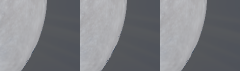
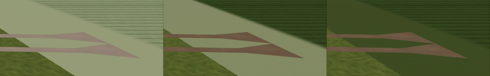

# Native visual audit — 28 November 2026

Ten specialist reviews produced ten validated shader changes across ten production files. The final source passed independent review of **60 matched native image pairs**, **12 A/B/B/A field comparisons** and **1,271 component-probe samples**. Native image review caught two regressions in the first candidate; both were corrected and recaptured. The remaining static views have no identified visual blocker in this roster. Motion and physical-GPU qualification remain open.

This evidence belongs to [VQ-07](../../plans/advanced-graphics.md). [Issue #23](https://github.com/bultodepapas/OpenRCsimulator/issues/23) and [draft PR #25](https://github.com/bultodepapas/OpenRCsimulator/pull/25) track the work on [`audit/native-visual-cohesion-2026-11-28`](https://github.com/bultodepapas/OpenRCsimulator/tree/audit/native-visual-cohesion-2026-11-28). The immutable comparison baseline is `71306784a250d634854f0c8bab3a927cc46a61b8`; the final captured production source is `1e91cb28eaed0079837e9a49d9e0b5a90253ee3e`. Later workflow and evidence commits do not change that runtime.

[Matched screenshot gallery](screenshots.md) · [Visual review](visual-review.md) · [Performance tables and replay](performance.md) · [Cited research](research.md) · [Independent review](independent-review.md)

## Scope and decision

The requested simulator is this repository's OpenRC Simulator. Its actual stack includes the existing Godot host, native C++ modules and custom compiled shaders. Production changes in this audit are confined to those shader paths. No new engine subsystem, production script, simulation tick, aircraft force model, user preset or renderer migration is introduced. Godot's renderer source is inspected to establish the existing host contract; graphics techniques are implemented directly in project shaders.

The visual direction is a believable RC club with legible aircraft, consistent daylight and weather, restrained material contrast, and detail that survives distance and motion. The [research review](research.md) connects that direction to real flying fields, aviation references, primary rendering literature and selected game imagery. Visual taste and photometric correctness have separate acceptance criteria: a source-level counterexample does not prove that the present game looks bad.

### Implemented changes and observed results

| Finding | Native change | Established evidence | Remaining acceptance |
| --- | --- | --- | --- |
| N1, lake absorption | Use bounded camera-ray length for Beer attenuation; retain an orthographic projection control | Thirty numerical samples; native lake overview and shoreline on both renderers. Compatibility shoreline changes stay within −3 to +5 code levels | Camera-pan invariance, additional shoreline/foreground conditions and hardware cost |
| N2, lens curtain | Square the signed Gaussian rim distance by multiplication | Nine signed samples remove GLSL's undefined negative-base `pow` input. Disabled, partial and held native lens controls reproduce the baseline on both renderers | Other driver/compiler behavior; no visible enhancement claimed on these drivers |
| M1, roof normals | Use relative UV conditioning and signed tangent-frame checks in both roof shaders; supply continuous texture gradients | Forty helper cases and 10,000 synthetic tangent-frame comparisons; both native 2 m roof views prove the old threshold was crossed. Metal relief is clearer; slate response is subtler | Motion, broader degenerate/flat-map rendered controls and local hardware cost |
| M2, Moon detail | Compute texture footprint from both projected-plane derivatives, retaining the original radial footprint as a lower bound | Symmetric-quad mip changes from 0 to 6.692645. All four final close/wide native images exactly reproduce baseline after the first limb regression was corrected | Subpixel motion, additional phases and supersampled comparison |
| P1, inactive Moon | Move the uniform zero-radiance return before projection and derivatives | Source control-flow review; active derivative flow remains uniform | Isolated inactive-output control and real sky-pass timing before crediting speed |
| L1, RC dirt lights | Honor the light's `SPECULAR_AMOUNT` in the custom GGX accumulation | Native 0.00/0.35/0.50 controls separate the highlights monotonically; lamp-off and neutral 0.50 images remain identical. Diffuse illumination remains at specular zero | Wider light/exposure combinations and hardware cost |
| PBR-01, countryside palette | Decode the proven authored vertex palette once per vertex; place the fixed headland swatch in the same color space before mixing | Fourteen transfer samples; all 7,168 triangles checked. Final headland–row gap 11.5818 passes the predeclared 6–30 criterion; road/row controls preserved | Other seasons, exposure and moving pilot readability |
| PBR-02, windsock | Derive the conical tangent from radius taper rather than diameter taper | Three rigid-section samples; normal angle corrects from 6.164° to 3.091°. Fabric shading changes in native views while the base control is identical | Flexible-section approximation and motion/shadow review |
| PBR-03, Aserradero veneer | Integrate periodic seam coverage over the unfolded pixel footprint | 168 samples and independent integration checks; front/top native views retain grain with localized seam changes | Stable pan and flight-distance shimmer; no temporal improvement claimed |
| ATM1, distant rain | Keep wrapped coordinates but pass unwrapped gradients to the fine texture sample | A 500×2 numerical grid removes the wrap-boundary mip spike. Native Compatibility storm stills differ at only 189/213 pixels by one code | Motion/compositing; no visible seam improvement established by these stills |

The changes add no production textures, render targets, passes, geometry, or resource bindings. They do add or rearrange shader arithmetic. The authored countryside vertex palette is converted per vertex, the lens square replaces `pow`, and the dark-Moon guard may skip work; none is a measured speedup. The relative roof check deliberately restores normal mapping in cases that previously skipped it, so its local cost can increase. Player frame-rate parity still requires physical-GPU measurements.

### Findings that were not changed

The [verification ledger](verification-ledger.json) contains all 24 reported dispositions: **17 validated, six conditional and one rejected**. The 17 include two corroborating duplicates and a measurement limitation; they are not 17 distinct visual bugs. There are 14 unique validated source defects/opportunities, ten implemented above and four deferred below.

| Finding | Independent conclusion | Why the source remains unchanged |
| --- | --- | --- |
| L2 / W2 | Already-lit lake-bed color is fed back through lit albedo | A naive emission replacement mishandles Compatibility exposure/tone mapping. Needs backend-specific radiometry fixtures |
| W3 | Water GGX density/visibility clamps differ from the native model | Removing clamps can create intense and temporally unstable glints. Requires a bounded HDR solution and matched motion |
| AVI1 | HX-700 rotor-blur color is multiplied twice | The ordinary repair belongs to the existing script mesh builder. Creating an unnecessary native subsystem would conflict with this audit's bounded native-only delivery |
| AVI2 | Stationary vegetation receives the aircraft-position wind sample under shear | Needs a separate field-position input while preserving aircraft-local effects and accepted simulation state |

Six hypotheses remain conditional: flight-line composition/readability, two optional paint tints at dusk, low-elevation cloud composition, lake Fresnel/roughness calibration, Moon-disc versus veil attenuation, and cloud/shadow registration away from the supported pilot origin. They lack the matched imagery or defined acceptance criterion needed to justify a change. The verifier rejected extrapolating software-renderer timing to target-GPU performance.

## Reproducible evidence

The pinned engine is `4.8.beta2.official.cafc17a19`, obtained and checksum-verified through `app/get-godot.sh`. The system-wide 4.7.2 executable was not used. The local host exposes no physical GPU or display and disallows the sockets required for a virtual display. It can run the pinned headless engine and a separate surfaceless Mesa OpenGL context.

### Numeric shader probes

[`shader_math_probe.py`](../../../tools/graphics/shader_math_probe.py) extracts the current production formulas, compiles them into a floating-point OpenGL framebuffer, and compares them to independent scalar/integral oracles. Run from the repository root:

```sh
python3 tools/graphics/shader_math_probe.py --out tmp/native-visual-audit-math-new.json
```

The [final-source passing receipt](evidence/shader-math-headland.json) records **nine groups / 1,271 samples**, source SHA-256 values and the exact renderer: Mesa 25.0.7 llvmpipe, LLVM 19.1.7, OpenGL 4.5, EGL 1.5. One thousand samples belong to a single rain-gradient grid; these are not 1,271 independent scenes or benchmarks. The independent verifier matched the recorded source hashes to the corresponding candidate. The [first passing receipt](evidence/shader-math.json) and [Moon-floor revision](evidence/shader-math-lunar-floor.json) retain their original source identities.

| Probe | Result |
| --- | --- |
| Water ray length / absorption | Maximum absorption error 2.70×10⁻⁸ against the oracle |
| Signed lens rim | All values finite; maximum error 7.37×10⁻⁷ |
| Palette conversion | Maximum error 1.18×10⁻⁸ |
| Rigid windsock taper | Maximum error 5.18×10⁻⁸ |
| Periodic veneer coverage | Maximum error 3.22×10⁻⁶; full-board mean 1.1/43 |
| Roof tangent helper | Maximum error 5.48×10⁻⁸ |
| Dirt specular control | Maximum error 9.36×10⁻¹² |
| Rain derivative footprint | Expected mip 3.619178; old wrap spike 10.991318; candidate maximum error 6.74×10⁻⁵ |
| Moon center footprint | Baseline mip 0; candidate 6.692645; oracle error 5.01×10⁻⁹ |

The [initial probe attempt](evidence/shader-math-initial.json) is retained. Its lunar fixture straddled two derivative quads, invalidating the zero-radial-derivative baseline oracle. Moving the same symmetric sample to a single quad corrected the fixture. This was a test-fixture error, not evidence of an additional game defect. Rain and lunar probes expose pre-fetch LOD calculations; they do not evaluate texture content, compositing or final game images.

### Integration and image checks

The checked runner records process exit, error/warning counts, completion and log hashes. The first production candidate passed all nine recorded gates: eight suites report 2,407 assertions and zero failures, and the roof gate checks geometry and material bindings separately. [Integration receipts](evidence/integration.json) distinguish baseline and candidate tests and retain two initial missing-asset failures resolved by hydrating the sparse checkout. These are historical integration results; the two subsequent shader corrections are checked by the final-source numerical probes and fresh native capture campaign. The [raw headless archive](evidence/headless-raw.tar.gz) preserves the exact logs and checked reports for all 19 recorded attempts, including the unsuccessful attempts; its [manifest](evidence/headless-raw-manifest.json) identifies all 38 files and their hashes. One windsock test used reference physics because the native stage library is unavailable; the headless lens test skips packed GPU buffer layout. Headless checks validate resource consumers and project logic; they do not establish rendered shader correctness or frame rate.

The [dedicated workflow](../../../.github/workflows/native-visual-audit.yml) runs the [matched capture tool](../../../tools/graphics/native_visual_audit.py) against OpenGL Compatibility/llvmpipe and Vulkan Forward+/lavapipe. Each workload uses a clean disposable checkout, the exact baseline/candidate shader bytes, the same pinned engine, fixed profiles/scene conditions and verified 1920×1080 PNGs. Actual runtime file hashes, camera/lighting manifests, observed renderer identity, checked logs and raw intervals are retained. Twelve offline tooling tests cover restoration, source scope, missing timing, renderer identity, matched conditions, active materials/controls and real nested-process completion/error handling.

```sh
python3 -m unittest discover -s tools/graphics -p test_native_visual_audit.py
python3 tools/graphics/native_visual_audit.py --renderer gl_compatibility --workload field:lake_shore --plan
python3 tools/graphics/native_visual_audit.py --renderer forward_plus --workload detail:roofs --plan
```

The field campaign uses six separate scene jobs per renderer. Each job retains A/B/B/A process order on the same VM, with 60 warm-up frames and 30 retained intervals per launch. The six detail groups each use A/B order; detail images do not supply timing comparisons. The roster contains 30 before/after views per renderer, including seeded storm rain, the selected Aserradero skin, seven [isolated dirt/lens controls](../../../tools/graphics/capture_native_shader_controls.gd), and two close roof views with runtime material and UV-footprint witnesses. The roof witnesses intersect the selected mesh on the CPU and verify that the old absolute determinant threshold is crossed. Both 2 m images visibly frame the witnessed material.

The controls exercise the production dirt material under an isolated spot and the production lens stack at exact seeded ages over a fixed chart; those chart images are component evidence, not a game scene. Shared test-harness copies resize existing SubViewports to 1080p; the paint harness also records camera, active-shader identity and native image hashes. Production scripts stay unchanged. The tool explicitly enumerates unexercised conditions, including temporal stability. It checks source, camera, lighting, adapter and decoded pixel identity before producing image differences. A changed-pixel count is evidence of a difference, not a visual-quality score.

The [first Forward+ attempt](evidence/hosted-initial-forward-plus.json) recovered 20 complete baseline images, including all five original roof views. Its roof process remained alive after publishing the completion manifest and was killed at the 900-second deadline; the exact blocked operation is unknown. No candidate block ran. The six-scene field launch took about 19 minutes, so a monolithic campaign also risked exhausting the job deadline. This evidence prompted workload sharding without reducing quality, warm-up or sample count. For image-only fixtures, the revised helper permits a recorded forced cleanup after a 30-second grace only when all native metadata and every expected, fully decoded PNG have been verified and remain unchanged. It preserves stdout/stderr through EOF for the independent checked runner and rejects genuine nonzero exits and engine errors. Imports and measured field launches still require normal completion. [Independent protocol review](evidence/capture-protocol-review.json)

### Lunar regression found during native review

The first complete Compatibility image set at `f066ef26` (production shader bytes identical to `9d456931`) exposed a localized close-Moon regression risk that the numerical center probe could not detect. Independent art and verification reviews found 141 pixels with a maximum channel difference of at least eight levels, all within the limb annulus; 34 changed by at least 64. At image pixel (1166, 390), a pale baseline edge pixel `[181, 182, 187]` became `[37, 58, 88]`, close to the surrounding sky. The [native-scale and enlarged edge comparison](evidence/images/moon-limb-initial.png) preserves this rejected first result. The radial coverage expression had not changed. The two-axis texture footprint could nevertheless select a finer mip than the old radial estimate along a diagonal, changing relief normals and their grazing-angle lighting.

The revised shader uses `max(plane_footprint, aa)`. This retains the center-footprint repair while preventing a sharper-than-baseline mip under the same filter rule. A source-bound scalar probe preserves the center's corrected mip and restores the old mip at an approximate version of the observed limb sample; it is not a rendered acceptance result. The [follow-up receipt](evidence/moon-limb-followup.json) records the rejected first image, geometric reasoning and predeclared native-image checks.

At final production source `1e91cb28`, all four native lunar stills—close and wide on both renderers—are RGB-identical to their matched baselines. All 141 Compatibility and 157 Forward+ close-view outliers of at least eight code levels are restored; the three corresponding Forward+ wide-view outliers also disappear. These images establish removal of the observed regression and preservation of that sampled phase on both renderers. The symmetric-quad probe establishes a separate filtering robustness improvement; the stills do not demonstrate more visible lunar detail or motion stability.



*Forward+ lower-right limb at native pixel scale. Left: baseline; middle: rejected first candidate; right: final source. The [crop manifest](evidence/regression-triptychs.json) records all original images, hashes and predeclared rectangles, including the Compatibility upper-right comparison.*

The Moon-only revision `48f931d2` launched both lunar views and all six A/B/B/A field workloads on each backend. This smaller routing is permitted only for a push whose entire `app`, `assets` and `tools` difference from `9d456931` is the lunar include. The subsequently observed headland issue below required a new revision and the full workload roster. The Moon-only run remains a separate, superseded experiment.

### Regional palette regression found during native review

The Forward+ field-entry pair exposed a mixed-color-space boundary after the vertex palette correction. The planted rows darkened toward the existing Compatibility reference, while a fixed headland pigment contributed 72% of the adjacent blend in its former domain. In the predeclared 24×16-pixel patches, the headland/row difference in encoded luma grew from 18.29 to 75.79 levels; the corresponding Compatibility gap was 11.86. The art reviewer and independent verifier both judged the resulting pale diagonal too conspicuous. [Independent measurement and acceptance criteria](evidence/headland-followup.json) · [Lossless native-pixel crop](evidence/images/headland-initial-roi.png) · [Crop provenance](evidence/images/headland-initial-roi.json)

Revision `1e91cb28eaed0079837e9a49d9e0b5a90253ee3e` puts only the headland pigment `(0.35, 0.40, 0.23)` through the existing color-space helper before the existing 0.28 palette mix. This is a deliberate choice to preserve the established Compatibility swatch and make its Forward+ blend coherent. The source history does not prove that every numeric color literal was authored in sRGB. The targeted test keeps the planted-row and road response as controls and checks the headland at the same native coordinates. A predeclared 6–30-level encoded-luma gap is an art-review tolerance for this composition, not a physical reflectance law.

The final native Forward+ field-entry image passes that criterion at **11.5818 levels**. The planted rows, track and stubble interior controls are unchanged from the first candidate, and the field border remains distinguishable without the rejected pale slab. Compatibility preserves its full field-entry and highway images exactly, including its 11.8562-level reference gap. In the Forward+ highway view, the correction changes 6,039 distant-parcel pixels while leaving the entire registered lane/median/shoulder rectangle unchanged. The art director, independent verifier and root reviewer all checked the decisive field-entry region. [Final visual review](visual-review.md) · [Independent native receipts](evidence/hosted-independent-review.json)



*Left: baseline; middle: rejected first candidate; right: final source. These are contiguous native-pixel crops without resampling or color adjustment. The full scene is preserved in the [paired gallery](screenshots.md).*

### Final campaign and retained evidence

The full roster was recaptured at `1e91cb28`: 30 baseline/candidate views on each renderer and six A/B/B/A field cases per renderer. The selected evidence contains 23 qualified workloads from [the primary run](https://github.com/bultodepapas/OpenRCsimulator/actions/runs/46172321068) and the Forward+ pavilion workload from [its qualified recovery](https://github.com/bultodepapas/OpenRCsimulator/actions/runs/46179049192). The primary pavilion job reached its outer deadline after three successful field launches and its fourth import. Its missing fourth result remains missing. The original pilot job completed and therefore remains selected, despite an available recovery.

The recovery selection rules were committed before results were available. They prefer a complete original result, never choose by measured speed, and keep all four launches of each comparison on one VM. Both nonselected attempts are preserved separately. [Pilot selection](evidence/pilot-selection-final.json) · [Pavilion selection](evidence/pavilion-selection-final.json)

The independent verifier checked all 60 final native pairs against the original archives. All 60 baseline frames reproduced their earlier untreated captures. Compared with the first candidate, 43 final candidate frames are unchanged, four lunar views restore baseline, and 13 Forward+ views contain the regional palette correction. These counts describe the recorded static roster, not all aircraft, weather states or quality settings.

The [gallery](screenshots.md) preserves 60 side-by-side review JPEGs. The original archives contain 120 distinct retained 1920×1080 PNG files; another 24 field-repeat observations have matching recorded PNG/RGB hashes and were deduplicated by the capture tool. There are 144 recorded image observations, not 144 retained PNGs. The repository also preserves lossless regression crops, image provenance and [raw numeric replay](evidence/field-benchmarks-final.zip). Original hosted archives have the workflow's 14-day retention; the committed review images, hashes and numeric evidence remain in Git.

All 48 selected measured field launches exited naturally with code 0. Of 24 image-only launches, 19 exited naturally and five Forward+ processes required recorded post-save SIGTERM after complete images remained stable through at least 30 seconds. These were both windsock captures, both storm captures and the candidate roof capture. The [lifecycle ledger](evidence/hosted-capture-lifecycle-final.json) preserves all return codes, signals, grace periods and log hashes. Optional Vulkan optimization logged 256 unsupported-opcode messages across the selected logs; the engine fallback retains original SPIR-V. The cause of delayed teardown was not established.

### Performance acceptance

The [complete performance report](performance.md) includes FPS, wall-time P50/P95, viewport CPU/GPU polls, sampled process CPU/RSS and engine allocation/draw counters for all twelve cases. Its raw replay regenerates the published JSON byte-for-byte. The verifier separately recalculated 648 timing statistics, 24 paired throughput changes and all 48 process resource records.

| Selected measurement | Result |
| --- | --- |
| Retained post-warm-up wall intervals | 1,440 across 48 launches |
| Compatibility paired throughput changes | −0.55% to +1.03% |
| Forward+ paired throughput changes | −0.66% to +2.25% |
| Comparisons whose two paired changes have opposite signs | 8 of 12 |
| Engine allocation, draw and primitive counters | Identical across all four launches in each of 12 cases |
| Direct-process resource coverage | 45 complete; three partial due to a missing terminal process-status sample after exit |

These small, mixed changes do not establish a repeatable speedup. Each scene uses its own VM; no cross-VM or cross-backend timing average is reported. Sampled RSS and CPU remain per-launch observations, not proof of memory or CPU improvement.

Hosted software timing is scoped to its named software installation. Render-loop FPS is derived from post-draw wall intervals. The viewport's CPU-side counter measures elapsed time around rendering and can include waits; it does not measure consumed process CPU time. Positive GPU polls have unverified age; zero readings remain unavailable. In the sharded campaign, direct-process CPU consumption and RSS are sampled separately from startup through that job's selected scene; the initial monolithic receipt spans all six views. Engine video-memory accounting is not physical GPU memory.

These distinctions follow the pinned engine's [viewport begin/end measurements](https://github.com/godotengine/godot/blob/cafc17a192acf67903910a68aeb3c076c0907a4b/servers/rendering/renderer_viewport.cpp), [OpenGL timestamp collection](https://github.com/godotengine/godot/blob/cafc17a192acf67903910a68aeb3c076c0907a4b/drivers/gles3/storage/utilities.cpp) and [timestamp publication](https://github.com/godotengine/godot/blob/cafc17a192acf67903910a68aeb3c076c0907a4b/servers/rendering/rendering_server_default.cpp). The driver uses a three-slot query buffer. Distinct positive values do not establish which rendered frame each poll describes, because the fixture does not retain its query/frame identifier. The report preserves the values without asserting same-frame GPU attribution; see also [Vulkan asynchronous query semantics](https://docs.vulkan.org/spec/latest/chapters/queries.html).

Target acceptance requires the same A/B/B/A campaign on a named physical GPU with fixed resolution, driver, renderer, AA, display/present settings, scene, clock, flight backend and an idle host. The supplied hosted runner deliberately forces and verifies a software device; physical qualification needs an explicit hardware profile instead of that software-only policy. Preserve all runs and raw frame-time distributions, CPU scope, GPU query/trace attribution and memory scope. Report variation between launches before claiming a small difference; see [Kalibera and Jones](https://kar.kent.ac.uk/33611/). Attribute actual GPU work with an appropriate profiler such as [Nsight GPU Trace](https://docs.nvidia.com/nsight-graphics/UserGuide/gpu-trace-overview.html). No target FPS, GPU time or memory improvement is asserted by this audit's local receipts.

### Reproduce a native software capture

Use a disposable Linux checkout with all tracked `app`, `assets` and `tools` files hydrated, the virtual-display/Mesa packages listed in the workflow installed, and no existing generated files under `app` or `assets`. Pin the corrected production source before running; the capture runner checks cleanliness and temporarily substitutes the ten baseline shaders, restoring candidate bytes after every launch. The output directory must be new.

```sh
git checkout --detach 1e91cb28eaed0079837e9a49d9e0b5a90253ee3e
git fetch --no-tags --depth=1 origin 71306784a250d634854f0c8bab3a927cc46a61b8
audit_python="$(app/tests/visual-env.sh)"
python3 -m pip --python "$audit_python" install -r tools/godot/requirements-resources.txt
godot="$(app/get-godot.sh)"
xvfb-run -a -s "-screen 0 1920x1080x24" "$audit_python" \
  tools/graphics/native_visual_audit.py \
  --renderer gl_compatibility --workload field:lake_shore \
  --godot "$godot" --out /tmp/openrc-native-qa-gl-lake-shore \
  --disposable-checkout
```

Use `forward_plus` for the other backend, or `detail:moon` for the matched lunar views. The tool's `--plan` output lists the exact checked commands and fixed environment without starting the engine. These software-only settings and device checks are intentional; removing the device guard and calling the result a physical-hardware benchmark would invalidate the comparison policy.

### Broader PR checks

Ordinary PR CI tests a synthetic merge with newer main-branch changes; the dedicated campaign above tests the frozen audit runtime directly. The historical [independent CI receipt](evidence/ci-triage.json) attributes the initial merged visual-capture errors to a runtime shader-global helper added on main, and reproduces four fixture source-pin mismatches already present at the audit baseline that block both shaft and weather publication checks. Its session-reach and Windows floating-point deadline observations belong to those recorded commits. They do not establish the cause of later CI results.

The [follow-up receipt](evidence/ci-followups.json) keeps later merge identities and job statuses separate. Windows tooling suites passed at the `57ea3da9` and `4ed6eed6` synthetic merges. Broader CI at `57ea3da9` included successful Linux/Windows native build, kernel and production checks, but its required aggregate failed after several other jobs were cancelled. At the recorded `4ed6eed6` snapshot, Linux/Windows builds and kernel qualification, Windows native production checks and unit shard 5 had passed; other selected jobs were still running. This audit does not report all PR checks green. The evidence-only commit starts ordinary PR checks again and does not bypass any gate.

## Independent review and team

All ten requested specialists ran as separate `gpt-6.2-astra` agents with `ultra` reasoning, in batches constrained by four concurrent slots. The verifier reviewed each intake, rejected unsupported interpretations, examined the implementation independently, and retained missing acceptance evidence per finding. The [independent review](independent-review.md) is separate from the implementation report.

| Role | Contribution |
| --- | --- |
| 1. Art director / references | RC field composition, material and game reference research |
| 2. Native rendering architect | Actual host/native/shader paths, bounded integration |
| 3. Graphics mathematician | Derivatives, numerical conditioning, roof and Moon implementation |
| 4. Lighting / GI | Native light semantics and water transport limitations |
| 5. PBR / microtextures | Color transfer, fabric normals and periodic filtering |
| 6. Water / reflections | Ray length, Fresnel and roughness hypotheses |
| 7. Atmosphere / effects | Rain gradients, cloud and lunar visibility |
| 8. Aviation physicist | Rotor rendering and spatial wind consistency |
| 9. Game / GPU performance | Matched capture tooling, timing and memory attribution |
| 10. Independent verifier | Every finding disposition, source review and independent checks |
