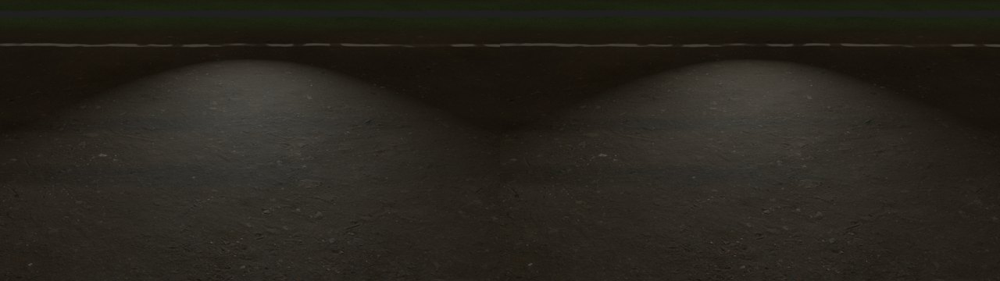

# Matched image review

The final static review covers **60 baseline/candidate image pairs**, 30 on each renderer. The corrected Moon reproduces the baseline in all four captured views. In Forward+ the field-entry headland and rows now differ by **11.58** luma-code levels, down from **75.79** in the rejected candidate. The close metal shelter roof shows clearer raised ribs and fasteners on both renderers. The two storm stills on each renderer establish no visible rain-seam improvement. The [final comparison](#final-comparison) records the evidence and the [gallery](screenshots.md) contains the paired compositions. Motion stability, in-flight aircraft readability and physical-GPU cost require separate evidence.

## Compatibility — isolated dirt and pilot-lens controls

Baseline `71306784a250d634854f0c8bab3a927cc46a61b8`, candidate `9d4569310ef223fc129472a20e21aada8ea624f0`. Seven baseline/candidate PNG pairs, 1920×1080, captured with Godot 4.8-beta2 `cafc17a19`, OpenGL 4.5 Compatibility, Mesa 25.2.8 llvmpipe (LLVM 20.1.2). Reviewed the complete compositions and native-pixel crops of the lamp pool, upper track edge, curtain rim, drip ends and chart bars. Coordinates below use the top-left origin and exclude the right and bottom endpoints. [GitHub Actions artifact 15272026249](https://github.com/bultodepapas/OpenRCsimulator/actions/runs/46165331310/artifacts/15272026249)

Baseline is on the left; candidate is on the right. This is a reduced JPEG review image; pixel equality and measured color use the original PNGs. [Zero-specular comparison](evidence/images/9d456931/gl_compatibility/controls-dirt_specular_000.jpg) · [Partial lens control](evidence/images/9d456931/gl_compatibility/controls-lens_curtain_partial.jpg)

| Images reviewed | Observed result |
| --- | --- |
| `dirt_light_off`, `dirt_specular_050` | Each pair is pixel-identical. The off view retains the dim brown soil. At 0.50 the gray highlight remains visible over the textured patch. |
| `dirt_specular_000`, `dirt_specular_035` | At zero specular the candidate retains a diffuse lamp pool over brown soil and removes much of the gray sheen. At 0.35 it makes a smaller reduction. The stones and soft edge of the pool remain recognizable. Every channel change is a decrease within the lower receiver region (y ≥ 226). The upper background is identical. No new boundary or visible break appeared at the pool edge. |
| `lens_disabled`, `lens_curtain_partial`, `lens_curtain_held` | All three pairs are pixel-identical. At 0.5 s the red rim and drip tips are visible against the chart. At 1.5 s only sections of the rim remain along the lower image edge. The disabled view shows the unobscured chart. The partial view provides the clearest check of rim continuity. |

In the lamp pool (x 860–1060, y 300–500), baseline mean RGB was (68.6, 66.5, 61.0) for all three lit settings. Candidate means at 0, 0.35 and 0.50 were (59.4, 53.9, 42.6), (66.0, 63.0, 56.2) and (68.6, 66.5, 61.0). These are 8-bit output values. The measured change follows the lamp control in this composition. Primary rim crops were x 820–1140, y 380–590 for partial, and x 744–1064, y 950–1080 for held. The lens arithmetic change preserves these two active ages on this driver. Scope is static control imagery.

## Compatibility — field, Moon, roofs, windsock, storm and paint

The original run compared baseline `71306784a250d634854f0c8bab3a927cc46a61b8` with candidate `f066ef26c28947fbfa2f7893ececbc1f8657e5b3` on the same 1920×1080 OpenGL software renderer. The ten production shaders match the later `9d456931` candidate byte for byte. We reviewed all 21 field and detail pairs in the first A/B blocks, using the native PNGs for crops and RGB comparisons. The seven controls in each block also match their corresponding sharded captures pixel for pixel. The original run stopped during its last baseline repeat. Its image pairs support the observations below. Its timing experiment is incomplete. [Original run 46160123980, artifact 15272014501](https://github.com/bultodepapas/OpenRCsimulator/actions/runs/46160123980/artifacts/15272014501) · [Recovered run receipt](evidence/hosted-initial-compatibility.json)

| Images reviewed | Observed result at 1080p |
| --- | --- |
| Field — lake overview, lake shore, pilot north, field entry, highway, pavilion postcard | The shore changes chiefly in the oblique band of shallow water. In the lower-left crop (x 0–285, y 825–975) mean green and blue rise by about 1.4 and 1.5 levels. The bank edge, visible bottom and lily pads remain legible. The overview changes by at most one level. Pilot north has 62 one-level differences on the far right. The other three views are pixel-identical, including the dirt tracks and distant field colors. The empty pilot view cannot assess aircraft readability. |
| Moon — full high, close and wide | The close disc retains its mottling and round outline at composition scale. A short part of the upper-right limb has a visibly harder staircase in the candidate. Around (1166, 390) several formerly intermediate pixels drop to sky color. The wide disc occupies roughly nine pixels across, with 45 pixels changed by at most four levels. Its surrounding sky and clouds match. Close-limb acceptance remains open. |
| Roofs — club aerial, farm, pavilion from pilot, pavilion roof, shed roof | At the pavilion and shed, the shingle courses, seams and trim match to the eye. Only six and one pixels respectively differ, each by one level. The farm and pilot pairs are identical. The strongest aerial change is on the windsock (x 1496, y 552). These five frames preserve the sampled roofs but do not establish restored detail at the shader's old UV cutoff. |
| Windsock — whole, fabric, throat and base | The changed shading follows the curved cloth. It is easiest to see on the orange bend and inner throat (x 898–1183, y 585–735). The highlight shifts subtly while the fabric bands, dark hoop and support remain legible. The base pair is pixel-identical. The stills show no new break at a band boundary. They do not establish motion behavior. |
| Storm — distant daytime pilot, 25° and 50° | The column, its pale lower rain and the hillside read alike in both views. The decoded differences are sparse in the lower sheet, with 213 and 189 pixels respectively changing by just one level. Neither crop demonstrates a visible reduction in rain seams. |
| Aserradero — three-quarter front and top | Differences follow the veneer seams on the wing, fuselage and tail. Native wing crops (front x 898–1183, y 465–615 and top x 898–1183, y 345–495) retain fine grain, knots and section boundaries. No new stripe across the skin is apparent at these distances. These two stills do not test seam shimmer during a pan. |

At the strongest lunar outlier, baseline RGB (181, 182, 187) becomes (37, 58, 88). All 141 close-view pixels with a channel delta of eight levels or more lie 249–256 pixels from disc center (959.5, 539.5), near the roughly 254-pixel limb. Several alternate between sky and surface in a short diagonal. Elsewhere the central surface changes are subtle. A registered supersampled reference and a subpixel pan would distinguish more faithful relief from sampling artifacts and test whether the stepping persists in motion.

## Forward+ — first candidate

The following pairs compare baseline `71306784a250d634854f0c8bab3a927cc46a61b8` and first candidate `9d4569310ef223fc129472a20e21aada8ea624f0` in the 1920×1080 Vulkan software-renderer campaign. The [gallery](screenshots.md) identifies each source revision and capture.

**Isolated spot and pilot lens (seven pairs).** Under the lamp, the zero-specular candidate keeps the rounded diffuse pool and visible soil texture while reducing the gray sheen. The same effect is gentler at 0.35. In the native crop at x 820–1100, y 394–534, mean RGB changes by (−9.2, −12.4, −17.9) at zero and (−2.6, −3.4, −4.7) at 0.35. The off and 0.50 pairs match exactly. All three lens pairs also match exactly. The partial view shows the individual drips against the chart and the held view retains a strip of visible rim near the bottom. [Control artifact 15272644713](https://github.com/bultodepapas/OpenRCsimulator/actions/runs/46165331310/artifacts/15272644713)

**Countryside field entry.** The track turns from light pink-gray to earth brown and remains readable. At right, a pale diagonal headland stands out much more sharply against the darkened planted rows. The boundary was visible in both images. Its higher contrast makes the candidate read as a pale wedge across the field at ordinary viewing size. In the native crop x 1408–1920, y 456–696, two 24×16-pixel patches at x 1718–1742 isolate the planted rows (y 486–502) and headland (y 546–562). Their mean 8-bit luma-code separation increases from 18.3 to 75.8 levels, using 0.2126R + 0.7152G + 0.0722B on the saved RGB. The same two patches differ by 11.9 levels in the Compatibility view. The distant pale parcel remains stable at x 1690–1718, y 296–305. The shared palette conversion restores the intended crop and track color handling, while the headland mix still needs art review in Forward+. [Field entry artifact 15273698470](https://github.com/bultodepapas/OpenRCsimulator/actions/runs/46165331310/artifacts/15273698470)

**Moon (two views, superseded source).** The close view shows a few extra dark blue flecks at the lower-right lunar edge. At x 1200, y 621 a pale RGB (154, 155, 159) becomes (37, 56, 81). All 26 close-view pixels with a channel difference of at least 64 levels are within radii 250.6–254.4 pixels of disc center. The wide Moon remains a small bright disc among clouds in both captures. The directional glare around the Moon is present in both. [First Forward+ Moon artifact 15274170525](https://github.com/bultodepapas/OpenRCsimulator/actions/runs/46165331310/artifacts/15274170525)

## Compatibility — close roof materials

The two close views in the seven-view roof shard compare `71306784` with `9d456931`. At a camera distance of two metres, the pavilion slate and corrugated pit-shelter roof each fill the frame. The observed center-ray UV determinants were 2.24314×10⁻⁷ and 2.76123×10⁻⁷ respectively. The slate changes subtly: courses, chipped edges and mottling remain legible. The metal shows a clearer highlight and shadow on opposite sides of the ribs, and the fasteners stand out from the sheet. At x 113, y 1069, where the largest metal change occurs, the rib darkens within a continuous relief pattern. The center and lower-left native crops show no new break in the ribs, and neither metal image clips an RGB channel to white. The five wider views reproduce all ten corresponding earlier PNGs pixel for pixel. This is close-range, fixed-camera evidence for M1. [Roof artifact 15273728682](https://github.com/bultodepapas/OpenRCsimulator/actions/runs/46165331310/artifacts/15273728682)

## Headland follow-up criteria set before capture

For the field-entry crop above, the art target is a legible headland that belongs to the planted parcel. The two reference gaps measured 11.9 and 18.3 luma-code levels. The proposed local acceptance band is a positive gap of 6–30 levels, with recognizable rows, an uninterrupted track and no new halo at the field boundary. The unchanged track and distant patch are controls. For the highway, inspect the lane markings, asphalt, median and shoulder at x 1510–1900, y 760–944 and the distant parcels at x 1390–1915, y 520–680. The targeted pigment change should preserve lane/asphalt interiors from the first candidate and the Compatibility image. These thresholds belong to these saved compositions and do not describe a universal physical property of farmland.

## Forward+ — additional first-candidate field and material views

These pairs also use `71306784` and `9d456931`.

| Views | Observed result |
| --- | --- |
| Plain highway | Pale gray asphalt becomes charcoal. Lane dashes and edge markings stay narrow and legible, with a paler grass median. The nearest right parcel has a thin dark oblique edge. The more distant parcels and electricity pylons remain distinguishable. The conspicuous pale headland wedge from field entry is absent at this distance. [Highway artifact 15272959800](https://github.com/bultodepapas/OpenRCsimulator/actions/runs/46165331310/artifacts/15272959800) |
| Lake overview and shore | In the overview, the strongest changes belong to the planted parcels behind the pond. Native crop x 505–955, y 88–253 shows darker fields and stable farm buildings and tree silhouettes. The pale shallow rim and lily pads remain visible. The shore camera shows a subtle change where the bottom is visible under oblique water. At x 12–292, y 805–945, mean RGB shifts by (−3.9, −2.0, −1.7) with no new line across the water. [Overview artifact 15274611048](https://github.com/bultodepapas/OpenRCsimulator/actions/runs/46165331310/artifacts/15274611048) · [Shore artifact 15274430846](https://github.com/bultodepapas/OpenRCsimulator/actions/runs/46165331310/artifacts/15274430846) |
| Windsock — base, whole, fabric and throat | At the bend and inner orange throat the material changes subtly while the stitched boundary, hoop and pole remain continuous. The base pair is pixel-identical. Other changed regions include the distant field and pavilion visible behind the cloth. [Windsock artifact 15274097834](https://github.com/bultodepapas/OpenRCsimulator/actions/runs/46165331310/artifacts/15274097834) |
| Pavilion postcard | The composition retains the white clubhouse, shaded porch and nearby pilot figures. The roof shading shifts subtly. A native crop around x 497, y 559 places the strongest change in the distant field strip behind the parked vehicle. [Pavilion artifact 15273839584](https://github.com/bultodepapas/OpenRCsimulator/actions/runs/46165331310/artifacts/15273839584) |
| Roofs — seven views | Both 2 m target materials fill their frames, with the same measured UV footprints as Compatibility. In the shelter close-up, the lapped ribs and fasteners gain visible relief. At x 113, y 1062 the strongest change follows one continuous shaded rib. The slate retains the chipped courses and mottling. The pavilion aerial, pilot and shed views preserve the roof silhouettes. In the farm view much of the change belongs to the surrounding parcels, where the light headland contrast is visible again. [Roof artifact 15273889693](https://github.com/bultodepapas/OpenRCsimulator/actions/runs/46165331310/artifacts/15273889693) |
| Aserradero — three-quarter front and top | Native wing crops at x 900–1180, y 470–610 (front) and y 350–490 (top) retain the veneer grain, knots and dark edge trim. The small changes trace the board seams on the aircraft, with peak channel differences of nine and eight respectively. These stills establish no improvement in motion. [Aserradero artifact 15274524705](https://github.com/bultodepapas/OpenRCsimulator/actions/runs/46165331310/artifacts/15274524705) |
| Pilot north | The first checked image pair from this incomplete timing shard shows 953 changed pixels in a narrow distant-field band at y 553–584. The tree line, mountain skyline and foreground keep their visual hierarchy. The candidate repeat matches exactly. No aircraft is present to test attitude legibility. [Pilot artifact 15274381976](https://github.com/bultodepapas/OpenRCsimulator/actions/runs/46165331310/artifacts/15274381976) |
| Distant storm — 25° and 50° | The 25° view changes by at most one level in 350 pixels around the lower rain sheet. In the 50° view, the strongest differences appear along the distant ground behind the trees; the broad column and pale rain read alike. Neither view demonstrates a visible seam reduction. [Storm artifact 15275388076](https://github.com/bultodepapas/OpenRCsimulator/actions/runs/46165331310/artifacts/15275388076) |

## Final comparison

The final campaign uses baseline `71306784a250d634854f0c8bab3a927cc46a61b8` and candidate `1e91cb28eaed0079837e9a49d9e0b5a90253ee3e`. For each final pair, the complete decoded native PNGs are compared with the corresponding previously reviewed baseline and first-candidate PNGs. An exact match carries the earlier full-frame and crop observations forward. Changed pixels drive a new visual inspection at the relevant surface. The [final capture run](https://github.com/bultodepapas/OpenRCsimulator/actions/runs/46172321068) and [image gallery](screenshots.md) identify the individual sources.

**Compatibility Moon.** Both final full-high views match the baseline exactly across all 1920×1080 RGB pixels. The baseline PNGs also match across the two campaigns. In the upper-right close crop (x 1046–1286, y 290–490), the earlier hard step is gone. Pixel (1166, 390) returns from (37, 58, 88) to (181, 182, 187). All 141 earlier close pixels with a channel difference of eight levels or more return to baseline. This confirms removal of the observed regression. The center-quad benefit remains a separately measured property of texture LOD; the full-high stills display the baseline surface detail. [Final Compatibility Moon artifact 15276690827](https://github.com/bultodepapas/OpenRCsimulator/actions/runs/46172321068/artifacts/15276690827)

**Compatibility, complete roster.** All 30 final baseline PNGs reproduce their original baseline RGB exactly. Of the 30 candidate images, 28 exactly reproduce their first-candidate RGB. This includes both close roofs, the aircraft, the rain sheet, all six field views, every windsock view and all seven dirt/lens controls. The two Moon images are the exceptions described above. The field-entry and highway baseline/final pairs remain pixel-identical. The registered field-entry headland gap is 11.86 levels in all three revisions. [Final roof artifact 15277025966](https://github.com/bultodepapas/OpenRCsimulator/actions/runs/46172321068/artifacts/15277025966) · [Final field-entry artifact 15276408008](https://github.com/bultodepapas/OpenRCsimulator/actions/runs/46172321068/artifacts/15276408008)

**Forward+ highway.** The first and final candidates have identical RGB throughout the declared road, shoulder and median crop (x 1510–1900, y 760–944). The narrow marks stay continuous on the dark asphalt. All 6,039 changed pixels between candidates lie in the distant parcel band at y 495–571. In native crop x 930–1350, y 470–666, a pale strip beside the road darkens toward its surrounding vegetation. The first-campaign and final baseline PNGs match. [Final highway artifact 15276704188](https://github.com/bultodepapas/OpenRCsimulator/actions/runs/46172321068/artifacts/15276704188)

**Forward+ field entry — headland accepted.** In the predeclared x 1408–1920, y 456–696 crop, the final border reads as muted olive soil and vegetation beside the darker planted rows. The light wedge no longer dominates the parcel. The row pattern, brown track and turn at the parcel end remain visible, including the pre-existing angular track geometry. No new halo appears along the transition. The original and final baseline PNGs match exactly. [Final field-entry artifact 15277202149](https://github.com/bultodepapas/OpenRCsimulator/actions/runs/46172321068/artifacts/15277202149)

| Forward+ field entry, same 24×16 patches | Baseline | First candidate | Final |
| --- | ---: | ---: | ---: |
| Mean RGB, rows | (126.3, 137.5, 100.7) | (47.0, 63.7, 27.2) | (47.0, 63.7, 27.2) |
| Mean RGB, headland | (147.9, 154.9, 118.1) | (130.1, 137.6, 99.8) | (61.5, 74.9, 34.0) |
| Headland minus rows, luma-code levels | 18.29 | 75.79 | **11.58** |

The measured final gap is within the predeclared 6–30 review range. Relative to the first candidate, three interior controls are pixel-identical: planted rows (x 1718–1742, y 486–502), brown track (x 1500–1520, y 565–570) and distant pale parcel (x 1690–1718, y 296–305). The final candidate was read from the artifact's `2-candidate/field/plain_field_entry.png`. The baseline and rejected candidate were read from the matching `1-baseline` and `2-candidate` paths in [first field-entry artifact 15273698470](https://github.com/bultodepapas/OpenRCsimulator/actions/runs/46165331310/artifacts/15273698470).

**Forward+ Moon.** Both final full-high PNGs match their respective baselines at every RGB pixel. The lower-right crop (x 1120–1280, y 552–694) shows the baseline edge again. At (1200, 621), RGB returns from (37, 56, 81) to (154, 155, 159), and all 157 earlier close-view deviations of at least eight levels disappear. These two frames and the two Compatibility frames demonstrate regression removal on the captured static phase. [Final Forward+ Moon artifact 15277531335](https://github.com/bultodepapas/OpenRCsimulator/actions/runs/46172321068/artifacts/15277531335)

**Forward+, complete roster.** All 30 baseline frames reproduce the first-campaign RGBs. Fifteen candidate frames exactly reproduce the first-candidate output, including both close roof materials, both Aserradero views, all seven dirt/lens controls and the 25° storm view. The two Moon frames regain the baseline limb. Across the remaining 13 views, direct first-to-final differences fall on the countryside parcels. The headland is easiest to see at the field entry and in the farm aerial. At x 1349–1769, y 538–734 in the farm view, the conspicuous pale rim at a dark cultivated plot becomes a muted olive border. The farm buildings and ribbed roof relief remain legible. In the lake, windsock, pilot and 50° storm views the follow-up affects strips of distant ground. The foreground water, cloth and cloud observations from the first review carry over. [Final Forward+ roofs](https://github.com/bultodepapas/OpenRCsimulator/actions/runs/46172321068/artifacts/15278167538) · [Final Forward+ windsock](https://github.com/bultodepapas/OpenRCsimulator/actions/runs/46172321068/artifacts/15277876831) · [Final Forward+ storm](https://github.com/bultodepapas/OpenRCsimulator/actions/runs/46172321068/artifacts/15278026779)

The original final Forward+ pavilion job was cancelled. The selected postcard pair comes from recovery run `46179049192`, artifact `15278390564`, at the same baseline and final shader revisions. Its baseline is RGB-identical to the prior baseline. The final versus first candidate changes 477 pixels at x 1–437, y 558–560 inclusive, in a distant field strip visible behind trees and parked cars. The clubhouse, porch figures and roof preserve their earlier appearance. [Recovery pavilion artifact 15278390564](https://github.com/bultodepapas/OpenRCsimulator/actions/runs/46179049192/artifacts/15278390564)

Across the 60 selected static views, **43 final candidate frames** match the first candidate's decoded RGB exactly (28 Compatibility and 15 Forward+). **Four lunar frames** restore the baseline output. The **13 remaining Forward+ frames** contain the headland correction in the main field or in background parcels. Every final baseline matches its corresponding first-campaign baseline. These counts establish which visual observations carry over between revisions.
