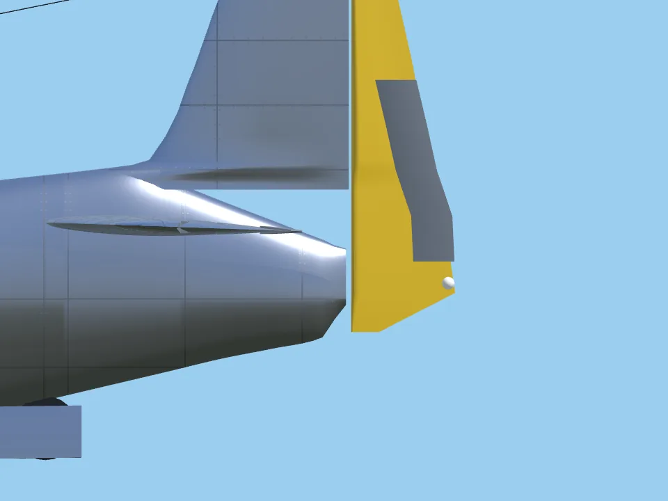
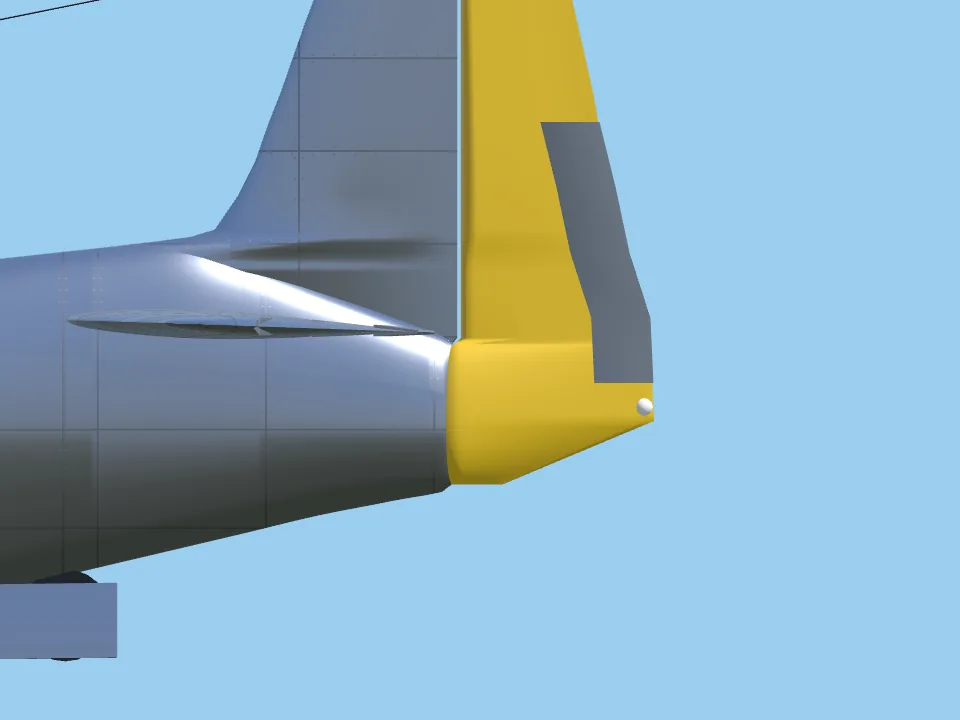
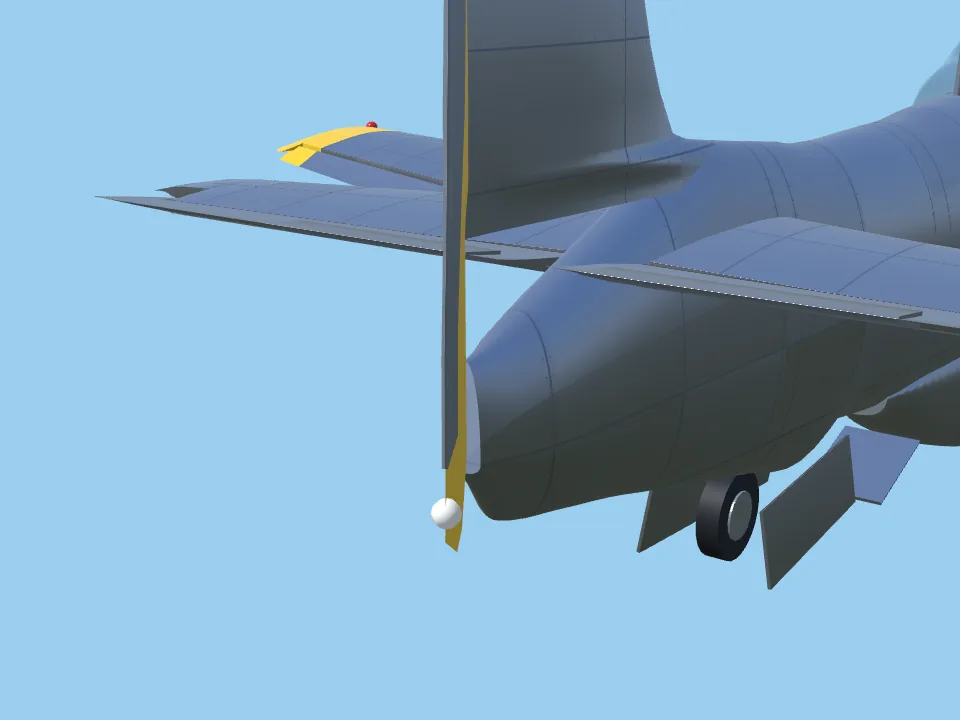
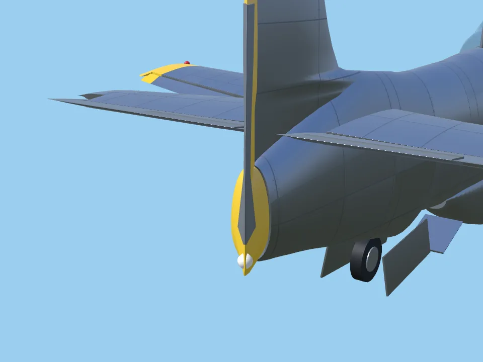
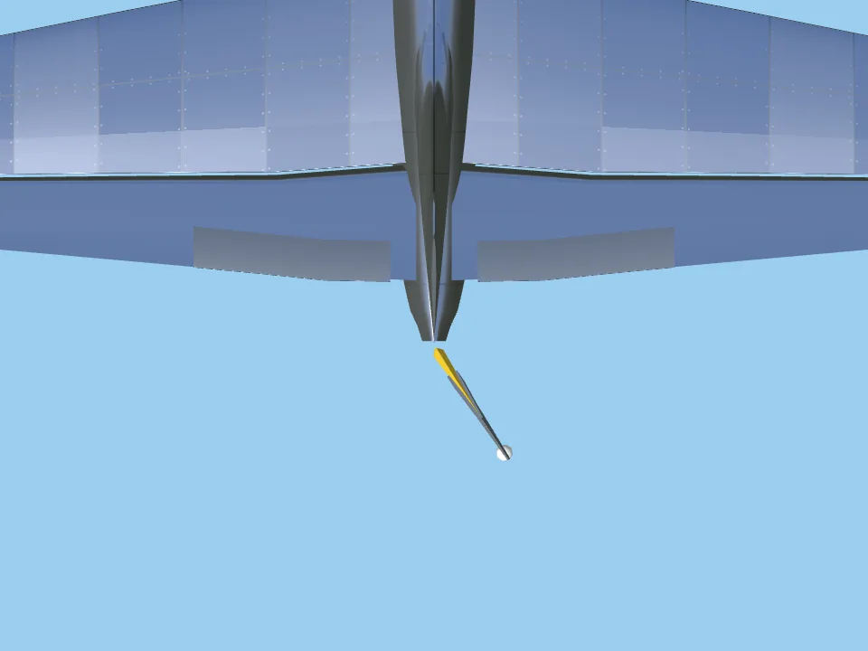
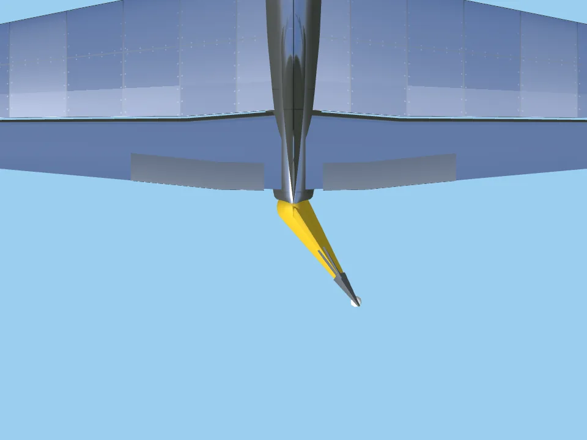
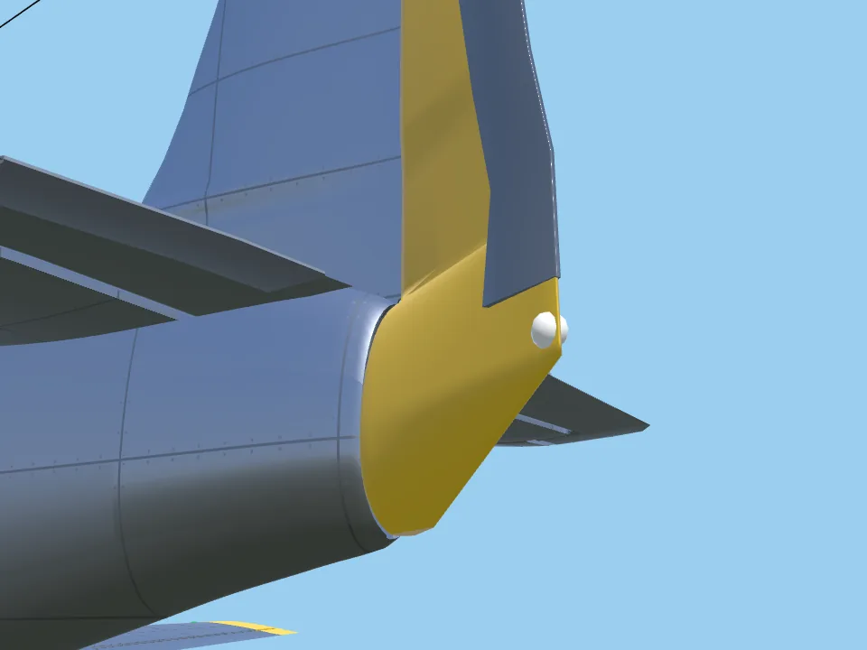

# P51-V14: the visual rudder is the physics rudder

2026-10-15 · Revision 1 · **Status: implemented and verified in software.**
- The P-51's 3D rudder now hinges where its physics rudder does: the aerodynamic hinge P51-24 solved from the NACA production rudder area.
- The tail cone aft of the hinge is now the lower rudder, with a round nose turning inside a matching concave cut in the fuselage.
- A see-through gap above the aft fuselage under the fin is closed.
- Physics data is bit-identical.

Prefix: P51-V14. [P-51 guide](../../../P51-PLAN.md) · Physics hinge: [P51-24](../P51-24/README.md) · Probe: [`clearance_probe.gd`](../../../../research/p51/p51-v14/clearance_probe.gd)

## Before

[P51-24](../P51-24/README.md) moved the *physics* rudder hinge to 6.488 m (full size). With the hinge there, the measured silhouette aft of it is the production P-51D rudder, 10.41 ft² (NACA RM L6J25 / MR L-566). The visual model kept an unmeasured 6.64 m tail post, which leaves a 7.2 ft² rudder. Moving it failed `verify_p51`, because the fuselage tail cone extended past the new hinge.

The new close-up tail captures (`inspect_p51.gd --suite=tail`) also showed two visual defects:
- **Gap above the aft fuselage:** the fin's lowest section was flat at the dorsal height (0.144 m), while the fuselage deck falls to 0.074 m at the tail. The sky showed through a 35–50 mm gap above the aft fuselage in side view; the pixels there were exactly the background colour.
- **Blunt tail:** the tail cone ended in a blunt face, with a 21.6 mm rudder blade behind it. On the P-51D the lower rudder fairs the fuselage cone down to the tail light.

| | Before | After |
| --- | --- | --- |
| Side |  |  |
| Rudder full right, from behind |  |  |
| Rudder full right, from above |  |  |

Rudder full left, from below left: 

## Change

**One hinge.** `source.json` `tail.rudder_hinge_z` is now 6.4883 m, the P51-24 solve. The earlier 6.64 m post is kept as `tail_post_z`, used only for the cone stations and the physics side polygon's corner. That is why the physics data is bit-identical: 0 differences across every value and string of `p51d_mustang_120.json`; only one note in `derivation.md` changed. Both values are written by [`apply_metrology.py`](../../../../research/p51/p51-02/silhouette/apply_metrology.py). [`derive_physics.py`](../../../../research/p51/p51-05/derive_physics.py) now fails if the visual hinge drifts more than 0.5 mm from its solved hinge, so the two cannot diverge again.

**The metrology writer is idempotent again.** Re-running `apply_metrology.py` would have reverted the P51-13 aileron correction: 3.377 m inner end and chord fraction 0.19 (NACA XP-51 dimensions), which had been edited into `source.json` directly. The writer now carries those values, and its output on a disposable copy differs from `source.json` only by the hinge change.

**Builder** ([`p51d_model.gd`](../../../../app/aircraft/p51d_model.gd)):

| Part | Geometry |
| --- | --- |
| Fixed fuselage | Ends at the hinge. Its end is a concave cut: in every horizontal slice, a circle about the hinge axis 2.5 mm outside the rudder's nose. The cut is held at the end sections' radii above and below the lower rudder, so the straight facets between fixed vertices never cut inside the nose |
| Lower rudder | From 3 mm above the measured lower contour up to the deck. Each horizontal section has a round nose whose radius is the fuselage half-width at the hinge for that height, so the section turns within its own circle. The sides taper to the trailing edge and are never thinner than the rudder foil |
| Upper rudder | Unchanged foil with a bevelled nose, now 38 mm wider in chord |
| Fin | Reaches down into the fuselage at its plain thickness, so it meets the falling deck. Below the deck at the hinge its trailing edge follows the cut |
| Trim tab | Seated on the actual rudder section at each height |

Node and hinge names are unchanged. The tail light keeps its model position on the rudder base.

## Verification

Godot 4.7.2, native Windows ([logs](tests/)).

- **Visual rudder area matches NACA:** a new `verify_p51` check rasterizes the rudder and tab side view at 1 mm in the hinge frame. The result is 0.06154 m², or 10.61 ft² full size, +1.9 % against the NACA 10.41 ft² (before: about 7.2 ft²). `verify_p51` passes 250/250.
- **Clearance** (`verify_p51_clearance`, 48/48):
  - It now also checks the rudder against the fuselage and both elevators, and both elevators against the fin, at the flown throws and at 45°. These parts now meet.
  - Smallest rudder–fuselage gap: 0.78 mm at neutral and 0.90 mm at ±33.5° and ±45°, at the deck seam ([probe](tests/clearance_probe.txt)). The required minimum is 0.5 mm.
  - The script now takes about 75 s, so `app/test.sh` gives it 180 s instead of the default 60 s.
- **Other tests:** P-51 lights (the tail light still follows the rudder), night kit, crash masses, fracture, hull labels, airframe scuffs, retracts, propeller strike, flaps, body directional, aircraft data and the aircraft contract (2,940) all pass ([summary](tests/summary.txt)).
- **Generators:** geometry, compiled geometry, physics, appearance, model manifests and Workshop descriptors are current; the P51-15 inventory oracle passes.

## Limits

- **Lower rudder shape:** the trailing taper is a straight wedge (an estimate).
- **Tail cone stations:** the stations aft of the old post were interpolated by the metrology rules, not measured.
- **Hinge gap:** the 2.5 mm radial gap is a model choice.
- **Seam band:** the 4.5 mm band where the lower rudder blends into the foil shows as a small shoulder at the deck line.
- **Validation:** software verification is not physical validation.
