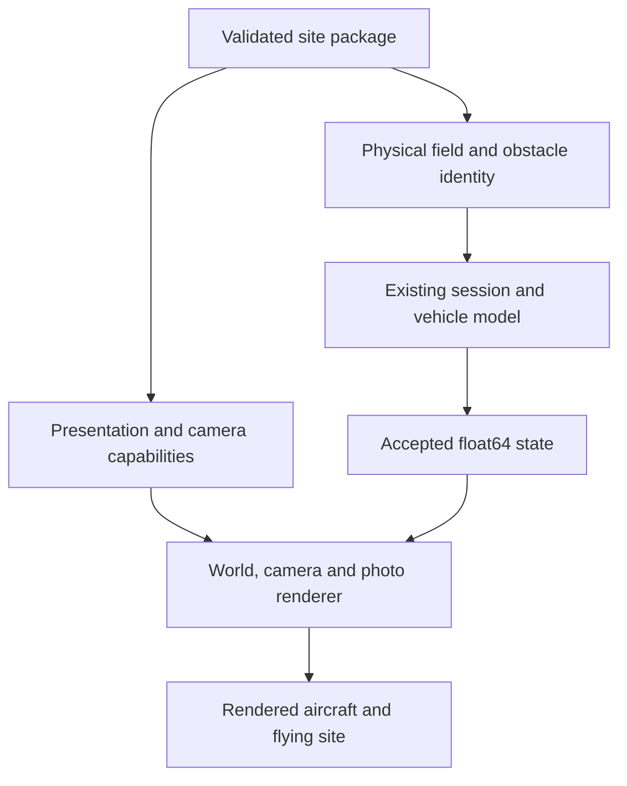

# Proposed Godot integration design

2026-11-18. Design proposal for [SC-PHOTO](../../../plans/photorealistic-flying-sites.md).
No interfaces in this document are implemented unless explicitly identified as
existing in the [source audit](current-architecture.md).

## One admitted site, separate responsibilities

There is one physical authority. The panorama, depth proxies, shadow receivers
and texture tiers are presentation consumers. Contacts are supplied through
the existing field/collision owners, using supported quantities and primitives.
A Godot collision node used for editor picking or camera inspection does not
become the aircraft's physical ground by implication.

## Proposed presentation descriptor

Keep `openrc-field v1` unchanged for a field that fits its contract. Introduce a
small, separately validated sidecar with a new explicitly versioned format
(working name `openrc-photo-site v1`). The name and exact serialization are
proposals to resolve in SC-PHOTO-03, not an existing accepted format. The catalog
would expose validated capabilities through an optional interface, with old
adapters retaining existing behavior. Do not add a loose dictionary to field
data and assume the current strict loader accepts it.

| Descriptor group | Required information / proposed validation |
| --- | --- |
| Identity | Unique landscape/site ID, descriptor version, field path/hash, presentation revision, source/derivative manifest |
| Capture station | Surveyed NED station, actual lens entrance-pupil/eye height, units, source and uncertainty; station must agree with the field pilot |
| Projection | Full 360° × 180° equirectangular source or a separately supported projection; image dimensions, longitude-zero/seam convention, orientation matrix/quaternion and its documented direction |
| Runtime variants | Relative allowlisted resource paths, source/output hashes, dimensions, encoding/color space, alpha use, mip/compression settings and estimated resident-size limits |
| Registration | Non-collinear landmark coordinates/bearings, held-out validation points, runway corners and geometric tolerances |
| Lighting | Captured sun direction, exposure/white-balance intent, ambient approximation or separately captured HDR lighting resource, static-shadow ownership |
| Capability policy | Permitted camera views, fixed translation, admitted activities/starts, whether dynamic time/sky/weather appearance are available, magnifier/reflection policy |
| Occlusion/contact relationship | Stable IDs linking surveyed features to render silhouette proxies and independent physical shapes; decorative/distant exclusions stated |
| Limits | Physical flight envelope, outside-area policy, unavailable camera modes, source detail, known seam/foliage/ground approximations |
| Rights | Author/source, license evidence, permitted redistribution, required attribution, modifications and capture permission record |

Reject nonfinite coordinates, zero/invalid transforms, duplicate IDs, unsupported
versions/projections, dimensions over the admitted limit, missing packed paths
and disagreement with the referenced field. Validate sizes before large
allocations; allow only the package's known resources. The first release uses
bundled trusted assets, not arbitrary user scripts, live URLs or executable mod
packages. Raw-source imports are an offline authoring step.

Physical and visual identity should be separate: changing an 8K texture to its
4K derivative cannot alter contact hashes, while moving a fence must. All
derivatives of a site share one surveyed coordinate source. A collision mismatch
is a different physical scene and cannot be hidden behind a visual-quality
preference.

## Panorama and coordinate registration

Use the existing fixed-pilot eye. At each heading, render the photograph using
a direction from that recorded station, then draw the aircraft in the usual
detached-state presentation. A world point's photograph lookup uses the same
capture-origin direction and orientation as the background. Do not independently
tune two yaw offsets until they happen to look similar.

Define the longitude convention with compass markers and cardinal test rays.
For an equirectangular representation, longitude wraps horizontally and latitude
maps vertically; the exact sign/seam/origin choices must be documented and tested.
Normalize directions and clamp inverse-trigonometric inputs. Verify pitch/roll
with synthetic fixtures and measured level references; the visible tree or hill
line is not necessarily a geometrically level horizon.

Metre scale comes from measured geometry and camera position, not panorama
dimensions. Fit rotation to known landmarks, then validate against landmarks
not used in the fit. Do not change the aircraft scale, simulated altitude,
runway friction or camera zoom law to disguise a calibration error.

`PanoramaSkyMaterial` is a useful initial experiment ([G01](sources.md#g01)).
Production choices are either an agreed photo-aware World sky path or a custom
photo shader integrated with the existing World owner. The current World
refresh checks are not compatible with casually replacing its expected
`ShaderMaterial`. Sky radiance filtering must also be separated from background
sharpness where necessary; measure the actual sampled image, not an assumed
reflection-map size.

## Occlusion is the first renderer risk

An aircraft behind a photographed tree must disappear; in front it must remain
visible. A sky image alone cannot decide that. Physical collision and visual
occlusion are separate: a canopy silhouette may hide an aircraft without being
an accurately modeled solid collision volume.

Evaluate these candidates on the same small fixture:

| Candidate | Mechanism | Required evidence / tradeoff |
| --- | --- | --- |
| Photo-projected opaque proxy | Simplified geometry samples the same panorama rays as the background and writes ordinary depth | Best portable first candidate. Verify identical color, orientation, filtering and tone mapping at boundaries; no repeated fog or baked lighting |
| Explicit depth-only/composition path | Submit registered depth and compose panorama/aircraft with known ordering | Investigate only through APIs supported by each target renderer. No assumption that a zero-alpha material or a render-priority change is sufficient |
| Selected 3D foreground object | Replace a nearby photographed feature with actual textured geometry and a repaired background | More authoring, but useful for unavoidable close parallax; requires rights and consistent photographic cleanup |

Godot documents depth modes and `shadow_to_opacity`, but that is not proof of
correct combined composition in all renderers ([G02](sources.md#g02)). In
particular, alpha blending, depth prepasses, sky draw order, render layers and
anti-aliasing must be tested. A culling occluder is an optimization structure,
not the visible depth mask needed for this effect. Avoid making the baseline
depend on a compositor feature unavailable in Compatibility
([G03](sources.md#g03)).

For opaque buildings, boxes or deliberately authored silhouettes are a good
starting point. Trees and open fences need more careful masks/geometry because
solid rectangles hide too much. Record the approximation; do not fill sky gaps
with collision just because a visual card is easy to build. Never disable
essential visual occlusion on Low while retaining its physical obstacles.

## Shadows and photographed lighting

The photograph already contains static lighting and shadows. Initially preserve
its daylight condition. Light the dynamic aircraft with a matched sun and
measured or estimated ambient illumination, and mark estimates honestly.
An LDR panorama is acceptable for visible background; renaming it `.exr` does
not recover clipped illumination or create a measured HDR environment.

Compare the existing projected aircraft-shadow path with a dedicated receiver
using supported shadow shader behavior. The first site can use a flat calibrated
ground receiver. Verify its height and depth bias against the physical support
surface, then test landing, rotation and low passes. Detailed shadows are useful
only when they remain stable and communicate height/attitude.

Static photographed trees/buildings should not automatically cast a second
duplicate shadow. Give static photo content, new 3D objects and the aircraft
explicit casting/receiving responsibilities. Reflections likewise need a
deliberate policy: an inexpensive photo-matched environment for the aircraft can
be separate from a full-resolution background. Lake/planar-reflection paths
and nearby reflective surfaces remain outside the pilot unless qualified.

World must resolve photo policy before it constructs dynamic clouds, sky, sun
glare, field lights and exposure effects. Apply the same policy during refresh,
time flow, paused updates, reset and scene restoration. Do not simply allocate
all old effects and hide them; disabled work should avoid ongoing processing
and retained textures. Preserve normal state when returning to a 3D site.

Color checks must include source transfer function, texture sampler hints,
output encoding, exposure, tone mapping and renderer differences. Use a color
fixture across the background/proxy join and an actual capture under controlled
settings. Do not double-apply gamma or fog to a photograph that already contains
atmospheric appearance. If a source HDRI is used for illumination, document its
brightness normalization separately from background color.

## Capability enforcement

| Path | First-pilot policy |
| --- | --- |
| Pilot look/track/manual and automatic zoom | Allowed at the recorded eye; texture sharpness limits reported in diagnostics |
| Chase, fly-by, orbit, close-up and crash camera | Unavailable for the photo scene; retain a fixed-pilot framing with a clear reason |
| CLI/debug/review height | Refuse incompatible translation in certified mode; a separate technical override must label the result outside photo-site acceptance |
| Magnifier | Unavailable until a correct fixed-eye and occlusion-aware design is demonstrated; preserve preference for other sites |
| Home presentation / Workshop trial | Use an admitted fixed composition or separate clearly identified 3D inspection environment; never move through the photo unnoticed |
| FPV, airship, ground vehicle, unqualified helicopter | Refuse the site/activity pairing before leaving the accepted Home; do not pass its field into a builder that draws another environment |
| Time of day / visual sky and precipitation | Captured appearance for the pilot. Controls explain the limitation; physical wind settings remain independently meaningful |
| VR | No automatic admission. A mono panorama does not provide stereo scenery or correct translated views |

This policy is a product contract consumed by every caller, not a menu-only
change. Preserve the selected site and the user's global settings on refusal.
Do not silently switch the physical world mid-flight. If a 3D counterpart is
offered, start it through the normal accepted session transition.

## Ground, starts, native evaluation and replay

SC-PHOTO-04 uses supported ground materials and collision shapes. Calibration
requires independent runway measurements and obstacle positions. A new site
must not inherit Club trees, lake surfaces, scenery damage IDs, companion
locations or RC circuit data by calling the default scenery builder.

The current builders do not expose arbitrary surveyed boxes/capsules merely
because the solver can query those shapes. Choose representable existing
prefabs or define a separate versioned, validated physical-inventory input under
SC/GP ownership. Its builder must check dimensions/transforms, unique stable IDs,
response/damage semantics, bounded bin references and deterministic identity
before passing the world through the existing adapter seam. Keep that physical
input distinct from the presentation descriptor and test malformed input,
edge contacts, no-contact clearance and checkpoint identity explicitly.

SC-PHOTO-04a must address the current legacy-ID gate for runway starts. If the
real runway's bearing, slope or material cannot fit field v1 and the shared
maintained-turf contact assumptions, SC-PHOTO-04b is a prerequisite
with explicit GP/field/start/native/replay ownership. An initial airborne-only
technical demonstration may proceed, but it is not the promised takeoff/landing
pilot and cannot close SC-PHOTO-10.

Native admission remains a separate check. The new field may use the GDScript
reference evaluator until its domain is qualified. Compare requested and
effective backend and report refusal/fallback reasons. Retain exact-input and
same-backend replay evidence when checking visual-only changes. Cross-backend
equivalence must meet the existing native contract, not a new informal tolerance.

Numerical replay reconstructs the physical scene independently of the camera.
The existing flight-log replay is an offline numerical research workflow, not
a player-facing visual replay feature. No new visual replay player is required
by the pilot. For a separately proposed visual replay, bind descriptor and asset revisions in an appropriate
presentation record. If unavailable, report missing visual content or use a
clearly identified diagnostic presentation with the same physical world; never
substitute different obstacles to make playback continue.

## Transactional loading and release

Resolve the field and presentation into a detached candidate. Check capability,
provenance/resource references, dimensions and estimated allocation first.
Decode/import and allocate through bounded stages, with cancellation cleanup
owned by the caller. Commit the landscape ID, accepted Home/flight and saved
selection only after the candidate is valid. Preserve the previous accepted
scene if an image, sidecar or stage fails.

Detaching nodes does not isolate current World/Atmosphere globals. Include
appearance, sky/cloud transport, active owner, live/time-flow and related shared
presentation state in the transaction. Prefer prepare-without-publication;
otherwise design a complete validated snapshot/restore that runs on every
failure, cancellation and stale/superseded build. The existing partial World
presentation context alone is not sufficient evidence. After rejection, the
old scene must continue updating, refreshing and flowing time with its original
ownership, not merely remain visible.

Test both synchronous and staged routes; current consumers do not uniformly
treat a null adapter result as a recoverable error. Bind camera/world policy
before the first visible frame so startup cannot flash an incompatible sky or
moving Home view. Release old panorama, proxies, radiance maps, per-site materials
and any worker references when changing sites, retaining only explicitly bounded
caches. Deferred GPU release may require a settle interval before memory checks.

Exports must include the sidecar, variants, generated resources, licenses and
provenance notices actually used at runtime. Validate an offline clean package
whose resource root has none of the developer's originals. A raw project path
working in the editor does not prove packaging.

## Conditions for a 3D follow-up

For moving cameras, replace the nearby photographed environment with cleaned
meshes/terrain and a background valid across the allowed flight volume. Keep a
plain Godot-mesh baseline before choosing Terrain3D. A single-valued heightfield
cannot express bridges or overhangs; those need geometry and their own contact
representation. Orthophotos with baked trees/shadows need cleanup where 3D
objects would otherwise be duplicated.

If an authoritative heightfield provider is required, define CPU float64
sampling, interpolation, normals, material regions, no-data/edge behavior,
hashes, determinism and native/reference parity before adding it to a session.
GPU displacement and plugin physics bodies cannot be the sole source of those
values. Keep the simulator independent of visual LOD and streamed mesh residency.
