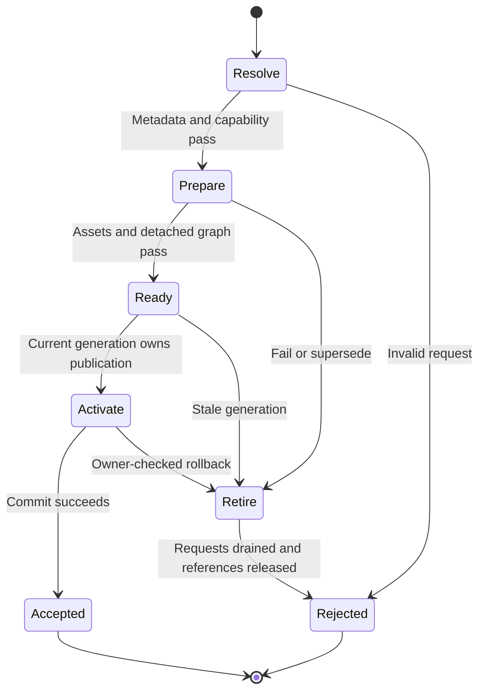

# Photographic-site implementation contracts

2026-11-19. Proposed contracts for SC-PHOTO-02…10. They refine and, where
different, supersede the corresponding choices in the
[2026-11-18 design](../2026-11-18/godot-design.md).
No interface below is implemented by this research change.
[Findings](adversarial-review.md) explain the defects;
[qualification](qualification-protocol.md) defines the proof.
The [canonical plan](../../../plans/photorealistic-flying-sites.md) owns status.

## C01 — one coordinate convention and one photographic lookup

**Proposed first method:** a full 2:1 equirectangular background plus opaque
photo-projected geometry for a small number of measured foreground objects and
ground. Compute the same lookup per fragment in both paths. Start with opaque,
simple shapes. Alpha-cutout foliage, a depth-only compositor and layered-depth
representations are later comparisons if a demonstrated defect requires them.
Do not interpret an alpha-zero material as a guaranteed depth writer.

Use existing float64 NED metres for survey and physical data. Let `s` be the
surveyed eye and `p` a point, both in that same NED frame. Author a proper
rotation `R_photo_from_ned` as nine **row-major** numbers mapping NED column
vectors into the panorama reference frame; not its inverse, not Euler angles.
The runtime loader must transpose/reconstruct appropriately for Godot's
column-based Basis/shader representation. Reject nonfinite numbers, reflection,
scale and nonorthogonality; propose a maximum orthogonality/determinant residual
of 1e-6 for serialized float64 metadata.

For normalized `q = R_photo_from_ned × (p − s) / |p − s|`, write
`q = (n, e, d)`. The proposed image has its reference north at the center and
its south at the horizontal seam. These equations specify mathematical behavior;
the shader must implement their edge cases deliberately:

```text
longitude = atan2(e, n)
latitude  = asin(clamp(-d, -1, 1))
u = fract(0.5 + longitude / (2π))
v = 0.5 - latitude / π
render_position = (east, -down, -north)
```

This is the new asset convention, not an assertion about the built-in panorama
material's default orientation. Reproject a captured master into it explicitly
or record the rotation; never silently flip the field frame. The image's first
row is the zenith, its last row the nadir. Horizontal sampling repeats; vertical
sampling clamps at the poles. Qualify how both material paths achieve that
asymmetric addressing on every renderer: a bare repeat/clamp hint is not proof.
If needed, compare seam-aware padding/manual seam filtering or another supported
representation, including its mip levels. Do not assume a RenderingDevice
sampler API is available to the Compatibility material path.

Implement a defined quadrant-correct shader lookup for zero-denominator cardinal
rays as well as exact poles; CPU/Python atan2 behavior does not establish shader
behavior. Exact east/west map to longitude ±π/2. At an exact pole, choose a
canonical longitude and prove continuity of the image in its neighborhood.
H10's documented atan edge case is a capability question to verify on the pin,
not evidence that a beta2 shader was observed failing.

| Direction with identity rotation | Godot render direction | Expected normalized UV |
| --- | --- | --- |
| North | (0, 0, −1) | (0.5, 0.5) |
| East | (1, 0, 0) | (0.75, 0.5) |
| South | (0, 0, 1) | (0 or 1, 0.5) |
| West | (−1, 0, 0) | (0.25, 0.5) |
| Up | (0, 1, 0) | (any, 0) |
| Down | (0, −1, 0) | (any, 1) |

A raster sample center corresponds to `((i+0.5)/W, (j+0.5)/H)`; normalized
geometric boundaries are not integer texel centers. Supply a renderer-space
relative position to the fragment shader, convert consistently to the declared
frame and normalize there. Do not interpolate already converted spherical UVs
across a large triangle. Avoid subtracting huge absolute geospatial coordinates
after float32 conversion; the existing bounded local field frame is sufficient.

At the seam, separately check color continuity and mip selection. If implicit
derivatives fail, derive branch-safe gradients from the continuous direction or
test a cube representation with correct gutters/orientation. Differentiating
the wrapped UV after its discontinuity is insufficient. Compile and capture on
the actual pin before adopting either remedy. The independent
[arithmetic fixture](../../../../research/photorealistic-flying-sites/optics_review.py)
provides cardinal and rotated round trips, not a Godot shader test.
Sources: H01, H02, H06, H10 and H11 in the [register](research-log.md).

## C02 — calibration, depth and the qualified visual envelope

Keep the camera eye at the surveyed station through tracking, manual/automatic
zoom, pause, reset, crash framing, Home preview and every secondary view.
Rotation and established FOV laws remain available. A route requiring another
eye must be refused or use a separately qualified representation; do not hide a
translated view behind a fixed-pilot label.

Retain three distinct sets of observations:

1. Fitting observations for orientation/lens/stitch calibration.
2. Held-out bearing and height observations for image alignment.
3. Held-out distances/feature extents for visual depth and physical contact.

Record measurement method, uncertainty and which set each point belongs to
before fitting. Near/far range evidence cannot be replaced by a good panorama
silhouette. An obstacle's real contact volume, its visible silhouette and its
unobserved back side need separate declarations.

The qualification receipt declares a **visual envelope**: output dimensions,
representative FOVs, station, relevant bearings/ranges, uncertainty, and which
features are hard occlusion boundaries. It also declares **surveyed physical
coverage**, which C05 handles separately. Neither term means an aircraft's
aerodynamic flight envelope.

Use actual output projection to evaluate held-out errors. For an on-axis
vertical angular residual `δ` at vertical FOV `v` and output height `Ho`:

`f_y = Ho / (2 tan(v/2)); pixel_error = f_y tan(δ)`.

Off-axis and two-dimensional errors require the full projection; the center
formula is an illustration, not a whole-frame bound.

| Vertical FOV, 1080 px high | Old 4 px / 90° horizontal error becomes | 16K×8K source texels along the central meridian |
| --- | ---: | ---: |
| 45° | 5.43 px | 2048 |
| 30° | 8.40 px | 1365.3 |
| 15° | 17.09 px | 682.7 |
| 6° | 42.93 px | 273.1 |
| 1° | 257.82 px | 45.5 |

The source-texel column assumes a level/equatorial optical axis. It is an angular
span, not a uniform sampling density for pitched, rolled or polar views.

**Proposed admission rule:** the old 4/8-pixel wide-view result remains a useful
survey screen, not the final gate. Before capture acceptance, designate the
landing corridor and critical hard occluders. Q02/Q03 set their per-view limits
and uncertainty checks. A site failing those checks must improve its survey,
proxy or capture, or reduce its claimed usable region before release. A declared
soft background at extreme zoom does not permit an aircraft to disappear on
the wrong side of an obstacle.

For the first site, prefer a clear landing corridor, no close foreground fence
and simple distant hard landmarks. Retain the 1° zoom, report its heavy background
magnification, and avoid claiming uniformly photographic detail at every FOV.
Do not improve the metric by changing the zoom law or inventing source pixels.

Admit camera-space near clearance of visible proxy fragments over all supported headings and the 120°
vertical maximum, and inspect depth ordering at the farthest relevant obstacle.
The current 0.5 m pilot near setting is the starting value, not a universal site
guarantee. If it fails, move the *capture station before capture*, select another
site, or scope a camera-owner change; never translate the runtime eye away from
its capture. Record effective near/far and depth format per renderer.

## C03 — explicit color and captured-world policy

The initial photo input is a tagged, display-referred sRGB LDR derivative.
Keep any scene-referred HDR capture as a separate authoring/lighting resource.
Converting an LDR file to EXR does not restore radiance.

SC-PHOTO-02 first establishes a reference path with fixed exposure and a known
output transform. A unit-exposure linear-tonemap fixture is the simplest
baseline to investigate; it is not yet the production World setting. Record the
entire path: texture transfer decoding, shader arithmetic, engine material/sky
conversion, exposure, tonemapping and output encoding. Choose the production
route only after the independent reference agrees and aircraft lighting remains
acceptable. If an existing filmic transform is retained, document an explicit
photo compensation/composition method and its behavior for clipping; “unshaded”
alone does not prove it bypasses all output transforms.

Feed known neutral and RGB ramps, mid-gray and highlight/clipped patches through
background and proxy paths separately. Compare each to a reference computed
outside the same runtime shader. Then inspect the seam. Use the same display
capture transform for all comparisons and record color-management assumptions.
Q04 owns thresholds and fixtures. The existing Compatibility conversion helper
is a candidate to verify on the pin, not a formula to copy indiscriminately.

Freeze captured sky, sun appearance, clouds, exposure and static vegetation for
the photo representation. Wind may still change through the existing physical
weather contract, with a clear static-scene explanation. Bind this policy before
the first visible Home/flight frame and during every World refresh. Do not write
restricted values into the player's saved settings. On a normal 3D site, restore
its existing world policy and requested controls. Sources: H08 and H09.

## C04 — one aircraft-to-ground shadow owner

Use a **projected aircraft ground cue** as the first photo candidate, on a
qualified receiving surface. Prevent the existing native-sun fade from removing
that cue just because a casting light exists. Native aircraft self-shadowing
is a separate capability; it may remain enabled if it does not add a second
ground shadow or incompatible proxy shadows.

| Requested technique | Initial effective photo-ground policy | Required behavior |
| --- | --- | --- |
| Auto | Projected owner throughout its admitted receiving area | No distance-based handoff to an absent receiver |
| Projected | Projected owner | Respect existing cue/Off controls; qualify sun and optional vertical aid separately |
| Native | Projected fallback until a native photo receiver is qualified | Explain the effective fallback; preserve requested Native for other sites |
| Off | No aircraft ground shadow | Intentional preference, not a rendering defect; release default still needs grounding |

The implementation must introduce a per-world/site resolution seam in the
existing shadow owner. Do not mutate global preferences or add a second shadow
subsystem merely to force the desired result. Explicitly distinguish
`native_self_shadow`, `native_photo_ground_receiver` and
`projected_photo_ground` in capability reasoning; these are proposed concepts,
not current serialized fields.

Photo-baked static objects do not cast their already captured shadows again.
Receiver/proxy depth and draw order must work with the aircraft and intentional
openings. A photo-projected opaque ground surface can visually reconstruct the
photo while receiving the projected overlay; that whole composition still
needs exact-renderer proof.

The dynamic shadow crossing an existing photographic shadow is a separate
test. A bounded authored sunlight/strength mask may reduce the projected
contribution over a known static shadow; it is an artistic approximation with
documented scope, not recovered physical lighting. First prefer a clear runway.
If the mismatch remains objectionable in the qualified landing/low-pass region,
the scene fails Q05. Do not label it fixed because duplicate static casters were
disabled. If native receiving later wins a comparison, qualify its handoff
weights and eliminate both zero-shadow gaps and double-shadow bands.

## C05 — stable physical semantics and honest coverage

Photo resolution, mesh LOD, shadow mode and renderer must share one physical
field/inventory identity. Do not inherit Club scenery or lake contacts by
accident. Continue using existing field/contact/session owners and deterministic
float64 values; render transforms never become solver input.

For photo-baked physical obstacles, use damage profile `none` in the first
pilot. This prevents breaking the static photographic object while retaining
its ordinary collision response. Do not confuse “no scenery destruction” with
“no collision” or “aircraft cannot be damaged.” Reject a destructible profile
bound to static pixels during site validation. A later destructible representation
needs an explicit synchronized background/proxy/contact state machine.

Choose maintained turf fitting existing support, bearing and start contracts.
SC-PHOTO-04b is necessary for a materially different site: independently define
surface response and relief so adjusting friction/rolling resistance cannot
silently move the support surface. Preserve estimated-versus-measured provenance.
The first pilot does not add a terrain solver.

**Proposed route capabilities:** fixed-pilot fixed-wing flight and validated
runway starts may be admitted; Natural Random, FPV/multirotor, airship, ground
vehicle, translated inspection and Workshop routes stay unavailable unless their
own full construction path is qualified. Runway support and Natural Random must
be independent predicates at both Home and route entry. Unknown or stale route
requests fail with a reason before replacing a session. Existing Club behavior
is a regression case.

**Proposed first coverage policy:** use a finite NED axis-aligned surveyed volume
with inclusive bounds, separately identifying the validated landing rectangle
and obstacle volumes. The notice monitors the accepted aircraft reference point
and a declared conservative radius enclosing the supported aircraft's geometry;
the entire sphere must fit to count as inside. Do not reuse collision LOD bounds.
If this is too restrictive for a site, author a reviewed volume representation
instead of changing semantics silently.

Validate the admitted aircraft's actual runway start and landing corridor with
this radius and the re-entry margin. A wing-span-sized sphere can extend below
the ground although the aircraft does not; choose an appropriate padded
monitoring volume or a reviewed tighter bound so normal ground use does not
raise a permanent warning. Such mathematical padding is not a claim of surveyed
subsurface obstacles or terrain.

On exit, show a persistent, unobtrusive “Outside surveyed site coverage” notice.
Continue physical inputs, integration and existing outside-region support
unchanged. Observe every accepted tick or its retained segment; test fast
crossings rather than sampling only rendered frames. Use a proposed 1 m inward
re-entry margin to avoid edge chatter, record that value, and clear after accepted
re-entry. Starting outside shows the notice immediately; pause does not clear it;
reset re-evaluates the new accepted state. No invisible wall, teleport, forced
camera translation or automatic world replacement is introduced. Logs/debug
receipts distinguish outside coverage from contact failure.

The pilot retains existing **numerical** replay and checkpoint identity checks.
Material/region attribution in replay observations is not promised to match live
registry provenance. If users need that report equivalence, add a separately
versioned provenance record and its tests; do not claim a physics defect without
accepted-state evidence. The accepted obstacle inventory must also fit existing
collision-bin and flight-log packet limits; test the actual chosen inventory
rather than speculating that a small site exceeds them.

## C06 — bounded preparation, serialized activation and cold-start recovery

Use existing staged Home/flight preparation and admission tools.
The first implementation permits **one candidate resource load group at a time**
and **one activation owner**. Coalesce repeated selection requests to the newest
desired site. A cancelled group may still finish decoding; retire it before
starting another large group. This bounds memory at the cost of waiting for a
noncancelable operation, which must remain visible and responsive.



This diagram describes a candidate, not the lifetime of the existing accepted
scene. The old scene stays accepted until successful activation.

| State | Required invariant |
| --- | --- |
| Resolve | Validate version, field binding, paths, station, capabilities, metadata sizes and admitted tier before expensive work |
| Prepare | No publication to global World/Atmosphere/cloud/appearance owners; one large imported-resource request at a time, bounded smaller requests, status polled across frames |
| Ready | Detached resources, required notices, physical identity and resolved camera/world policy are complete; generation still matches |
| Activate | Serialize with Home/flight routes; install one coherent scene, physical identity, camera and world policy before exposing a frame |
| Accepted | Only now publish selection and persist it; retain the old scene until rollback is no longer needed |
| Retire | Never restore over a newer owner; release only this candidate's references and wait for known in-flight work to become terminal |
| Rejected | Retain prior scene and requested settings, report reason, keep UI usable; no wrong-field fallback |

If existing World constructors publish globals during preparation, first split
their preparation/publication seam. If an unavoidable activation step can fail,
capture the complete affected state and guard rollback by owner/generation.
A partial presentation context is not sufficient. Test continued time flow,
refresh and input after rejection, not just whether the old frame remains visible.

The retained scene continues under its own policy: a flow-enabled 3D World keeps
its original time flow, while a photo World retains captured appearance. The
accepted physical simulation clock is a separate concern.

One candidate group alone is not a memory bound. Start with one large imported
resource request at a time. Bound any smaller concurrent requests by a declared
aggregate CPU/GPU staging estimate included in the host peak. Do not start the
next large request until the previous one is terminal and its retained
allocations are accounted for.

ResourceLoader's documented threaded interface does not promise cancellation.
Do not call threaded-get until completion; a generation check is not a memory
release. Establish how successful and failed requests drain on the pinned engine,
bound their references and measure settling. Unknown/failed status must not
trigger an unbounded blocking wait on the UI thread. Q07 exercises rapid requests,
slow completions, switch-away and failure.

**Cold startup is separate:** there may be no accepted old scene. Offer Retry,
Choose another site and Quit in a small recovery UI that uses no photo assets.
Choosing a valid alternative is explicit and goes through normal validation.
Until that succeeds, preserve the originally requested site in saved preferences.
Never start the default physical field while retaining the broken photo identity.
A failure to save the new preference is reported without invalidating the live
selection. Headless or explicit automation requests return failure with a reason.
Test recovery when no site can be loaded too.

## C07 — four identities and four resource budgets

| Identity | Recorded association | Verification point |
| --- | --- | --- |
| Capture/master source hash | Identifies authoring bytes and links the reviewed rights record; a hash alone proves neither permission nor use | Build-time provenance, outside ordinary runtime package |
| Pre-import derivative hash plus recipe | Links a PNG/EXR/model to recorded conversion settings; repeat conversion and receipts verify that association | Reproducible authoring/import receipt |
| Field/inventory identity | Which authoritative physical definition is installed | Existing versioned physical owners; raw-file and canonical semantic hashes are explicitly distinguished |
| Export artifact/build identity | Which imported resources and notices were actually delivered | Release receipt, package inventory and offline load |

Runtime images/models resolve through ResourceLoader with expected class,
dimensions and descriptor binding. Do not read an authoring PNG with FileAccess
and require its pre-import digest unless raw source bytes were deliberately
shipped. Raw JSON and notices use their appropriate file path and byte checks.
A manifest does not hash itself; its own digest belongs in the outer build receipt.

Proposed runtime paths are under `app/landscapes/<site_id>/`, with descriptor,
physical-inventory binding and `NOTICE.txt` named explicitly in the schema.
SC-PHOTO-03 settles exact filenames; SC-PHOTO-07 updates **all three** export
presets and the field-package checker for those paths. Wildcard interpretation
is verified from exports, not guessed.

| Budget | Initial decision |
| --- | --- |
| Steady photo GPU allocation | Retain proposed 4K/8K/16K ceilings of 32/96/256 MiB, including photo-specific mips, lighting and masks |
| Whole-process/transition peak | Set per host before admission; include accepted scene, candidate, CPU decode, uploads, stale requests and driver overhead without double-counting unified memory |
| Incremental compressed release size | Proposed first-site cap: 128 MiB per target, measured against the same build without the site |
| Incremental installed size | Proposed first-site cap: 256 MiB per target; disclose actual included variants and imported formats |

The two delivery caps are project proposal values, not known asset sizes or
derived hardware limits. Revise them only with a named benefit and reviewer
decision before calling the site accepted. Ship a prequalified lowest-tier
fallback (initially 4K where supported), and 8K only where qualified; otherwise
refuse the photo site clearly. Keep optional 16K outside the exported project until
it earns its cost. Selection of a single resident texture does not remove
unused resources from `all_resources` exports.

Compatibility has no RenderingDevice query. Use trusted package dimensions and
a conservative per-renderer/device tier validated by measurements; query limits
where available and treat unknown capability conservatively. Estimates cannot
guarantee free VRAM or recover a driver/process termination. Allocation/load
failures that the engine reports must reject the candidate cleanly; an OOM crash
is a failed qualification, not an acceptable fallback demonstration.

Substantiate GPU ceilings through target-appropriate measurement or a documented
conservative bound covering all photo-specific allocations. If neither is
available, that device's memory subgate is inconclusive. Missing counters do not
mean zero GPU use; unified-memory reporting must avoid counting the same bytes
twice.

No runtime downloader, account or pack marketplace is added. Future downloaded
packs need an authenticated release identity and content/namespace restrictions
before mounting; a digest beside untrusted content is insufficient.
Optional KTX/glTF optimizations must prove the exact route used: distinguish
standalone image decode from embedded extensions, and test required-extension
assets without a fallback as well as with one. Existing PNG/JPEG and validated
mesh routes remain the baseline. Sources: H13–H17 and H20–H24.

## C08 — measurable qualification rather than attractive averages

Q01…Q12 define outcomes as pass, fail or inconclusive, with scope and evidence.
Do not replace an unavailable measurement with an invented estimate. A capture,
an analytical calculation, a headless numerical pass and a target-hardware flight
answer different questions.

SC-PHOTO-02 closes only the synthetic rendering method on named renderers.
SC-PHOTO-09 closes a real site on named output/device/backend configurations.
The existing Gate P 500 µs computation target and native domain admission remain
with their owners; the 240 Hz tick interval is not the compute allowance.

Use the existing graphics, debug-bridge, logging, platform and export tools
linked by [qualification](qualification-protocol.md#existing-tools-and-receipts).
Do not create a second test runner or imply that offline numerical replay already
drives the camera and GPU. A repeatable render-view fixture and a full live-flight
workload are separate evidence.

## C09 — implementation sequence and stop decisions

The first implementation increment should produce one synthetic fixed-eye scene
with independently known geometry, color and shadow reference, on the pinned
engine. It earns a rendering-method decision before a large real-world capture.

Then build the descriptor/physical policy and capability seam, add bounded
loading/recovery, capture one simple qualified field, and export it offline.
Q12 checks the final pilot experience. Only after that should moving-camera 3D,
Terrain3D, splats or native acceleration compete for effort.

If projection or color fails, correct the representation before art production.
If survey/occlusion fails, improve data or change the selected site. If loading
fails, lower the admitted tier or fix ownership. If hardware cannot meet a
declared budget, narrow the supported configuration honestly or revise the
design with evidence. No failed gate is closed merely by adding another tool,
a larger texture or a different engine name.
