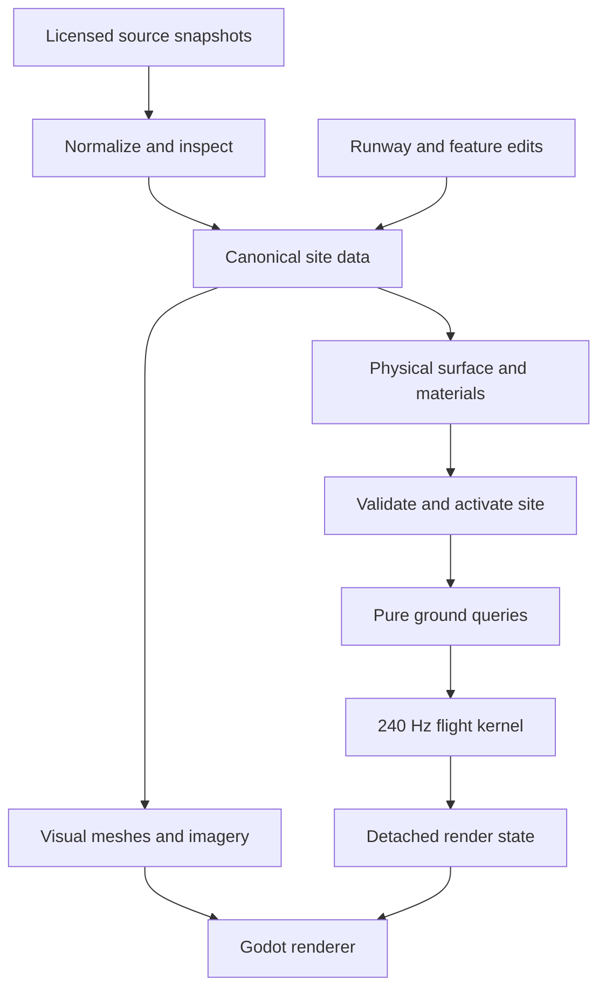

# Worldwide scenery: examples and integration decisions

Reviewed: **2026-11-20**. Owner: scenery, with landscape, field/session, ground/contact, replay, native-backend and renderer co-owners.

**Recommendation:** add a reproducible local-site compiler that can prepare a supported location from coordinates, elevation, imagery and semantic map data. Generate a versioned physical surface and an independently scalable visual package. Prepare and validate the physical site before flight; allow visual detail to improve without changing contact behavior.

This research pack consolidates **56 investigations and 172 distinct search queries**: the preceding 32-option/100-query review plus this round's **24 investigations and 72 queries**. Some investigations examine algorithms or new uses of previously surveyed ecosystems; these counts do not mean 56 independent products, adopted dependencies or successful experiments. Source retrievals and code reads are additional verification, not counted as search queries.

## Read the evidence

| Document | Purpose |
| --- | --- |
| [Global scenery options](global-scenery-options.md) | The preceding 32 investigations: Godot terrain, GIS tools, simulator scenery, data packaging and geodesy; adoption order reconciled with the existing plan |
| [Games, simulators and terrain techniques](game-world-precedents.md) | This round's 24 concrete mechanisms, examples, guides, reuse proposals and limitations |
| [Exact search record](search-record.md) | All 172 queries, investigation method, inspected source snapshots and verification limits |
| [SC-PHOTO plan](../../../plans/photorealistic-flying-sites.md) | The sole implementation status ledger |
| [Earlier implementation contracts](../2026-11-19/implementation-contracts.md) and [qualification protocol](../2026-11-19/qualification-protocol.md) | Existing scene, contact, lifecycle, optical, hardware and export requirements |
| [Hybrid experiments](../2026-11-19/hybrid-experiments.md) | Existing fixed-eye and later moving-view comparisons |

No runtime implementation status changes in this pack. **SC-PHOTO-02 remains the first implementation action**, alongside collecting the SC-PHOTO-01 site brief. For later SC-PHOTO-11 moving views, retain ordinary local/distant meshes and a sky-only panorama as the control; Terrain3D is a conditional comparison. Geographic generation complements this sequence. It does not replace the photographic proof or imply an engine migration.

## Product scope: three separate capabilities

1. **Choose a place and fly locally.** Select coordinates or a region, inspect source coverage, import or author the runway, compile a package and fly offline within its admitted extent. This is the recommended first geographic milestone.
2. **Fly farther within a prepared region.** Add visual tile prefetch and coarse-to-fine detail. Physical coverage remains independently validated and resident. A larger selection is a data, memory and preparation decision.
3. **Travel continuously around the globe.** This later capability needs recorded physical-region transitions, changing local frames, globe-aware up/gravity, coverage policy and replay semantics. A globe viewer or GPS origin does not provide those contracts automatically.

“Any location” therefore describes the selection intent, with explicit source-coverage and quality limits. It cannot promise uniform imagery, surveyed runway accuracy or locally valid projection everywhere. A coarse dataset can support recognizable distant relief while still being inadequate for RC wheels and close approaches.

## What to reuse first

| Need | Existing tool or precedent | Proposed OpenRC use |
| --- | --- | --- |
| Normalize and inspect geography | GDAL, PROJ, QGIS; original options 9, 10, 13 | Offline source preparation and control-point review |
| Compile a site in stages | Arnis, GeoMapgen, cs-mapgen | Bounded stages, diagnostic products, provenance and output hashes |
| Interpret sparse map data | maps4fs, SUMO, Webots | Versioned tag rules, explicit defaults and feature-selection controls |
| Author runway earthworks | BeamNG and Landscape Splines guides | Preview and bake a physical edit with shoulders and grading masks |
| Keep terrain and water distinct | SC4Mapper; Gazebo DEM workflow | Separate validity, ground, water classification and water-surface height |
| Load distant visual context | OSM Drone Simulator, WorldWind, OpenSpace | Prioritized bounded loads, sparse coverage, cache accounting and local overrides |
| Separate render detail from contact | Cesium's culling warning; Gazebo shared DEM | A pinned canonical physical surface independent of camera and LOD |
| Reduce visual cost | Existing mesh pipeline; optional Terrain3D, MARTINI, CDLOD/clipmaps | Measured comparison after the plain-mesh control |
| Deliver larger collections | Existing package flow; later PMTiles, quantized-mesh or 3D Tiles | Add only the formats needed by a selected client and content library |

The recommendations in the last column are design inferences from the linked [precedent dossiers](game-world-precedents.md). The referenced applications do not implement OpenRC's particular physics, replay or platform contracts.

## Proposed compiler and runtime boundaries

**Preparation.** Acquire permitted source snapshots, inspect bounds and metadata, normalize coordinates and vertical datum, handle NoData, and derive semantic masks. Keep original inputs or sufficient licensed canonical products. Repair terrain only through an explicit rule set; preserve original values, affected masks and uncertainty. Site rules then create runway modifications, exclusions, surface classes and contextual objects. Expensive GIS and mesh work belongs here, outside physics evaluation.

**Physical product.** Define one authoritative physical snapshot with a fixed material table and explicit obstacle ownership. A future admitted contract may combine heightfield terrain with separately represented collidable bridges or overhangs; it need not force the entire world into one single-valued heightfield. Store bounds, sample registration, interpolation or triangulation, boundary ownership and water behavior. Pin its data and contract before flight. Render simplification cannot select a different support surface. Existing boxes/capsules and flat-site behavior remain their own supported contracts until a new ground domain is deliberately admitted.

**Visual product.** Build ordinary near/distant meshes first, with independent imagery and object identities. Visual LOD, texture quality, culling and downloads may change appearance. Those changes must preserve the same physical site identity. Geometry that hides the aircraft, receives a shadow or is also collidable needs an explicitly consistent representation; an arbitrary map mesh is not automatically a valid occlusion/contact proxy.

**Activation and persistence.** Use the existing serialized site/session activation owner and reject stale, partial or corrupt candidates. Editor saves and permitted caches may write outside pure model evaluation. The first geographic flight needs no network after preparation. A future continuous-world mode must prepare, validate and record region changes before crossing them; a network callback cannot silently activate new contact geometry.

These boundaries follow the current [stack snapshot](https://github.com/bultodepapas/OpenRCsimulator/blob/48580b75a796fc6048fb77cdd69875c94ebb69e0/docs/STACK.md) and the existing SC-PHOTO contracts. The [current field loader](https://github.com/bultodepapas/OpenRCsimulator/blob/48580b75a796fc6048fb77cdd69875c94ebb69e0/app/data/field_loader.gd) is strict and versioned. The [surface definitions](https://github.com/bultodepapas/OpenRCsimulator/blob/48580b75a796fc6048fb77cdd69875c94ebb69e0/app/physics/ground_surfaces.gd) still describe an axis-aligned flat-surface contract; arbitrary-bearing runways and geographic relief require intentional GP/NK/replay changes. Installing a visual plugin does not supply them.

## Geographic, precision and provenance contract

Record horizontal CRS, axis order, units, geographic origin, projection validity, transforms to local NED and Godot axes, vertical datum and transformation grids. A GPS location supplies coordinates; imagery supplies appearance; a DEM supplies elevation samples; OSM supplies semantic features with varying completeness. None is a substitute for all the others. Orthometric map elevation and ellipsoidal GPS height need an explicit conversion.

The contract must distinguish **source uncertainty**, **encoded precision**, **resampling/repair error**, **visual approximation** and **numerical equivalence**. Float64 arrays cannot recover information lost before import. For a linear 16-bit encoding using all 65,536 codes with both endpoints available, the nominal step is height range / 65,535: a 400 m range gives approximately **6.10 mm**, while a 10,000 m range gives **152.59 mm**. These are calculated encoding increments, not claims of terrain accuracy. A reserved NoData code, restricted code range or different scale/offset changes that calculation. The [BeamNG example](https://documentation.beamng.com/beamng_tech/tools/terrainandroadimporter/) supplies the encoding context.

Terrarium's documented decoder is h = 256R + G + B/256 - 32768 meters. Known samples must be tested independently of downloaded terrain. Its fractional encoded step does not establish equivalent source resolution or accuracy. An absent tile must produce an unavailable result, never a valid zero elevation. [Detailed decoder](https://github.com/OlivierB-OB/osm-drone-simulator/blob/main/docs/data/elevations.md) · [Sampler behavior motivating the negative case](https://github.com/OlivierB-OB/osm-drone-simulator/blob/main/docs/data/elevation-sampler.md).

Physical seams require matching shared-edge geometry without artificial height steps, consistent edge subdivisions and specified triangulation/interpolation. Exact seam queries need deterministic boundary ownership and a defined normal convention. One-sided normals may legitimately differ at a real slope discontinuity; camera movement or visual LOD must not change the result of the same physical query. Rendering skirts do not repair contact seams. Preserve separate unknown/NoData, dry ground, water mask and water level. OSM layer values indicate relative ordering, not surveyed clearance; never flatten a bridge into terrain just because a road is being draped.

Normalize or split antimeridian selections. Test projection-zone boundaries and high latitudes; reject or explicitly bound unsupported coverage. Choose the valid local frame per site rather than assuming a single projected map or tangent plane works over the entire Earth.

For reproducibility, pin source dates/IDs and hashes, transformation grids, repair/classification rules, seeds, compiler dependencies, serialization and output hashes. Record whether byte identity is claimed only within a pinned environment or across specified platforms. Preserve imagery, mesh and physical identities separately. Record attribution, derivative, caching, offline and redistribution terms per dataset/asset. A library's MIT or Apache license does not settle those data rights.

## Runway authoring

Offer three explicit paths: imported real runway geometry, a user-corrected real site, and a deliberately synthetic strip. Store endpoints or center/true bearing, metric length/width, longitudinal profile, crossfall, shoulders, material, start positions, pilot position and exclusion zones. Keep provenance and uncertainty visible to the author.

A grading operation is a proposed change to the physical world. Preview the terrain delta and affected region, retain the unmodified source, then save a new version when accepted. Generate the visible runway and physical surface from that version. Validate both runway ends, the strip/shoulder transition, obstacle clearance and orientation. Do not impose a universal flat pad or silently alter a surveyed profile.

Road/runway paint, surface friction and support geometry are separate properties. A material edit must not accidentally change terrain shape. A purely visual texture refresh must not change any of them. Authored FPV gates or race routes can share geographic placement, but their activity admission still belongs to SC-PHOTO-12 and the corresponding activity owner.

## Map the later geographic follow-on to existing owners

The following table identifies reusable interfaces and evidence owners for a later local-site import track. It does not add GIS ingestion, a new ground domain or a geographic deliverable to the current photographic milestones. Their existing acceptance criteria and site scope remain unchanged. If the geographic follow-on is selected, extend those interfaces deliberately and qualify the new site domain before runtime admission.

| Existing owner or interface | Geographic follow-on proposal | Evidence for that follow-on |
| --- | --- | --- |
| SC-PHOTO-01 | Select a bounded site with source/datum/rights and ground-detail evidence | Site brief, independent checkpoints and named target hardware |
| SC-PHOTO-03 | Add geographic metadata, coverage and physical/visual identities to the descriptor design | Version/path validation, activation ownership and capability/refusal rules |
| SC-PHOTO-04 / 04a / 04b | Specify height/normal, oriented runway, water and material domains only as needed | GP/NK/replay ownership, both starts, exact same-contract evaluator comparisons |
| SC-PHOTO-07 | Add staged GIS preparation, repair masks, semantic rules and package manifests | Repeat conversion, source/output identity, rights and actual package budgets |
| SC-PHOTO-08 | Cover failed imports, cancelled/stale loads, cold recovery and offline flight | Existing normal-use, reset/restore and replay cases |
| SC-PHOTO-09 | Compare the admitted site on required renderers and physical hosts | Defined frame/memory statistics, pilot readability and independently scoped backend receipts |
| Packaging established by SC-PHOTO-10 | Later publish one usable geographic site and contributor recipe | Clean offline export and explicit source/coverage limits |
| SC-PHOTO-11 | Compare ordinary meshes first, then a justified Terrain3D or visual-LOD candidate | Moving-camera coverage, close-flight alignment, exact-build renderer/export qualification |
| SC-PHOTO-12 | Route the accepted geographic site into supported FPV/other activities | Explicit spawn/reset/contact/race/replay integration |

SC-PHOTO-02 is unchanged. The geographic runtime follow-on builds on the admitted moving-view site boundary; offline preparation research can proceed independently. Continuous globe travel and automatic physical-region streaming are beyond the local-site milestone and need a separately accepted extension; the table does not add them to an existing step.

## Qualification fixtures

These are proposed cases, not tests run during this research.

| ID | Fixture and purpose | Required observation |
| --- | --- | --- |
| WG01 | Known raster controls and Terrarium samples | RGB (128,0,0) decodes to 0 m; (127,255,0) to -1 m; NoData stays invalid. CRS, axes, pixel registration and datum match independent controls |
| WG02 | Shared tile edge with mixed visual LOD and the camera facing away | Canonical heights/normals and contact identity remain unchanged; edge interpolation and ownership agree |
| WG03 | Non-cardinal graded runway with crossfall and shoulders | Both starts and transitions match the new physical revision; original source and graded delta remain recoverable |
| WG04 | Bridge over a road, dry ground below sea level, and a water body | Relative layers are not invented clearance; water class and height remain separate; no false sea-level fallback |
| WG05 | Antimeridian, projection boundary and high-latitude selections | Extents split/normalize correctly; unsupported provider/projection coverage fails clearly |
| WG06 | Cold/warm cache, partial download, cancellation and offline reload | Stale results cannot activate; incomplete packages fail; physical state is independent of network timing |
| WG07 | Representative optimized tree and hangar | Required names, materials, transforms and metadata survive actual import/export; contact products remain separately identified |
| WG08 | Same bounded field with ordinary meshes and one optional terrain/LOD candidate | Measured frame/memory cost and visual error on the exact engine/platform; contact and replay equivalence for the same physical dataset |

For a proposed native evaluator, retain the repository's required **byte-identical comparison over at least 10,000 states**, exact trajectories, fleet fingerprints and applicable target-host evidence. Approximate visual error budgets must not replace those equivalence gates. Two intentionally different physical sites need not produce the same trajectory. For display qualification, follow normal 1080p priority and the Apple Silicon Retina native-panel exception, recording output, drawable and internal 3D pixels separately. [Repository guidance](https://github.com/bultodepapas/OpenRCsimulator/blob/48580b75a796fc6048fb77cdd69875c94ebb69e0/AGENTS.md).

## Verification and limits

This round performed primary-source research, selected README/schema/API inspection, a main-source compatibility check and a bounded adversarial review. The review corrections are incorporated above: explicit physical grading, deterministic seam semantics that allow real slope breaks, quantified artifact precision, bounded geographic validity, labeled inference, scoped reproducibility/rights, and preservation of the original photographic milestone criteria.

Documentation checks cover dossier/query counts, internal paths/anchors, preserved implementation statuses and saved content. No dataset was licensed or downloaded for shipment; no addon was installed; no site was generated; no flight, performance, renderer, export, native-parity or hardware qualification was run. Published examples are evidence of their documented methods, not measured OpenRC results.
