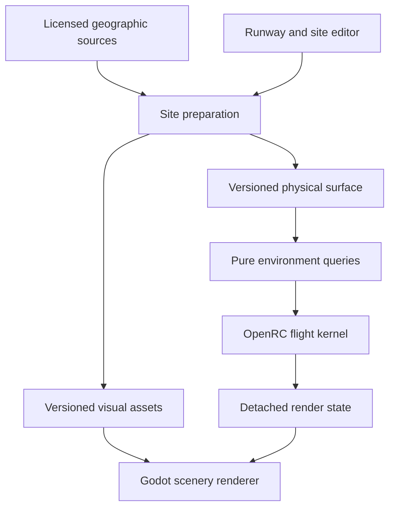

# Global scenery options: 32 investigations

Original review: 2026-11-19. Adoption order reconciled with the existing photographic plan on 2026-11-20. This is the earlier research retained alongside the new game and guide examples. The [SC-PHOTO plan](../../../plans/photorealistic-flying-sites.md) owns status; the [current pack README](README.md) defines the later geographic follow-on and its limits.

**Reviewed: November 20, 2026.** OpenRC can add geographically located flying sites through reproducible GIS preparation, a physical snapshot fixed for each flight and an independently scalable visual renderer. The first geographic milestone is a prepared local site selected by coordinates, with an imported or authored runway and offline flight. This is a later geographic follow-on to the existing photographic-site plan; it does not replace its first fixed-pilot rendering proof.

This part preserves the preceding **32 investigations and 100 distinct search queries**. The [24-example follow-up](game-world-precedents.md) adds 72 queries. See the [combined decisions](README.md) for scope and the [search record](search-record.md) for all 172 queries. These are source reviews, not adopted dependencies or runtime results.

Use **GDAL and PROJ for geographic preparation, QGIS for inspection and GeographicLib for coordinate checks**. Preserve the existing plan's ordinary-mesh control for moving-view scenery, then compare Terrain3D only when a measured requirement justifies it. Godotiles, PMTiles, procedural city tools and services remain optional additions.

## Recommended adoption order

| Capability | First choice | Decision |
| --- | --- | --- |
| Normalize terrain and datum | GDAL and PROJ | Establish the geographic contract first |
| Inspect a prepared site | QGIS | Check height, orientation, masks and runway registration |
| Validate coordinates and bearings | GeographicLib | Use as an independent numerical reference |
| Render nearby terrain in Godot | Ordinary local/distant meshes first; conditional Terrain3D trial | Preserve the moving-view control and qualify both required renderer paths |
| Produce a detailed ground model | PDAL or ODM | Use only when source coverage and control evidence support it |
| Add contextual scenery | OSM2World and optional BlenderGIS | Keep authored runway exclusions and separate asset identity |
| Build regional selector maps | tilemaker or Planetiler | Select one builder based on measured regional requirements |
| Deliver tiled visual archives | PMTiles | Add an explicit adapter only when archives improve delivery |
| Stream distant terrain | Godotiles or a later Cesium integration | Experimental until platform and coverage gates pass |
| Serve dynamic maps or rasters | Martin or TiTiler | Defer until a service requirement exists |

Software licenses below describe the inspected source or documented version, not the rights to every dependency, dataset, texture, imagery service or generated asset. Pin selected revisions and record data provenance. Initial deployment should minimize tools in the application: most GIS processing belongs in the preparation workflow.

## Findings that change the implementation plan

1. **Terrain3D remains a viable conditional trial.** Its platform guide documents Compatibility/OpenGLES support, so advanced terrain does not automatically require Forward+. Keep the existing plan's ordinary-mesh control first, then qualify Terrain3D on OpenRC's exact build, including Metal and export behavior. [Platform guide](https://terrain3d.readthedocs.io/en/stable/docs/platforms.html).

2. **Godot already has a geographic streaming experiment worth inspecting.** Godotiles provides quadtree loading, origin shifts and a cache, but its height availability follows resident tiles and its extra zoom detail may be synthesized. Those are reasons to keep its live visual stream outside authoritative contact. [Source](https://github.com/ziv/godotiles).

3. **Display data and physical data need different products.** Vector tiles can contain generalized geometry, raster previews can replace numeric elevation with color, and changing visual LOD can change meshes. Preserve original runway geometry and a defined physical sampler separately.

4. **Source versioning needs actual retained content.** Overture publicly retains releases for at most 60 days and does not promise stable GERS identities for base-theme features. Record a permitted extract, hashes and release-aware source IDs. [Retention](https://docs.overturemaps.org/release-calendar/) and [identifier scope](https://docs.overturemaps.org/gers/registry/).

5. **The OpenDroneMap and WebODM names no longer identify one pipeline.** OpenDroneMap has WebUI/NodeODM; the current separate WebODM repository identifies ODX rather than ODM. Pin the actual reconstruction engine. [WebUI](https://github.com/OpenDroneMap/WebUI) and [WebODM](https://github.com/WebODM/WebODM).

6. **Any location and continuous planetary travel are different milestones.** First generate bounded local sites from geographic coordinates. Continuous travel adds active-region handover, curvature and changing local frames. Web Mercator tile coverage also stops before the poles; a global product needs a separate coverage strategy there. [GDAL Mercator implementation notes](https://github.com/OSGeo/gdal/blob/master/swig/python/gdal-utils/osgeo_utils/gdal2tiles.py).

## Godot terrain and globe engines

### 1 Terrain3D

**Decision:** Conditional prototype after the ordinary-mesh control. **Code license:** MIT. [Project or primary documentation](https://github.com/TokisanGames/Terrain3D).

A C++ GDExtension for editable heightmap regions, terrain LOD and foliage. The documented regional extent reaches 65.5 km square. Its current platform guide supports Compatibility/OpenGLES from Terrain3D 1.0 with Godot 4.4, and supports Vulkan Mobile; the same guide explicitly leaves full Metal support uncertain.

**OpenRC use.** Compare it as a terrain-rendering and authoring candidate after the ordinary-mesh control. Feed it a prepared, georegistered heightmap and keep OpenRC's physical terrain contract separate. Qualify any reduction in rendering work on the required devices.

**Integration conditions.** Qualify a pinned build against OpenRC's Godot 4.8-beta2, including Compatibility/OpenGL and Apple Silicon Mobile/Metal at the required display resolution. Check terrain/runway registration, LOD transitions and memory. Background procedural visual terrain must not be mistaken for collision data.

[Platform support](https://terrain3d.readthedocs.io/en/stable/docs/platforms.html) · [Heightmaps](https://terrain3d.readthedocs.io/en/stable/docs/heightmaps.html)

### 2 Godotiles

**Decision:** Experimental streaming candidate. **Code license:** MIT or Apache 2.0. [Project or primary documentation](https://github.com/ziv/godotiles).

A Rust GDExtension with quadtree terrain and imagery streaming, origin shifting, worker downloads and a persistent disk cache. Its height query can return null when no resident tile covers the point. Zoom levels beyond a source's native detail synthesize terrain rather than add measurements.

**OpenRC use.** Use it to investigate distant scenery streaming, tile lifecycles and local-origin management in Godot. Its engine-independent core is also a useful design reference.

**Integration conditions.** Do not connect live resident-tile queries to the flight solver. Verify Godot version, renderer, macOS architecture, antimeridian handling and provider coverage. Cache location, quotas and offline rights need explicit policy. A PMTiles archive is not automatically compatible with its source interface.

[README and source layout](https://github.com/ziv/godotiles/blob/main/README.md) · [Height-query implementation](https://github.com/ziv/godotiles/blob/main/rust/src/godot/streamer.rs)

### 3 HTerrain

**Decision:** Authoring fallback. **Code license:** MIT. [Project or primary documentation](https://github.com/Zylann/godot_heightmap_plugin).

A GDScript heightmap editor with painting, holes, grass and LOD. Current master targets Godot 4.6 and newer; the maintainer describes maintenance as bug fixes rather than active feature development. Some hosted documentation describes older Godot APIs.

**OpenRC use.** Use it for a lightweight local terrain prototype or heightmap authoring. Terrain3D explicitly documents importing HTerrain output, so prepared authoring data may transfer if that renderer is selected.

**Integration conditions.** Check the selected revision and actual renderer behavior instead of treating old documentation as evidence for Godot 4.8 support. A rendered heightmap still needs the same sample convention and datum as physical terrain.

[Repository and maintenance status](https://github.com/Zylann/godot_heightmap_plugin) · [Terrain3D heightmap imports](https://terrain3d.readthedocs.io/en/stable/docs/heightmaps.html)

### 4 Voxel Tools

**Decision:** Defer until volumetric terrain is needed. **Code license:** MIT. [Project or primary documentation](https://github.com/Zylann/godot_voxel).

Provides chunked voxel terrain, smooth LOD and geometry that can represent tunnels or overhangs. It offers both a custom-engine module and a GDExtension route; GPU features have renderer-specific requirements.

**OpenRC use.** Consider it if caves, undercuts, deformable terrain or volumetric ground become explicit product requirements. Ordinary flying fields can begin with a simpler height surface.

**Integration conditions.** Prefer evaluating the extension route before taking on a custom Godot build. Test CPU paths and each target renderer independently. Do not substitute its Godot collision implementation for the authoritative OpenRC evaluator.

[Source and feature overview](https://github.com/Zylann/godot_voxel) · [Documentation](https://voxel-tools.readthedocs.io/en/latest/)

### 5 GeoDot

**Decision:** Offline prototype or reference. **Code license:** GPL 3.0. [Project or primary documentation](https://github.com/boku-ilen/geodot-plugin).

Wraps GDAL in a Godot GDExtension for georeferenced raster and vector access. The README says the Mac implementation is x86-only and describes a vector extraction issue, while the current SConstruct accepts arm64.

**OpenRC use.** Useful for testing GeoTIFF, GeoPackage and nearby-feature queries directly in a Godot editor experiment. Its data extraction patterns can inform an import tool.

**Integration conditions.** Apple Silicon support is unresolved by the conflicting documentation and build flags. Verify an actual working binary, dependency packaging and selected-version license obligations before linking it into OpenRC. A separate GDAL build step is initially simpler.

[Repository README](https://github.com/boku-ilen/geodot-plugin) · [Build configuration](https://github.com/boku-ilen/geodot-plugin/blob/master/SConstruct)

### 6 osgEarth

**Decision:** Reference viewer and optional converter. **Code license:** Current master is MIT; verify the selected release and dependencies. [Project or primary documentation](https://github.com/pelicanmapping/osgearth).

A C++ geospatial terrain and map SDK built on OpenSceneGraph and GDAL. Its osgearth_conv utility can prepare local GeoTIFF data as MBTiles or TMS datasets.

**OpenRC use.** Use an independent viewer to compare imagery/elevation registration and examine terrain paging. The converter can help prepare existing geospatial assets.

**Integration conditions.** This is a separate rendering stack, not a Godot plugin. Keep it as an authoring or comparison tool unless a measured need justifies the integration cost. Verify the particular data format and imagery rights.

[Repository](https://github.com/pelicanmapping/osgearth) · [osgearth_conv](https://docs.osgearth.org/en/latest/osgearth_conv.html)

### 7 vsgCs

**Decision:** Globe architecture reference. **Code license:** MIT. [Project or primary documentation](https://github.com/timoore/vsgCs).

Integrates Cesium Native with Vulkan Scene Graph. It supports 3D Tiles, imagery overlays, multiple tilesets and whole-Earth terrain paging.

**OpenRC use.** Study how it connects streamed geographic data, world anchors and a host renderer. It is a useful reference for evaluating a future Cesium Native integration.

**Integration conditions.** Its Vulkan Scene Graph renderer does not drop into Godot or establish Godot Metal support. Keep its visual paging separate from physical surface activation. Dataset and hosted-service rights remain independent.

[Project README](https://github.com/timoore/vsgCs) · [Cesium Native](https://github.com/CesiumGS/cesium-native)

### 8 Cesium 3D Tiles Tools

**Decision:** Use when importing 3D Tiles. **Code license:** Apache 2.0. [Project or primary documentation](https://github.com/CesiumGS/3d-tiles-tools).

A Node and TypeScript command-line toolkit for inspecting, merging, upgrading and converting 3D Tiles content. It can extract or convert certain tile payloads to GLB and create a tileset description with a geographic anchor.

**OpenRC use.** Prepare reproducible visual scenery imports and diagnose coordinate or payload problems before loading them in Godot.

**Integration conditions.** It is neither a Godot renderer nor a complete global-terrain generator. Some conversions can lose information; verify metadata, transforms, material extensions and the capabilities of the chosen Godot loader. Tool licensing does not authorize reuse of imported content.

[Commands and limitations](https://github.com/CesiumGS/3d-tiles-tools)

## Geographic preparation and site authoring

### 9 GDAL

**Decision:** Core preparation tool. **Code license:** Generally MIT with additional dependency notices. [Project or primary documentation](https://github.com/OSGeo/gdal).

Reads, inspects, crops, reprojects and resamples geographic rasters. gdalwarp can perform automatic vertical transformations on suitable single-band rasters. Its target-aligned-pixel option aligns output extent to resolution, not necessarily to the source grid.

**OpenRC use.** Build a repeatable terrain preparation command that produces explicit grid geometry, units, validity masks and separate visual imagery. Inspect source metadata before transforming it.

**Integration conditions.** Specify output extent, origin, spacing, sample convention, interpolation and NoData explicitly. Record the selected vertical operation so a geoid shift is neither omitted nor applied twice. Neighboring physical tiles need matching boundary behavior.

[gdalwarp](https://gdal.org/en/stable/programs/gdalwarp.html) · [Raster geotransforms](https://gdal.org/en/stable/tutorials/geotransforms_tut.html) · [License](https://gdal.org/en/stable/license.html)

### 10 PROJ

**Decision:** Core preparation tool. **Code license:** MIT; transformation grids retain their own terms. [Project or primary documentation](https://github.com/OSGeo/PROJ).

Provides coordinate operations and transformation-grid handling. projinfo exposes candidate operations and grid requirements. Since PROJ 9.1, both CRS definitions must be 3D for a vertical transformation to be possible.

**OpenRC use.** Make horizontal and vertical datums explicit before combining satellite elevation, GPS observations, runway endpoints or photogrammetry. Pin the actual chosen operation and its grids.

**Integration conditions.** A CRS label alone does not establish identical heights. Record datum, units, axis order, grid hashes, database version and any epoch. Verify control points with required grids present and networking disabled; fail preparation when the chosen operation cannot run.

[projinfo](https://proj.org/en/stable/apps/projinfo.html) · [Resource files](https://proj.org/en/stable/resource_files.html) · [Transformation grids](https://github.com/OSGeo/PROJ-data)

### 11 PDAL

**Decision:** Use for LiDAR sites. **Code license:** BSD. [Project or primary documentation](https://github.com/PDAL/PDAL).

Processes point clouds and can classify ground points, filter ground classes and rasterize elevations. Its GDAL writer supports several output statistics and optional filling of empty cells.

**OpenRC use.** Create higher-detail bare-earth terrain around important RC fields from appropriately licensed LiDAR. Process a buffered area, preserve density and coverage evidence, then inspect the runway and its margins.

**Integration conditions.** Choose an explicit output statistic and common grid. Filtering and interpolation do not prove that hidden ground was measured. Preserve empty-cell and uncertainty information instead of silently filling unsupported areas.

[Pipeline documentation](https://pdal.io/en/stable/pipeline.html) · [GDAL writer](https://pdal.io/en/2.9.2/stages/writers.gdal.html) · [License](https://github.com/PDAL/PDAL/blob/master/LICENSE.txt)

### 12 OpenDroneMap and WebODM

**Decision:** Optional high-detail site capture. **Code license:** ODM and WebODM identify AGPL 3.0. [Project or primary documentation](https://github.com/OpenDroneMap/ODM).

ODM can produce georeferenced point clouds, orthophotos, DSMs and requested DTMs from photographs. The current OpenDroneMap interface is WebUI with NodeODM. The separate WebODM repository says it is not affiliated with OpenDroneMap and uses ODX rather than ODM.

**OpenRC use.** Create premium local RC sites from authorized photography and surveyed control/check points. Store the engine version, options, datum and source evidence with the resulting site.

**Integration conditions.** A photogrammetric surface is not automatically surveyed bare earth. Check vegetation/building filtering and independent errors. ODM's DEM resolution uses centimeters per pixel; its GPS Z offset affects image EXIF, not GCP heights. Do not confuse the current WebODM and OpenDroneMap toolchains.

[ODM outputs](https://docs.opendronemap.org/outputs/) · [ODM options](https://docs.opendronemap.org/arguments/) · [OpenDroneMap WebUI](https://github.com/OpenDroneMap/WebUI) · [WebODM](https://github.com/WebODM/WebODM)

### 13 QGIS and Qgis2threejs

**Decision:** Core review workflow. **Code license:** QGIS GPL 2 or later; plugin GPL 3 or later. [Project or primary documentation](https://github.com/minorua/Qgis2threejs).

QGIS can inspect geographic layers together; Qgis2threejs provides 3D previews and glTF/GLB export. Its original-DEM-values mode requires matching project and DEM CRS and equal horizontal grid spacing.

**OpenRC use.** Review runway endpoints, terrain, masks and orthophotos before building a site. A GLB preview makes alignment problems visible to people who are not working in the GIS toolchain.

**Integration conditions.** Keep vertical exaggeration at 1 for geometry checks. Exported visual geometry needs a recorded local origin, scale and axis conversion; do not assume the GLB alone preserves the geographic contract.

[QGIS](https://www.qgis.org/) · [Qgis2threejs exporter](https://minorua.github.io/Qgis2threejs/docs/3.2/Exporter.html) · [Plugin repository](https://github.com/minorua/Qgis2threejs)

### 14 BlenderGIS

**Decision:** Optional scenery authoring. **Code license:** GPL 3 or later. [Project or primary documentation](https://github.com/domlysz/BlenderGIS).

Bridges Blender with georeferenced rasters and vectors. Its georeferencing workflow uses a scene CRS and projected origin.

**OpenRC use.** Author a clubhouse, fences, runway furnishings and locally detailed scenery over a geographic reference; export visual assets through Blender's normal glTF workflow.

**Integration conditions.** Record origin, scene scale and axis conversion outside the visual file. Check known points after export. Imagery import access is not a grant to redistribute that imagery, and a visually polished mesh does not establish accurate ground contact.

[Repository](https://github.com/domlysz/BlenderGIS) · [Georeferencing](https://github.com/domlysz/BlenderGIS/wiki/Georeferencing-management)

### 15 OSM2World

**Decision:** Prototype contextual scenery. **Code license:** Current master MIT; verify older selected releases and asset notices. [Project or primary documentation](https://github.com/tordanik/OSM2World).

Converts OpenStreetMap features into three-dimensional objects and supports glTF/GLB output. Its project discusses cross-tile terrain integration as continuing technical work.

**OpenRC use.** Generate surrounding buildings, roads and landmarks from a pinned regional extract. Keep a replaceable scenery layer around the authored RC site.

**Integration conditions.** Supply and verify elevation registration separately. Apply runway clearance and user exclusion polygons. Preserve source IDs where useful, generator version, styles and texture licenses. OSM data remains subject to ODbL.

[Repository](https://github.com/tordanik/OSM2World) · [GLB release support](https://osm2world.org/blog/2025/01/21/release-0.4.0/) · [Terrain integration roadmap](https://osm2world.org/blog/2026/06/03/ptf-roadmap-2026-osm-3d-terrain/) · [Default styles](https://github.com/tordanik/OSM2World-default-style)

### 16 Overture Maps and DuckDB

**Decision:** Additional feature discovery source. **Code license:** DuckDB MIT; Overture base data ODbL with source attribution. [Project or primary documentation](https://docs.overturemaps.org/getting-data/duckdb/).

Overture's infrastructure schema includes runway, taxiway, apron and airstrip classes. DuckDB can extract geographic subsets from its GeoParquet releases. Public releases are retained for a maximum of 60 days, and base-theme UUIDs carry no GERS stability commitment.

**OpenRC use.** Discover candidate runway and scenery geometry by bounding box and class, inspect returned subtype and geometry, then reconcile it with other data or user corrections.

**Integration conditions.** Coverage and mapping accuracy vary. Save a permitted, attributed extract and its checksum instead of relying on a future URL. Maintain release-aware source mappings and stable OpenRC site IDs. Apply exact geometry tests after the broad bounding-box filter when required.

[DuckDB access](https://docs.overturemaps.org/getting-data/duckdb/) · [Infrastructure classes](https://docs.overturemaps.org/schema/reference/base/types/infrastructure_class/) · [Retention](https://docs.overturemaps.org/release-calendar/) · [ID registry](https://docs.overturemaps.org/gers/registry/) · [Attribution](https://docs.overturemaps.org/attribution/)

## Existing simulator designs

### 17 FlightGear scenery architecture

**Decision:** Primary architectural precedent. **Code license:** GPL 2 or later code; scenery and assets have separate terms. [Project or primary documentation](https://github.com/FlightGear/flightgear).

FlightGear divides geographic scenery into indexed tiles. Its documented index uses fixed latitude bands with longitude widths adjusted by latitude.

**OpenRC use.** Adopt the idea of independently versioned terrain, airport overlays and scenery objects. Give every regional package an explicit spatial extent and identity; test memory and loading around representative locations.

**Integration conditions.** A degree of longitude does not represent the same ground distance at every latitude. FlightGear is a separate simulator, not a library to drop into Godot. Reusing its concepts is simpler than importing its entire runtime.

[Tile index](https://wiki.flightgear.org/Tile_Index_Scheme) · [Scenery source](https://github.com/FlightGear/flightgear/blob/next/src/Scenery/tilemgr.cxx)

### 18 TerraGear

**Decision:** Offline pipeline precedent. **Code license:** GPL 2 family; verify selected files and dependencies. [Project or primary documentation](https://github.com/FlightGear/terragear).

FlightGear's terrain-generation toolchain combines prepared elevation, geographic features and airport information into scenery. Airport generation depends on prepared terrain.

**OpenRC use.** Borrow its staged build approach: normalize elevation, prepare airport/runway geometry, assemble terrain, then attach objects. A source change should invalidate only the derived artifacts it affects.

**Integration conditions.** Its output formats target FlightGear, and the mirror contains historical instructions. Reproduce the selected revision before depending on its binaries or exact commands; do not adopt an old installation guide as a current working build.

[Repository and build stages](https://github.com/FlightGear/terragear)

### 19 osm2city

**Decision:** Procedural scenery precedent. **Code license:** GPL notice verified in an inspected fork; verify chosen upstream revision. [Project or primary documentation](https://osm2city.readthedocs.io/en/latest/).

Builds FlightGear scenery from OSM features and accounts for existing terrain and feature placement. Its parameters include exclusions and controls for generated scenery.

**OpenRC use.** Use the same conceptual split for replaceable contextual buildings, roads and vegetation. Generate against OpenRC's prepared terrain and support runway clearance, authored exclusions and persistent feature overrides.

**Integration conditions.** OSM coverage controls what can be generated. A plausible building is not evidence that its dimensions match reality. Check the upstream revision, textures and data attribution before copying code or distributing output.

[Working method](https://osm2city.readthedocs.io/en/latest/how_it_works.html) · [Parameters](https://osm2city.readthedocs.io/en/latest/parameters.html) · [Inspected fork license](https://gitlab.com/bartacruz/osm2city/-/blob/master/LICENSE)

### 20 TerraSync

**Decision:** Regional delivery precedent. **Code license:** FlightGear component; inspect the chosen client revision and scenery rights. [Project or primary documentation](https://wiki.flightgear.org/TerraSync).

An integrated FlightGear component that downloads and updates scenery for the region being used.

**OpenRC use.** Build an OpenRC package installer with regional manifests, checksums, resumable transfer, staging and atomic activation. A saved flight should keep its selected physical package even when a newer package exists.

**Integration conditions.** Background network/cache work may run outside the physics evaluators. Physical inputs must not change halfway through a flight because a download completed. TerraSync is a simulator component, not a generic tile hosting service.

[TerraSync documentation](https://wiki.flightgear.org/TerraSync)

### 21 GeoFS

**Decision:** Product behavior precedent. **Code license:** Whole application and imagery not established as open source. [Project or primary documentation](https://www.geo-fs.com/).

A worldwide browser flight simulator. Its instructions explain that it overlays standard runway graphics when the underlying imagery is too coarse to show runways clearly; its credits name OurAirports and OSM.

**OpenRC use.** Give OpenRC usable runway visuals even when satellite imagery is absent or coarse. Draw markings from the runway definition, with the physical surface prepared independently from the same geometry.

**Integration conditions.** Treat GeoFS as a product example, not as a reusable application codebase. Its use of open libraries does not grant rights to its imagery, assets or service.

[Instructions](https://www.geo-fs.com/pages/instructions.php) · [Credits](https://www.geo-fs.com/pages/credits.php)

### 22 X-Plane WorldEditor and MeshTool

**Decision:** Airport editor precedent. **Code license:** Laminar original XPTools src code MIT or X11; dependencies and data separate. [Project or primary documentation](https://github.com/X-Plane/xptools).

WorldEditor authors airports and overlays; its manual identifies MeshTool as the separate base-mesh generator. The editor also validates scenery and distinguishes internal airport identity from changeable public identifiers.

**OpenRC use.** Give OpenRC a small site editor with runway endpoints or true bearing, dimensions, surface profile, pilot point, starting positions and exclusion zones. Keep editable airport geometry distinct from the terrain build and assign stable internal IDs.

**Integration conditions.** The Gateway API separately restricts products primarily serving other flight simulators without written permission, despite the GPL status of received airport data. Do not use it as the default OpenRC airport acquisition service.

[WED manual](https://developer.x-plane.com/manuals/wed/) · [XPTools licensing](https://github.com/X-Plane/xptools/blob/master/README.md) · [Gateway access terms](https://gateway.x-plane.com/api)

### 23 Ortho4XP

**Decision:** Build graph precedent. **Code license:** Historical GPL 3 listing; selected code and bundled dependencies require inspection. [Project or primary documentation](https://github.com/oscarpilote/Ortho4XP).

Builds X-Plane scenery through separate vector, mesh, mask and imagery stages. Its repository includes platform and provider maintenance caveats. A dependency, Triangle, has separate commercial-use restrictions stated by its author.

**OpenRC use.** Separate OpenRC's imagery refresh from physical terrain and runway generation. Cache each intermediate result under its own inputs and generator version so visual changes do not alter replay contact.

**Integration conditions.** Use the build architecture as the immediate lesson. Do not assume a blanket open-source permission covers every triangulator, provider, texture or shipped binary.

[Repository](https://github.com/oscarpilote/Ortho4XP) · [Build stages](https://github.com/oscarpilote/Ortho4XP/blob/master/src/O4_Tile_Utils.py) · [Triangle author's terms](https://www.cs.cmu.edu/~quake/triangle.html)

### 24 Microsoft Flight Simulator 2024 SDK

**Decision:** Exclude from the OpenRC tool stack. **Code license:** Proprietary SDK with MSFS-specific permitted use. [Project or primary documentation](https://docs.flightsimulator.com/msfs2024/retail/introduction/sdk-eula/).

The published SDK license limits the software to MSFS add-on development and expressly restricts using it for a competing flight simulator or competitive analysis.

**OpenRC use.** This investigation rules out a tempting shortcut: OpenRC should use the open terrain, authoring and scenery tools in the other dossiers instead of depending on this SDK or its sample content.

**Integration conditions.** This conclusion concerns the licensed SDK software and content. It does not assert that merely reading publicly accessible product information is prohibited.

[Published SDK license](https://docs.flightsimulator.com/msfs2024/retail/introduction/sdk-eula/)

## Discovery packaging and distribution

### 25 PMTiles

**Decision:** Optional versioned visual archive. **Code license:** BSD 3 clause reference implementation; specification CC0. [Project or primary documentation](https://github.com/protomaps/PMTiles).

Stores a tile pyramid in a single archive and supports remote retrieval of selected byte ranges. Archives are read-only; changing their contents means rewriting the archive.

**OpenRC use.** Distribute versioned regional imagery or map archives using ordinary object storage, and support local archives where the data license permits it. Keep the canonical physical terrain bytes separately specified.

**Integration conditions.** PMTiles needs archive access and decoding plus a rendering adapter in Godot. It is not a terrain renderer, a collision sampler or automatically a Godotiles source. Object storage and HTTP range requests still have costs. Start the MVP with prepared local meshes/textures if that is simpler.

[Format and implementations](https://github.com/protomaps/PMTiles) · [Concepts](https://docs.protomaps.com/pmtiles/) · [Cloud storage](https://docs.protomaps.com/pmtiles/cloud-storage)

### 26 tilemaker

**Decision:** First regional map builder. **Code license:** FTWPL; inspect bundled dependency notices. [Project or primary documentation](https://github.com/systemed/tilemaker).

Converts OSM PBF extracts into vector tiles without requiring a database. It supports configurable processing and MBTiles or PMTiles output.

**OpenRC use.** Build an initial regional world-selector map or optional contextual feature layer with a deliberately small schema. Preserve RC-relevant tags in the source extraction.

**Integration conditions.** Display tiles may simplify, clip or omit feature detail. Keep original canonical runway and contact geometry outside the display-tile pipeline. Pin the configuration and input extract alongside the tool revision.

[Repository](https://github.com/systemed/tilemaker) · [Processing configuration](https://github.com/systemed/tilemaker/blob/master/docs/CONFIGURATION.md)

### 27 Planetiler

**Decision:** Scale option after regional success. **Code license:** Apache 2.0 code; map schemas and source data retain their terms. [Project or primary documentation](https://github.com/onthegomap/planetiler).

A Java-based geographic vector-tile builder that outputs MBTiles or PMTiles and supports custom profiles.

**OpenRC use.** Use it when the world selector or a larger feature catalog needs repeatable regional or global builds. Evaluate it as an alternative to tilemaker, rather than requiring both.

**Integration conditions.** Plan actual build time, memory, temporary disk and updates for the intended extract. A global-capable build tool does not make all source detail suitable for physical geometry. Preserve source data and profile identities.

[Repository and profiles](https://github.com/onthegomap/planetiler)

### 28 Martin

**Decision:** Optional service. **Code license:** MIT or Apache 2.0. [Project or primary documentation](https://github.com/maplibre/martin).

A Rust tile server that can serve PMTiles and MBTiles and produce vector tiles from supported geographic sources such as PostGIS or GeoJSON.

**OpenRC use.** Introduce it if OpenRC needs server-managed layers, controlled map access or dynamic geographic queries. It can serve a future community site catalog.

**Integration conditions.** Static versioned packs do not need a custom tile server. Do not add Martin to the first local-site prototype without a concrete service requirement. Server updates must not mutate a flight's pinned physical package.

[Repository](https://github.com/maplibre/martin) · [PMTiles sources](https://maplibre.org/martin/sources-pmtiles/)

### 29 TiTiler

**Decision:** Optional raster preview service. **Code license:** MIT. [Project or primary documentation](https://github.com/developmentseed/titiler).

Python modules for building FastAPI raster tile services around sources including Cloud Optimized GeoTIFF and STAC. Current installation uses its documented component packages.

**OpenRC use.** Provide previews and visual raster delivery from prepared geographic datasets when a web authoring workflow needs them.

**Integration conditions.** Keep raster processing off the flight path. An RGB preview is not the numeric elevation surface. Decide authentication, cache and processing cost before deploying a service; the first site can read prepared local files.

[Repository and modules](https://github.com/developmentseed/titiler) · [License](https://github.com/developmentseed/titiler/blob/main/LICENSE)

### 30 PySTAC Client

**Decision:** Automate source discovery. **Code license:** Apache 2.0. [Project or primary documentation](https://github.com/stac-utils/pystac-client).

A Python client for searching SpatioTemporal Asset Catalog APIs. It helps discover datasets and assets by geographic and temporal criteria.

**OpenRC use.** Create a dataset discovery step that lists candidate elevation or imagery assets for a requested site, including dates, quality metadata and available asset links.

**Integration conditions.** A catalog search does not itself process data or grant access or redistribution rights. Record collection, item and asset identity, source terms and content checksums; handle authenticated or expiring URLs outside the runtime.

[Repository](https://github.com/stac-utils/pystac-client) · [Usage](https://pystac-client.readthedocs.io/en/stable/usage.html)

### 31 MapLibre Native

**Decision:** Evaluate for a richer world selector. **Code license:** BSD 2 clause. [Project or primary documentation](https://github.com/maplibre/maplibre-native).

A native library for GPU-accelerated map rendering across supported application platforms.

**OpenRC use.** Use it if OpenRC's site-selection/editor map grows beyond a simple geographic picker and a native bridge is justified. It can display the map products from tilemaker or Planetiler.

**Integration conditions.** It is not a Godot terrain or flight-physics engine. Godot embedding is separate integration work. An offline API or map SDK license does not supply imagery/data rights. A simpler map UI is acceptable for the first prototype.

[Repository](https://github.com/maplibre/maplibre-native) · [License](https://github.com/maplibre/maplibre-native/blob/main/LICENSE.md)

### 32 GeographicLib

**Decision:** Coordinate reference and possible library. **Code license:** MIT. [Project or primary documentation](https://github.com/geographiclib/geographiclib).

Provides geodesic, geocentric and local Cartesian calculations, with related gravity and geographic utilities.

**OpenRC use.** Use it as an independent reference for latitude/longitude-to-local transformations, runway endpoint distances, true bearings and tests near the antimeridian or poles.

**Integration conditions.** Keep coordinate/datum identity explicit. Linking a native implementation does not automatically meet OpenRC's exact reference/native equivalence requirement. Pin data used by any geoid utility separately from the library.

[Repository and license](https://github.com/geographiclib/geographiclib) · [Documentation](https://geographiclib.sourceforge.io/C++/doc/)

## OpenRC integration

OpenRC currently uses a pinned Godot build, a float64 simulation model, fixed 240 Hz RK4 integration and a separate rendering boundary. Field surfaces provide contact; Godot rigid bodies do not solve flight. New scenery should enter through the existing session, environment and landscape boundaries. [Current architecture](https://github.com/bultodepapas/OpenRCsimulator/blob/48580b75a796fc6048fb77cdd69875c94ebb69e0/docs/STACK.md).

### Data flow

The site editor and package manager may save user edits and provider-permitted cache data outside physics evaluation. For the first implementation, a flight loads and freezes a complete physical site before it starts. Visual downloads may improve appearance without changing the ground under the aircraft. A later continuous-world design must explicitly prepare and record physical-region activation boundaries.

### Geographic contract

Define the following before choosing binary formats or plugins:

- Horizontal CRS and axis order; geographic origin and units; conversions between Earth coordinates, local NED and Godot axes.

- Vertical datum, geoid transformation and required grids. GPS ellipsoidal height and orthometric map elevation must not be silently mixed.

- Grid origin, spacing, sample-center convention, interpolation and normal calculation. The visual mesh and physical sampler need a deliberately compatible surface.

- Coverage and validity masks, water classification and behavior at tile edges or missing data. Missing height is not sea level.

- Canonical source geometry, runway surface profile and any explicit terrain modification. A synthetic graded strip should be identified as an authored modification rather than presented as a surveyed runway.

- Independent physical and visual identities. A physical identity covers canonical bytes, coordinate and sampling rules, runway modifications, material table and generator versions; a visual identity covers imagery and objects.

For repeatable builds, record source release/item identifiers, selected transformation, tool versions, source and output checksums, attribution and permitted use. Preserve enough licensed input or canonical output to reproduce the flight package after an upstream URL changes.

### Changes to existing boundaries

| Existing boundary | Proposed responsibility |
| --- | --- |
| [Field loader](https://github.com/bultodepapas/OpenRCsimulator/blob/48580b75a796fc6048fb77cdd69875c94ebb69e0/app/data/field_loader.gd) | Explicit versioned geographic metadata or companion manifest; preserve existing field compatibility |
| [Landscape catalog](https://github.com/bultodepapas/OpenRCsimulator/blob/48580b75a796fc6048fb77cdd69875c94ebb69e0/app/landscapes/catalog.gd) | Register a geographic site adapter using prepared data |
| [Ground terrain](https://github.com/bultodepapas/OpenRCsimulator/blob/48580b75a796fc6048fb77cdd69875c94ebb69e0/app/physics/ground_terrain.gd) | Consume a defined immutable physical height and normal provider |
| [Ground surfaces](https://github.com/bultodepapas/OpenRCsimulator/blob/48580b75a796fc6048fb77cdd69875c94ebb69e0/app/physics/ground_surfaces.gd) | Support oriented runway geometry and material lookup |
| [Ground starts](https://github.com/bultodepapas/OpenRCsimulator/blob/48580b75a796fc6048fb77cdd69875c94ebb69e0/app/physics/ground_start.gd) | Derive starts from either runway end and its true orientation |
| [Environment](https://github.com/bultodepapas/OpenRCsimulator/blob/48580b75a796fc6048fb77cdd69875c94ebb69e0/app/sim/environment.gd) | Expose pure prepared-ground queries; audit all direct terrain consumers and native mirrors |
| [Render frames](https://github.com/bultodepapas/OpenRCsimulator/blob/48580b75a796fc6048fb77cdd69875c94ebb69e0/app/render/frames.gd) | Convert detached local simulation state into the renderer's coordinate frame |
| Session and replay identity | Pin the physical site, coordinate contract, material/runway revisions and evaluator backend |

This is an integration plan. These responsibilities are not already implemented by installing a terrain plugin.

### Runway generation and editing

The runway definition should contain endpoints or a geographic center plus true bearing, length, width, surface material, longitudinal profile, start points and a provenance status. Add markings, pilot position and scenery exclusion zones as related authored data.

Support three clear cases: imported real runway geometry; a user-corrected real site; and a deliberately synthetic strip placed on or graded into the terrain. Preserve user edits in a versioned site definition. Build physical and visible runway products from that same definition. Validate both directions, surface seams and spawn clearance.

Treat imagery as a visual aid. Its apparent precision must not override known source uncertainty or turn synthesized detail into ground truth.

## Geographic qualification sequence

| Experiment | Concrete deliverable | Pass condition |
| --- | --- | --- |
| Geographic preparation | One site built through GDAL and PROJ, inspected in QGIS | Known checkpoints, runway ends, sample positions, units and vertical datum agree within an explicitly chosen source-appropriate error budget |
| Terrain rendering | Ordinary meshes from the prepared site, followed by a justified Terrain3D comparison | Correct registration, no unacceptable LOD seams, and measured memory/frame cost on Compatibility/OpenGL and Apple Mobile/Metal |
| Deterministic contact | Reference and any proposed native evaluator using the same canonical site | Existing required byte-identical comparison on at least 10,000 states, exact trajectories and applicable malformed-input cases |
| Runway authoring | Imported runway plus an arbitrary-bearing user runway | Both start directions, visual/physical alignment, edits, reload and explicit grading behavior work |
| Package lifecycle | Download or import, verify, activate, reload and offline flight | Corrupt or incomplete packages cannot activate; imagery refresh does not change physical identity or replay |
| Coverage and scale | Additional mountain/coastal and poorly mapped sites, plus coordinate edge cases | Declared fallbacks for missing data; correct antimeridian handling; polar behavior is supported or explicitly bounded |

Exact equivalence compares implementations of the **same versioned terrain contract and data**. Real geographic terrain is expected to produce different outcomes from an old synthetic field; preserve that field's existing regression fixtures separately. Define the build and platform scope of every equivalence claim.

Follow OpenRC's existing performance policy: normally 1080p first; Apple Silicon Retina qualification uses the native display pixel target and records output, drawable and internal 3D resolution separately. Do not infer Mac acceptance from a 1080p benchmark. [Repository guidance](https://github.com/bultodepapas/OpenRCsimulator/blob/main/AGENTS.md).

The first geographic milestone is: choose coordinates, prepare a local physical snapshot, import or author a runway at an admitted heading, attach optional imagery, and fly offline with the existing OpenRC physics and replay contract. The existing photographic plan still begins with SC-PHOTO-02. Geographic runtime work follows the moving-view boundary and its required ground-domain qualification. Global visual streaming is a later bounded experiment; continuous physical globe travel requires a separately accepted design.
