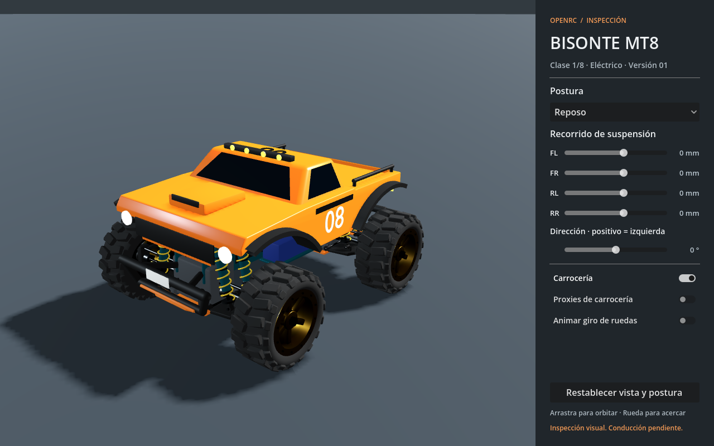

# RCV-14a: first Bisonte MT8 asset intake

**Date:** 2026-10-13. **Scope:** inspect the user's first `RC CARS` delivery and make its articulation reviewable in the pinned Godot 4.7.2 Compatibility renderer. [Commands and controls](../../../../research/rc-monster-truck/README.md#rcv-14a-mt8-visual-inspection) are maintained in the research tool guide. The [active plan](../../../plans/rc-monster-truck.md) owns pending integration.

## Received and checked

The canonical source is `RC CARS/MT8_Bisonte_entrega1_1/MT8_Bisonte/`: editable Blender source, generated GLB, geometry specification, generator sources, visual rig, renders and prior developer reports. `RC CARS/MT8_Bisonte_1.glb` is an identical copy, not a second revision. Both are 1,929,840 bytes with SHA-256 `7967bb46673ae5b4178a3d40ad8c3b8e1a9d0350b1cc73e2084f52ab496bb0a6`.

The [generated intake](intake.json) records all supplied artifact hashes and checks the binary glTF directly. It distinguishes newly observed data from the author's earlier reports. No Blender regeneration or live Blender change was performed. Three Luna Max agents audited the handoff, implemented the static intake, and tested articulation; the lead implemented the adapter/inspector and verified the integrated result.

| Item | Observed delivery |
| --- | --- |
| Imported frame | Metres; +X right, +Y up, −Z forward |
| Datum | Symmetry plane, midpoint between axles, underside of chassis plates |
| Declared design datum height | 0.125 m above ground |
| Wheelbase / centre-to-centre track | 0.420 m / 0.430 m |
| Nominal tire radius / width | 0.100 m / 0.090 m; tread expands mesh bounds slightly |
| Visual bounds, length × width × height | Approximately 0.667 × 0.523 × 0.365 m |
| Suspension / steering range | −0.070…+0.050 m travel; ±30° front steering |
| Geometry and materials | 72,800 visual triangles; 18 visual materials and one proxy-only material |
| Contact proxy geometry | Six dimensioned chassis/roof/side/bumper boxes, matching the supplied spec |
| External resources / baked animation | No external resource URIs and no animation tracks in the delivered GLB |

The adapter binds the received names (`MT8_Root`, `Corner_FL`, `FL_Suspension`, `FL_Steer`, `FL_Spin`, etc.) explicitly. Rear carriers have no steering capability. Source pivots remain unchanged. This is a concrete mapping of the proposal in plan §13.2, not an assumption that the proposed names exist in the file.

## Implemented inspection

The local inspector renders the complete truck, accepts independent suspension travel, front steering and optional forward wheel animation, and can hide the shell or display body collision boxes. Presets cover rest, bump, droop and diagonal articulation. Orbit/zoom exposes the underside; controls work with keyboard focus and mouse. It has English and Spanish labels.

[Cross articulation without the shell](cross-en.png) and [full extension with body proxies](droop-proxies-es.png) show additional review poses. These are Godot captures, separate from the delivered Blender renders.

The presentation adapter verifies pinned GLB/spec/rig bytes before loading the supplied generated rig. It refuses incomplete, nonfinite or out-of-range poses before changing any node. Positive forward wheel rotation maps once to the author's negative local-X spin. Proxies stay visual meshes; no `VehicleBody3D`, `RigidBody3D` or second physics authority is introduced. The imported asset is staged locally with [GLTFDocument](https://docs.godotengine.org/en/stable/classes/class_gltfdocument.html); it is not copied into exported application assets.

## Verification

[Native verification output](verification.log) and the [verification receipt](verification.json) record commands, source identities and results. The focused checks cover:

- Nine Python intake tests, including disposable corrupt-container, missing-node, external-resource, negative-scale, baked-animation, pivot/spec/rig and proxy-dimension mutations; deterministic manifest freshness.
- Forty-six Godot visual checks: dimensions and wheel corners, independent travel, 27 travel/steering combinations, joint/shock closure, front steering and four-wheel spin witnesses, neutral restoration, invalid-pose nonmutation, instance isolation and repeated load/free.
- Nine inspector checks in each language through Godot GUI key-event routing: sliders, checkboxes, preset popup, opt-in rotation and scope text fitting the minimum window.
- CLI refusal checks and a focused fresh checkout with `core.autocrlf=true`, proving exact delivery bytes and loading without an existing Godot import cache.
- Native Compatibility captures of rest, crossed articulation and full extension/proxies.

The observed articulation sweep's maximum wheel-centre error was 3.73e-9 m, arm closure error 1.49e-8 m, shock endpoint error 1.68e-8 m and shock-axis direction error 1.17e-7. The tests exercise delivered visual kinematics; they do not prove full mesh clearance, collision response or real suspension mechanics. The author's interference report remains supplied evidence and was not regenerated.

No aircraft physics, catalog, menu or generated aircraft data changed. The complete application suite, exported packages, native Linux/macOS and target-hardware frame pacing were not qualified in this intake. The shared tree may be committed by other tracks during verification; the receipt records source hashes rather than treating HEAD alone as the checked state.

## Follow-up for the Blender developer

The draft is usable for local inspection. To progress the runtime handoff:

1. Supply the source/reuse audit and an explicit author/license/attribution declaration covering geometry, scripts and materials. No license is inferred from the repository's MIT license or from receiving the files.
2. Keep the current datum and names stable. Add a versioned binding manifest with original asset hashes, rest transforms and named camera/audio mounts, or coordinate an explicitly documented mapping with the integration owner.
3. Review the 18 visual materials and provide the agreed LOD strategy. The current triangle count fits the plan's provisional LOD0 range, but material/draw-call cost and distant-wheel readability still need runtime evidence.
4. Maintain the six dimensioned body proxies. The spec already supplies tire radius/width, so physics can derive wheel primitives; separate wheel proxy meshes are optional once that binding is agreed.
5. Preserve the documented staging step for the standalone author test: copy GLB/spec from `out/` to `godot/`. Those copies are absent in the original package; that is a prerequisite stated by its README, not a failed test result from this intake.

The physical owner still needs a sourced mass/CG/inertia, suspension, tires, motor and gearing inventory. The old four-corner bench is synthetic and has different dimensions; this asset does not silently replace its parameters. RCV-14 remains partial, with production pose/CG binding, shared menu selection and driving tracked separately.
