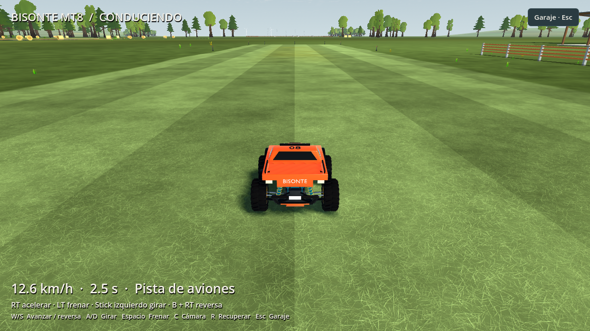
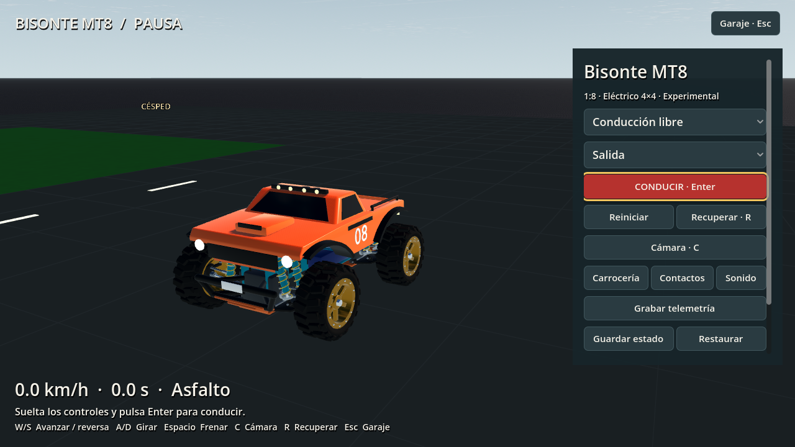
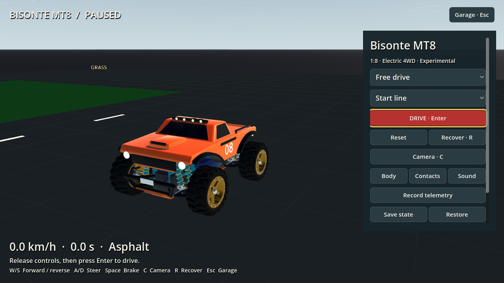
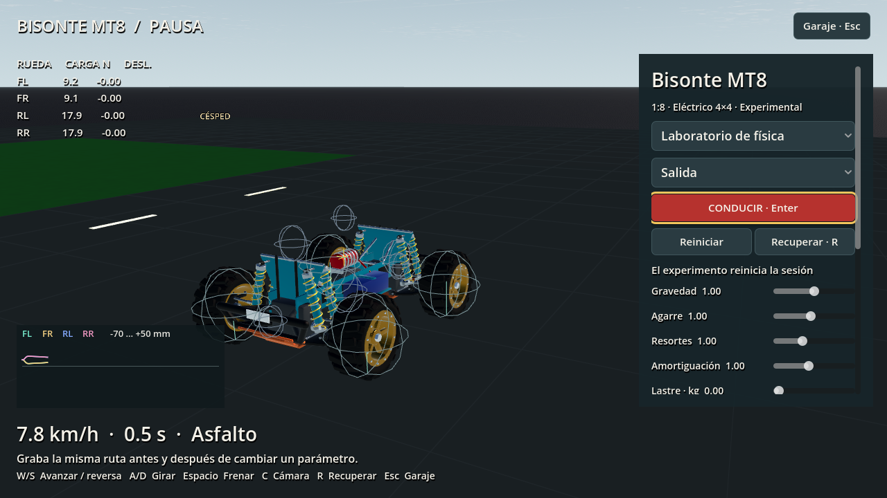
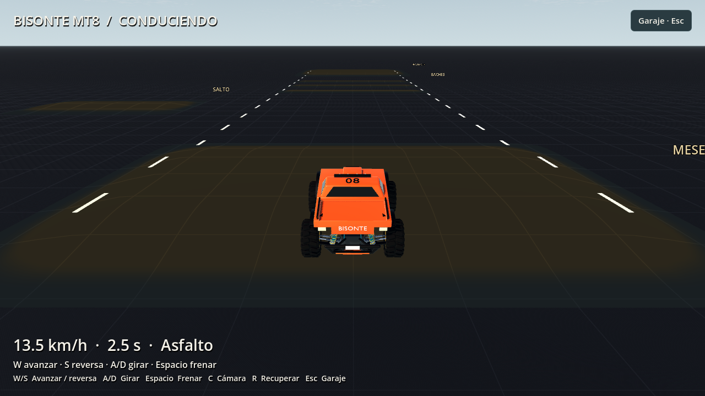
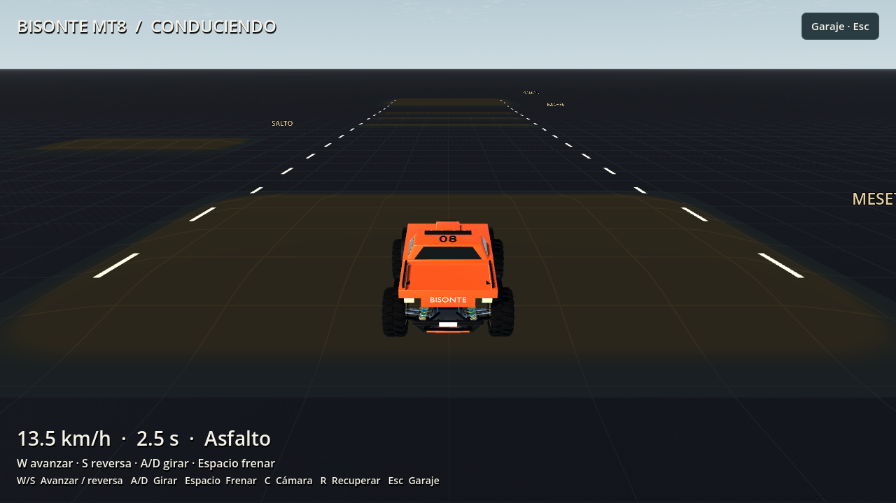

# RCV runtime evidence — 2026-10-13

This dated record covers the experimental Bisonte MT8 integration. The [operating guide](../../../../research/rc-monster-truck/README.md#drive-and-experiment) owns controls, commands and current use; the [RCV plan](../../../plans/rc-monster-truck.md#11-execution-order-and-reviewable-steps) owns remaining acceptance gates. Software verification does not establish physical calibration.

The [October 13 evidence index](final-evidence-index.json) binds the original follow-up logs to that runtime revision. The later airfield integration has its own receipt below.

## Shared airfield start — 2026-10-14

The player now enters the Bisonte garage on the aircraft runway. Home passes the selected field, lighting, sky and night options into the activity; `World.build` constructs the shared airfield. `AirfieldCourse` adapts the accepted aircraft surface table and analytic terrain, including the resolved lake bed, to the truck's road callback. Its identity includes field/material content and source or exported-bytecode artifacts. The surface rolling factor multiplies the truck's existing rolling coefficient exactly once.

The center start points along the runway; the end start faces inward with a 2 m margin. Four tire patches receive a terrain-supported, zero-speed placement with gravity preload and bounded suspension travel. Small physical settling is allowed; this is not an arbitrary-slope equilibrium solver. Zero gravity starts with relaxed suspension above the highest patch. The previous strict flat-course initializer and synthetic jump/bump fixtures remain intact. No separate car track was built; that future track belongs inside this airfield.

The [bounded verifier](airfield-20261014/verification/verification.json) passed all 13 groups, with unchanged runtime source hashes during the run. These include 32 airfield checks (shared heights/normals/materials/lake bed, translated field, inward end start, experiments, checkpoint JSON round trips and foreign-field rejection, and driving onto existing rough grass), 55 dynamics checks, 85 session checks, 23 synthetic activity checks, 16 presentation checks and 19 Home/RC navigation checks. The [controller regression](airfield-20261014/controller-ground.log) passed 22/22. This is focused software verification, not the full application suite or physical calibration.

Native Godot 4.7.2 Compatibility captures on RTX 3090 at 1280 × 720 verify the actual field scene. [Garage](airfield-20261014/garage-es.png), [driving after 600 ticks](airfield-20261014/drive-es-final.png), and [laboratory after 120 ticks](airfield-20261014/lab-es.png) have adjacent JSON receipts. The first drive capture reported four objects at immediate process shutdown; letting the capture tool flush one frame after freeing the scene removed that warning in the final drive/lab runs. Field scenery remains decorative for truck collision response; lake-bed contact adds neither buoyancy nor water drag.

A fresh Windows RC-only release snapshot passed import, export, packaged airfield startup and the existing compiled cost entry: [package receipt](airfield-20261014/package/package-verification.json), [source hashes](airfield-20261014/package/source-sha256.json). This confirms that the airfield identity can resolve exported bytecode artifacts. The forced `--quit-after` startup log retains a four-object shutdown warning; it contains no script errors. This is not full application release qualification, and its cost entry still measures the synthetic practice fixture, not the new airfield road.

## Verified software

The later [RCV-05-R1 controller audit](../../controller-support-2026-10-14/README.md#rcv-05-r1-car-controller-audit) fixes resting-axis deadzones, fresh-input resume and car-specific device selection, adds camera/recovery shortcuts, and records native garage captures. Its operating instructions live in the [driving guide](../../../../research/rc-monster-truck/README.md#drive-and-experiment).

| Check | Result and retained evidence |
| --- | --- |
| Data, course and input | 23 vehicle-data checks, 29 course checks and 23 input checks passed; [runtime receipt](runtime/verification.json) includes generator freshness, mutation rejection and float64 guard results. |
| Native-integrated dynamics | 47/47 passed, including reference/native trajectory comparison, reverse/braking, heading, conservation/refinement and backend identity: [log](runtime/test_rcv_vehicle_dynamics.log). |
| Session and checkpoint | 85/85 passed, including tick-zero JSON checkpoint round trip, exact float64 state, replay, recording/export limits and backend mismatch rejection: [log](runtime/test_rcv_session.log). |
| Activity, presentation and RC menu | The bounded run passed 14/14, 16/16 and 10/10 respectively: [activity](runtime/test_rcv_activity.log), [presentation](runtime/test_rcv_presentation.log), [menu](runtime/test_rcv_menu.log). The expanded activity regression subsequently passed 23/23, including actual jump/landing and accepted throttle-release boundaries: [final log](jump/test_rcv_activity-release-boundary.log). |
| Aircraft regression | Four current-working-tree golden flights passed without this track re-recording them: [log](aircraft-golden.log). Other tracks have edited aircraft data/goldens in this shared tree; this is not a clean-HEAD regression claim. |
| Broader Home checks | Functional Home passed. The first bounded run retained two failures in the default Stik 720p layout, 41 px overflow in EN and ES; [original log](runtime/test_ui_home_layout.log). A 42 px reduction in outer margins/fixed gaps preserved control sizes and made all layout checks pass: [final layout log](home-layout-final.log). [Home](home-final.log) and [RC menu](rc-menu-final.log) passed again after that fix. |
| Native evaluator parity | Windows and Linux each passed 39 evaluator comparisons, malformed-input checks and float64 loading: [Windows log](native-windows-parity.log), [Linux receipt](native-linux/verification.json). |
| Windows release, native enabled | Fresh import, release export, packaged activity startup and actual compiled release cost entry passed: [receipt](package-native/package-verification.json). Backend identity confirms the installed native DLL; `debug_build` is false. |
| Windows release, reference only | The same four checks passed with generated native artifacts excluded: [receipt](package-reference/package-verification.json). Identity correctly hashes the exported remapped GDScript bytecode. |
| Generated-output ignore rule | A fresh sparse Git clone with the current ignore-rule patch ignored a native test artifact: [receipt](native-ignore-check.json). This checks the rule only, not an entire fresh-clone build. |
| Full application export | The shared aircraft export gate rejected a visual family lacking a checked-in model manifest, traced to HX-700: [receipt](global-package-block.json), [log](global-package-block.log). The RC-only verifier disables that plugin only in its disposable snapshot and does not qualify the application release. |

The source hashes stayed unchanged throughout the retained runtime run. Its overall `ok` is false because it honestly includes the original broad Home-layout failures; the subsequent Home-only layout fix has separate passing logs above. The canonical full application suite was not completed by this track; its RC checks are registered in [app/test.sh](../../../../app/test.sh). No CI result is claimed.

## Release tick cost

Measured in the actual Godot 4.7.2 Windows release executable on an AMD Ryzen 9 5900X (24 logical processors). Each mode runs 60 warmup ticks and 240 measured `Session.tick_once` calls, driving/steering then braking, without rendering. Recording-off runs first. The native and reference packages bind the same estimated vehicle/course bytes. Other workstation workloads were not controlled; these bounded observations are not target-hardware frame-pacing qualification.

| Backend / recording | Mean µs | Median µs | p95 µs | Maximum µs |
| --- | ---: | ---: | ---: | ---: |
| Native / off | 2,344.38 | 2,269 | 3,470 | 5,330 |
| Native / on | 2,127.23 | 2,072 | 2,850 | 5,868 |
| GDScript reference / off | 6,600.63 | 6,740 | 7,736 | 9,059 |
| GDScript reference / on | 6,663.58 | 6,723 | 7,832 | 8,428 |

Native mean and p95 pass the 4,166.67 µs interval available at 240 Hz. Maximum ticks exceeded that interval. Both backends fail the stricter 500 µs plan mean target, and the reference backend also fails the 240 Hz mean/p95 budget. Passing package startup is separate from either timing gate. No global tick-rate reduction, force clipping or aircraft golden replacement was used to meet these checks.

Native executable SHA-256: `3a5e23e9d6dc40f3048b4ecceea6950d623fceb09cf6b8ad31877a5264fd3c5a`. The exported DLL SHA-256 is `2958c34163a8c13d5d5fc675806bd6b45750eb8f435708c1ba4d4b67ade8789e`. Source manifests and complete bounded logs accompany each package receipt. Packages are fresh copies of the current working tree without import cache, not clean Git clones. The earlier solver-v1 6.9–7.6 ms probe is superseded by these solver-v2 measurements.

## Visual inspection

The garage, lab and driving captures use Godot 4.7.2 Compatibility rendering at 1280 × 720 on an NVIDIA GeForce RTX 3090. The lab follows 120 ticks; driving follows 600 ticks. Vehicle SHA-256 is `941d50bea199e652efdbbfe585cfd3fa1b3b49616e232a42bea861ce2f6f6ab0`; course SHA-256 is `55fd8cac65a004308a618d50a3034677d09d32b093768008e1b42f9716a290f5`.

 [Receipt](garage-es-final.png.json)

 [Receipt](garage-en-final.png.json)

 [Receipt](laboratory-es.png.json)

 [Receipt](drive-es.png.json)

These four captures were made with the GDScript reference backend before native installation. They establish presentation, not native performance or physical accuracy. The [asset intake record](../RCV-14a/README.md) separately covers rest, articulation, droop and proxy inspection. The final native-enabled garage and drive captures were also visually inspected; their receipts explicitly identify the native DLL backend and the same vehicle/course hashes.

 [Receipt](garage-es-native.png.json)

 [Receipt](drive-es-native.png.json)

## Rollover and independent experiments

The [retained CSV](rollover/rollover.csv), [source receipt](rollover/rollover.json) and [independent analysis](rollover/rollover.analysis.v2.json) contain 2,163 finite samples across three 3 s releases at 240 Hz with solver `openrc-ground-vehicle-dynamics-rk4-v2`. The 35° and 55° neutral releases regained four tire contacts after 0.3167 s and 0.5708 s and settled near 0°. The 75° release crossed 90°, contacted two hull probes at 0.6208 s and finished at −177.51° with one supporting tire. The analyzer reconstructs the quaternion body-down axis to classify the wrapped final roll as inverted.

Two geometric comparators deliberately remain distinct: the fixed-ground-edge `atan2(half_track, CG_height)` value is 46.2903°, while the approximate spherical tire-center normal-moment sign change is 63.4652°. The 55° restoring response is plausible below the latter threshold. Neither estimate measures a real truck's rollover threshold or qualifies self-righting. The model has no automatic righting force or roll clamp; manual recovery invalidates the run.

The independent Python analyzer also checks whole-vehicle center-of-mass free fall, analytical bump geometry and ideal constant-friction braking comparisons. The complete six-test experiment process suite passed before the added 75° witness; the affected rollover test passed again afterward. Generator tests cover exact LF output and refusal to overwrite stale data in check mode. These are software oracles for estimated data.

## Actual activity jump and input audit

The [300-tick](jump/jump_landing_300_control-audit.json) and [600-tick](jump/jump_landing_600_control-audit.json) full-throttle drives start at the supported `jump_start` and then release to neutral. Neither injects vehicle state or recovers manually. Both produce a first airborne event at tick 649 and contact at tick 662 (0.05417 s airtime). At contact the truck has two supporting wheels, no hull contact and an upright body-down dot of 0.9934. After 120 more ticks it is upright, on four wheels and still `run_valid`.

An audit resolved the identical sampled trajectories despite different throttle durations: the accepted tapes differ exactly at the intended boundary, and their canonical SHA-256 hashes are `41b3d813289d58d29079c7e620897d7bb43caf21dab96d4d821f141897532592` and `76fe3a535ab04edc91e852091973b2135512bd41ae2d37eb9e935cc813a7a93f`. The driver records per-sample accepted commands and boundary wheel-spin states. At accepted tick 301 the slower wheel is already at 40.606 rad/s, above the configured 40 rad/s torque-fade cutoff; applying the source formula yields zero endpoint motor torque at the audited boundary samples. This supports the motor-curve explanation and rules out unchanged accepted input. It is not a claim that every internal RK stage's torque was independently logged.

The [half-gravity laboratory run](jump/jump_landing_300_half-gravity-applied.json) applies 4.903325 m/s² through the activity's experiment path and records its distinct model identity. Its first hop lasts 0.05833 s and lands upright with a valid run. Both normal-gravity and half-gravity receipts deliberately report `ok: false` for their stricter success-toast gate: neither first hop exceeds the existing 0.08 s threshold. AIR-to-ground HUD feedback and accepted control release pass; the larger-jump toast remains unqualified. The driver stops 120 ticks after the first landing, so these outcomes describe that first-hop window and do not prove the toast impossible later in a run.

## Native build and integration findings

The [aggregate receipt](native-build-receipt.json) binds the two installed platforms to ABI 1, backend `openrc-ground-vehicle-native-evaluate-v1`, solver v2 and source SHA-256 `451a76a00ac0e7d4513390d405e45eb55c6cb9b387ed21e55035d09ab7ef697f`. The [native build guide](../../../../research/rc-monster-truck/native/README.md) owns compiler, dependency and install commands. Generated DLL/SO/receipt/license files live under ignored `app/native/ground_vehicle/`; they are not checked-in binaries.

Linux qualification used WSL Ubuntu 24.04.4, GCC 13.3.0 (`13.3.0-6ubuntu2~24.04.1`) and pinned Godot 4.7.2. Its ELF SHA-256 is `21966983e1bceab446e4ee0fa5f57a909c17cf711570ad9663bd916a25f8447c`; `ldd` resolved the standard loader, libc and libm. The isolated build used a sparse archive of HEAD `73e28b7512b5fa146a4b4bd286ac2385f901ad7a` plus hashed current native/parity inputs. [Build log](native-linux/build.log) and [receipt](native-linux/verification.json) retain that scope. The first compile exposed godot-cpp's disabled exceptions; appending `-fexceptions` after its base flags fixed the guarded wrapper build. Floating-point contraction and fast-math remain disabled.

Windows used the pinned MSVC/SDK and `/fp:strict`; the DLL depends only on `KERNEL32.dll`. Both platforms now install together after binary/source receipt checks. A Linux build/load/parity step was added to [CI](../../../../.github/workflows/ci.yml), but was not executed here. Windows CI and dual-platform artifact assembly remain open; macOS explicitly excludes the extension and uses the slower reference backend.

Integration caught and fixed two real export/checkpoint defects: an empty control tape tried to update a hashing context with an empty buffer at tick zero, and reference-backend identity initially assumed readable `.gd` source existed in a compiled export. The fixes preserve SHA-256 of empty input and identify `.gd` source versus `.gdc` remapped bytecode explicitly. Native sessions also refuse a live backend change or a checkpoint from a different binary/source/toolchain identity.

## Remaining qualification

Masses, inertias, tire/contact laws, suspension, motor/brakes and surface coefficients are estimates. Finite tire footprints, vertical curb/sidewall contact, differential/electrical models, calibrated sound, real radio acceptance and user playtests remain beyond this experimental delivery. The 500 µs target, long-run frame pacing, remaining platform exports and the global application release gate remain open. The playable local implementation and retained software checks do not close these physical or release gates.
