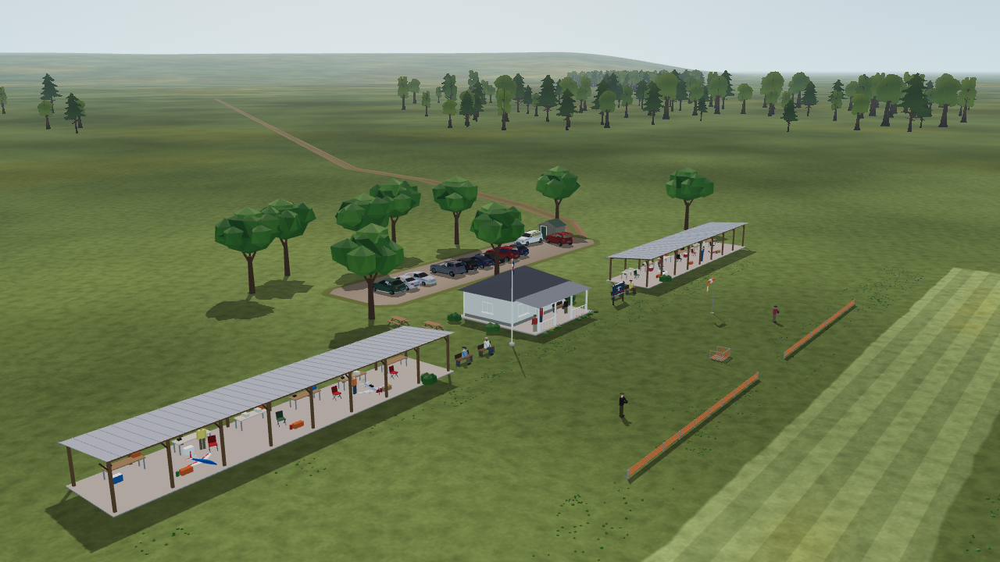
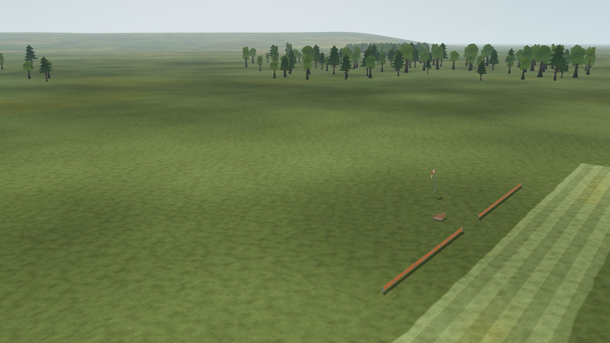

# SC-02a: complete scenery by default

**Status (2026-10-11): implemented; native Windows and all five scenery tests pass. Full app suite stops at a separately reproduced baseline atmosphere failure.**

The owner requested default-on scenery after two Windows launches showed the bare field. `Scenery.options()` now falls back to `on`. CLI options still override the environment; `--scenery=off` or `OPENRC_SCENERY=off` remains available. Home and flight use the same resolver. Birds retain their separate off default.

The existing switch test now verifies default on, explicit environment off/on and return to the default. The bare-field builder test explicitly selects off. `app/capture.sh` and `tools/world/parity.sh` explicitly select the original bare-field reference; their scenery views and runway scenario still select on. No simulation parameters changed.

## Native Windows proof

Godot 4.7.2-stable, Compatibility/OpenGL, NVIDIA GeForce RTX 3090. The existing production-world capture script rendered `postcard_club` with `OPENRC_SCENERY` absent: first without a scenery argument, then with `--scenery=off`. Both completed without engine/script errors.

| Case | Scenery enabled | Instances | Fleet models | Flower cushions | Draw calls |
| --- | --- | --- | --- | --- | --- |
| Normal default | true | 128 | 4 | 2,970 | 34 |
| Explicit CLI off | false | — | — | — | 14 |

Reports: [default](native-default.json), [off](native-off.json). Logs: [default](native-default.log), [off](native-off.log). The captures were visually inspected: the normal default contains shelters, pavilion, cars and people; explicit off removes those props.





Reproduce with the pinned Windows executable in `.tools/` (set `OPENRC_SCENERY` to absent in the process environment):

```powershell
& .tools/Godot_v4.7.2-stable_win64.exe --path app --audio-driver Dummy --script res://scenery/capture_views.gd -- --scenery_audio=off --views=postcard_club --out=C:/Temp/scenery-default
& .tools/Godot_v4.7.2-stable_win64.exe --path app --audio-driver Dummy --script res://scenery/capture_views.gd -- --scenery=off --scenery_audio=off --views=postcard_club --out=C:/Temp/scenery-off
```

The single view and build timings are scene checks, not gameplay frame-time or readability acceptance. Gate SC's remaining human/target-hardware measurements are still open.

## Regression verification

The full `app/test.sh` run used a fresh local clone at `cf3d9dc` with the six changed runtime/test/tool files overlaid, pinned Linux Godot 4.7.2 and a Linux filesystem. The clone used LF text checkout; Windows `core.autocrlf` otherwise changes byte-checked generated files. Resource import, data/generator guards, float64/transcendental guards, shader-clock guard and parsing of every app script passed. The suite then stopped at `test_atmosphere_flight.gd`:

- `FAIL reset recomputes a fresh trim for the extreme density`.
- `_failure_recovery`, line 184: invalid Dictionary key `format`.

Restoring only the original scenery file in a disposable copy reproduced the same failure (137 checks, one failed, exit 1). This change therefore does not claim a passing full suite. Evidence: [full run](full-suite.log), [original-default comparison](atmosphere-baseline.log).

All five focused scenery scripts passed with exit 0 and no engine/script errors: [summary](focused-summary.tsv), [loader](test_scenery_loader.log), [builder](test_scenery_build.log), [trace parity](test_scenery_trace.log), [ambience](test_scenery_ambience.log), [runway scenario](test_scenery_scenario.log). The real app's scenery-on/off trace rows match exactly. Shell syntax checks for the changed launch/capture/parity scripts also passed.

The ordinary Windows app was then launched without scenery CLI arguments or `OPENRC_SCENERY`, opened its Home window and reported no startup errors ([log](native-home.log)). The application preference is changed in source; already-published release binaries retain their bundled version.

## Other runtime defaults reviewed

| Feature | Ordinary fresh-launch default | Selection |
| --- | --- | --- |
| Decorative scenery flock | Off | `--scenery_birds=on` or `OPENRC_SCENERY_BIRDS=on` |
| Wind, gusts and turbulence | Calm: zero wind/gusts; no turbulence | Home weather editor or `--weather=<preset>` |
| Time/lighting | Day, legacy fixed daylight | Home time editor; field-world `--time_of_day=<preset>` or `--time=HH:MM` |
| Field-world time progression | Frozen (`time_scale=0`) | `--time_scale=<value>` or `OPENRC_TIME_SCALE` |
| Runway start | Off: flight starts airborne | Home toggle; experimental, Ugly Stik/default-field only |
| Engine shadow maps | Off; comparison/debug path | `--engine_shadows` |
| Radio latency marker | Off; diagnostic overlay | `--latency-patch` |

Interactive soundscape, crash effects and scenery ambience default on. Saved weather/time preferences can override fresh-launch defaults. Projected scene shadows remain active; engine shadow maps are a separate comparison path. Per-aircraft conditional physics modules are governed by aircraft data, not a global user off switch.

Sources: [scenery options](../../../../app/scenery/scenery.gd), [preferences](../../../../app/app_state/preferences.gd), [wind defaults](../../../../app/physics/wind_config.gd), [world conditions](../../../../app/render/world/conditions.gd), [legacy time config](../../../../app/environment/time_of_day_config.gd), [atmosphere](../../../../app/render/atmosphere.gd), [flight setup](../../../../app/main.gd), [latency overlay](../../../../app/input/latency_patch.gd).

Time currently has two interfaces: the field-world flags above and TOD's `--time-of-day` / `--lighting` / `--lighting-config`. Visible progression claims in the older TOD plan are not interchangeable with field-world `time_scale`; that interface unification is separate work.

## Aircraft-scoped physics modules

These are data choices, not a global application off switch. Enabling them requires valid, sourced model parameters under the aircraft contract.

| Module | Default Ugly Stik | Packaged P-51 |
| --- | --- | --- |
| Shaft torque-balance RPM | Absent (`engine.shaft`); uses the existing throttle-to-RPM lag | Declared |
| Thrust angles, propeller normal force and P-factor moment | Absent | Declared |
| Tail slipstream | Absent | Declared |
| Wash convection/transport lag (`transport_speed_floor`) | Absent | Absent; declared wash is quasi-static |

Propeller gyroscopic precession is active on the Stik through its declared rotating inertia. Reference-air physics is active in calm weather; custom atmosphere is a separate weather selection. Ground effect is currently unimplemented, not a disabled switch.

Sources: [Stik propulsion data](../../../../app/data/aircraft/jensen_ugly_stik_60.json), [P-51 data](../../../../app/data/aircraft/p51d_mustang_120.json), [optional propulsion loader](../../../../app/physics/aircraft_data.gd), [propulsion](../../../../app/physics/propulsion.gd), [dynamics](../../../../app/physics/dynamics.gd), [wash transport](../../../../app/physics/wash_transport.gd), [aerodynamics scope](../../../../app/physics/aero.gd), [runway-start UI](../../../../app/ui/home.gd).
