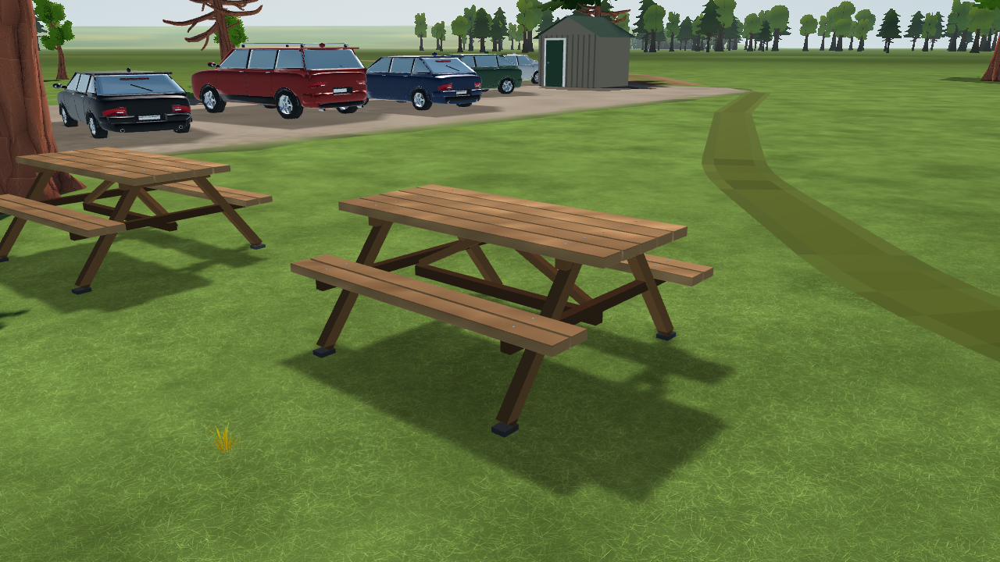
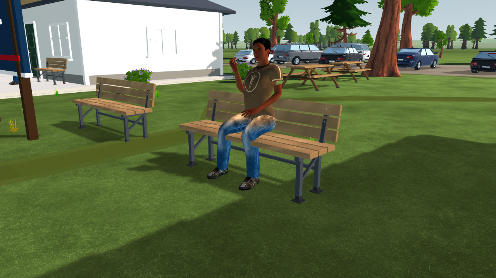

# SC-08-R1 — club seating detail

2026-10-16. Visual refinement of the existing picnic tables and spectator/pavilion benches.

Picnic tables now use five separate tabletop boards, split seats, bevelled edges, A-frame legs, under-top bearers, diagonal braces, a longitudinal stretcher, metal foot caps and washer/hex-head fittings. Benches use three seat and three backrest boards, steel uprights, braces, foot plates and fixings. Seat surfaces remain at their original heights (0.47 m picnic, 0.48 m bench); existing seated people retain their fit. Placement, collision proxies and simulation data are unchanged. All joinery dimensions are artistic estimates.

`app/scenery/club_furniture.gd` refines the existing prefabs through `MeshKit`, retaining cell merging, damage ranges and the shared opaque material. The existing [ambientCG Wood049 CC0 source](../../../../app/assets/landscape/flightline/PROVENANCE.json) is filtered to 96 × 64 and sampled into board vertex colours at build time. This supplies restrained colour variation rather than a per-pixel material or normal map. There are no new downloads, shader passes, frame callbacks or draw nodes.

Focused regressions pass **268 checks**: 126 scenery builds/catalog sizes/winding/themes/tiers, 78 destruction, 40 population and 24 support/collision checks. The complete scenery count rises from 599,765 to **627,623 triangles**, below the existing 650,000 ceiling. Two paired native Windows OpenGL table views retain the same draw counts (76 / 72 respectively). The four final views were inspected, including the occupied bench. Bench cameras were repositioned to avoid the club sign, so only the table views are before/after camera matches. This does not establish target-device frame-time performance or close Gate SC.

[Verification and source hashes](verification.json) · [Before table](before/table.png) · [Table joinery](accepted/table-detail.png) · [Bench rear](accepted/bench-rear.png).

Reproduce with the pinned native Godot binary, `--path app --rendering-driver opengl3 --script ../tools/ground/capture_club_furniture.gd -- --out=<new-directory>`. Run the four `test_*.gd` scripts named in the verification report headlessly. Native captures disable scenery audio and birds and use a fixed shader clock.
