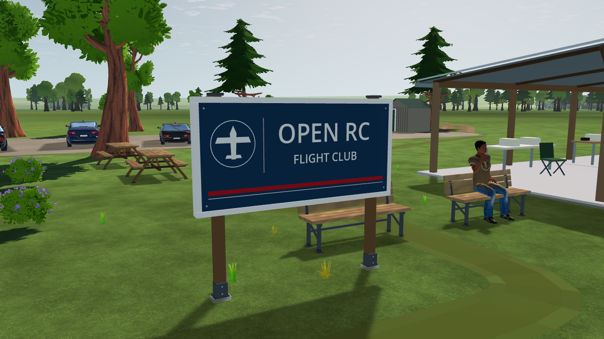

# SC-08-R2 — club sign finish and identity

2026-10-16. The existing club sign now carries a restrained OPEN RC / FLIGHT CLUB identity, a circular aircraft emblem and a red accent strip. A four-sided bevelled frame protects the inset panel. Posts sit behind the graphic face; caps, concrete feet, metal shoes, fasteners, rear battens and a diagonal strap make the mounting readable from both sides. Joinery and graphic dimensions are artistic estimates. The existing 2.5 × 2.2 × 0.14 m catalog envelope and placement are retained.

`app/scenery/club_sign.gd` emits all parts into the existing opaque cell mesh. Letter contours reuse Godot's bundled fallback font through [TextMesh](https://docs.godotengine.org/en/stable/classes/class_textmesh.html), then merge into the same vertex/normal/colour arrays. Painted lettering has no extrusion, separate text node, texture atlas or transparency pass. Font contours are cached, message translation is disabled for the fixed fictional club identity, and no font or asset download is added. Existing damage tags and scenery shadows remain in control.

Focused regressions pass **261 checks**: 126 scenery build/catalog/winding/theme/tier checks, 78 destruction checks and 57 projected-shadow checks. Native Windows Godot 4.7.2 compatibility captures compare front, detail, rear and actual-pilot views with identical camera poses. Draw counts remain **82, 81, 144 and 114** respectively. The complete scenery mesh count is **630,559 triangles**, below the existing 650,000 ceiling. This establishes software/visual verification, not target-device frame-time acceptance or Gate SC closure.

[Verification and source hashes](verification.json) · [Before](before/front.png) · [Rear mounting](accepted/rear.png) · [Pilot view](accepted/pilot.png).

Reproduce with the pinned native engine: `--path app --rendering-driver opengl3 --script ../tools/ground/capture_club_sign.gd -- --out=<new-directory>`. The capture uses production field assembly, a fixed shader clock and scenery audio/birds disabled. Test logs are retained beside the verification report.
