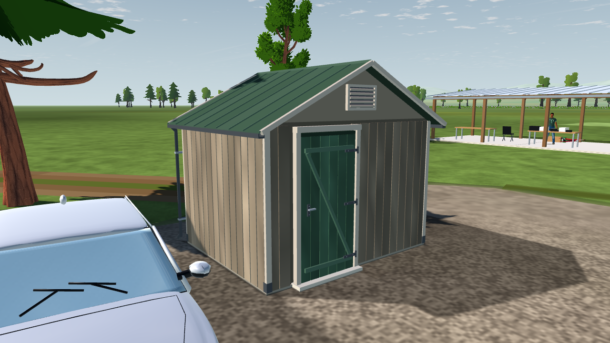

# SC-08-R3 — storage shed construction details

2026-10-16. The existing parking-side shed now has separate bevelled timber boards, corner protection, a concrete threshold, a braced painted door with strap hinges and a latch, front/rear louvred vents, standing roof seams, ridge flashing, gutters and clipped downpipes. Dimensions and joinery are artistic estimates. Its placement and catalog envelope are retained (built bounds 3.40 × 2.88 × 2.86 m).

`app/scenery/club_shed.gd` emits into the existing opaque scenery cell. Cladding reuses the existing CC0 Wood049 source through `club_furniture.gd`'s filtered vertex-colour sampler. No asset download or additional material pass is required. The shared timber helper retains identical picnic-table and bench geometry digests. Existing damage tags, quality tiers and projected shadows remain in control.

Focused regressions pass **261 checks**: 126 scenery build/catalog/winding/theme/tier checks, 78 destruction checks and 57 projected-shadow checks. Four matched native Windows Godot 4.7.2 compatibility captures retain their draw counts: **52 front, 45 door, 61 rear and 42 roof**. Total scenery geometry is **638,617 triangles**, below the 650,000 ceiling. The first build test overlapped native capture and exceeded the 800 ms build gate (1288.4 ms); the sequential rerun passed at 734.1 ms. Both logs are retained. These checks do not establish target-device frame-time acceptance or close Gate SC.

[Verification and source hashes](verification.json) · [Before](before/front.png) · [Door](accepted/door.png) · [Rear](accepted/rear.png) · [Roof](accepted/roof.png).

Reproduce with the pinned native engine: `--path app --rendering-driver opengl3 --script ../tools/ground/capture_club_shed.gd -- --out=<new-directory>`. Capture uses production field assembly, a fixed shader clock and scenery audio/birds disabled.
