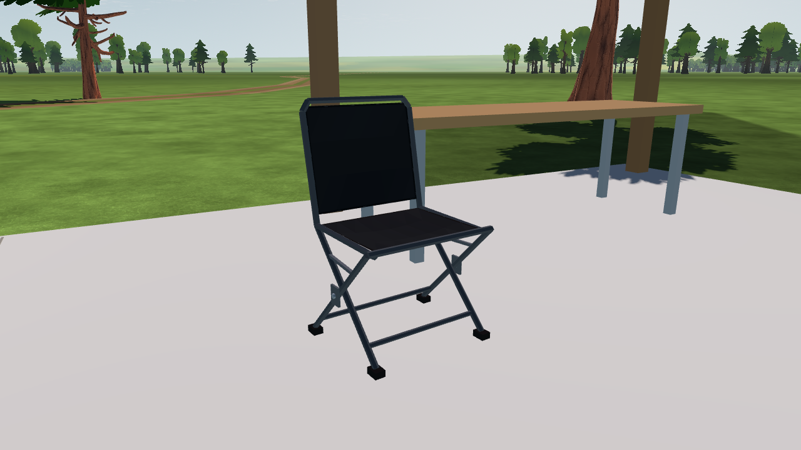

# SC-08-R4 — folding chairs at the pits

2026-10-16. The existing seeded folding chairs now have tubular crossing legs, offset hinge plates and axles, connected lower crossbars, folding stops, rubber feet and a framed backrest. Seat and back cloth have shallow sag, folded edge binding and stitch marks. Positions, yaw and seeded fabric colours are retained. Dimensions and construction details are visual estimates.

`app/scenery/pit_chair.gd` replaces only the folding-chair helper in `prefabs.gd`. The existing CC0 Fabric001 colour source is filtered once to 64 × 64 and sampled into vertex colours. It provides subtle cloth variation, not a full-resolution weave or normal-map pass. Geometry stays in the existing opaque cell mesh, with no new draw nodes or downloaded assets. No simulation or collision contracts change.

**261 focused checks pass:** 126 scenery build/catalog/winding/theme/tier checks, 78 destruction checks and 57 projected-shadow checks. The complete scenery contains **647,131 triangles** against the existing 650,000 ceiling; the checked build took 498.1 ms against 800 ms. Native Windows Godot 4.7.2 compatibility captures preserve draw counts (**23 front, 22 detail, 131 rear and 47 context**). The rear view is partly blocked by the existing work table. These results do not qualify target-device frame time or close Gate SC.

[Verification and source hashes](verification.json) · [Before](before/front.png) · [Detail](accepted/detail.png) · [Context](accepted/context.png).

Reproduce with the pinned engine: `--path app --rendering-driver opengl3 --script ../tools/ground/capture_pit_chairs.gd -- --out=<new-directory>`. The capture uses production field assembly and the first seeded chair in the first shelter, with a fixed shader clock and scenery audio/birds disabled.
