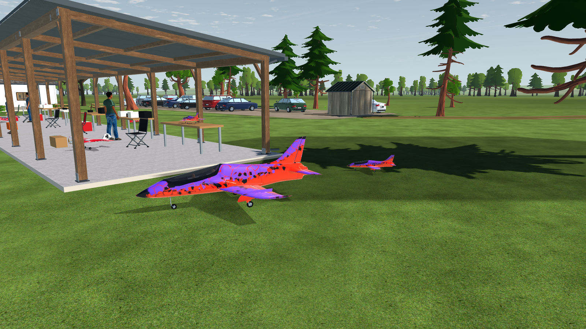
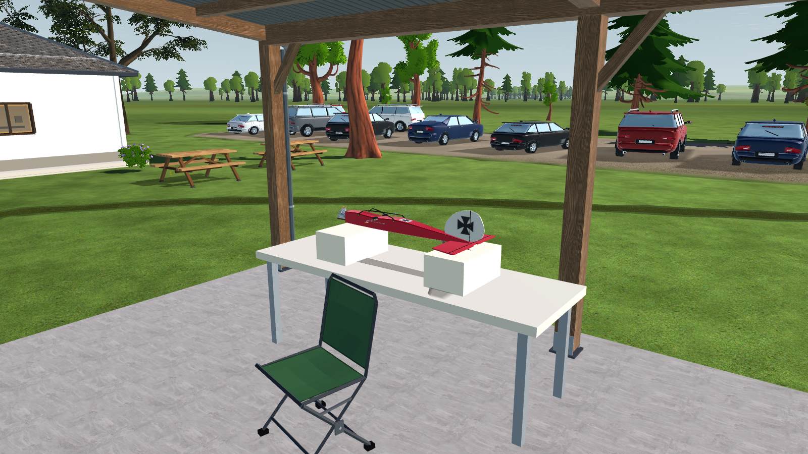

# SC-09-R1 — current aircraft around the pit shelters

2026-10-20. The production Club field now has 13 static aircraft from the five
current project families, replacing four legacy vertex-colour snapshots. Existing
aircraft builders, liveries, shelter furniture and Workshop maintenance features
are reused; no new third-party models or flyable configurations were introduced.

## Arrangement and visual review

| Family | Count | Purpose |
| --- | ---: | --- |
| Ugly Stik | 2 | Slab ready bay; wingless fuselage on the existing foam service supports |
| Extra 300S | 3 | Slab ready bay, rear grass waiting area, small model on an east worktable |
| P-51D | 1 | East shelter ready bay with its taildragger ground attitude |
| Avanti / Ventage Jet | 5 | Full-size ready bay, 1.3× model at the west end, two 0.5× grass models and a 0.45× bench model |
| Turbo Lumber Evolution | 2 | East shelter ready bay and adjacent grass |

Five aircraft rest on the 0.10 m slabs, five on grass, and three on tables or foam.
The worktops are 0.90 m high and the foam tops 1.12 m. Headings, scales and spacing
separate carrying routes, ready bays and maintenance. The layout preserves the
existing people, cars and runway clearance rules.

The baseline was captured before replacement. Native Compatibility captures at
1600 × 900 cover both shelters, the ready area, service bay, worktable, large/micro
jets, club overview and pilot view. Iteration corrected empty serialized textures,
retracted jet gear, wheel-plane signs, unused P-51 source vertices below its visible
tires, front-box clearance and shadows incorrectly landing below the worktops.
The jet's orange/violet paint was checked against its source atlas and the existing
[AV-31 source-model capture](../../avanti-blender/AV-31/front-quarter.png).

| Matched camera | Before | Final |
| --- | --- | --- |
| Pit shelters | [Baseline](before/postcard_pits.png) | [13-aircraft layout](after/postcard_pits.png) |
| Club overview | [Baseline](before/postcard_club.png) | [Final](after/postcard_club.png) |
| Fleet close view | [Baseline](before/fleet_close.png) | [Final](after/fleet_close.png) |
| Pilot south | [Baseline](before/pilot_south.png) | [Final](after/pilot_south.png) |

Additional final views: [west shelter](after/hangar_west.png),
[east shelter](after/hangar_east.png), [microjet worktable](after/hangar_bench.png),
[P-51 ready bay](after/hangar_ready.png) and [east worktable](after/hangar_east_bench.png).

## Runtime and collision

The [baker](../../../../tools/scenery/bake_parked_aircraft.gd) calls the public aircraft
builder offline, deploys retractable gear, poses wheel contact, retains materials
and UVs, and creates six static meshes with automatic LODs. Generated metadata
records source identities, dimensions, ground contacts and collision parts. The
P-51 retains complete gear-bearing material surfaces at near distance.

Identical image payloads are shared before serialization. S3TC preserves source
texture dimensions and suits the existing desktop targets; see Godot's
[portable texture guidance](https://docs.godotengine.org/en/4.7/classes/class_portablecompressedtexture2d.html)
and [Compatibility compression guidance](https://docs.godotengine.org/en/4.7/tutorials/assets_pipeline/importing_images.html#compress-high-quality).
The six `.res` files total 8,672,052 bytes. Texture block payload is 52,232,856 bytes
versus 280,581,460 decoded bytes (81.4% less), counting each unique image once per
resource; this is image storage, not a complete
resident-VRAM measurement. No texture downsampling was used. The scratch Avanti
compression experiment was inspected visually; final native close views retained
readable paint, glazing, wheels and surface detail. The retained
[texture inventory](checks/texture-inventory/engine.log) lists formats, sizes and
shared payloads.

The renderer shares eight `MultiMeshInstance3D` batches, split by model,
configuration and shelter. They have no scripts, children or processing. Aircraft
use a 350 m visibility limit and the existing sun-update transaction for compact
contact shadows; worktop shadows are clipped to their receivers. They add no
engine shadow passes.

The same normalized placement drives the float64 collision world: 71 oriented
part boxes cover the 13 aircraft. Body, wings, tail, gear and propeller use separate
bounds. Contacts use the existing `light_airframe_impulse` response and
`damage_profile="none"`; parked aircraft remain fixed. The Avanti body was narrowed
from 1.813 to 0.470 m by classifying its ailerons/flaps with the wings. Clear-space
sweeps verify that this is not one solid wingspan-sized box. The P-51 body was
narrowed to 0.2685 m after routing its root-level wing details and gear-bay doors
to the correct parts; the focused collision test passes 45 checks.

An oriented-box/vertical-interval audit found no aircraft-to-aircraft overlaps and
no overlaps with registered props/buildings. Internal shelter tables, foam and
loose furniture are not registered collision proxies; their intended supports and
clearances were inspected visually and checked with a separate furniture audit.
That audit reconstructs 115 furniture boxes from the actual shelter seeds and
finds no aircraft-part overlaps, including chairs, front boxes and fuel containers.
Aircraft contact geometry is a bounded scenery
approximation, not a physical airframe contact calibration.

## Verification and performance scope

Commands and supported placement fields live in the
[scenery tools guide](../../../../tools/scenery/README.md). The new collision test
covers rotated, scaled and elevated aircraft, clearance misses, stable IDs and
nondestructible response. Existing collision, setup, support, checkpoint, runtime
crash, destruction and day/night lighting checks were also exercised.

The full near-detail fleet has a separate 350k-triangle ceiling; the existing
725k allowance remains for the rest of the field. Batching reduces the fleet's
material submissions from 282 to 179 (36.5%) while retaining authored finishes.
The 13 instances contain 273,421 full near-detail triangles, with automatic LOD
reductions farther away. This is an implementation budget, not closure of Gate SC.

Matched native camera counters (whole visible field, RTX 3090 / Compatibility):

| View | Draws before → final | Primitives before → final |
| --- | ---: | ---: |
| Pilot south | 174 → 174 | 329,156 → 318,683 |
| Fleet close | 122 → 164 | 282,962 → 290,564 |
| Club overview | 201 → 380 | 348,555 → 433,276 |
| Pit shelters | 188 → 367 | 408,687 → 497,422 |

All eleven final views recorded zero engine shadow draws. The counters are retained
in [before](before/views.json) and [after](after/views.json); they measure rendering
submissions, not elapsed frame time. The additional material cost is concentrated
in close shelter views; the matched pilot view kept the same draw count.

The existing 800 ms cold scene-build gate remains unchanged and open: the retained
build test's only failure was 1195.1 ms cold initialization; its later warm build
was 216.6 ms. A control
run with all fleet groups removed still took 1031.8 ms on this shared Windows
workspace. Close shelter views also cost more draws than the four legacy flat
aircraft. Native samples are diagnostic; they do not establish frame-time p95 on
all target hardware. Independent pilot/readability and target-hardware acceptance
remain under [Gate SC](../../../SCENERY-PLAN.md#remaining-work).

## Retained checks

| Check | Result / evidence |
| --- | --- |
| Source pins, six generated meshes, textures and wheel contacts | [Generated resource checker](checks/assets/engine.log) |
| Placement schema and grounded/slab/table population | [Loader](checks/loader/engine.log), [population](checks/population/engine.log) |
| Parked part contacts, scale, yaw, elevation and empty-space misses | [Parked collision](checks/test_parked_aircraft_collision.log) |
| Collision inventory, session, setup, support, checkpoint and native response | [World](checks/test_landscape_collision_world.log), [core](checks/test_landscape_collision.log), [session](checks/test_landscape_collision_session.log), [setup](checks/test_landscape_collision_setup.log), [support](checks/test_landscape_collision_support.log), [checkpoint](checks/test_landscape_checkpoint.log), [runtime](checks/test_landscape_runtime.log) |
| Aircraft/registered-prop clearance and internal furniture | [Registered overlap audit](checks/aircraft-overlaps.log), [furniture audit](checks/furniture-clearance.log) |
| Day/night contact-shadow updates | [25 checks passed](checks/time-of-day/engine.log) |
| Existing destruction integration | [78 checks passed](checks/destruction/engine.log), [8 runtime checks passed](checks/destruction-runtime/engine.log) |
| Build budget | [One failure: cold initialization exceeds 800 ms](checks/build-budget/engine.log); [no-fleet control](checks/build-without-fleet/engine.log) |
| Self-contained assets outside the source project | [Isolated PCK load](checks/isolated-pack/engine.log), [fresh checkout receipt](checks/fresh-check.json) |
| Native OpenGL visual run | [Engine log](checks/capture/engine.log), [capture counters](after/views.json) |

The fresh checkout check overlays the changed placement generator, loader, runtime
asset access, export filters and generated assets onto a separate checkout, then
checks generated layout bytes and all three desktop export filters. A minimal
Godot project with no aircraft sources or import cache mounts a PCK containing
only the 12 generated mesh/metadata files and loads every material and texture.
This verifies resource independence; it is not a complete release export.

The retained audit scripts are diagnostic tools for this dated layout. Run them
with the current production `app` as the Godot project and an absolute `--script`
path. For the isolated pack script, use a minimal project: pass the asset directory
after `--` to create `fleet.pck`, then run without that argument to verify it.
The [artifact manifest](artifact-manifest.json) records the delivered source,
generated assets and retained evidence hashes; concurrent unrelated workspace
changes are outside this evidence scope.
