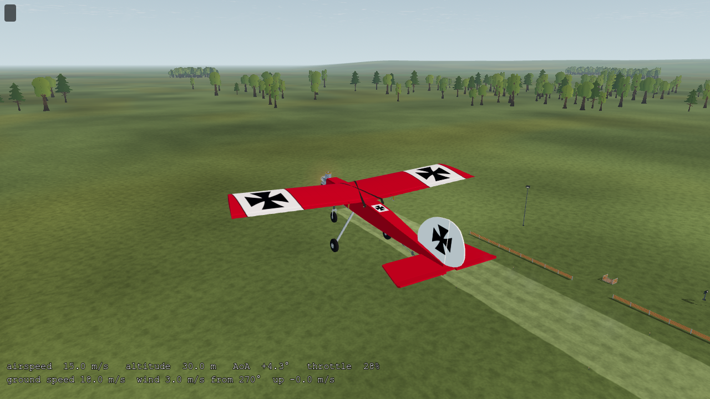
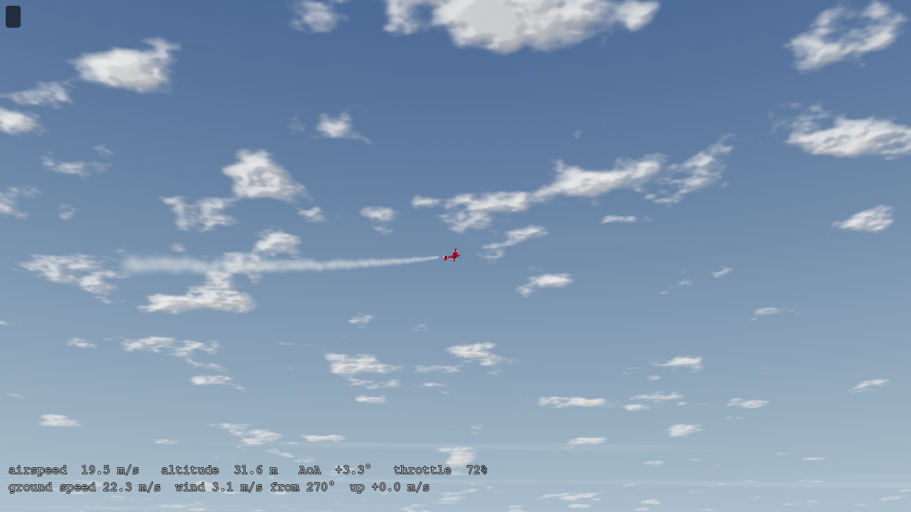
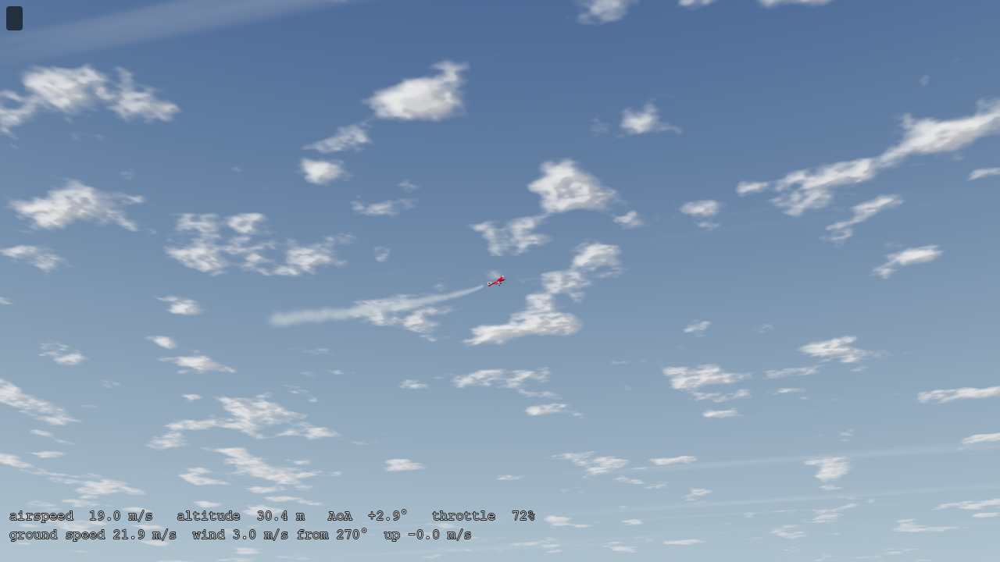
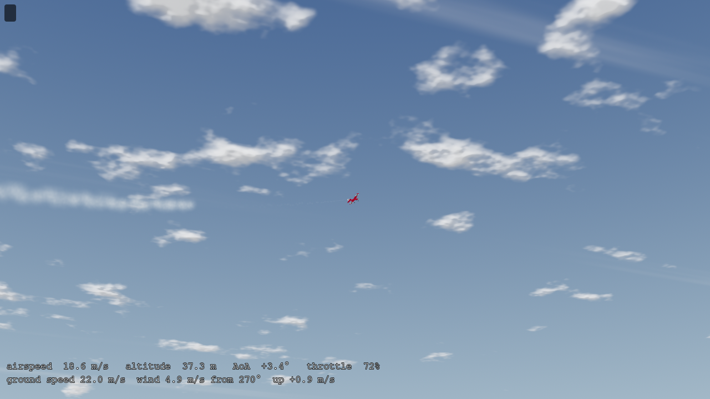
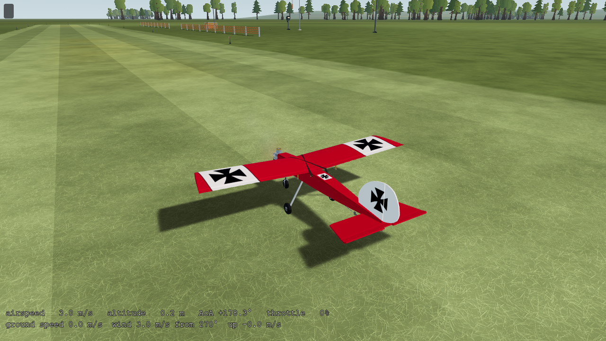
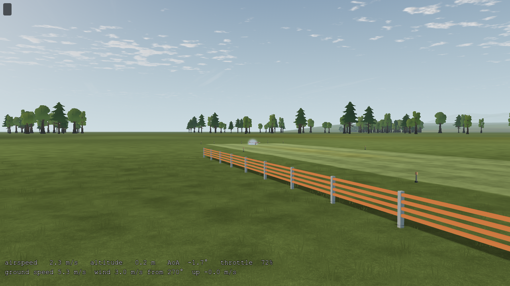

# SM-00…09 implementation and verification

2026-10-12, America/Bogota: dated delivery record. This work began from research-only status and delivered the runtime feature. The implementation was included by a concurrent commit, `c5a00d0`, together with other tracks. The subsequent focused smoke commit owns the final surface refinement, runway review and this evidence. Other contributors' work was preserved.

Current behavior/limits live in [SMOKE](../../../SMOKE.md), pending work in [SMOKE-PLAN](../../../SMOKE-PLAN.md), and commands in [tools/smoke](../../../../tools/smoke/README.md). Original counts, aircraft scope, synthetic RPM fixtures and failures below retain their source snapshot. Later finite combustion/fuel implementation does not turn those fixtures into source-state acceptance. This report records software/rendered evidence, not measured RC emissions or pilot acceptance.

## Implementation

The Stik publishes its hollow muffler's actual model-local mouth and axis. [Exhaust rendering](../../../../app/render/smoke/exhaust.gd) owns two bounded world-space native GPU systems; its [particle shader](../../../../app/render/smoke/process.gdshader) reconstructs fractional births between presented poses, entrains aircraft/jet momentum and advects existing puffs with the shared M5 wind. Main reads accepted propulsion RPM/throttle and the existing thrust/wake kernels. It never writes flight state or loads.

The original synchronous 64² mask needs no external artwork or addon. Field-lit alpha billboards use depth sorting, native 0.12 m proximity fading, distance-dependent birth density and bounded visibility history. Pause freezes age; reset/reload/checkpoint restoration clears history. Unsupported or invalid sources cannot create an emitter. The healthy turbine, electric installations and aircraft without authored RC exhaust mouths remain clear.

Optional AUX is independent of AETR. Guided OFF→ON→OFF assignment supports an unused axis or held/press-edge button, rejects ambiguity/other devices and requires fresh OFF events after connection/profile changes. Radio recalibration retains a valid AUX binding; corrupt/conflicting AUX disables only smoke. Gamepad bindings persist separately from the fixed flight profile. Help and assignment text are localized; English and Spanish Help both fit at 598/600 px.

## Rendered observations

Godot `4.7.2.stable.official.ed1daf0bf`, Windows, Compatibility/OpenGL 3.3, NVIDIA RTX 3090 / driver 610.88. The [native probe](probe.json) compared 40 m/s births at 30 FPS (1.333 m per interval): swept-box row coverage was 90.1%, versus 26.0% for point births. Pause and fixed-seed replay matched exactly. An explicitly queued emitter aged off camera past its lifetime and returned empty. Native particle alpha ordering also passed. These are same-machine observations.

The final [production-scene flight report](flight.json) records **27 passing checks, 70 captures and 511 presented intervals**, each after eight real 240 Hz ticks. Synthetic RPM/40 m/s fixtures are explicitly labeled; actual throttle response, roll and runway motion use FlightSession physics. The [exported-pack report](package.json) passes the same 27 checks using packaged production resources and an externally supplied harness.

- Close glow exhaust is faint and follows the actual mouth. Startup/shutdown pictures are RPM fixtures because combustion operation is not modeled.
- Pump-on flight leaves a diffuse trail; an actual roll reaches about 45° bank with a curved plume.
- Existing puffs remain visible as shared M5 wind changes from about 3.05 to 4.89 m/s.
- Pump OFF stops births; the pump-only mask is empty after 6.267 s. Reset replay has zero differing smoke-mask pixels.
- Actual runway idle is 2,800 RPM, zero throttle and no pump births. A 0.72 throttle command accelerates the Stik to about 5.315 m/s over 2.093 m.
- The low-speed pump makes a dense cloud in the close view. Native proximity fading slightly softens airframe/ground intersections; it is not fluid/solid coupling. Pilot-view appearance changes little.

Reports retain hashes for every generated capture; only the selected images above and the probe spacing image are committed. [Manifest](manifest.json) records their file hashes, provenance and scope. Shader/frame repeatability is not claimed across GPUs or platforms.

## Regression and cost

[Checkpoint parity](parity.json) is exact with smoke on/off at 30, 60 and 144 FPS: complete checkpoints agree, and body-state SHA-256 remains `8e5d99f5e218b9f5608cfe0d2ca936cf697f3db4ff55b8d553260cdb1bd407dc`. No golden flight or aircraft physics data was changed for smoke.

On the isolated `bb7e89caed14` snapshot, all 459 scripts parsed. The 230-test first pass had 13 failures; eight copy/UI issues were corrected and passed on retest. The other five reproduced on pristine HEAD: downwash-lag declarations, P-51 static Cm, shaft-refinement ratios, P-51 scalar slipstream and a Windows `/tmp` trace path. The final focused set passed 13/13 with no runtime errors, including **54 engine/main-scene checks**, **60 AUX/storage checks**, and the existing RC input/calibration/profile suites. [Regression record](regression.json) preserves this distinction and the `app/test.sh` attempt blocked by a stale schema. The previously linked `current-checks.json` is not retained; no final full-entrypoint pass is established by this record.

[Native timing](timing.json) used six alternating 4 s samples after 2 s warm-up. Two focus-paused runs are explicitly excluded. The remaining observations were near the 120 FPS cap: off p50/p95 8.32/9.05 ms; pump 8.33/9.16 ms; exhaust 8.31–8.32/9.07–9.16 ms. These shared-desktop, capped samples precede the small depth-fade refinement and do not isolate its GPU cost or close target-hardware acceptance. Allocation is bounded at 96+768 particles; 100 resets created no additional nodes or unbounded history. Occasional shutdown ObjectDB warnings occurred in earlier runs; the final verbose native/pack runs had no warning. A long native memory soak remains open.

## Remaining acceptance

These are the original campaign's gates. The [remaining plan](../../../SMOKE-PLAN.md) owns current qualification and customization work.

Other installed RC exhaust geometry, real radio/SDL mappings, other GPU/OS exports, further night/intersection review and target-display/performance acceptance remain open. Entrainment, expansion, opacity, jet speed and pump gates are visual estimates. Fuel/temperature/mixture, smoke-oil depletion and emissions calibration require new measured source state; no failure or continuous turbine/electric smoke is inferred.

The clock/birth implementation was checked against pinned [GLES3 particle processing](https://github.com/godotengine/godot/blob/4.7.2-stable/drivers/gles3/storage/particles_storage.cpp) and [fractional shader DELTA](https://github.com/godotengine/godot/blob/4.7.2-stable/drivers/gles3/shaders/particles.glsl), then exercised by the rendered probe. It uses the existing engine, not a new dependency.

## 2026-10-19 documentation recheck

Godot 4.7.2 official, native Windows; focused headless runs with temporary user-data roots. Before/after hashes of main, smoke renderer/shader, AUX/assignment and authored outlet sources were unchanged during these checks.

| Check | Observed result |
| --- | --- |
| `test_smoke_aux.gd` | 60 checks pass. |
| `test_engine_smoke.gd -- --soundscape=off` | 56 checks pass, including the P-51 outlet and real main-scene assignment/reset routing. |
| `test_controller_aux_runtime.gd` | 38/38 pass; the calibration-overlap warning is an intentional conflict case. |
| `test_controller_aux_setup.gd` | All setup assertions pass. |
| `capture_engine_smoke.gd -- --parse-only` | Pass; no capture/GPU campaign is implied. |

All five processes exit 0 without script errors. Source review confirms a remaining integration gap: `main.gd::_update_smoke()` passes crash/fault validity to `advance()`, not accepted combustion or finite-source state. RPM/load still gate the visual output. The smoke tests do not close cut/depletion/windmilling coherence; that remains SM-02 work despite combustion/fuel support elsewhere.

Local links/anchors, literal guide paths and shell-example syntax pass, including inbound links to the retained future-plan anchors. The missing full-entrypoint artifact above was not replaced with an inferred result.

Rendered probe/flight/package checks, frame timing, long soak, other backends, physical emissions and real-radio review were not rerun. The current [guide](../../../SMOKE.md) and plan separate those gates from integrated behavior and from the proposed AE/SM customization API.
