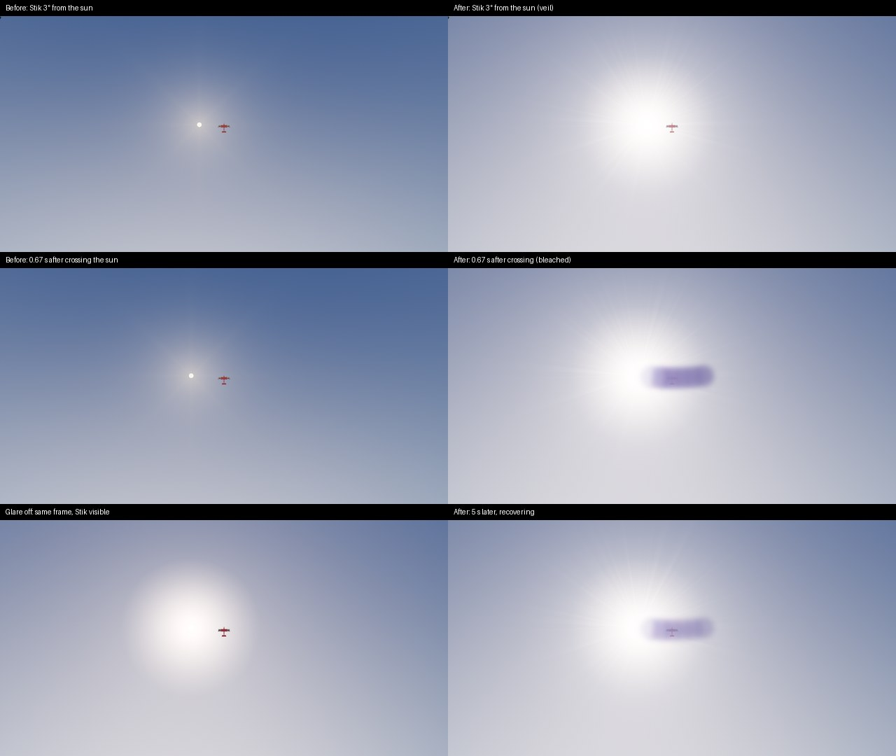
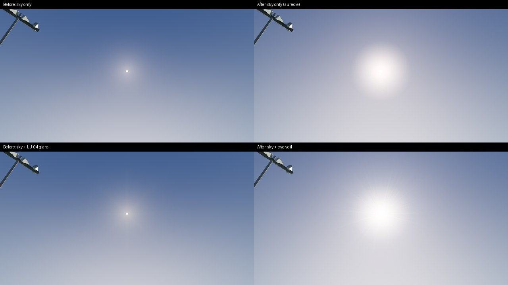

# SUN-01…05: sun disc, eye glare, bleaching and lens optics: results

2026-10-19. Plan: [sun.md](../../../plans/sun.md); physics and sources: [SUN-00](../SUN-00/README.md).

Environment:
- Linux under Xvfb with Mesa llvmpipe (no GPU); Godot 4.7.2 Compatibility; 1280×720.
- Captured with `app/tests/capture_landscape_upgrade.gd`: 60 warm-up frames and 3 timed frames per case.
- Lighting: the calibrated Day, plus the field-world presets `golden_hour` (sun 6°) and `sunset` (sun 0.5°).
- "Before" is HEAD 8b52fc28 (LU-04), run from a mirror of `app/` with this step's files reverted and the new capture harness.

These are pixel and behaviour checks, not performance numbers.

## 1. What changed for the pilot

Contrast is the Stik's displayed Weber contrast with glare over the same frame without it, measured by [`glare_contrast.py`](../../../../tools/landscape/glare_contrast.py). The view is centred on the Stik at 60 m in planform.

| Case | Before (LU-04) | After |
| --- | ---: | ---: |
| Day, Stik 1° from the sun | 78 % | 35 % (model 32 %) |
| Day, 3° | 85 % | 52 % (model 48 %) |
| Day, 10–12° | 97 % | 77 % (model 78 %) |
| Day, 0.67 s after flying across the sun | 88 % | **10 %** (bleached streak) |
| Day, 5 s later | 88 % | 26 %, returning |
| Golden hour, 3° | 87 % | 76 % (model 74 %) |
| Golden hour, 0.67 s after crossing | 89 % | **25 %** |
| Sunset (sun behind the treeline from this view) | 100 % | 99 % |

The sun disc now has a limb-darkened, refraction-flattened profile inside a KS91 aureole. Chase, orbit and close-up views show a lens flare (starburst and ghosts) instead of the eye's glare. Layered weather decks now hide the glare along with the disc.





More: [disc at Day, golden hour and sunset](sun-disc.jpg), [low sun](sun-low.jpg), [afterimage and lens](sun-optics.jpg). Tile sources and SHA-256 are in [sheets.json](sheets.json); the sheets come from [sheets.py](../../../../research/sun/sun-05/sheets.py).

## 2. Measurements

- **Veil against the model.** At eight angles the measured retention follows 1/(1 + r) within 0.05 at every angle; see [Day](day-glare-contrast.json). The calibrated day's E/B is 9.15. The overlay's contrast mapping itself was validated earlier against a sky-only veil: within 0.03 at every angle.
- **Crossing.** In the [Day](day-glare-contrast.json) and [golden hour](golden-glare-contrast.json) crossings the Stik flies from 4° before the sun to 4° past it in 1.33 s of simulation time, with the view following it. The bleached streak hides it; after 5 s it returns.
  - Peak dose 0.99 (Day), 0.98 (golden hour).
  - At [sunset](sunset-glare-contrast.json) E/B is 0.02 and the dose 0.06: no glare and no afterimage, and the low red sun can be looked at.
- **LU glare fixtures, checker v2.** [13 of 13 checks pass](day-glare-checks.json).
  - Full blocker: exactly 0. Partial blocker: 0.39× clear. The Stik over the disc keeps a veil at 0.26× clear, since what remains of the disc still scatters.
  - Off-axis, night: exactly 0. Dense cloud: 0.003× clear.
  - Half strength: 0.55× clear.
  - Afterimage against a rested eye: 31.9/255 at the frame centre, confined to a 78×78 px box.
  - Lens flare drawn.
  - The same fixtures under the old checker v1 on LU-04: [before](before-lu04-glare-checks-v1.json).
- **Software.** `app/tests/test_sun_optics.gd`: **95 checks, 0 failed**.
  - CIE values (Ψ(1°) = 15.9, Ψ(10°) = 0.0755 at age 40) and the exact display mapping.
  - Calibrated-day E/B 7–16; veil bands at 1°, 5° and 10°.
  - Strength and occlusion scale the straylight, not the aureole background. E/B falls toward sunset.
  - Bleaching: a 0.15 s glance, a 1 s crossing, recovery within 30 s, a dim sun, exact integration independent of frame count, pause and backward steps, cell merge and split, a sweep leaving a streak, the cell cap.
  - Limb mean and I(0.5); flattening matching the moon's law at 2°; aureole shape and its 45° cut.
  - Cloud mirror: 32-bit hash, overcast, layered stratus.
  - Glare source and sky mirror; `Atmosphere._set_sun_uniforms` (golden hour, a moonlit night with no sun aureole, the calibrated day).
  - Shader constants pinned to `SunOptics`.
- **Existing suites** after the change, run individually: sky render 30, atmosphere 47, world sky 38, moon sky 62, moon aureole 23, moon light 33, moon flow 31, world flow 26, TOD render 203, TOD render update 94, landscape lighting 54, landscape twilight 394, sky checkpoint 45, camera views 39, camera route 19, horizon 19, pilot aids 22, presentation context 17 and stars 22 checks pass. Sky routes passes 16 checks but logs engine errors for two soundscape files left unimported by another track's asset update; the full-suite run records the outcome after `test.sh`'s import.
- **Review.** An independent read-only review found 9 issues; all were fixed before these captures. They were:
  - the veil's background aureole scaled with strength and occlusion;
  - the aureole broke the horizon fog seam under a low sun;
  - a check that could not fail;
  - visible cells evicted mid-sweep;
  - stale capture metadata;
  - `sun_disc` applied twice;
  - shadow compensation in the aureole;
  - reversed `smoothstep` edges;
  - weak tests.

## 3. Limits

- **Performance.** llvmpipe only, so there is no frame-time claim.
  - The veil keeps LU-04's single full-screen draw while the sun is within 45° of the view.
  - The ghost pass draws only in lens views.
  - The afterimage canvas layer and its screen copy draw only while a patch is visible.
  - The CPU cloud mirror costs 66 µs per evaluation (330 µs with eight weather layers) and is cached until its inputs change.
- **Display mapping.** It assumes the background displays near 0.75 of the veil's colour, a day sky near the sun. The forced dark-exposure fixture over-veils (18.2/255 against 7.3 clear).
- **What the bleaching dose ignores.** Trees, buildings and the aircraft are not counted, so a low sun behind a near tree can still mark the eye. The on-screen veil uses the real depth buffer.
- **Size of the bleaching model.** Eight 1.15° cells, not a retina; the minutes-long faint afterimage tail is not drawn.
- **Coverage of the evidence.** One aircraft, attitude and distance. Display contrast is not a detection threshold.
- **Constants still marked estimates** in `app/render/sun/sun_optics.gd` wait for SUN-08's owner flights: recovery 8 s, masking 0.95, the blur, age 40, the 3° skyline.

## 4. Reproduce

```sh
"$(app/get-godot.sh)" --headless --path app --audio-driver Dummy --script res://tests/test_sun_optics.gd
xvfb-run -a -s "-screen 0 1280x720x24" "$(app/get-godot.sh)" --path app --audio-driver Dummy --rendering-driver opengl3 \
  --script res://tests/capture_landscape_upgrade.gd -- --out=<absolute-dir> --frames=3 --width=1280 --height=720 \
  --cases=glare_crossing,glare_crossing_off,glare_crossing_hidden,glare_crossing_hidden_off
"$(app/tests/visual-env.sh)" tools/landscape/glare_contrast.py <absolute-dir>
```

- Full case list (LU fixtures plus `glare_offset_<deg>`, `glare_crossing_late`, `glare_afterimage`/`_rested`, `glare_lens`, `glare_disc_zoom`): [tools/landscape](../../../../tools/landscape/README.md). The exact lists used here are in each `*-capture-report.json`.
- `python3 tools/landscape/verify_glare.py <dir>` checks the fixtures.
- Add `--time_of_day=golden_hour` or `--time_of_day=sunset` after `--` for the field-world sky.
