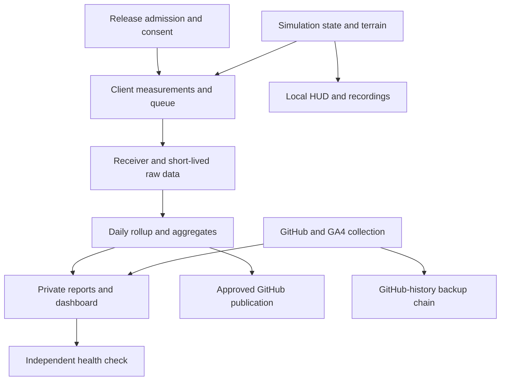

# Scope, prior findings and remediation

Part of [TELEM-AUDIT-2026-11-22](README.md), source snapshot `7940a4081e10994f34c858c4acac3d7a1a271464`.

## System boundaries

Product telemetry begins with release admission and player consent, samples bounded context/performance/activity data, seals an in-memory queue and sends it through the receiver. The receiver stores short-lived raw batches, creates ID-free daily aggregates, and exposes controlled reports. Operator dashboards combine those results with independent GitHub/GA4 data. Publication and backups have separate state and trust boundaries. Local flight HUD and ground-vehicle recording use the word “telemetry” too, but are separate consumers of simulation data.

The diagram shows logical source boundaries, not an inspected live-host inventory. In particular, the automated backup scripts audited here concern the **GitHub-history archive**. They do not prove that receiver aggregate backups exist, and raw receiver data must not be backed up under its stated retention contract.

## Reviewed source and verification matrix

The [source inventory](../../../../research/telemetry/audit-2026-11-22/evidence/source-inventory.json) identifies 135 primary telemetry, test, contract, deployment and selected integration files at the baseline. It is not a count of every repository file or a claim that each surrounding subsystem received an independent full audit.

| Surface | Source review performed | Executed evidence / limits |
| --- | --- | --- |
| Client telemetry | All nine `app/telemetry/*.gd` modules: policy/admission, notice store, contract, hardware, frame window, queue, sender, release, service | Five core suites and six targeted probes on the pinned engine |
| Integration and consent UI | AppRoot context/lifecycle, main flight event/pause flow, telemetry settings screen, related consent/export tests and release wiring | Headless admission and actual sender/receiver bridge; no rendered consent or packaged native release check |
| Flight event semantics | Detector, semantic event validation and statistics forwarding; revision and activity-slice behavior | Real detector revision probe; statistics/UI as supporting source |
| Receiver | Every `openrc_telemetry` module: ingress, config, contracts, counters, rate limiting, storage, rollup, insights, report, publisher, CLI | 141 receiver tests plus the separately executed Godot bridge; two new receiver/publication counterexamples |
| Reference and data contract | Schema/example generators, checked-in schemas/examples, reference aggregation/publication and property tests | 128 reference tests; both generators' `--check` passed |
| Operator tooling | Dashboard, snapshot, GA4 collector, GitHub archive, release metrics and analytics history | 100 operations/analytics tests; three new Python counterexamples |
| Deployment design | CT/host units, firewall sample, health checker, archive backup/export/pull, private GitHub synchronization and runbooks | Calendar check and local backup validation; no service installation, live firewall/proxy test or off-site restore |
| CI and release gates | Telemetry contracts/health workflows and their relation to main release CI | Static review, not a new GitHub Actions/full CI acceptance run |
| Local HUD | Overlay snapshot, telemetry calculations, panel/flight-data display and terrain producer; ground plot and consumers | Source trace for TA22-H01; no rendered flight/plot or target-hardware claim |
| Local ground recording | Recording entry point, session channels, bounded capture, reset/replay/exit guards, file output and error cleanup | TA22-L01 source trace; separate from TELEM network consent and sender; no native ground simulation/export execution |

Unrelated debug traces, performance-capture tools and the physics engine as a whole were followed only where they supplied telemetry context. This audit does not replace the existing physics, rendering, test-pool or website-wide audits.

## Prior-audit reconciliation

The historical reports are [19 November](../TELEM-AUDIT-2026-11-19/README.md) and [21 November](../TELEM-AUDIT-2026-11-21/README.md). Their live observations must retain their dates and source identities.

| Earlier observation | State at this baseline | Treatment here |
| --- | --- | --- |
| No active receiver/runtime at an early research snapshot | Later reports record rollout/configuration progress; the deployed state was not re-inspected today | Do not repeat the old inactive-state conclusion as current fact |
| Small-cell overlap could overstate a disclosure floor | [`insights.py:197–231`](https://github.com/bultodepapas/OpenRCsimulator/blob/7940a4081e10994f34c858c4acac3d7a1a271464/services/telemetry/openrc_telemetry/insights.py#L197-L231) now computes a conservative per-day union lower bound | Earlier defect addressed in source; retain its regression tests |
| Rolled, suppressed and missing observation coverage needed distinction | Current dashboard has distinct day states; the machine health path still removes actionable warnings | TA22-O01 is the remaining, reproduced propagation defect, not a claim that all coverage work is missing |
| Busy WAL checkpoint handling needed retry | [`cli.py:68–84`](https://github.com/bultodepapas/OpenRCsimulator/blob/7940a4081e10994f34c858c4acac3d7a1a271464/services/telemetry/openrc_telemetry/cli.py#L68-L84) retries an unsuccessful purge/checkpoint after the retry delay | Do not repeat “no retry”; all-copy deletion and operator visibility still need qualification |
| UTC/four-hour observation boundaries required qualification | Rotation still occurs on event append | TA22-C02 adds a pinned-engine counterexample to the open boundary issue |
| Failed decline persistence on an unwritable location | Current process stops and surfaces the save error, but a readable prior grant can survive removal/replacement failure | Reproduced residual risk, consistent with the documented best-effort limitation; outside the new defect count |

## Residual risks and unverified conditions

### Revocation persistence under filesystem failure

The consent probe observed `on → off`, a nonzero save error, a remaining readable `enabled` grant and `on` in the next service instance. The source and current consent plan already describe best-effort persistence when the filesystem prevents both removal and replacement. See the [client report](client-and-hud.md). A durable revocation guarantee requires an explicit design decision; the audit does not imply such a guarantee is possible when every durable write fails. At minimum, the failure messaging and source comments should accurately distinguish current-process stopping from next-launch behavior.

### Logical retention is not proof of deletion from every copy

[`status_report`](https://github.com/bultodepapas/OpenRCsimulator/blob/7940a4081e10994f34c858c4acac3d7a1a271464/services/telemetry/openrc_telemetry/cli.py#L123-L139) derives `retention_ok` from logical raw rows. A retry after a busy checkpoint is valuable, but that field does not attest to WAL truncation, a live reader's snapshot, filesystem copies, proxy logs, VM snapshots, backups or stopped dashboard artifacts. The source README already limits the claim. Verify those surfaces with a dated deletion drill and expose a checkpoint backlog; no current all-copy retention violation was established here.

### CI and deployment evidence remain separate

The [telemetry-contracts workflow](https://github.com/bultodepapas/OpenRCsimulator/blob/7940a4081e10994f34c858c4acac3d7a1a271464/.github/workflows/telemetry-contracts.yml#L1-L19) describes itself as nonrequired, filters receiver/reference/tool changes, and does not trigger on an `app/telemetry`-only change. Client tests run through the app suite. Its [receiver step](https://github.com/bultodepapas/OpenRCsimulator/blob/7940a4081e10994f34c858c4acac3d7a1a271464/.github/workflows/telemetry-contracts.yml#L46-L69) does not configure the Godot bridge and the requirements do not install the optional cryptography dependency used by the GA4 RS256 test. This audit installed that dependency and exercised both paths locally. Repository branch-protection settings were not queried, so a workflow comment is not proof of the deployed protection rules.

The [daily health workflow](https://github.com/bultodepapas/OpenRCsimulator/blob/7940a4081e10994f34c858c4acac3d7a1a271464/.github/workflows/telemetry-health.yml#L19-L38) succeeds without probing when the repository endpoint variable is empty. Previously shipped binaries can still contain their embedded endpoint. Current variable values and delivery of GitHub failure notifications were not checked. Its public `/healthz` test is liveness, not proof of ingestion, aggregation, deletion, release allowlist alignment or backup readiness.

Ground-session backend reporting also needs a qualification decision: the AppRoot projection reads `stage_backend_status()` when present, while the ground session has native/reference internal identities without that same method. This is a dimension-coverage gap; it does not prove which backend is used by a shipped build. Full Linux/Windows/macOS package admission, locale/HiDPI behavior and user-facing consent remain release acceptance work.

### Measurement interpretation remains bounded

Opt-in ephemeral sessions are not unique people or an unbiased sample of all players. A public anonymous measurement endpoint cannot establish that every allowed payload represents a genuine player. The existing session caps, bounded enums and suppression floors should remain intact. Short sessions, quit before a slice/flush, intentional in-memory dropping, and gaps excluded from frame histograms constrain interpretation. These are documented limits rather than newly discovered implementation bugs. Refer to the baseline [data contract](https://github.com/bultodepapas/OpenRCsimulator/blob/7940a4081e10994f34c858c4acac3d7a1a271464/docs/plans/telemetry/data-contract.md) and [architecture](https://github.com/bultodepapas/OpenRCsimulator/blob/7940a4081e10994f34c858c4acac3d7a1a271464/docs/plans/telemetry/architecture.md).

## Repair sequence and acceptance

The following are proposed ownership areas and acceptance evidence, not tickets already assigned to people or repairs implemented by this branch.

| Order | Work item | Suggested owner | Evidence required to close |
| --- | --- | --- | --- |
| 1 | TA22-R01: align admitted numeric types with rollup | Receiver/data contract | Complete admitted-payload-to-rollup property test; decimal/exponent and stored-body cases; healthy multi-release day remains correct |
| 1 | TA22-O01: preserve actionable alerts in machine health | DevOps/dashboard | Overdue-rollup and near-retention fixtures fail/degrade the monitor appropriately; actual notification rehearsal; quiet/suppressed cases stay correctly classified |
| 2 | TA22-C01/C02: explicit measurement/context/epoch boundaries | Client telemetry | Old-context partial window, correct new warmup, UTC and four-hour split before observation, no migration of counters |
| 2 | TA22-C03/C04: accident semantics and actual pause eligibility | Flight integration + telemetry | Same accident revision counted once across slices; second accident counted; focused crash/manual pause and resume exercised through AppRoot |
| 2 | TA22-C05: end-to-end age/deadline policy | Client queue/UI | 599/600/601-second retry/cancel/late-callback cases; pre-seal age and capacity eviction; notice and detailed retention table agree |
| 3 | TA22-R02: exclusive durable publisher claim | Receiver/publication | Two connections/processes yield at most one remote create; ambiguous outcome remains conservative; ledger cannot be overwritten by a stale owner |
| 3 | TA22-O02: private credential persistence | Analytics/DevOps | Atomic mode-0600 file creation/replacement on POSIX; traversable parent/ACL threat model checked; existing-file behavior and Windows policy explicit |
| 3 | TA22-O03/O04: restorable, correctly ordered archive backup | DevOps | Actual archive reader/identity/schema validation, disposable restore, explicit UTC scheduling/dependency chain, retained known-good copy |
| 4 | TA22-H01: authoritative terrain in the HUD | Flight/HUD | Flat/sloped/enabled-track samples agree with contact terrain; AGL and warning transitions checked without changing physics |
| 4 | TA22-L01: clean up failed local metadata export | Ground recording | Injected failure after temporary JSON creation leaves no owned orphan; samples remain available; retry and existing-output preservation verified |
| 4 | Residual consent, deletion and release qualification | Product + client + DevOps | Explicit persistence decision, all-copy deletion drill, packaged OS admission and current deployment evidence |

After each repair, convert the corresponding counterexample to an assertion of correct behavior. Preserve the baseline evidence and add a new dated closure record referencing the repair commit. Re-run the affected existing suite and actual bridge where a contract or wire behavior changes. Full application tests and deployment gates belong to the eventual repair/release scope; broad test repetition on this documentation branch would not supply the missing native or live-host evidence.

## Verification on main — 2026-11-22

Both source inventories matched all 137 distinct Git blobs at the audited commit. Before repairs, 136 matched integrated `main` at `2bfb4dc7b`. The only difference was the link to this audit in the telemetry plan.

| Finding | Repair and verification | Open acceptance |
| --- | --- | --- |
| TA22-R01 | Validated integer metrics stay integral in GPU, vehicle and private insight aggregation. The regression covers stored and newly ingested integer, decimal and exponent forms across two releases. It also checks aggregate equality and original-body retry/conflict behavior. The receiver suite passed 142 tests and the reference suite passed 128. [Repair](https://github.com/bultodepapas/OpenRCsimulator/commit/25c3736d3badd71e45eae5dcf140c93d9419fbf4) | Loopback Godot bridge and deployed recovery rehearsal |
| TA22-O01 | Machine health and the independent checker now include warning severity and recovery details. Regression checks cover all six receiver warnings, a recoverable rollup, quiet and suppressed cases, and separation from upstream failures. All 103 operator tests passed on Windows. [Repair](https://github.com/bultodepapas/OpenRCsimulator/commit/0f859b5f358f4807877ec8bd7fe8009bc3856d3f) | Deploy matching dashboard and checker code and confirm notification delivery before the rollup cutoff |

The hosted telemetry workflow passed schemas, examples, reference, receiver, operator and container-smoke checks for both repairs. [Telemetry contracts run](https://github.com/bultodepapas/OpenRCsimulator/actions/runs/45046440057).
