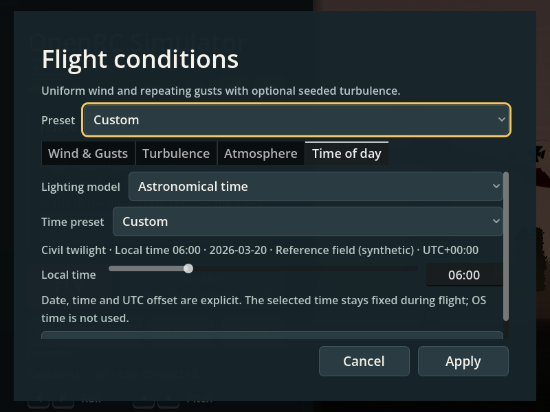
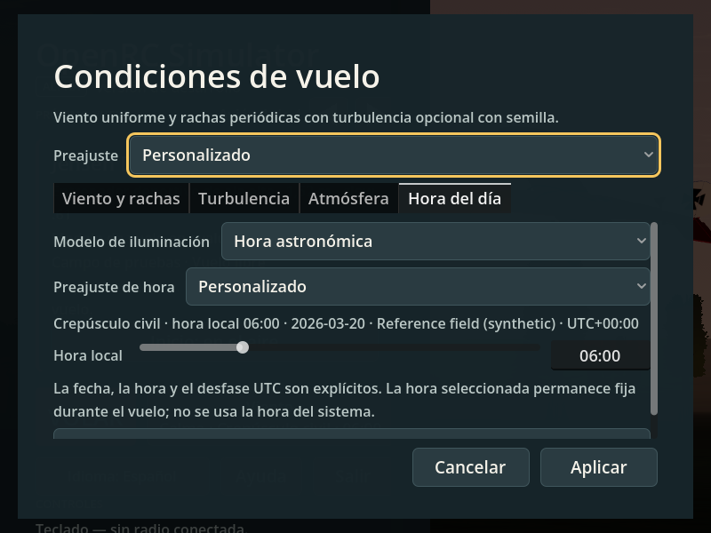

# TOD-06 — Fixed time selection UI

Status: implemented and verified, 2026-10-10. Parent: [time-of-day plan](../../../TIME-OF-DAY-PLAN.md).

The WeatherDialog now has a **Time of day** tab. It keeps the old weather `applied(Dictionary)` contract and edits lighting as a separate draft. Legacy daylight remains the default. Astronomical mode accepts an explicit local civil time, date, UTC offset, and coordinates; the slider selects whole minutes and the text field also accepts seconds. The date/location controls are under Advanced, while the predicted phase and `local time · date · location · UTC offset` summary stay visible when Advanced is closed. No operating-system clock or timezone is read.

The phase label uses the same deterministic solar-position result as rendering: daylight at or above −0.8333°, civil twilight from −6° to −0.8333°, nautical twilight from −12° to −6°, astronomical twilight from −18° to −12°, and night below −18°. A visibility note appears only below −6°; it explains that there are no aircraft or field lights. This is a visual limitation, not a weather or aircraft capability setting.

Preferences preserve the earlier weather formats and their outer schema numbers. An untouched legacy lighting selection continues to save as weather-derived schema 1, 2, or 3. A non-default lighting selection is stored separately under schema 4. Versions newer than 4 may be read where valid, but are never overwritten. Invalid saved lighting falls back to the visible legacy daylight state without changing weather. Apply validates both drafts before changing either; Cancel discards both. Applying lighting updates the still Home backdrop and passes the same config to the next flight.

## Verification

Headless UI and migration tests:

```sh
$(app/get-godot.sh) --headless --path app --audio-driver Dummy --script res://tests/test_ui_time_of_day.gd
$(app/get-godot.sh) --headless --path app --audio-driver Dummy --script res://tests/test_ui_weather.gd
$(app/get-godot.sh) --headless --path app --audio-driver Dummy --script res://tests/test_ui_weather_sliders.gd
$(app/get-godot.sh) --headless --path app --audio-driver Dummy --script res://tests/test_ui_atmosphere.gd
```

The TOD UI test covers schema 1–4 migration, future-schema read-only behavior, invalid preference fallback, exact coordinate preservation, invalid date and preset refusal, slider and seconds entry, radio focus isolation, cancellation, Apply, Home-to-flight-to-Home, EN/ES text, 800×600 bounds, and contextual night-note visibility. The existing weather and atmosphere UI suites pass with the new tab present.

The rendered pointer smoke test saves the screenshots below and checks the real mouse path from Home to Weather and Cancel:

```sh
xvfb-run -a "$(app/get-godot.sh)" --path app --audio-driver Dummy --script "$PWD/research/time-of-day/tod-06/capture_ui.gd"
```





The screenshot fixture is synthetic and intentionally uses 0° latitude, 0° longitude, UTC+00:00 on 2026-03-20 at 06:00 local time. It demonstrates the civil-twilight phase label and the visible fixed-time/location summary; it does not represent a club field. The modal body scrolls on smaller viewports, keeping the summary, time input, and action buttons available without clipping the panel.
