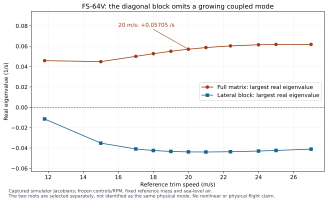

# Follow-up 01: implementation-ready external audit

**Date:** 2026-11-15. **Branch:** `audit/ugly-stik-flight-physics-2026-11-15`. This continues the [original Stik audit](../README.md) as an external review: deeper source investigation, reproducible counterexamples, proposed changes and acceptance criteria. The follow-up changes reports and research probes only. Every proposed application/tool repair below remains open.

The executed audit checkout is `00610ce3df391560dc195444d797bb81f2f83270`, with runtime baseline `ad21070798bfb9658785576a9c0b8bfc9a71fc7f`. A newer main, `e488ef7653e8dd0f0a2e7db18e396bb4da0aaccc`, was inspected for freshness. It changes fourteen app paths, including camera/reconstruction behavior, so this is **not a whole-app qualification of that newer commit**. The relevant input, physics, simulation and statistics trees match the tested runtime. See [verification](verification.md) and the [exact source manifest](evidence/source-manifest.json).

## What this investigation adds

**The input repair needs a stronger contract than a seen-axis flag.** In the production reader, a roll event of +0.8 can set `_seen`, then an independent poll of 0.0 can supply the actual command. A direct profile remap can also preserve historical axis-event diagnostics. The seven-case probe and source tracing identify which values, device generation, mapping and focus state a future readiness rule must qualify. The report distinguishes motor arming from flight readiness and treats direct session-only calibration as a policy choice that needs clear semantics, not automatic corruption.

**The FS-64V mode report can assign misleading names, and the block approximation can omit a growing coupled mode.** The longitudinal spectrum changes from two complex pairs to a fast complex pair and slow real roots between the sampled 17 and 18 m/s points. The heuristic assumes the real pair is the short period and calls the remaining complex pair phugoid; the card then hides that fast “phugoid.” At 20 m/s, the full frozen-control/fixed-RPM matrix has a real eigenvalue approximately +0.05705/s while the lateral projection has a slow real root −0.04381/s. This distinction survives three finite-difference step sizes and independent eigensolutions. The source already documents the projection; the generated card drops that qualification. Neither the root names nor this local linear model establishes physical-aircraft or nonlinear-session stability.

**Electric landing statistics now has a concrete candidate.** Independently derived Electric 6S contact positions agree with the production loader and validator in both ideal and finite-pack modes. Thirty focused checks pass, including refusal of the basic-Stik donor geometry and synthetic detector behavior before/after a hypothetical support profile. Actual adapter clearance, lifecycle and UI acceptance remain specified work; no profile was installed. The analysis also distinguishes retained per-flight source hashes from missing mode/coverage presentation.

**Several reports can look stronger than the evidence behind them.** An injected early floor stop reuses its endpoint for unobserved future time labels. Timeout handling drops captured diagnostic streams. Malformed profiles can abort before the failure receipt is written. Empty, disjoint or malformed comparisons can produce a zero-change exit. The runway report has related source-identity, frame-coverage and missing-sync-receipt issues. Each is bounded to its actual reproduction; no prior normal campaign is declared corrupt without evidence.

## Reports and evidence

| Report | What an implementer can use immediately |
| --- | --- |
| [Input contract and repair plan](input-contract-and-repair-plan.md) | Owner/focus/remapping lifecycle, seven reproduced sequences, alternative freshness policies, calibration boundaries and acceptance matrix. |
| [Mode and trim diagnosis](mode-and-trim-diagnosis.md) | Actual roots/Jacobians, independent SciPy analysis, period semantics, a nearby full-throttle trim solution and bounded reporting changes. |
| [Electric integration plan](electric-integration-plan.md) | Exact accepted hashes, candidate support coordinates, contact tolerance, counter/UX/history effects and identity-consumer matrix. |
| [Runway evidence follow-up](runway-evidence-contracts.md) | Metadata-only comparison and history reproductions, positive controls, source compatibility and coverage criteria. |
| [Evidence contracts and failure paths](evidence-contracts-and-failure-paths.md) | Floor-stop, timeout, invalid-profile and comparator counterexamples; minimal repair scopes and regression cases. |
| [Independent review](independent-review.md) | Challenges to severity, physical interpretation, numerical robustness and misleading pass claims. |
| [Verification](verification.md) | What actually ran, exact source/engine scope, retained diagnostics, reproducibility and limits. |
| [Probe instructions](../../../../research/ugly-stik-audit-2026-11-15/follow-up-01/README.md) | Executable research sources and commands, with no runtime patch required. |

The [evidence directory](evidence/) includes raw checked logs and receipts, accepted identities, captured Jacobians, independent spectra, card CSVs, synthetic inputs/outputs and SHA-256 manifests. A pass in an observation probe means the stated behavior was reproduced; several probes intentionally confirm an open defect.

## Findings and recommended work packages

Priorities rank engineering usefulness, not physical hazard. Work packages are proposed independent changes; they are not commits already implemented by this follow-up.

| Package | Priority / status | Bounded change and owner paths | Acceptance before closure |
| --- | --- | --- | --- |
| INPUT-1 — current command authority | High; CTRL-01 expanded with checked counterexamples | `app/input/rc_input.gd`, registry/service, session and focus boundaries: keep diagnostics separate from qualified values and owner/mapping epochs. | Missing axes, disagreeing event/poll, remap, reconnect and focus cases; quiet radio and trusted gamepad controls; native-device ordering evidence. |
| INPUT-2 — calibration evidence and transaction policy | High for CTRL-02; additional route differences are contract decisions | `rc_calibration.gd`, service/setup/session: distinguish hardware reports from repeated polls; specify managed persistence and direct session-only behavior. | Real endpoint holds/outliers/cadence, Cancel, refusal and rollback failure; metadata preservation; restart behavior. Do not change direct motor/surface semantics accidentally. |
| EVID-2/3 — durable failure records | Medium/high; reproduced, open | `research/flight-test/run.py`: retain both timeout streams and isolate invalid profiles per aircraft. | Positive run, actual timeout capture, malformed profile and mixed good/bad batch all produce truthful receipts. |
| EVID-4 — comparison eligibility | High for regression gates; reproduced, open | `research/flight-test/compare.py`: validate unique identities, report roster/coverage and distinguish empty evidence from no change. | Empty/disjoint/duplicate/one-sided fixtures plus ordinary changed/unchanged controls; intentional partial comparisons remain explicit. |
| EVID-1 — time coverage | High evidence integrity; injected production-card reproduction | Shared `_fly`/time lookup and `card_power.gd`: explicit stop reason, observed interval and unavailable future metrics. | Stop before/between/on target times and full-duration control, serialized to JSON and Markdown; planned card-version compatibility. |
| MODES-1 — honest modal output | High diagnostic value; CARD-02 deepened | `flight_modes.gd` classifier and flight-card consumers: raw roots, ambiguous names, projection scope, natural versus oscillation period. | FS 17–18 transition, 20 m/s raw spectrum, no-lag control, basic/electric/Extra controls, coalescence and real/unstable synthetic cases. |
| STATS-1 — Electric support profile | Medium product gap; mechanically checked candidate, open | `app/statistics/profiles.gd`, adapter/detector tests and coverage presentation. | Independent role review, both exact sources, real-adapter clearance and landing/lifecycle/counter cases; retain historical unknowns. |
| CAPTURE-1 — source and comparison coverage | Medium/high evidence clarity; ORG-03 expanded | Runway scenario manifest, `scenario_report.py` and wrapper/history. | Accepted source path/hash/mode, different-source labels, zero-overlap/removed-frame handling, unknown missing sync receipts, rendered qualification separately. |
| TRIM-1 — distinguish solver failure from a speed limit | Medium; constructive diagnosis, open presentation improvement | Trim-sweep/card output: retain failure reason, sample spacing and fallback-speed origin. | Successful nearby trim and bounded full-throttle root; failed 28 m/s solve must not assert universal infeasibility or a measured maximum speed. |
| PROVENANCE-1 — external candidate identity | Medium; source-reviewed opportunity | Candidate `--app` runner provenance and accepted engine/source manifests. | Identify actual candidate bytes before/after execution; preserve exact loaded JSON identity and deliberate candidate comparisons. |

The modal, time-coverage and comparison changes belong to evidence semantics and can be reviewed independently of aircraft tuning. INPUT-1 needs backend/device qualification before claiming universal readiness. STATS-1 needs the real adapter/lifecycle checks even though its contact arithmetic is now established. Keep these dependencies visible so a small report improvement is not held hostage to a full aerodynamic recalibration.

## Quantified example: coupled and projected spectra

The roots in the two curves are selected independently; the chart does not establish that they are the same physical mode. It explains why a stable diagonal block cannot certify the full captured matrix. The [modal report](mode-and-trim-diagnosis.md) preserves equations, source assumptions, three-step sensitivity checks, coordinate-scaling caveats and control-aircraft results.

For the trim investigation, a diagnostic solve using the same production residual and full throttle found an equilibrium near **27.6184 m/s**. This supports a nearby local throttle-bound explanation for the successful 27 m/s and unsuccessful 28 m/s samples. It does not prove global uniqueness, exclude another branch, or qualify the installation against its RPM recommendations.

## Opportunities deliberately left as hypotheses or policy choices

- A raw controller silent between unchanged events is not automatically disconnected. Repeated finite polls also cannot prove ongoing hardware communication. Backend sequence/health evidence or a clearly stated pilot-confirmation contract is needed.
- Surface movement while the motor is disarmed can be useful for preflight inspection. Readiness and motor arming should have separate names and rules; this audit does not invent a requirement to suppress every surface.
- A direct calibration applied for the current session but visibly reported “NOT saved” is not automatically storage corruption. The intended session/persistence policy needs an explicit decision and regression coverage.
- A failed trim solve is not a proof that a valid equilibrium cannot exist elsewhere. A growing mode of a frozen-input Jacobian is not a measured flight instability.
- Comparing different hashes can be intentional. The missing piece is visible compatibility and scope, not a blanket ban on comparing candidates.
- Source inspection still does not establish a CPU/GPU bottleneck or a speedup. The original profiling candidates remain open. Measure target-device frame percentiles and costs after correctness/identity boundaries are protected, preserving float64, replay, ownership and rollback contracts.

The first audit's physical-validation priorities remain: actual mass/CG/inertias, control geometry and actuator timing, motor/ESC/propeller data, stopped/windmilling behavior, wake coupling, sideslip/induced-flow closure and held-out stall/spin evidence. This follow-up makes the software evidence and implementation boundaries more precise; it supplies no replacement aerodynamic coefficients.
