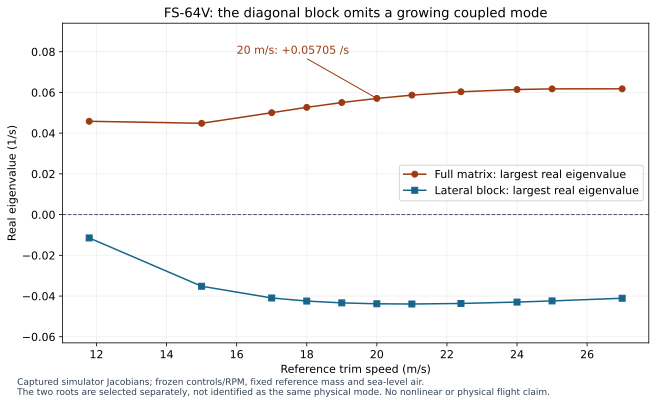

# Follow-up: FS-64V modal labels, projection and trim boundary

**Scope and identity.** This is a read-only investigation of the simulator's model and reporting at audit branch `00610ce3df391560dc195444d797bb81f2f83270`; relevant runtime sources are unchanged from `ad21070798bfb9658785576a9c0b8bfc9a71fc7f`. At the subsequently observed main `e488ef7653e8dd0f0a2e7db18e396bb4da0aaccc`, `app/physics`, `app/sim`, `app/input` and `app/statistics` match this execution; other app paths did change. The audit branch separately includes the earlier runner/card validation repairs. See [the exact source manifest](evidence/source-manifest.json). Results concern the authored FS-64V installation, the specified equations and test conditions, and not a measured airplane, a flight demonstration, or pilot feel. No production coefficients, generated assets or runtime code were changed.

**Evidence.** The checked production-path probe uses the loader, `FlightModes`, `Dynamics`, `Trim`, `FlightSession` and `Linearize`: `research/ugly-stik-audit-2026-11-15/follow-up-01/modes_probe.gd`. The checked pinned official Godot 4.8-beta2 extended capture is `evidence/checks/modes/{report.json,engine.log}`: `ok=true`, `complete=true`, process exit 0, zero counted errors and warnings, required completion marker present; log SHA-256 `e34eb21647109b3ae85198e7422f4e0ab912e23a63a8c88c1bd0d37d3716877b`. Structured input to the independent analysis is `evidence/modes.json`. SciPy 1.17.0 / NumPy 2.3.5 analysis is in [`modes_analysis.py`](../../../../research/ugly-stik-audit-2026-11-15/follow-up-01/modes_analysis.py) and [`modes-analysis.json`](evidence/modes-analysis.json); it reads the captured matrices, not the engine. The static card is [the retained original static profile](../evidence/fleet-static/stik-glow-fs64v-4t/profile.json). The data and code paths are relative to the repository unless otherwise identified; Analysis files and checked receipts are retained with this follow-up. Analysis was independently challenged; see the limitations below.

## What the analyzer actually computes

`app/physics/flight_modes.gd:23-61` trims with calm air, sea-level density and fixed reference model properties, then centrally differences a frozen-control, fixed-RPM continuous model at `h=10⁻⁶` (`app/physics/linearize.gd:10-33`). The state order is `[u,v,w,p,q,r,φ,θ,wake]`, with the ninth wake proxy when lag is enabled. Fixed RPM still permits propeller and aerodynamic loads to vary with airspeed. The state does not include shaft acceleration, changing fuel inventory or servo/engine dynamics; it is not an eigenanalysis of the complete flight session. `Trim.state_for` uses body velocity based on α and β and sets level-flight attitude (`app/physics/trim.gd:25-36`); the mode evaluator holds the trim controls and RPM while perturbing body state. The production routine returns both the full Jacobian and its historical diagonal-block projections and explicitly warns that cross-axis terms are omitted (`app/physics/flight_modes.gd:54-61,100-108`). It does **not** promise to solve the full coupled spectrum.

The static campaign's `1.3Vs` is 1.3 times the analytic CLmax estimate, 11.79136 m/s here. Because its dynamic stall and maximum-speed tests were not run, `0.8Vmax` is 0.8 times the first failed trim-sweep sample, 22.4 m/s (`research/flight-test/flight_test.gd:125-132,509-535,1145-1149`). These are neither measured stall nor measured maximum speeds.

## A. Likely longitudinal mode reversal in the existing heuristic

The table below gives **all** longitudinal projected eigenvalues in s⁻¹, computed independently from the captured production matrices. `±` denotes a conjugate pair. `V` is m/s. The labels in the last column describe the heuristic's result, not independently verified physical identities.

| FS-64V condition | Fast pair | Other roots | Current analyzer/card result |
| --- | --- | --- | --- |
| 11.79136 | −8.15063 ± 3.48914i | −9.59905; −0.33879 ± 0.72250i | Fast pair called short period; slow pair called phugoid. |
| 17.0 | −13.35624 ± 4.13407i | −10.46042; −0.51193 ± 0.13687i | Same ordering; slow pair is heavily damped. |
| 18.0 | −14.31755 ± 4.39700i | −10.71445; −0.76580 and −0.32254 | Slow real roots called overdamped short; fast pair called phugoid, then suppressed by card. |
| 20.0 | −16.18209 ± 4.93770i | −11.34334; −1.02652 and −0.18990 | Card reports “short period” 0.070 Hz, ζ 1.378; phugoid omitted. |
| 22.4 | −18.35896 ± 5.59080i | −12.22434; −1.24806 and −0.12094 | Card reports “short period” 0.062 Hz, ζ 1.762; phugoid omitted. |

The 17–18 m/s sequence supports the interpretation that the slow complex pair has become two real roots while the fast pair continues. The captured left/right eigensolutions also show, under the recorded state coordinates, that the slow 17 m/s pair is associated primarily with `u` and `θ`, whereas the fast pair has strong `w`, `q` and wake participation. This is evidence for a likely label reversal under the heuristic, **not** a unique proof of physical mode identity: the sampling is sparse, mode branches can mix or exchange character, and participation depends on how states are defined. The exported biorthogonal participation components are not percentages; individual values can be negative or exceed one.

The reason the output changes is explicit: `flight_modes.gd:72-96` sorts two oscillatory pairs by natural frequency when both exist. With one pair and three real roots, it instead identifies the real root nearest `−V/l` as wake, **assumes** the other two stable real roots are an overdamped short period, and assigns the oscillatory pair to phugoid. At 20 m/s the nominal uncoupled wake pole is −26.15405 s⁻¹, while the selected real pole is −11.34334 s⁻¹; proximity to the nominal value does not prove the selected coupled mode is uniquely a wake mode. The flight-card consumer then suppresses the putative phugoid when its natural frequency is no lower than the putative short period (`research/flight-test/flight_test.gd:1153-1158`). The routine still marks the row valid because a start row exists (`:1166-1167`).

The 0.070269 Hz is `sqrt(λ₁λ₂)/(2π)`, an **equivalent undamped natural-frequency parameter** for the two real roots, with `ζ=−(λ₁+λ₂)/(2 sqrt(λ₁λ₂))`. It is not an oscillation frequency: the roots at 20 m/s are nonoscillatory, with e-fold decay times 0.974 s and 5.266 s. The fast complex pair has `ω_n/(2π)=2.69269 Hz` and `ζ=0.95646`; its mathematical damped oscillation frequency is `|Im λ|/(2π)=0.78586 Hz`, with a very rapidly decaying envelope. These distinctions matter independently of what names a more complete classifier ultimately assigns.

**Wake counterexample.** A diagnostic model copy with `downwash_lag_length` removed and otherwise the same FS data produces at 20 m/s the slow roots −1.02528 and −0.19010 and the fast pair −8.49590 ± 7.20996i. Thus this slow-root separation and the mislabeling heuristic do not require the extra wake state. The substantial shift of the fast pair also shows wake dynamics interact with the motion; the counterfactual is not a proposed runtime change or physical calibration.

**Controls and numerical checks.** At basic Stik 15 m/s the projected fast/slow pairs are −7.89820 ± 2.76307i and −0.15591 ± 0.61503i; ideal 6S Stik 15 m/s, −15.02302 ± 9.15639i and −0.18719 ± 0.47353i; Extra 22 m/s, −12.57929 ± 8.54842i and −0.15818 ± 0.51446i. All three have the usual two-pair labeling in these individual conditions; they are counterexamples to a fleet-wide claim. On the FS 20 m/s longitudinal projection the independent SciPy and production eigenvalues agree within `8.8×10⁻¹⁴ s⁻¹`; a separately reproduced copy of the mode RHS gives an exactly matching default-h longitudinal matrix, and using `h=10⁻⁷`, `10⁻⁶`, `10⁻⁵` changes matched longitudinal roots by at most `2.1×10⁻⁷ s⁻¹`. The extended capture also checks the full matrix across those steps, as described below.

## B. A documented projection can mask the sign of a coupled slow root

At the same FS 20 m/s reference trim (reported residual norm `8.33×10⁻¹¹`), SciPy gives the following full **9-state, frozen-control/fixed-RPM** eigenvalues, s⁻¹:

`−25.94135; −15.97162 ± 4.75468i; −11.51521; −1.78892 ± 4.62092i; −0.97619; −0.35649; +0.05705186`.

The separately projected lateral block has a slow root `−0.04380683 s⁻¹`, which the card displays as a 15.8 s spiral half-time. The full captured matrix instead contains a growing real mode at `+0.05705186 s⁻¹`: the linearized mode's e-fold time is 17.53 s and its mathematical doubling time is 12.15 s. This is a real distinction between the spectra of the captured full matrix and its diagonal blocks, not a declaration of real-world or nonlinear-session instability. It is also not evidence that `FlightModes` violated its contract: its source documents the projection and provides the matrix for cross-axis work. The presented card is where that qualification becomes easy to lose: `_modes` copies only named numbers into its result, discarding `projection_note` and the full matrix (`flight_test.gd:1153-1167`); `_write_report` serializes those rows to `profile.json` and `profile.md` (`:1364-1395`), and `research/flight-test/summarize.py:53-62,80-81` presents the spiral figure without restoring that distinction. `research/flight-test/README.md:154` does document the block projection. No app UI consuming these fields was established in this audit.

Across the tested FS speeds, the projected slow lateral root stays negative while this full-matrix root stays positive: at 11.79136 m/s they are −0.01147 and +0.04582 s⁻¹, and at 22.4 m/s −0.04365 and +0.06032 s⁻¹. At the checked basic 15 m/s and ideal-electric 15 m/s points both roots are negative; at Extra 22 m/s both are positive. These are examples, not a general fleet stability survey. At FS 20 m/s, the recorded full-mode left/right participation has substantial φ and θ components; its exact values and any cross-axis entry magnitudes depend on the state representation and should not be interpreted as physical percentages.

**Numerical qualification.** For the captured FS 20 m/s full matrix, the independent eigenpair has normalized residual `2.3×10⁻¹⁶` and coordinate-dependent 2-norm eigenvalue condition estimate 3.65. A diagonal similarity rescaling using V, span and chord preserves the spectrum to `4.0×10⁻¹⁴ s⁻¹`, while changing that condition estimate to 10.31. The reproduced full RHS matrix at `h=10⁻⁶` agrees element-for-element with the production matrix, and the full slow root is +0.057051863601, +0.057051863496 and +0.057051863379 s⁻¹ at respective steps `10⁻⁷`, `10⁻⁶` and `10⁻⁵`; the maximum matched change across all nine roots is `2.27×10⁻⁷ s⁻¹`. The same sign distinction persists over those steps at each sampled FS speed. This supports local finite-difference robustness at the sampled conditions; it does not prove convergence at every state or validate the model against hardware. Production's custom characteristic-polynomial solver is documented as used only for the smaller projected matrices (`flight_modes.gd:54-57`), so these full 9-state roots came from independent SciPy, not from `Linearize.eigenvalues`.

## C. The reported phugoid period is a natural period

`FlightModes` defines `f_hz = ω_n/(2π)`, where `ω_n=|λ|` (`flight_modes.gd:67`; `linearize.gd:149-163`). The card computes `phugoid_period_s = 1/f_hz` (`flight_test.gd:1161`), which is the **undamped natural period** `2π/|λ|`. For a genuinely complex pair `λ=σ±iω_d`, the mathematical interval between successive oscillations is `2π/|ω_d|`; the two differ whenever damping is nonzero. For the FS low-speed row the card shows 7.87 s, whereas the projected eigenvalue gives 8.70 s. At 17 m/s the values are 11.86 s and 45.91 s, respectively; because the mode decays by approximately `6.2×10⁻¹¹` per mathematical cycle at that condition, a real observed cycle would not be practically distinguishable. A pair of real roots has no oscillatory period at all. This is a terminology/output issue in a static diagnostic, not evidence of an actual flight period.

## D. The 27–28 m/s trim change is consistent with a nearby throttle bound

The card's grid finds a trim at 27 m/s and the next sampled `session.trim_at` at 28 m/s fails. The reported 28 value is the **first failed solve**, not proof of a physical or modeled maximum speed (`flight_test.gd:509-535`). The following local experiment freezes the session's start conditions: calm sea-level density 1.225 kg/m³, gravity 9.80665 m/s², engine charge ratio 1, starting fuel fill 1, and session `_trim_model` mass 2.62554338 kg. This mass-inventory trim path (`flight_session.gd:1084-1102,2939-2947`) is a separate calculation from the reference-model modal linearization above.

| Speed m/s | Converged session trim | Throttle | Steady RPM | Residual norm |
| ---: | --- | ---: | ---: | ---: |
| 27.00 | yes | 0.84504650 | 11,687.92 | 2.20×10⁻¹⁵ |
| 27.25 | yes | 0.90857282 | 11,796.91 | 1.14×10⁻¹⁴ |
| 27.50 | yes | 0.98103184 | 11,905.91 | 1.68×10⁻¹⁴ |
| 27.75–28.50, sampled | no | final attempts reach 1.0 | — | see receipt |

At 28 m/s, direct attempts from initial throttles 0.4, 0.75 and 0.95 all return `glow trim stalled: no finite residual-decreasing step within throttle [0,1]`, with final residual norms 0.5761, 5.2588 and 16.3135. The public solver retries cold seeds after a failed warm start (`trim.gd:115-139`), so identical final warm/cold failures do **not** demonstrate identical first iterations. The bounded line search and residual-decrease rule are explicit in `trim.gd:142-206`; a failed step is a numerical/constraint outcome, not a proof that all admissible roots are absent.

As a separate constructive check, a diagnostic six-variable Newton/backtracking solve fixed throttle at exactly 1, used the **same production `Trim._residual`**, treated speed as an unknown bounded to 20–35 m/s, and started from the 27 m/s session trim. It found a trim at **27.61841052 m/s**, residual norm `1.95×10⁻¹²`, with no reported control-throw excess. The continuously increasing successful throttle and that nearby full-throttle equilibrium strongly support a local throttle-bound explanation for the cutoff. They do not prove global uniqueness or rule out another admissible 28 m/s trim. The authored propeller's provisional, generically derived max-RPM recommendation is 11,785.7 rpm (`app/data/glow/stik_fs64v_4t.json:154-159`); at the successful 27.5 m/s point the model returns 11,905.9 rpm, above that provisional reference and the engine's authored 11,000-rpm recommendation (`app/data/glow/os_fs_64v_candidate.json:393-397`). These are model outputs and declared references, not measured hardware operation or a claim that the trim solver enforced those recommendations.

## Minimal future changes and acceptance cases

1. **Stop asserting names where the root structure is ambiguous.** Preserve raw eigenvalues and whether each is real or complex; return explicit `ambiguous/unclassified` metadata if the existing overdamped assumption cannot be justified. At minimum, prevent the contradictory case in which a much faster complex pair is labeled phugoid while slow real roots are displayed as the short period. Keep named results only where the classifier has documented evidence; a continuation/eigenvector-based classifier can be added later, with an ambiguity outcome near coalescence. Keep the existing 4/5-state float64 path and other historical consumers compatible; do not tune aero to make this example pass.
2. **Qualify the card's scope.** Propagate a visible `diagonal-block projection; cross-axis coupling omitted` note into each `modes` row/report/summary, ideally with raw roots and model-input assumptions. A separate full-spectrum analysis may be introduced later with an appropriate, verified nonsymmetric 8/9-state solver; do not silently apply the small polynomial solver outside its documented range. A full-spectrum result must stay distinct from a session-level or physical stability claim.
3. **Fix period semantics.** Either rename the existing value as undamped natural period while preserving compatibility, or calculate the complex-root oscillation period as `2π/|Im λ|` and retain the natural period under its own name. For real or nearly coalescent roots, return no oscillation period and explain why. Document rounding and the practical unobservability of heavily damped cycles.
4. **Represent trim failure honestly.** Record `first_unsolved_mps` and the actual trim failure reason, distinguish it from a confirmed limit, and disclose the origin of fallback speeds. Preserve or deprecate the existing `first_untrimmable_mps` field with explicit semantics so existing consumers are not broken. A bounded continuation/full-throttle search is a diagnostic improvement, not proof that no disjoint trim branch exists.

Meaningful acceptance cases should cover: FS 11.79136, 17, 18, 20 and 22.4 m/s with exact retained spectra and correct distinction between complex and real roots; the 20 m/s no-lag counterfactual; basic, ideal-electric and Extra control cases; and synthetic examples of both genuinely overdamped short and slow branches, near-coalescence, all-real roots, unstable real roots, and wake/short-mode mixing. A synthetic stable-diagonal-block matrix with unstable full spectrum, for example `[[−1,2],[2,−1]]`, should show why projection cannot certify coupled stability. Independently check the full RHS Jacobian across multiple difference steps and scaled coordinates, with eigenpair residuals; if this motivates a coupled runtime result, compare against a trusted eigensolver and a controlled small-disturbance integration with matching frozen RPM/controls and fixed mass. For trim, assert success at 27.5 and the independently constructed full-throttle root near 27.6184 under the stated model; a failing 28 m/s solve must report failure without asserting universal infeasibility. Test the card and comparison summary as serialized user-visible artifacts, including null/ambiguity handling and legacy fields.

## Primary background sources

- J. A. Franklin, [*V/STOL Dynamics, Control, and Flying Qualities*, NASA/TP-2000-209591](https://ntrs.nasa.gov/api/citations/20010038495/downloads/20010038495.pdf), p. 75 discusses an example in which a phugoid becomes two real roots. This illustrates why the presence of real roots alone does not uniquely identify a short-period mode; the V/STOL example is not validation of the Stik or a source of its coefficients.
- R. F. Stengel and P. W. Berry, [*Stability and Control of Maneuvering High-Performance Aircraft*, NASA-CR-2788](https://ntrs.nasa.gov/api/citations/19770014156/downloads/19770014156.pdf), appendix, p. 157, on aircraft modes and eigenvectors: a mode can involve multiple states. The examples are not RC-aircraft measurements.
- W. W. Quinn, [*Multivariable Control of a Forward Swept Wing Aircraft*, NASA-CR-177112](https://ntrs.nasa.gov/api/citations/19860019481/downloads/19860019481.pdf): p. 34: eigenvectors depend on state scaling. This is a general numerical interpretation caveat, not a calibration source for the simulator.

- SciPy 1.17.0, [`scipy.linalg.eig` reference](https://docs.scipy.org/doc/scipy-1.17.0/reference/generated/scipy.linalg.eig.html), accessed 2026-11-15: the independent analysis uses the general square-matrix left/right eigensolver; its result still needs the residual and scope checks described above.
