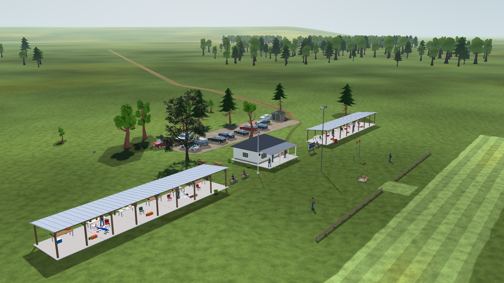
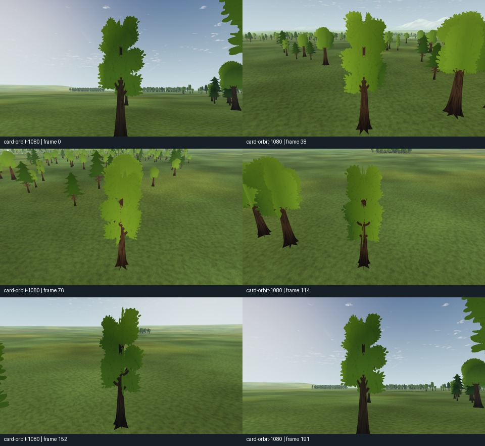

# Vegetation realism audit and implementation proposal

2026-10-20 · Research and implementation intake · Owner: landscape **L**, coordinated with **SC/LU**, **VQ**, **M5**, **FW/TOD** and **RCV**.

**Implementation status:** the user subsequently authorized implementation. Source intake has started; no replacement vegetation has been integrated into the application. See the dated handoff in section 10. Sections 1–9 retain the original research findings and proposed acceptance gates.

**Recommendation:** preserve the clubhouse maple and the other good downloaded vegetation; replace the conspicuous stylized tree silhouettes, especially the distant forest; then build convincing woodland edges, meadow patches and transitions using existing licensed assets. A tint adjustment or a density increase would not meet the requested improvement. The intended result is a coherent, realistic landscape from pilot, chase, aerial and ground cameras.

This document adds a dated audit, source comparison and proposed implementation sequence. It does not implement or approve a runtime change. The [tree/forest plan](../plans/tree-forest-quality.md), [grass plan](../plans/grass-quality.md), [landscape registry](../LANDSCAPE-PLAN.md) and [global visual/performance plan](../plans/global-performance-visual-quality.md) retain ownership of their steps and acceptance gates. No new step namespace is introduced. No vegetation is to be modeled, painted or generated from scratch; conversion and any necessary lower-detail representations must derive reproducibly from downloaded assets.

## 1. Inspection scope and evidence strength

The audit used the codebase graph, current source/configuration and asset manifests, existing source archives' receipts, retained native captures, supplier pages, GitHub metadata and public download checks. The shared checkout advanced during inspection; the later inspected HEAD was `49a461810018844e4a33c9a2babf5a59304f7f0a`. This was not a frozen benchmark checkout. Existing unrelated work, including pond vegetation, was preserved.

The application pins Godot **4.7.2-stable**, **Compatibility**, a **1280 × 720** default viewport and **4× MSAA**. See [STACK](../STACK.md), [project.godot](../../app/project.godot) and [engine pin](../../app/get-godot.sh). Candidate assets must work in that renderer; a Forward+ demonstration is not compatibility proof.

Evidence labels used below:

- **Local:** retained source/catalog facts or existing project captures were inspected.
- **Verified endpoint:** a public metadata/file endpoint responded; this does not prove a complete archive, import fidelity or runtime quality.
- **Listing:** supplier/indexed listing claims; counts and available formats still require archive inspection.
- **Proposed:** an art, integration or validation decision to test later.

No new Godot session, FPS benchmark or full asset intake was run for this report. Visual observations refer to the explicitly linked retained images. New GLB checks read only headers/JSON into memory; no new vegetation files were installed or retained. Failed/account-gated access is identified rather than called a verified download.

## 2. Preservation register

### The clubhouse maple is a hard exclusion

| Property | Protected identity |
| --- | --- |
| Placement | `prop:shade-trees:06`, seed `793949324`, N **−32 m**, E **10.5 m**, heading **247.1°**, uniform height **14 m** |
| Data / placement logic | [scenery data](../../app/data/scenery/default.json), [VegetationPlacement](../../app/scenery/vegetation_placement.gd), including `CLUB_MAPLE_SEED` |
| Asset | `maple_tree`, LOLIPOP's supplied `Acer_large_3_LOD1` |
| Runtime geometry | [maple_large_3_lod1.gltf](../../app/assets/landscape/vegetation/models/maple_tree/maple_large_3_lod1.gltf), its `.bin`, six maps and their `.import` settings in the same asset directory |
| Source proof | [conversion manifest](../../assets/landscape/vegetation/derived/lolipop_maple_2026/conversion_manifest.json), [catalog](../../app/assets/landscape/vegetation/catalog.json), [CC BY 4.0 notice](../../app/assets/landscape/vegetation/LICENSE_MAPLE.txt) |
| Geometry / dimensions | 5,541 triangles, two surfaces; source height 18.3271 m; fitted crown footprint approximately **9.63 × 13.24 m** |
| Effective presentation | White instance tint; source PBR; opaque bark; double-sided foliage, alpha-scissor 0.5; static material fallback; existing automatic mesh LODs |
| Current texture policy | Compressed maps; bark/normal/ORM mips retained; leaf color/alpha **unmipped**. The later map-expansion decision supersedes the earlier all-mipped intake. |

The catalog's glTF SHA-256 is `ba5eb469c725d00eb8160b335211a2ab064f17669beccc3f93b6b63b62ead942`; the catalog and conversion manifest enumerate its dependencies. A future baseline must also hash the effective runtime files and import settings, not rely on this one hash.

**Do not replace, move, rescale, recolor, re-filter, change the source LOD, alter shadows or add wind to this tree.** Preserve its grounded pivot, crown offset and collision dimensions. Its source materials are shared with other maples: experiments must use separate candidate resources. Changing a global alias, shared texture importer, material cache or generator can modify the protected tree indirectly. Preserve the seed-to-asset mapping explicitly when expanding the catalog; a changed modulo must not silently select a different tree. Keep the lighting/exposure reference fixed when judging preservation.

The dark, irregular maple beside the white clubhouse is the benchmark. The same image exposes the style mismatch with nearby simplified trees and the background forest. See the [original intake](visual-quality-implementation/L6c/house-tree/README.md) and [later expansion](visual-quality-implementation/L6c/map-expansion/README.md).

### Preserve other successful work

- Keep the other three maples at N/E **(555, 295)**, **(580, 280)** and **(−480, −770)**, approximately **10.01 / 10.21 / 11.52 m** tall. Do not turn the entire landscape into clones of this one crown.
- Retain the downloaded LOLIPOP small/tall grass and dasy444 leafy shrub as the first small-plant candidates. Preserve their source pixels, UVs and provenance; assess wider reuse in a separate fixture.
- Retain accepted turf/mown boundaries, woodland litter, grounded placement and flight exclusions. Recent work is not an empty starting point.
- Preserve the lake's new waterlilies and localized reeds. The [LU-22-R2 evidence](landscape-upgrade/LU-22-R2/README.md) describes 105 leaves, 14 blossoms and 21 reed clumps; this is a separate visual-only system with its own depth rules and open hardware gate.
- Keep unused source assets and historical evidence. Replacing a visible stylized placement does not require deleting its licensed archive or fallback.

## 3. Current vegetation audit

| Layer | Inspected implementation / evidence | Problem and proposed disposition |
| --- | --- | --- |
| Field and distant trees | [treeline.gd](../../app/render/treeline.gd), [tree_assets.gd](../../app/render/tree_assets.gd), [tree shader](../../app/render/treeline.gdshader), [identity include](../../app/render/tree_identity.gdshaderinc). **1,680 trees**: 480 near at 270–570 m from the pilot and 1,200 far beyond 600 m, with an actual maximum near **1,399.36 m** inside the 1,500 m design bound. Three Quaternius source silhouettes, six triangles per tree, eight sector MultiMeshes, 1024² atlas. | **Highest visual priority.** Flat crossed planes, filled-in crowns, repeated exaggerated trunks/conifer outlines and a sharp style contrast with the maple. Replace source silhouettes and qualify a camera-dependent near/far representation; retain deterministic placement/exclusion infrastructure. Distance from the pilot is not distance from a flying chase camera. |
| Forest composition | Twelve irregular far patches already exist; [habitat diagnostics](visual-quality-implementation/L6c/tree-completion/habitat/README.md) retain 55–173 trees per patch and 9 m near / 4.5 m far minimum-spacing checks. | Do not propose uniform randomness or equal circular patches as new improvements. Existing irregularity helps, but repeated crown shapes and disconnected tree islands still dominate the retained wide views. Add species/age structure and graduated edges, initially at the same population. |
| Imported close trees | [library](../../app/scenery/imported_vegetation.gd), [placement](../../app/scenery/vegetation_placement.gd), [scenery assembly](../../app/scenery/scenery.gd). Catalog has nine tree assets; production uses eight source forms across 17 placements. **Four placements** use the one maple source; seven Quaternius forms and the retained oak also exist in the library. | Preserve all maples. Review non-maple club/road/farm trees individually; replace visibly stylized crowns with additional downloaded realistic forms. More available catalog assets do not mean every asset is placed. The retained oak is not the current clubhouse tree. |
| Imported near grass | [imported_near_grass.gd](../../app/scenery/imported_near_grass.gd), three grass sources at 155/326/622 triangles. Quality caps **38/76/150**; high default allocation **67/42/41**, in a 30 m pilot disk, 0.12–0.25 m heights, shadows off. [Field dispatch](../../app/render/field.gd) selects it only for `default` with attached scenery. | Sparse isolated clumps and a mismatch between geometric blades and ground texture can show at low camera height. Default imported grass is static. Test retained photographic tufts and root-color matching; do not just multiply the expensive wispy mesh. |
| Enhanced grass preview | [grass implementation evidence](visual-quality-implementation/grass-quality/README.md): `OPENRC_GRASS_QUALITY=enhanced`, allocation **100/30/20**, source total **37,720** instead of **49,579**, shared Grass001 turf and bounded imported wind. | Reuse this experiment; do not describe it as the accepted default. Combined live-session cost and boundary/owner acceptance remain open. The measured source-triangle saving is not measured FPS headroom. |
| Scenery-off grass | [near_grass.gd](../../app/render/near_grass.gd) and [shader](../../app/render/near_grass.gdshader): bounded opaque blades, fixed-root wind and 22–30 m geometric shrink. | A separate fallback, not proof that imported grass has the same fade or wind. Keep quality/fallback paths visually coherent; do not extend newly authored blade geometry under this proposal. |
| Shrubs, herbs, flowers and crops | Catalog includes 3 shrub, 6 grass/herb, 3 flowering, 2 crop and 1 reed assets in addition to 9 trees. [Botanical habitats](../../app/scenery/botanical_habitats.gd) and downloaded accent recipes reuse them. | Existing variety is useful, but bright isolated flowers and stylized bushes remain conspicuous in the meadow capture. Keep convincing low-cost tufts/shrub accents; replace excessive cartoon flower shapes selectively, reduce isolated color dots and place species in patches. Agricultural rows are intentional and should remain distinguishable from natural woodland. |
| Woodland margins | [woodland_edge_habitat.gd](../../app/scenery/woodland_edge_habitat.gd), latest [v3 groundcover evidence](visual-quality-implementation/L6c/tree-completion/groundcover-transition/README.md): **220 plants**, **472 triangles**, four foliage batches plus litter, four patches. Retains 24 fern, 16 tall-grass and 8 flowering-shrub cards; the former 12 grass meshes are now included within **172 short-grass cards**. Exact-default-only, decorative, no collision; low quality omits it. | Preserve the layered recipe and source-derived litter. Cards still flatten at close/elevated angles; the v3 report identifies dark grass roots. Replace the most exposed plants with supplied 3D assets or better supplied cards only after camera screening; avoid another uniform ring of shrubs. |
| Shore vegetation | Downloaded reeds, new CC0 lily meshes and bank materials, [pond source ledger](../../assets/landscape/pond-plants/README.md). | Preserve open water and shallow colonies. Reeds retain some close-view low-poly character; replacement is lower priority than trees. Do not plant generic dry-meadow flowers underwater. |
| Green paradise | [landscape contract](../LANDSCAPES.md): one 40 km flat grass plane, no tree/near-grass/scenery/lake population. | No existing forest to replace. Keep this minimal landscape intact during Club qualification; later vegetation requires a landscape-specific design and validated adapter/obstacle inventory. |

This image supports the flatness/repetition finding; it is not a new capture of the complete October 20 world. Also inspected: [farm maples](visual-quality-implementation/L6c/map-expansion/candidate/farm_maples.png) and [meadow tufts](visual-quality-implementation/L6c/map-expansion/candidate/meadow_tufts.png). The farm image shows the better maple silhouette against repeated distant islands; the meadow image shows isolated brightly colored accents and a weak transition between short turf and tall vegetation. These are visual judgments, separate from technical pass/fail results.

The 60 downloaded meadow/club/farm tufts and four shrub accents are separate from both near-grass placement and the 220 woodland cards. Default scenery also has seven flower-clump groups; its orchard group currently resolves to `forest_leafy_shrub`, not a fruit-tree asset. A hedge builder exists without default hedge placements. Procedural shade-tree/hedge prefabs remain legacy code; handled default tree/sapling/bush/flower groups route through `VegetationPlacement` and `ImportedVegetation`. Do not mistake those legacy generators for the active default population or extend them to author new plants. Count actual selected runtime populations rather than adding every available library asset to a scene inventory.

## 4. Reuse the repository's research and tools

| Existing home | What to reuse / avoid repeating |
| --- | --- |
| [Tree research, 2026-10-17](tree-forest-quality-2026-10-17.md), [tree plan](../plans/tree-forest-quality.md) | Original audit and 25 further investigations, supplied-LOD/source comparisons, material channel cautions, canopy composition and renderer limits. Earlier statements that Maple could not be obtained are superseded by the user-supplied archive and later integration. |
| [Tree source review, 2026-10-06](tree-resource-review-2026-10-06/README.md), [landscape research](landscape-research.md), [investigations](landscape-investigations/README.md) | Earlier pack/license/atlas work and landscape constraints. Keep dates visible; do not restore obsolete recommendations automatically. |
| [Grass research](grass-quality-2026-10-17.md), [grass plan](../plans/grass-quality.md), [RC ground source ledger](../../assets/landscape/rc-ground/README.md) | Forty-four investigations, retained ambientCG Grass001 at 2K, physical tile scale and existing quality experiments. No need to make a new turf texture or repeat the rejected Laplacian blend without a new defect. |
| [Vegetation pipeline](../../tools/landscape/vegetation/README.md), [catalog](../../app/assets/landscape/vegetation/catalog.json) | Twenty-four assets from seven sources; exact source IDs, licenses, hashes, dimensions and converters. Extend selection/conversion rather than build another asset system. |
| [Tree tools](../../tools/trees/README.md), [grass tools](../../tools/grass/README.md), [scenery tools](../../tools/scenery/README.md) | Deterministic placement, existing atlas bakes, identity readback, clearance, seam and capture fixtures. Regenerate outputs through these owners; do not hand-edit generated fields or meshes. |
| [House-tree source comparison](visual-quality-implementation/L6c/house-tree/source-options.md) | Already rejected Old Oak, Dim's Arboretum and Foliage_1 for silhouette/detail; Jacaranda was far heavier than the headline count. Preserve this evidence instead of selecting them again on download size. |
| [Map expansion](visual-quality-implementation/L6c/map-expansion/README.md) | Accepted maple filtering tradeoff, LOLIPOP grass and dasy shrub intake, current placement identities and cost scope. |
| [Completion evidence](visual-quality-implementation/L6c/tree-completion/README.md) | Motion/readability/world/lifecycle/export fixtures. The earlier five paired 720p flights were oak-era and default-grass evidence; they do not qualify the later maple, pond additions or combined enhanced-grass candidate. |
| [Existing impostor experiment](visual-quality-implementation/L8b/2026-10-18/README.md) | One tested configuration failed its appearance screen: 24.75% bad pixels versus a 10% limit; approximately 42.331 MiB decoded images for one form. Do not reinstall it and call the problem solved. |
| [Performance tools](../../research/performance/README.md), [global gates](../plans/global-performance-visual-quality.md), [TOOLS](../TOOLS.md) | Full-session timing, CPU/GPU distinctions, export and capture entrypoints. Existing 128 m tree cells increased one club view from 170 to 178 draws; smaller batches are an experiment, not an automatic optimization. |

## 5. Asset comparison and download evidence

### Selection policy

First reuse the retained [Maple source directory](../../assets/landscape/vegetation/source/lolipop_maple_2026/) and [Grass source directory](../../assets/landscape/vegetation/source/lolipop_grass_2026/) with their license notices. The Maple directory retains `source/Acer tree pack.fbx` and textures; its original ZIP is recorded in the intake as a user download, not a fresh-clone prerequisite. The Grass directory also retains its archive. Then compare a small realistic palette: two additional broadleaf crown forms, two conifer forms, a true young-tree form, low shrubs, meadow tufts and one restrained flower family. A pack with many variants is useful only if its scale, materials and silhouettes match the scene. Prefer supplied LODs over mesh editing; do not import an entire display/gallery scene with every alternate LOD visible.

All online checks below are dated **2026-10-20**. Public URLs and license evidence are acquisition records, not acceptance. New candidates have not been rendered in this project.

| Candidate | License / acquisition evidence | Quality, cost and Godot fit | Decision |
| --- | --- | --- | --- |
| **LOLIPOP Maple Trees Pack** | [Source listing](https://sketchfab.com/3d-models/maple-trees-pack-lowpoly-game-ready-lods-b5d2833c258f4054a01ee2b4ef85adf0), [alternate supplier page](https://www.fab.com/listings/20abd5c9-8e44-430e-91da-a2872bd5d5ad); original archive receipt, retained FBX/maps and CC BY 4.0 notice verified by existing intake. | Best demonstrated match: the protected tree already works. Selected source LOD1 is 5,541 triangles; listing gives 12,987 / 5,541 / 2,825 plus 36-triangle billboard for this form. Other supplied variants require selection/inspection. FBX → reproducible glTF path already exists. | **First broadleaf source.** Preserve all placed maples; qualify different downloaded variants for replacing weaker trees. Do not change the hero's LOD/materials. |
| **LOLIPOP Pine Trees Pack** | [Download listing](https://sketchfab.com/3d-models/pine-trees-pack-lowpoly-game-ready-lods-e1e9c07b8e2e445c943fec660beefba2); listing says CC Attribution. Direct page returned 403 during this review; indexed supplier description was available. Binary download not verified. | Listing describes 15 large-to-sapling forms with supplied LODs/billboards. Example large tree: 11,844 / 6,596 / 3,176 / 16 triangles. Small/sapling forms permit real age diversity. Vertex RGB encodes AO/wind/blending, not ordinary color. | **Preferred conifer trial if legitimately obtainable.** Confirm exact license version and archive contents before intake; no bypass of account access. |
| **LandscapeLab Quercus** | Public pinned [GLB](https://raw.githubusercontent.com/boku-ilen/landscapelab-assets/dfdde034c3547f9876967653d98827bd5348e52e/Natural/Plants/Trees/Quercus/quercus.glb); project default CC BY-SA 4.0. Header/JSON verified. | 7,016 triangles, two materials; opaque branches and double-sided MASK leaves. Existing mesh supplied by a Godot landscape project, but appearance and automatic-LOD quality are untested here. | Public broadleaf fallback comparison; do not substitute for the protected maple. |
| **LandscapeLab Pine** | Public pinned [GLB](https://raw.githubusercontent.com/boku-ilen/landscapelab-assets/dfdde034c3547f9876967653d98827bd5348e52e/Natural/Plants/Trees/Pine/pine_joined.glb); same default license; header/JSON verified. | 4,246 triangles, two materials; leaf MASK cutoff about 0.20652. No supplied LOD chain established from the inspected file. | Public conifer fallback when LOLIPOP cannot be acquired. Screen crown quality before integration. |
| **LandscapeLab Fruit** | Public pinned [GLB](https://raw.githubusercontent.com/boku-ilen/landscapelab-assets/dfdde034c3547f9876967653d98827bd5348e52e/Natural/Plants/Trees/Fruit/fruit.glb), [asset license](https://raw.githubusercontent.com/boku-ilen/landscapelab-assets/dfdde034c3547f9876967653d98827bd5348e52e/Natural/Plants/Trees/Fruit/LICENSE.md); CC BY-SA 4.0, including credited Malus leaf photograph. | 1,636 triangles, two materials, double-sided MASK foliage. Low geometry cost makes a small farm orchard trial plausible. Filename/leaf provenance do not establish modeled fruit, botanical accuracy or visual quality. | Conditional farm-only candidate. If it fails the realism screen, omit the orchard rather than add a cartoon substitute. |
| **LOLIPOP Grass Pack** | [Source/download listing](https://sketchfab.com/3d-models/grass-pack-lowpoly-game-ready-422f42f618d342c6958b02613dc57403); local CC BY 4.0 archive and converter retained. | Selected small/tall tufts are **26 / 20 triangles**, supplied textured cards, already converted to double-sided MASK. Very cheap geometry; overlapping alpha still costs pixels. | First reuse for meadow, verge and woodland edge; compare 30/60/120-instance fixtures before allocating a production count. |
| **dasy444 leafy shrub** | [Source scene](https://sketchfab.com/3d-models/a-forest-3-with-a-road-at-night-for-game-61f8c7817fe6457fb26e4814cfc48a3f), local CC BY 4.0 intake. | Selected shrub **144 triangles**, original 2K RGBA atlas and BLEND material; four already placed. Transparency sorting/overdraw needs testing before mass reuse. The source road and conifers were not adopted. | Keep existing four; compare a bounded shrub-edge patch. Do not silently replace BLEND with MASK on existing assets. |
| **Retained Quaternius Standard / crops / Aredon reeds** | Local pinned CC0 sources; [Standard author page](https://quaternius.itch.io/stylized-nature-megakit), [crops](https://opengameart.org/content/lowpoly-crops-pack), [reeds](https://opengameart.org/content/lowpoly-reed). | Efficient and already integrated, but conspicuously stylized crowns are the main replacement target. Reeds/crops can remain where their silhouettes work. Standard does not include the paid Source-tier Godot project. | Preserve source library and suitable accents/fallbacks; not the principal realism upgrade. |
| **Poly Haven Pine Tree 01 / Jacaranda** | [Pine page](https://polyhaven.com/a/pine_tree_01), [Jacaranda page](https://polyhaven.com/a/jacaranda_tree), CC0. Prior repository intake is authoritative for inspected geometry. | High-quality reference sources can be impractical. Pine listing advertises millions of triangles. Prior local Jacaranda inspection found **3,863,832** in complete LOD0 and **1,845,603** in Blend LOD1, unlike its 312k headline. | Do not scatter full scans. Only reconsider a suitable supplied lightweight representation; no custom tree modeling to rescue an unsuitable asset. |
| **ambientCG Grass001 / Poly Haven Forest Leaves 02** | Retained CC0 originals; [Grass001](https://ambientcg.com/view?id=Grass001), [Forest Leaves 02](https://polyhaven.com/a/forest_leaves_02). | Already evaluated 2K turf at about 1.4 m tile scale; existing litter uses a 512 px import at about 3 m. These add grounding/material continuity, not tree silhouette or grass parallax. | Reuse existing binders and localized litter; do not add another full-field texture layer by default. |

### Verified CC0 shrub, fern and flower downloads

Poly Haven's live `info`/`files` APIs and the exact 1K glTF URLs below were checked. The glTF requests returned **HTTP 200**. A second inspection parsed their JSON accessor counts and material modes; no mesh buffers or textures were installed. Download the glTF **and its companions** from the linked files manifest while preserving relative paths. A lone `.gltf` is not a complete asset. The 1K label controls texture resolution, not polygon count.

| Asset / direct download | Verified glTF structure; publisher metadata where different | Proposed use and limitation |
| --- | --- | --- |
| [Shrub Sorrel 01](https://polyhaven.com/a/shrub_sorrel_01) · [1K glTF](https://dl.polyhaven.org/file/ph-assets/Models/gltf/1k/shrub_sorrel_01/shrub_sorrel_01_1k.gltf) · [files](https://api.polyhaven.com/files/shrub_sorrel_01) | **3,319 triangles** across 11 mesh nodes, one MASK material, three images; approximately 1.17 MB companion payload. | Low flowering groundcover comparison, not a tall hedge. Preview suggests useful leaf/flower detail; pink South African flora is habitat-dependent. Select supplied parts only after checking hierarchy and silhouette. |
| [Fern 02](https://polyhaven.com/a/fern_02) · [1K glTF](https://dl.polyhaven.org/file/ph-assets/Models/gltf/1k/fern_02/fern_02_1k.gltf) · [files](https://api.polyhaven.com/files/fern_02) | Four mesh nodes: **2,384 / 2,248 / 784 / 816 triangles**, **6,232 total**; one MASK material, three images; approximately 1.14 MB companions. | Strong woodland-edge candidate: inspect the two lighter supplied clumps first, with enough three-dimensional depth for low/aerial views. No need to place the complete four-clump gallery as one fern. |
| [Flower Empodium](https://polyhaven.com/a/flower_empodium) · [1K glTF](https://dl.polyhaven.org/file/ph-assets/Models/gltf/1k/flower_empodium/flower_empodium_1k.gltf) · [files](https://api.polyhaven.com/files/flower_empodium) | Five mesh nodes: **758 / 758 / 933 / 360 / 244 triangles**, **3,053 total**; one **BLEND** material, three images; approximately 0.89 MB companions. Publisher API reports **5,820** and a LOD flag, a different count/scope. | First realistic flower trial in a small patch. Yellow blooms must remain restrained. Resolve alpha/sorting and identify source variants/LODs before adapting to cutout; the lighter meshes are not automatically known LOD replacements. |
| [Flower Gazania](https://polyhaven.com/a/flower_gazania) · [1K glTF](https://dl.polyhaven.org/file/ph-assets/Models/gltf/1k/flower_gazania/flower_gazania_1k.gltf) · [files](https://api.polyhaven.com/files/flower_gazania) | Eight mesh nodes, **14,340 total triangles**, one **OPAQUE** material, three images; approximately 2.83 MB companions. API reports **25,819** and a LOD flag. | Reserve for a tiny cultivated/verge patch. Verify whether source opacity is encoded as intended before importing; bright orange flowers should not become a field-wide pattern. |

These inspected counts sum unique triangle primitives from JSON, not the rendered active scene or supplier LOD costs. Full buffer validation, normals, image alpha, scale, per-object transforms and native material review remain required. The empirical differences from publisher metadata are a reason to inspect downloads, not to select by headline counts. Preview photographs/renders support selection only; no Godot quality pass is claimed.

Additional verified endpoints were evaluated and ranked lower: [Shrub 04 glTF](https://dl.polyhaven.org/file/ph-assets/Models/gltf/1k/shrub_04/shrub_04_1k.gltf) (publisher 47,813 triangles, branch collection), [Grass Bermuda 01 glTF](https://dl.polyhaven.org/file/ph-assets/Models/gltf/1k/grass_bermuda_01/grass_bermuda_01_1k.gltf) (223,596, described as a scatter system), [Tree Small 02 glTF](https://dl.polyhaven.org/file/ph-assets/Models/gltf/1k/tree_small_02/tree_small_02_1k.gltf) (4,652,585), and [Fir Tree 01 glTF](https://dl.polyhaven.org/file/ph-assets/Models/gltf/1k/fir_tree_01/fir_tree_01_1k.gltf) (7,853,731). The last two have roughly 101/487 MB of 1K companion payload. Their LOD flags do not establish a lightweight import. Use the publisher's [API](https://api.polyhaven.com/) files/info records and full source inspection before reconsideration; these are not mass-scatter recommendations.

For additional authored tree families, [LOLIPOP Fir](https://sketchfab.com/3d-models/realistic-fir-trees-pack-lods-gameready-f58e8b6d733e4b0586e5b7db847b89e7) and [Five Birch](https://sketchfab.com/3d-models/five-birch-trees-pack-lowpoly-lods-08fe5117138e4fdaa7ca440ef1201e07) are CC BY 4.0 listing-level reserves with supplied LODs. Public API face totals of 110,986/136,008 describe packs, not individual selected LODs. Pine's anonymous download API returned 401; specific archive formats/URLs remain unverified until legitimate authenticated acquisition. Keep fir/birch secondary to the smaller first palette.

The [Blendkit Lemon Bush/Tree](https://www.blendkit.com/asset-gallery-detail/9836ddfb-b4f6-4bc5-9f27-e686e7a14f2f/) was not selected: its listing reports 93,147 polygons, 213.3 MiB and a Royalty Free license, without a verified public glTF archive. Its [license terms](https://www.blendkit.com/docs/licenses/) are not CC0. Likewise, a free but solid-crown/stylized apple asset would repeat the current visual problem. The directly reachable LandscapeLab fruit asset remains the more useful bounded orchard investigation, pending appearance review.

### Public GitHub download verification

The [LandscapeLab asset repository](https://github.com/boku-ilen/landscapelab-assets) supplies engine-independent assets used in its Godot landscape application. Its [pinned README](https://raw.githubusercontent.com/boku-ilen/landscapelab-assets/dfdde034c3547f9876967653d98827bd5348e52e/README.md) gives CC BY-SA 4.0 as the default with per-asset exceptions. Reusing these already-created meshes complies with the no-modeling requirement; running their original tree-generation tools is unnecessary.

The GitHub API resolved revision `dfdde034c3547f9876967653d98827bd5348e52e`. HTTP Range requests to the three exact GLB links above returned **206**, valid `glTF` headers and JSON chunks:

| File | Declared complete file bytes | JSON inspected | Triangle count method |
| --- | ---: | ---: | --- |
| `Fruit/fruit.glb` | 6,580,144 | 3,444 bytes | Sum of triangle-mode index accessor counts ÷ 3: **1,636** |
| `Quercus/quercus.glb` | 7,389,596 | 3,480 bytes | Same: **7,016** |
| `Pine/pine_joined.glb` | 6,788,748 | 3,164 bytes | Same: **4,246** |

Each file describes one mesh node, two materials, four embedded PNG images and `KHR_texture_transform`. Counts describe unique source primitives, not Godot draw calls, shadows or LODs. Binary vertex/image payloads were not fully downloaded, hashed, validated or rendered. Full intake must inspect bounds, embedded images, dependencies, material channels and the license at this pinned revision. Do not assume small GLB bytes imply low VRAM use. The README requests normalized tree height; measure each file and fit an explicit world height rather than treating one unit as a mature tree's height.

### Licensing and availability rules

For [CC BY 4.0](https://creativecommons.org/licenses/by/4.0/), retain creator, source and license links and identify conversion changes. For [CC BY-SA 4.0](https://creativecommons.org/licenses/by-sa/4.0/), also preserve applicable ShareAlike terms for distributed adaptations; keep asset notices explicit rather than relabeling the whole library CC0. [Poly Haven's asset license](https://polyhaven.com/license) is CC0; retain provenance even when attribution is optional. Per-asset overrides and source-photo credits still need inspection.

Sketchfab listing URLs are acquisition pages, **not stable direct ZIP URLs**. Do not invent signed download links or treat an indexed “Download” button as successful binary access. Prefer the retained licensed Maple/Grass source files now; new account-gated packs remain conditional. A different marketplace listing does not automatically grant the same license as the retained archive. Reject unknown-license, noncommercial-only or ripped assets for this distributable project.

## 6. Landscape design

### Coherent art direction

Use the clubhouse maple's branching, irregular gaps, leaf scale, matte response and realistic trunk proportions as the reference. Aim for green mixed rural woodland around a maintained RC field, connected to the existing farms, roads and lake. Colombian terrain provenance does not prove that every current maple/conifer is locally native; this proposal is a coherent visual setting, not an ecological survey. Avoid introducing unrelated palms, desert plants or dense tropical foliage just because a pack is free.

Start with **4–6 distinguishable crown forms** and **two or three age classes** where actual source models exist. A practical trial mix is 60–75% broadleaf, 20–35% conifer and a small remainder of younger/open crowns, varied by habitat rather than every nth tree. These are art hypotheses, not measured ecology. Use modest uniform scale variation (initially about ±15%), stable yaw and mild species/patch color differences. A miniaturized mature tree does not substitute for a real sapling. Preserve source branch/crown proportions.

### Zones and placements

| Zone | Composition and initial trial | Exclusions / proof |
| --- | --- | --- |
| Clubhouse / pilot foreground | Keep the hero and other good plants. Replace only identified weak surrounding trees, one-for-one; keep open lawns, patchy small grass near edges and a few shaded shrubs behind activity areas. | No canopy intrusion over pilot sightlines, roof, vehicles, pits or footpaths. Confirm hero identity and appearance after every shared-library change. |
| Maintained runway / taxi / flightline | Short turf with existing wear and mowing boundaries; localized low clover/grass only in permitted margins. | Keep takeoff/landing areas and approaches readable. Do not add tall grass to conceal texture transitions. |
| Road / fence / farm edges | Unequal groups of 2–5 trees, occasional gaps and single specimens; intermittent grass/shrub patches. Agricultural rows may be regular, natural roadside trees should not be an evenly spaced avenue. | Use authoritative road/foundation/track masks and full crown envelopes. Keep access junctions and sightlines open. |
| Woodland cores | Reuse the twelve irregular patches; keep dominant species in subgroups, occasional taller emergents, asymmetric clearings and varied perimeter depths. Keep tree count fixed in the first comparison. | Preserve existing clearance contracts. Do not fill every gap or make a continuous circular wall around the pilot. |
| Woodland edges | Graduated canopy → young trees → shrubs/ferns → rough grass → maintained turf. Start with the existing four margins and improve exposed silhouettes before adding more. | Shade-tolerant undergrowth in shade; low litter beneath canopy, not a large brown carpet. Keep adequate root grounding from oblique and aerial views. |
| Meadow / rough grass | Species patches with variable patch sizes and sparse flowers, plus visibly empty areas. Initial visual target: flowers occupy a small minority of the meadow, not evenly scattered bright dots. | Test low views and aircraft backgrounds; avoid high-contrast speckle that competes with small aircraft. Keep farm crops visually distinct. |
| Lake / damp margin | Retain lilies, reeds, open water and current depth-bounded colonies. Add no new shoreline family until trees/meadow pass. | Use lake polygon, shore distance and actual bed depth. Dry terrestrial plants stay out of water; visual plants add no new water physics. |
| Farm orchard, optional | Trial **3–6** downloaded fruit trees near an existing farm, with modestly regular managed spacing and grass between rows. | Only if the candidate looks realistic, fits the palette and fits reallocated budgets. Avoid creating fruit or a new tree model. |
| Distant skyline / foothills | Shape broad crown groups with overlapping heights, broken edges and visible gaps. Use the same accepted species palette and matched lower-detail forms. | Existing 600–1,500 m forest and terrain beyond it are distinct layers. Do not place trees on non-colliding visual hills as if a terrain heightfield already exists. |

Placement should remain deterministic and offline. Reuse the seeded generators and spatial neighbor checks; encode species probabilities and density envelopes per zone. Minimum spacing alone produces an artificial evenly filled forest: combine gaps, clumps and crown-aware spacing. Allow plausible canopy overlap while rejecting coincident stems, floating roots and penetration of protected objects. Check complete crown plus wind extents, not just trunk centers.

No exact new world coordinates are committed by this proposal. Derive candidates from the current field/scenery/lake masks, retain stable IDs, and review map overlays plus native views before adopting placements. Changes to locations or physical crown envelopes require a new, explicit collision-world identity.

## 7. Godot integration and performance strategy

### Intake and source fidelity

1. Stage a small selection outside `app/` using the existing source pipeline. Retain original archive/file, retrieval URL/date, author, license text, SHA-256, converter version and selected object/LOD names. Do not edit original downloads.
2. Inspect scene hierarchy, units, root pivot, bounds, triangles per LOD, surfaces, draw-affecting parts, textures, UV transforms, vertex-color meaning and alpha. Remove gallery layout and select one intended representation through a reproducible conversion, not manual geometry authoring.
3. Prefer glTF/GLB. Use the existing pinned Blender conversion workflow only when necessary for source FBX/Blend; retain source normals/UVs and explicit material translations. Check the imported result, not just file-extension support.
4. Preserve correct sRGB color versus linear normal/AO/roughness channels. Confirm normal orientation and ORM packing. Keep opaque bark separate from alpha foliage. Avoid importing SSS/specular/blend channels as if Godot used them identically.
5. Validate source and effective Godot materials under front/back/side light, day/dusk/night and 720p/1080p. Use 1K/2K maps first; permit larger maps only for demonstrated close-view benefit. Alpha coverage, not JPEG size, decides whether a leaf texture works.

### Near, middle and far representations

The current imported trees and field cards are **separate populations**, not one working mesh-to-card LOD chain. Automatic Godot mesh LOD reduces a mesh; it does not supply a species-matched forest impostor system.

Proposed calibration ranges, measured from the **active camera**, not the pilot:

| View range | Representation to test | Acceptance condition |
| --- | --- | --- |
| Near, initially 0–120 m | Supplied 3D tree LOD with enough branch/crown depth; full shrubs only where exposed | Credible parallax, trunk/root detail and crown openings. Protected maple retains its existing behavior. |
| Middle, initially 120–350 m | Lower supplied mesh LOD or qualified automatic mesh LOD | Maintain silhouette and coverage; avoid an obvious crown collapse during approach/bank. |
| Far, initially 350–900 m | Supplied billboards or existing-tool bakes from the selected realistic source | Match pivot, dimensions, mean color, opacity and lighting; pass oblique/above-canopy camera views. |
| Very far, initially 900–1,500 m | Cheapest accepted source-derived representation within existing forest bounds | Convincing skyline masses without repeated cutout outlines or shimmering alpha. Keep some horizon gaps. |

These metre ranges are starting probes, not shipping constants. Calibrate against projected crown size, FOV, zoom and altitude. A distant tree can suddenly be near in chase view; a flight-capable camera cannot rely on pilot-distance cards forever. Begin with a bounded mesh-promotion experiment and record the worst simultaneously visible population. Do not promise unlimited close forest geometry under the existing budget.

Prefer supplied LODs/billboards. If they fail, reuse the repository's existing baker for a specific comparison; no new tree generator or new impostor tool is justified. A billboard must not embed a permanent midday shadow in its albedo. Reject a candidate that looks acceptable at eye level but exposes large crossed planes from the aircraft.

For the first far-tree experiment, replace the **three source forms** at the existing count and batching before expanding species slots. This isolates the largest visual change cheaply. A later 4–6-form atlas requires coordinated UV/catalog/validator/shader identity changes. The current four custom-data channels encode exact position bytes for Compatibility; they are not spare species/wind fields. Preserve identity readback and collision mapping.

### Instancing, transitions, wind and shadows

- Keep shared materials and MultiMesh reuse per source part. Compare existing batches with **64/128/256 m** spatial cells only where full-world bounds cause measured waste. A MultiMesh is one culling unit; batching everything together can defeat useful culling, while excessive cells multiply submissions. [Godot MultiMesh contract](https://docs.godotengine.org/en/4.7/classes/class_multimesh.html).
- Mesh LOD choice also applies to a MultiMesh as a batch. Grouping near and far trees into one large batch can keep too much detail. Measure actual primitives and frame time at the relevant camera, not only node/draw counts.
- Compatibility does not offer the same automatic visibility-range fades as Forward+. Use discrete switches with hysteresis and matched silhouettes, or a separately qualified source-preserving shader transition. Do not assume transparent per-instance fading, TAA or Forward+-only foliage effects are available. [GeometryInstance3D renderer restrictions](https://docs.godotengine.org/en/4.7/classes/class_geometryinstance3d.html), [HLOD per-node setup](https://docs.godotengine.org/en/4.7/tutorials/3d/visibility_ranges.html).
- Prefer qualified alpha scissor for new cutout foliage. **Do not rely on alpha-to-coverage to fix this renderer:** the pinned 4.7.2 GLES3 implementation's A2C blend case remains a no-op, confirmed in this investigation against the [engine source](https://github.com/godotengine/godot/blob/4.7.2-stable/drivers/gles3/rasterizer_scene_gles3.cpp#L3445-L3447). The [earlier project investigation](landscape-investigations/04-trees-and-impostors.md) also records the A2C/alpha-hash limitations. Keep L6b-R1 conditional on a reproduced defect and proven feature availability, rather than promising that an MSAA setting will solve leaf shimmer.
- Never enable ordinary mips across all existing leaves: this project has already observed dissolving crowns. Keep the protected maple untouched while testing coverage/filtering on separate resources. [Godot image import reference](https://docs.godotengine.org/en/4.7/tutorials/assets_pipeline/importing_images.html) and [foliage material modes](https://docs.godotengine.org/en/4.7/tutorials/3d/standard_material_3d.html) explain settings, but the native result remains the acceptance evidence.
- Fade/cull small grass and flowers earlier than trees using camera-aware bounds and approved habitat extents. Shader-hidden plants still submit geometry; hiding is not equivalent to freeing draw cost.
- Keep near hero/contact shadows where they matter; separately qualify reduced distant shadow participation. Avoid a forest of expensive alpha-tested shadow casters. Compare backlighting, shadow density and aircraft contrast before reducing quality.
- Reuse `sim_clock`/`wind_vec` and qualified fixed-root adapters. Preserve vertex AO/wind masks, update normals where needed, and expand AABBs for maximum motion. Do not add CPU scripts per plant. Leave the maple's source PBR/static fallback unchanged.
- Do not assume fog or thin foliage will be effective occluders. Benchmark fill rate and alpha overdraw with vegetation-hidden, simple-material, shadow-off and wind-off controls.

Automatic mesh LOD and manual HLOD are different tools: consult [mesh LOD including MultiMesh](https://docs.godotengine.org/en/4.7/tutorials/3d/mesh_lod.html). For wind, follow the existing shader contracts and [spatial shader semantics](https://docs.godotengine.org/en/4.7/tutorials/shaders/shader_reference/spatial_shader.html); keep deformation consistent with shadow passes and bounds. Prefer [glTF 2.0 import](https://docs.godotengine.org/en/4.7/tutorials/assets_pipeline/importing_3d_scenes/available_formats.html) over installing another runtime importer.

### GitHub and Godot-community tools evaluated

| Existing external work | Evaluation for this project |
| --- | --- |
| [ProtonScatter](https://github.com/HungryProton/scatter), MIT | Useful editor scattering system, but the project already has deterministic placement, exclusions and source receipts. Only consider offline authoring/export if an actual placement bottleneck remains; pin a revision and verify Compatibility before use. No migration is proposed. |
| [SimpleGrassTextured](https://github.com/IcterusGames/SimpleGrassTextured), MIT | Godot 4 grass example; not a source of automatically qualified realistic vegetation. Prior local research rejected its redraw-heavy approach for this project. Existing global wind and placement systems are sufficient. |
| [Octahedral impostor LOD](https://github.com/hdrsniped/octahedral-impostor-lod-godot) / [Godot Imposter](https://github.com/zhangjt93/godot-imposter) | Reuse the already pinned/tested tool only for a named residual problem. Its prior failure is specific evidence, not a claim that all impostors fail. The alternative advertises a Godot 4.5 beta target; no 4.7 Compatibility proof established here. Tool code licenses do not license input trees. |
| [Foliage3D](https://github.com/caphindsight/Foliage3D) | Interesting chunked MultiMesh/LOD architecture, but its README requires Terrain3D and a native extension build. This is a different integration scope and not a drop-in fix for the current field. No dependency adoption proposed. |
| [GodotFest: Plants, Polygons and Pixels](https://media.ccc.de/v/godotfest2025-plants-polygons-and-pixels-large-scale-vegetation-rendering-in-godot), Karl Bittner | Firsthand Godot landscape work covering habitats, shading, scattering and impostors. The talk abstract was reviewed as a reference lead; no full-video review or project benchmark is claimed. Reuse its already-published asset library where suitable; its plant-authoring workflows are outside this task. |

Community results help choose experiments, not FPS targets. These evaluations do not install plugins or add runtime dependencies.

### Budgets and integration boundaries

Retain the **650,000 source-triangle scenery ceiling**, **1,680 field-tree validator limit** and existing near-grass limits. Source triangles, imported LOD primitives, card population, shadow passes, draw calls and VRAM are separate counters. If field cards gain near meshes, record the added geometry in the combined ledger instead of exploiting separate accounting scopes.

The later map-expansion report counted **648,448 / 650,000** scenery triangles. Earlier reports counted 649,919 or 649,951 under different contents. These are dated configurations, **not current free capacity**; recount the final shared world including recent changes. Replacing all 1,680 six-triangle trees with the existing 5,541-triangle maple would imply **9,308,880 source triangles** before shadows and other scenery. This is not the proposed strategy.

Allocate headroom by replacing inefficient weak assets, qualifying existing lower-cost grass allocation, selecting supplier LODs and reducing unused material/texture duplication. Do not raise the cap or silently lower another feature's quality. A 23.92% grass source-triangle reduction does not guarantee the same GPU improvement, particularly when replacing opaque geometry with alpha cards.

Remain in landscape/render/scenery ownership. The simulation kernel and aircraft models need no vegetation-specific branches. For material-only changes, preserve state/replay and collision identities. For placement or envelope changes, regenerate authoritative data and proxies together, record new identities and retain the old world as the comparison control. Vegetation appearance does not validate physical tree strength or flight dynamics.

## 8. Prioritized implementation roadmap

Every row is **proposed / not performed by this report**. Use small reviewable changes and the existing owners/IDs below; earlier deliveries under these IDs remain historical evidence, not permission to mark this new scope complete.

| Priority / owning step | Concrete work | Proof required to advance |
| --- | --- | --- |
| **P0 — VQ-01c / L6c / VQ-01d** | Freeze current source/import/world identities and capture a new complete Club baseline. Record default/enhanced grass separately. Lock the hero and three other maples. | Matched pilot/club/farm/forest/low/aerial views; active-flight timing; protected dependency hashes, placement and proxy records; initial quality scores. |
| **P1 — L6a-R1 / L8a / VQ-02a** | Reuse Maple/Grass archives; inspect two distinct broadleaf and two conifer variants plus real young forms. Test public LandscapeLab files if a gated pack is unavailable. Intake only selected files with notices. | Provenance, full-file hashes, per-LOD counts, material/bounds report and native specimen comparison. Reject cartoon, expensive or incompatible candidates before population work. |
| **P2 — L6b-R2 / L8a; conditional L6b-R1** | Replace the three conspicuous far-tree source silhouettes in an isolated same-count candidate; qualify alpha edges, color and matching source dimensions. | Significant pilot/horizon improvement; silhouette/coverage and temporal comparison at both resolutions; identity/clearance preservation or explicitly changed world proof. This is the first major landscape improvement gate. |
| **P3 — L8a / L8b / L7-R2** | Qualify camera-based near/middle/far representations and a bounded mesh-promotion budget. Reuse supplied LODs or existing baker; test spatial cells only if profiling justifies them. | Approach/orbit/overflight/camera-cut clips; no flat near crowns or objectionable pops; measured worst-case geometry, alpha, CPU/GPU and memory. A rejected impostor stays rejected. |
| **P4 — L7-R1 / SC/LU** | Replace weak non-maple close trees one-for-one. Refine twelve woodland patches with coherent species/age groups and openings; add no density yet. | Hero/maple preservation; convincing club/farm/road composition; deterministic full-envelope checks; matching render/contact IDs and exact replay rules. |
| **P5 — L11a-R1/R2 / L11b / L9e-R2** | Reuse low-cost grass/shrub sources, improve meadow/woodland transitions, and compare one realistic flower family. Integrate only after combined grass/tree qualification. | Root/ground match, patch composition, default/low/high consistency, moving 25–35 m boundary test, low camera and aircraft visibility. Preserve rejected seam evidence and unchanged limits. |
| **P6 — L7-R1 / L11b, optional** | Trial farm fruit trees and any second shrub/flower family only if the palette still needs them. Shore improvements remain with LU-22 owners. | Visible benefit greater than added complexity; licensed source with credible appearance; reallocated geometry/texture budget. Omit failed candidates. |
| **P7 — VQ / L6c / SC / DT** | Qualify the complete result at target settings and on a representative lower-end machine; exercise Home/flight/RC/landscape switching and exports. | All quality/performance/correctness/resource gates below; independent owner acceptance. Only then adopt defaults and consolidate accepted findings into canonical guides. |

Do not start with a terrain-engine migration, new procedural plant authoring, wholesale density growth or a renderer switch. If the asset/silhouette stages do not produce a clear visual improvement, stop expanding the population and revisit source selection.

## 9. Visual quality and FPS acceptance

### Visual test matrix and a meaningful improvement threshold

Use identical camera transforms, FOV/zoom, time, weather, exposure, resolution, MSAA and input tape for A/B comparisons. Retain baseline/candidate source identities and original frames; compressed movies are review aids. Test scenery low/balanced/high, default/enhanced grass as applicable, and Home plus flight/ground routes.

| Test | Required result |
| --- | --- |
| Protected maple | Geometry/maps/import settings, placement, tint, source LOD and collision dimensions unchanged. Matched close/front/side/club views retain its appearance; moving other objects must not introduce clipping or an unwanted shadow over it. |
| Tree specimens | View front/back/side and above at roughly 10/30/100/300/600/1,200 m where meaningful. Credible leaf scale, irregular crowns, branching, roots and consistent palette; no plastic highlights or white/dark fringes. |
| Transition motion | Slow approach, fast low pass, bank, elevated orbit, zoom and camera cut through every threshold. No dissolving crowns, sudden silhouette replacement, duplicate trunks, obvious plane turns or recurring shimmer. Review normal-speed clips, not stills alone. |
| Composition | Broad groups, clearings, mixed heights, restrained species patches and continuous ground/understory transitions. No equal tree rings, clone skyline or uniform bright flower confetti in the reviewed views. |
| Lighting | Day, backlit sun, overcast, dusk and night. A fix must not depend on haze, darkness or changed exposure hiding defects. |
| Flight readability | Reuse L6c/VQ aircraft with contrasting colors at 20/50/100 m plus the existing far acceptance range, over sky/trees/meadow/clouds. Preserve detection and attitude-recognition scores; human flight acceptance remains mandatory. |
| Ground/shore | Low RC camera, wheel-height grass, path edges, litter and pond margin remain grounded and correctly zoned; no floating plants, visible batch cutoff rings or dry flora underwater. |

**Proposed owner quality gate:** score crown realism, forest composition, ground/understory integration and near/far continuity on a 1–5 rubric (1 = conspicuously artificial, 3 = mixed, 5 = believable at the intended camera). Require the final candidate to score at least **4/5 in each category** and improve forest realism/composition by at least **one full point** over the new baseline. In randomized paired views covering club, meadow, farm, pilot forest, chase and aerial routes, seek a clear candidate preference in at least **80%** of comparisons, with no protected-tree or aircraft-readability regression. These are proposed artistic acceptance criteria, not measured results or statistical proof. If only screenshots improve while moving views fail, the objective is not met.

### Performance protocol

Follow the [existing full-session tools](../../research/performance/README.md) and [global gates](../plans/global-performance-visual-quality.md). Run GPU experiments serially on the same machine/driver, log competing processes and reject invalid runs rather than mixing desktop contention with asset cost. At minimum, use **five alternating A/B pairs**, each with **10 s warm-up and 60 s active flight**, and repeat at 720p and 1080p. Include the densest forest overflight, backlit foliage, lake/meadow, club, chase and ground routes. Fixed empty scenes and paused startup frames are not flight performance tests.

Reuse `tools/trees/quality_capture.gd`, `profile_compare.py` and `flight_quality.py`, plus `tools/grass/quality_compare.py`, following their canonical READMEs. Use the source-library and placement `--check` workflows before integration, then focused tests and `app/test.sh` afterward. Do not run a headless GPU benchmark: [RenderingServer documentation](https://docs.godotengine.org/en/4.7/classes/class_renderingserver.html) notes that headless rendering uses dummy data; native counters also need rendered frames before inspection. Viewport timing and static geometry counters do not replace end-to-end frame intervals.

| Metric | Acceptance / reporting |
| --- | --- |
| 60 Hz pacing | Whole-profile **p95 ≤18 ms**, **p99 ≤25 ms**, simulation/wall **0.99–1.01**. Report frame intervals, 1% lows, worst frames and gameplay intervals >50 ms. Average FPS alone is insufficient. |
| Additional visual cost | Combined new visual work **≤+0.5 ms frame-p95**, within measured headroom and the whole-profile limits. This is shared with grass/other visual work, not an allowance per vegetation layer. |
| Uncapped throughput | Measure separately against **16.67 ms/frame** for 60 fps capacity; a 60 fps cap can hide GPU headroom changes. Separate CPU, GPU, presentation and simulation costs where tools allow. |
| Geometry / rendering | Existing source caps hold; report visible/submitted primitives, source parts, draw calls, shadow draws and alpha-overdraw/resolution sensitivity. Do not use triangle count as a substitute for GPU evidence. |
| Memory / loading | Record imported texture payload, GPU memory/residency where measurable, process memory, package size and cold/warm loading. Retain the global targets Home ≤5 s cold / ≤3 s warm and Fly ≤2 s; current cold Home/first Fly misses remain open under their owners. Vegetation must not worsen the measured baseline or claim those misses resolved. Retain the 800 ms scenery-only build test with its narrower scope. |
| Correctness | Source regeneration, relevant tree/grass/placement/material/bounds/collision checks, full app checks after integration, and exact replay where world identity is unchanged. No re-recorded physics goldens for visual work. |
| Lifecycle / exports | Run the global 20-cycle Home/Fly/Workshop/reset checks and the separate tree evidence's 20 fixed-wing and 20 RC/reset cycles as applicable, plus landscape switching and normal shutdown. Keep their scopes/results separate; require no growth/orphans or cross-scene material mutation. Verify packaged models, textures, licenses and resources on supported export targets. |
| Hardware | RTX 3090 results alone do not establish “excellent performance.” Run the same accepted profile on a representative lower-end target; record actual machine and limits rather than inventing a minimum specification. |

For context only, the earlier tree campaign's worst RTX 3090 candidate p95/p99 were **17.807 / 19.464 ms**, with paired p95 median **+0.036 ms**. That older oak-era/default-grass result does not qualify this proposed palette or the current combined world. No FPS improvement is claimed by this report.

### Rollback and completion

Retain a complete previous source/catalog/atlas/material/import/placement set. Rollback a visual-only change without altering physical identities; rollback a placement change together with its generated field/scenery and collision envelope. Never combine new crown visuals with stale proxy dimensions.

Completion requires a clearly better forest and foreground in moving views, preserved maples and flight readability, verified redistribution provenance, successful renderer/export checks and measured whole-session performance. More models, more trees or a successful import alone do not satisfy the request.

## 10. Implementation intake and interrupted handoff — 2026-10-20

Implementation was authorized after this research report. The shared checkout had advanced to `861bb7b59036c7f458189a7ed0240eac004dab05` when the implementation baseline identities were recorded. The worktree includes unrelated concurrent changes; preserve them. The local, ignored `tmp/vegetation-renewal-2026-10-20/baseline-identity.json` records 48 relevant file hashes, including all 15 protected maple runtime files, and the working-tree status. It is a file-identity receipt, not a rendered or performance baseline.

Completed intake:

- Downloaded LandscapeLab Quercus and Pine from pinned revision `dfdde034c3547f9876967653d98827bd5348e52e` into [the source directory](../../assets/landscape/vegetation/source/landscapelab_tree_2026/). Exact GLB bytes match the upstream Git blob identities. Quercus is 7,389,596 bytes / 7,016 triangles; Pine is 6,788,748 bytes / 4,246 triangles. Each has two surfaces and four embedded images. Retained the pinned README documenting CC BY-SA 4.0. [The intake converter](../../tools/landscape/vegetation/convert_landscapelab_trees.py) pins hashes, validates source structure and describes unchanged derived copies; derived generation and runtime integration remain pending.
- Downloaded the original Poly Haven Fern 02 and Flower Empodium 1K glTF sets, API snapshots, file hashes and CC0 legal text into [the understory source directory](../../assets/landscape/vegetation/source/realistic_understory_2026/). The original JPEG base-color files lack alpha; separately supplied alpha PNGs still need downloading before a faithful material derivative can be produced. Candidate source meshes are `fern_02_a` (784 triangles) and `flower_empodium_d_LOD0` (360 triangles). These selections are based on geometry inspection, not rendered qualification.
- No vegetation runtime files, placements, atlas, material settings or protected maple resources were changed by this intake. No new FPS, rendered-quality or export acceptance is claimed.

The implementation stopped at a disk-space blocker. A baseline copy exhausted the C: drive and was cancelled; the incomplete copy is confined to `tmp/vegetation-renewal-2026-10-20/baseline`. Automatic approval review rejected cleanup of that copy, returning only “blocked by policy.” The user was asked to remove that incomplete directory; preserve the separate `baseline-identity.json`. Avoid another full application/import-cache copy. Use bounded affected-file backups and sequential before/after captures after sufficient free space is restored.

Resume in this order:

1. Check free disk space and fresh working-tree status; verify the protected maple against the identity receipt. Reinspect concurrent changes before editing shared integration files.
2. Finish source/alpha intake and deterministic conversion; add catalog entries, license notices and focused source validation. Render isolated source galleries before selecting replacements.
3. Capture the current field and active-flight timing before runtime changes. Use the existing local pinned executable `.tools/Godot_v4.7.2-stable_win64.exe`; the documented `C:/Tools/` executable was absent during inspection. Do not mistake older retained captures for this baseline.
4. Extend the existing source-derived atlas pipeline and integrate accepted trees/understory within existing geometry and rendering budgets. Preserve all clubhouse maple resources and its placement.
5. Coordinate distant-tree collision envelopes with the new atlas. Current collision code creates 3,360 trunk/crown proxies for 1,680 field trees and uses species-specific atlas alpha half-widths `[0.2294921875, 0.1708984375, 0.2900390625]`, frame size `1.125001`, and 0.24 m wind allowance. New silhouettes require measured envelopes and collision/gap checks; do not retain stale constants or present a changed collision world as exact replay of the old world.
6. Run focused tree, forest, vegetation, scenery and collision checks, then the visual/FPS/export gates in section 9. The vegetation test's 650,000-triangle limit and a concurrently modified scenery test's 725,000-triangle limit have different scopes; the latter is not additional vegetation headroom.

The visible landscape transformation remains unfinished. Downloaded candidates and an intake script alone do not fulfill the implementation request.
