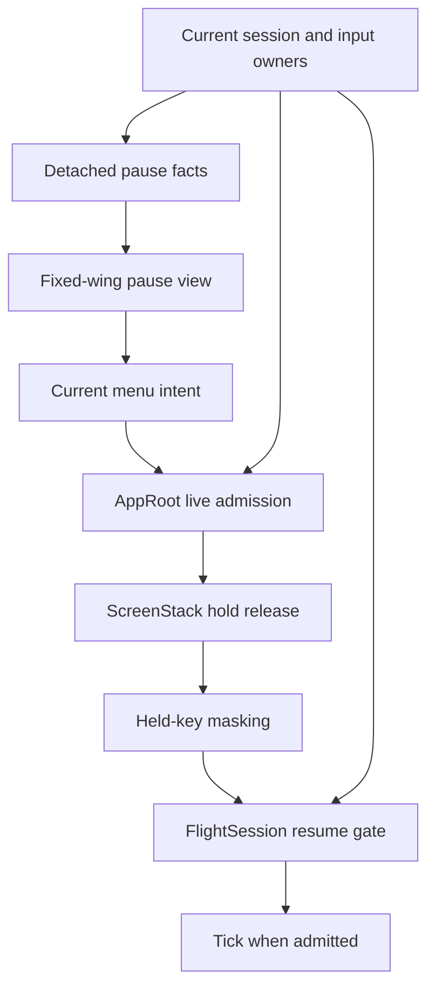

# Controls organization and implementation blueprint

**Revision:** 2026-11-21, following the plan at `8d61ca900a30686bc00eaf5ce80bee664e592a46`. **Runtime inspected:** `57abea025f62b20233ca281d58d2acbee4ab8b8e`, unchanged in this revision. **Deliverable:** a source-backed implementation design; no production repair, engine execution or device qualification.

The [VRC master plan](../../plans/vehicle-runtime-consolidation.md#6-step-plan-and-independent-changes) is the single implementation-status ledger. This document resolves its organization, first-consumer and persistence choices. The [control contract](CONTROL-CONTRACT.md) owns shared acceptance semantics; [control-cases.json](control-cases.json) owns the forty proposed cases. This revision refines those obligations without marking any case executed. The [source map](organization-map.json) pins the inspected owners, proposed destinations and work-package dependencies. [Primary-source research](PRIMARY-SOURCES.md) separates external guidance from evidence about this engine and game.

## 1. What will become one coherent system

The target is one understandable Controls workspace, one saved-profile authority for migrated routes, and one owner of each decision. The player should be able to identify the flight and menu controllers, edit a profile, understand which changes are saved or active, recover from a refused operation, and return to the activity without an accidental command. A complete setup-to-command path is the unit of delivery.

| Unify | Concrete decision | Boundary retained |
| --- | --- | --- |
| Player entry and terminology | Build on the existing Controls screen, its drafts, calibration and explicit Save. Present flight/menu roles and the scope of each saved value consistently. | Home, direct launch and experimental activities retain their actual navigation/recovery routes until separately migrated. |
| Profile meaning and validation | Reuse `controller_profile.gd` and `controller_actions.gd`; fix range and supported-consumer gaps in their owners. | Radio absolute throttle, gamepad rate throttle, AUX ownership and each family's command semantics remain distinct. |
| Saved controller data | Use the existing `ControllerProfileStore` as the eventual authority for profiles and their dependent menu-profile preference. | `settings.cfg`, display preferences, flight recordings and session state keep their separate contracts. Direct legacy routes migrate deliberately. |
| UI knowledge of a flight | Characterize the fixed-wing pause consumer; extract a small projection only when it removes a named duplicated decision or dependency. | AppRoot, ScreenStack and the family session retain admission, holds and transitions. |
| Storage feedback and recovery | Define outcomes for publication, activation, restoration and uncertain recovery. Use them in every migrated caller. | A legacy assignment active for this flight but unsaved remains a distinct current behavior until repaired. |
| Evidence and work ordering | Keep VRC status in the master plan, case definitions in the JSON ledger, and dated receipts in evidence. | D6/UI/family tracks still own their fixes. A plan entry is not a runtime pass. |

This organization uses the existing `app/input`, `app/ui`, `app/app_state` and family directories. It does not require a new top-level controls framework. The shared kernel already exists; the useful consolidation is at ownership and handoff boundaries. [Existing architecture](../../STACK.md#boundaries-and-data-flow) and [controller plan](../../plans/controller-support.md) remain authoritative for implemented behavior.

### What the first release of this work actually offers

The first cohort characterizes the fixed-wing pause display and proves its interaction with the existing Continue path, while prioritizing independently owned confirmed controls repairs. Keep its current implementation when a new helper does not remove real coupling. The cohort is complete when its selected interaction and recovery paths pass their gates, even if no new wrapper or optional cross-family extraction is warranted. Full keyboard remapping, universal direct-route Controls access, a persistent explicit flight-device preference, a portable profile bundle and a multi-profile Save All are additional features with their own acceptance, not effects of moving files.

## 2. Code organization and dependency rules

Paths labelled **proposed** do not exist as implementation in this branch. Existing paths should remain in place during characterization; avoid a directory move that obscures a behavior change.

| Path / owner | Responsibility after the relevant slice | Allowed collaborators | Keep out of this owner |
| --- | --- | --- | --- |
| [controller_registry.gd](../../../app/input/controller_registry.gd) | Connected-device observations, current role selections and connection generations | Input backend / injected observations | Persistent physical identity inferred from a numeric handle; profile disk writes |
| [controller_profile.gd](../../../app/input/controller_profile.gd) | Profile validation, conversion, calibration merge and conditioning definitions | Pure profile/action helpers | Scene-tree state, automatic controller selection, menu focus |
| [controller_actions.gd](../../../app/input/controller_actions.gd) | Semantic binding data, source conflicts and action matching | Validated profile data | Claiming every admitted binding has a consumer; family transition implementation |
| [controller_profile_store.gd](../../../app/input/controller_profile_store.gd) | Stored profile set and menu preference; cooperating-process lease, load/validation/publication/recovery | Profile validation and existing legacy import reader | Activating a flight, changing roles, UI strings as the sole machine-readable result |
| [controller_service.gd](../../../app/input/controller_service.gd) | Managed role/profile resolution and the transaction coordinating storage with session activation | Registry, store, profile validator, current session through existing API | Another readiness cache or a second persistent profile collection |
| [rc_calibration.gd](../../../app/input/rc_calibration.gd) | Existing calibration algorithm and compatibility entry points; repair legacy read/write behavior in place first | Profile validation; a transaction helper only if the repair benefits from it | New format migration hidden inside a refactor |
| **Proposed, conditional:** `app/input/controller_profile_access.gd` | Small stateless direct-route adapter after the storage transition is specified; resolve a current observation, return an explicit result, delegate to the existing store | Store and legacy compatibility entry points; caller-supplied device snapshot | Autoload, role registry, global cache, direct activation or silent legacy/V2 dual writes |
| [rc_input.gd](../../../app/input/rc_input.gd), [family input adapters](../../../app/input/) | Event evidence, polling, normalization, edges and family-specific input frames | Profile/action helpers and injected readers | UI state, disk work on every tick, per-stage resampling |
| [AppRoot](../../../app/app_root.gd), [ScreenStack](../../../app/ui/screen_stack.gd) | Shell context, menu holds, focus/capture and guarded player intents | Current activity/session and input owners | Generic simulation stepping; treating a UI snapshot as admission |
| **Proposed, conditional:** `app/ui/fixed_wing_pause_controller_status.gd` | Read-only controller-attention subprojection if characterization justifies extraction | Current fixed-wing session read surface; parent-bound current identity | Input polling, mutation, file access, persistent readiness or transition methods |
| [pause_menu.gd](../../../app/ui/pause_menu.gd), [controller_setup.gd](../../../app/ui/controller_setup.gd) | Render status; edit isolated drafts; submit intents; preserve focus and useful error text | Parent-injected callbacks / projection; existing UI helpers | Deciding a physical transition or deriving durable success from `ok` alone |
| Family activity and session | Family admission, first accepted command, reset/recovery and recorder ownership | Input owners, `Simulation`, family models | A universal resume/reset superclass |
| [Simulation](../../../app/sim/simulation.gd) / [VehicleModel](../../../app/sim/vehicle_model.gd) | Existing float64 240 Hz transaction and model contracts | Installed pure model callbacks | Dependencies on UI, controller storage or the new projection |

The adapter names above are concrete proposals so a developer can scope a PR. The fixed-wing PauseMenu is the chosen first consumer to characterize; a new projection is conditional. Its flat view still leaves other session/radio reads in the menu, so moving flags alone does not demonstrate reduced coupling. Name a duplicated owner decision eliminated or a dependency removed before creating it. **Default decision if no such benefit is established: retain the existing reads and prioritize confirmed dispatch/storage repairs.** Create the direct-route adapter only when the storage migration has a supported consumer and an accepted compatibility contract.

Dependency checks should target these boundaries, not ban all existing cross-layer references indiscriminately. At minimum, a moved input/storage helper must not import `app/ui` or `app_root`; `Simulation` must not gain a controller-store or pause-view dependency; the new projection must not call poll, save, resume, reset or tick. Review call sites and intentional injected callbacks, since a text import scan alone cannot prove those properties. [Godot scene guidance](PRIMARY-SOURCES.md#organization-and-detached-values) supports parent-supplied dependencies; the local ownership map determines the actual design.

## 3. First consumer: fixed-wing PauseMenu

### Existing chain to preserve

The real surface is already shared by fixed-wing and helicopter; it is not a new generic vehicle UI. [AppRoot.open_pause](../../../app/app_root.gd) creates/binds the menu, connects Continue, pushes the screen and calls `show_for`. The menu's button and Back route emit `continue_requested`. `AppRoot.continue_flight` checks the current screen, flyability, the applicable verified-radio center condition, controller loss/arming and independent holds. `_close_pause` pops the screen and masks held keyboard axes; `FlightSession.resume` applies its own readiness/crash/fault rules. See the pinned symbols in [the source map](organization-map.json).

This diagram describes required order; it does not assert that every stale-source interleaving is already guarded. AppRoot reads fields maintained by callbacks and polling rather than explicitly comparing every generation/profile at `continue_flight`. C01/C02 must exercise a source/profile change **after the displayed status and before the next poll/request**. If that reveals an unsafe path, repair its current owner separately before changing intent routing. A display-only projection can proceed with its own independent proof.

### Proposed surface and data

If the extraction passes the benefit gate, use a small read-only projector in `app/ui/fixed_wing_pause_controller_status.gd`, with one proposed operation, `capture(session) -> Dictionary`. Reading a live owner is observational, not a mathematically pure function. Its parent-injected provider binds weak references to the originating flight/session/menu. Before capturing, check actual current identity and pause **stack membership**, including when Controls or Help covers Pause; a read does not require Pause to be the top screen. A stale provider returns an explicit unavailable result and never falls through to the replacement flight. The intent gate, if later changed, does require the current top pause surface.

The first return shape is flat: `availability` (`known` or `unknown`) and `externally_selected`; only the externally selected route includes the observed `lost`, `connected`, `armed` and `is_gamepad` booleans. Do not eagerly read `session.radio` on routes/fakes where external selection is false. These are the owner's observed flags, not an independently reverified current-profile admission result. The helper never calls `RcInput.poll`, causes calibration, resolves a profile from disk or alters a hold.

This is one controller-attention subprojection. Flyability, pause/crash/calibration copy, holds, throttle/collective value, backend, failure and companion displays remain on their existing paths. A passing small extraction cannot close the complete VRC-01/04 status/intent scope. Extend the projection only when another actual consumer justifies a field.

Use scalar/string/enum values. Do not return a Node, Resource, live `radio.profile`, callback or mutable session collection. `Dictionary.duplicate(true)` still shares Resources and `make_read_only()` is not recursively immutable; the flat view avoids that problem. Test mutation of the first snapshot, a second snapshot and owner values. [External API evidence](PRIMARY-SOURCES.md#organization-and-detached-values) is guidance; the proposed view still needs its pinned-engine test.

### Compatibility and refresh

- AppRoot supplies the projection only for fixed-wing. Keep `PauseMenu.show_for(session, ...)` and its existing fallback for helicopter, standalone menus and fake fixtures until their own migration.
- Preserve existing button semantics: Continue is enabled by `is_flyable`, not a newly invented `can_resume`. A controller-attention state may guide recovery while the button remains enabled. A crashed fixed-wing Continue can close the menu and leave the flight paused; [test_ui_pause.gd](../../../app/tests/test_ui_pause.gd) already asserts that distinction.
- Preserve attention calculation each rendered frame, its one-second gamepad recovery-button delay, the 0.1-second text/value refresh and immediate refresh call sites. The provider is read on demand and never cached as authority. Avoid large copies at 240 Hz or setting a new latency target from this display timer.
- Keep localization in the UI; translate existing reasons consistently. Preserve focus, recovery-button delay, controls access, failure/backend display, layout and screen reuse behavior.
- The returned view does not claim all current generation/profile checks have happened; no stored view can grant a transition.

Target only the controller branches of `_session_status_text`, `_focus_primary`, `controller_attention` and `_refresh_controller_recovery`. Keep their fallback and public helper behavior. If the injected view is unavailable, do not show a ready-controller claim; keep the existing flyability button rule and admission route. Protecting this provider does not automatically protect the old deferred `refresh()` callback, which reads other session fields. Either characterize that callback separately as still unqualified, or add a narrowly scoped validity/membership guard and its own replacement test; do not claim whole-menu retirement from the new provider test alone.

Workshop can temporarily detach the original PauseMenu/session for a trial and later reattach those same objects. The provider should be unavailable while detached and work again when its original owners return; do not permanently retire it or close the recorder on temporary suspension. Include this actual trial-return fixture if binding/lifetime changes.

### Intent boundary and optional origin guard

The intent boundary and its proof remain required; a **new wrapper** is optional. The existing AppRoot signal/Continue chain can satisfy the minimal boundary if characterization proves its required contract. If it needs an origin guard, the smallest added target is a private AppRoot function such as `_continue_from_pause(expected_activity, expected_session, expected_menu)`. Bind weak references when that menu is shown. Before forwarding to `continue_flight`, confirm the targets are valid, not queued for deletion, still attached where required, and exactly the current flight/session/top pause surface. Revalidate after actual deferred/await boundaries and relevant reentrant owner operations. Retain existing direct no-argument callers until deliberately migrated. A status-only pass does not close the unproven intent contract.

This guard checks origin as well as current state. Merely looking up the new current flight when an old event drains can apply A's intent to B. The existing `_finish_controller_launch(target)` already checks its target and provides a local pattern. The unparameterized deferred pause at AppRoot's focus/continuity callbacks and quad's deferred source selection are **source-derived investigation scenarios**, not newly reproduced defects. Changing them needs a discriminating old-A/new-B or reused-handle witness, without breaking deliberate current-source recovery.

Separate origin-bound commands from scheduled reconciliation. Quad `_sync_selected_controller()` intentionally reads the current selection when it runs. A callback scheduled by an older event on the **same** activity may still need to rebind/hold the current source; dropping it unconditionally can break recovery. Retired activity A cannot mutate replacement activity B, while current-activity reconciliation must retain the owner's policy without borrowing old authority.

`continue_flight()` and `resume()` return `void`. Do not report a new `accepted/resumed` result from a forwarded call or menu disappearance. Refresh actual owner state afterward; a future explicit result API requires its own characterization. Keep reset, restart transaction, exit, recorder finalization and disposal outside this bridge.

### Caller and test inventory for this slice

| Consumer | Treatment / acceptance |
| --- | --- |
| PauseMenu Continue button and Back/close | Exercise the actual signal and screen route once each; no double connection or duplicate request. |
| AppRoot `open_pause`, `continue_flight`, restart refreshes | Preserve current `show_for`, `status_text` and `refresh` call sites or migrate them explicitly. |
| Main pause signal and AppRoot controller/focus routes | Keep source-to-menu ownership; late callbacks must not act on a replacement. |
| `debug/godtest_driver.gd` actual Continue button | Preserve the real UI automation route. |
| `test_ui_pause`, `test_controller_pause_recovery`, `test_ui_screen_stack`, `test_radio_menu_journey` | Extend only missing actual-owner oracles. Existing test names alone do not prove coverage. |
| Helicopter in `test_ui_home`; standalone/fake PauseMenu, layout and backend helpers | Keep the existing route intact and prove compatibility where affected. |

The [machine-readable inventory](organization-map.json) also names tests that call no-argument `continue_flight`: settings integration, dead-end recovery, quit, help, controller menu and pause. Re-run call-site search at the implementation commit; this source snapshot cannot enumerate future callers.

Required first-slice cases are C01–C04, C05–C07, C24, C30, C33–C34 as applicable to its actual changes. Status-only changes do not automatically require a new flight-recorder or physical-device campaign. Routing/admission changes expand the Q1/Q3 scope and need real first accepted command/tick observations; post-conditioned replay is insufficient for raw-input order.

## 4. Launch and settings scope

The [route map](organization-map.json) records the inspected source entry points. At implementation, fill in exact fixtures and flags for each route actually touched. A supported CLI entry and a manually instantiated standalone session are different rows.

| Route | Current controls authority | Persistence / recovery consequence |
| --- | --- | --- |
| Home fixed-wing and helicopter | AppRoot ControllerService plus registry; shared shell PauseMenu; family session activation | Managed V2 profile Save and current menu preference. Preserve each family's admission and the visible Controls return path. |
| AppRoot direct fixed-wing / direct helicopter | Early direct route can run without ControllerService; session uses its direct input path | Legacy calibration and direct smoke where applicable. No implicit adoption of Home preferences. Keep keyboard recovery and existing pause capabilities. |
| Home airship | Activity receives the managed registry/profile resolver; activity owns its live armed check and native menu route | GCA-02/03 gate the relevant role-map/retry migration. Present recovery actually reachable today: Home → Controls → relaunch. |
| Direct / standalone airship without injected registry | Its input adapter connects and reads legacy calibration | Do not add a mandatory service to share persistence. Distinguish supported launcher from a component fixture. |
| Home quad | Managed registry/resolver injected into activity | Quad owns source continuity, held fallback, readiness, arming and first accepted tick. |
| AppRoot direct quad | Quad creates its own ControllerService for the direct route | This is a managed V2 route, not the no-registry fallback. |
| Standalone quad with no registry | Explicit component fallback uses legacy reader | Preserve only the scope offered by that route; do not transfer the Home qualification claim. |
| Fixed-wing Workshop trial | AppRoot's actual trial launch/attach path and trial-specific navigation | Verify profile/service attachment and borrowed-menu lifetime at the affected entry. Trial is not a new persistence authority. Other family trials need their own inventory before expansion. |
| Ground, optional cohort | Its activity/input/session contract | Characterize the exact route before migration; no ground qualification follows from a fixed-wing pass. |

### What Save currently covers

| Value | Current saved/active behavior | Design consequence |
| --- | --- | --- |
| Selected profile's axes, calibration, conditioning, actions and AUX | V2 profile storage, after validation; Save returns the canonical stored form | Preserve the stored form for runtime, dirty-state baseline and restart. Do not apply the unrounded candidate after acknowledging a different saved form. |
| Menu controller preference | Stored with the profile as keyboard, profile UUID, or automatic/empty according to the selected route | Resolve a currently eligible unique match on restart; do not persist the OS handle. |
| Explicit flight role / device handle | Current-run choice; startup can automatically select from observed devices/profile matches | Do not claim that Save persists an explicit flight-device selection. Adding that feature requires an ambiguity/disconnect/restart policy. |
| Multiple profile drafts | Current Save commits the current profile; other dirty contexts remain and the UI says so | Preserve per-draft dirty state. Save All needs an explicit multi-profile transaction and conflict policy. |
| Keyboard flight axes | Fixed physical-key layout in [keyboard.gd](../../../app/input/keyboard.gd) | D6-UX-02 remains pending. V2 keyboard semantic action bindings are a separate capability. |
| HUD stick mode / radio model | Display preferences in [preferences.gd](../../../app/app_state/preferences.gd) and [overlay settings](../../../app/render/overlays/overlay_settings.gd) | Do not describe the visual Mode 1/2 setting as remapping the keyboard flight axes. |
| Reset controls action | Existing Controls reset changes the action map in the draft | Do not relabel it as resetting calibration, conditioning or the whole profile. |
| Direct calibration / smoke | Legacy storage; assignment may activate before write | Preserve explicit active-but-unsaved feedback until an owning behavior change replaces it. |

These distinctions belong in the Controls design and developer contract. Player copy should state the practical result, such as “Saved”, “Active for this flight; not saved”, or “Could not restore previous settings; review Controls”, rather than expose internal transaction implementation.

### Action-to-consumer coverage

[action-consumers.json](action-consumers.json) records all 37 current semantic action definitions and six AUX channel names from `ControllerActions`, plus five bounded quad source examples. It is an evidence checklist, not a new runtime support registry. Remaining activity/route/form combinations are explicitly uncharacterized. Extend it for each migrated family before claiming every offered assignment works.

Use one row per activity, actual entry route, action, binding form, context and default/override policy. Record the visible offer, effective profile source, actual consumer, expected command or explicit unavailable explanation, and a real assignment → Save/reload or activation → dispatch witness. Include relevant key/chord, gamepad button, radio button and learned-axis forms; AUX and fixed P/Escape/flight axes have separate witnesses. An action ID or validator pass cannot establish consumer coverage.

For example, quad-selected Controls can show `throttle_cut` because its capability requirement is empty, while quad input explicitly excludes inherited throttle-cut dispatch and AppRoot bypasses generic flight routing for that activity. A unique explicit assignment and real quad journey must discriminate its runtime effect; this revision records a source-derived potential misleading offer, not a new confirmed incident. The known GCA-01 Pause gap separately requires per-form proof. Hide/refuse unsupported **current-family** assignment with an explanation without deleting valid shared-profile bindings for other families.

## 5. One persistence authority, with explicit failure outcomes

### Reuse the existing transaction

The V2 store already validates the profile collection, serializes cooperating access using a directory/token lease, converts profiles to a ConfigFile encode/parse fixed point, validates temporary read-back, stages a rollback copy and publishes the primary. The service holds an outer lease while it coordinates that publication with activation. Keep these working parts; do not replace them with a second generic repository. [Store](../../../app/input/controller_profile_store.gd), [service](../../../app/input/controller_service.gd).

The lease has a specific scope: cooperating callers and the same store instance's nested operations. A future adapter must hold that outer lease across snapshot → publish → activation → attempted restoration, or use a verified expected-current-state condition. `restore_snapshot()` by itself reloads for readability and rewrites the supplied whole snapshot; releasing the lease between save and restoration can overwrite another acknowledged commit. An activation callback must not yield with the lease held or take it through a different instance without a defined nonblocking protocol. Characterize synchronous signal reentry as well.

### Proposed outcome contract

Existing `ok`, `profile`, `error` and `warning` are not enough to infer every failure's state. In a separately scoped D6/UI repair, retain compatibility with them while adding only the explicit publication/runtime/role outcome fields that callers need. Do not parse English error text to decide safety. The exact GDScript representation can remain a Dictionary; a new framework is unnecessary.

| Observed phase/result | Required statement and state handling | Regression observation |
| --- | --- | --- |
| Validation, busy lease or prepublication refusal | No acknowledged update. Preserve the editable draft and previously known state where no mutation occurred. | File/profile/roles unchanged; no activation callback for a rejected preflight. |
| Publication succeeds; requested activation succeeds or is not applicable | Report saved, and separately applied only when activation was requested and observed. Keyboard/unassociated/no-session saves can have no profile activation. Retain any cleanup warning. | When a connected flight profile is activated, runtime equals the canonical stored form; otherwise inspect the saved record and declared role outcome without inventing an active profile. |
| Publication succeeds; activation refuses; every attempted restoration succeeds | Report rejected and restored. Distinguish unchanged components from restored components. | Previous disk profile set/preference, role selection and active runtime profile all verified; draft retained. |
| Publication fails after staging, or activation refuses and any restoration fails/is unobserved | Report the known component outcomes and a reconciliation-required result. Preserve recoverable files and draft; no auto-Continue or assumption that `ok=false` means “unchanged”. A repair must keep the affected route held until the owner re-admits known state. | Inject failed commit, failed storage restore, failed role restore and failed runtime reapply separately. Inspect disk, runtime, holds, UI and restart. |
| Legacy applies successfully but publication fails | Truthfully report active for this flight and not saved; keep existing safe recovery until an intentional repair changes the order. | Current profile/command differs from restart state, and the UI states that distinction. |
| Publication succeeds but old rollback-copy cleanup fails | Saved with warning, not a rejected save. | New primary reloads; any actual activation matches the canonical form. Restart roles follow documented selection policy; cleanup warning stays visible. |

Current code is not uniformly at this target. Full Controls Save reports storage/role/runtime restoration separately; the narrower in-flight `apply_profile` route does not check the previous-profile reapply return. Controls `_save_profile` prefixes any false result with “Profile was not saved”; managed smoke substitutes a generic unchanged-profile message and discards the richer error. Both need fault-specific caller tests before claiming truthful recovery. These are source-backed design gaps; no new runtime failure was executed in this revision. [Service](../../../app/input/controller_service.gd), [Controls Save](../../../app/ui/controller_setup.gd), [smoke caller](../../../app/main.gd).

Reconciliation must re-read under the existing lease, retain actual error/recovery provenance, revalidate current connection and intended profile, then request family-owned activation while held. Keep unknown disk/runtime states explicit; offer review/reload/retry only when the specific operation is safe. Do not automatically erase a busy/stale lock by elapsed time or PID alone; the present store deliberately refuses automatic lock reclamation. Recovery tooling must establish that no writer can still own the data and preserve recoverable bytes.

### Stale edits are separate from write serialization

Source inspection establishes a whole-profile replacement by `profile_id` after the store loads the latest set. No expected persisted base is passed by Controls. Therefore two sequential, successfully serialized saves can still overwrite disjoint edits made from the same old profile. The same risk applies to calibration/smoke candidates derived from a cached runtime profile. This is a **code-derived scenario pending a runtime witness**, not a reproduced incident or a claim that the existing API promised conflict detection.

Adopt this proposed behavior for the robust-save repair:

1. At draft creation retain the actual detached persisted base profile, including association, or an explicit “absent” base for a new UUID. The UI's `_clean_snapshots` is not that base: its dirty fingerprint removes association. Keep device-connection leases and stored-profile bases separate.
2. Under the existing write lease, compare the current stored target with that exact stored base. Use the canonical loaded/stored representation. If it changed, refuse publication, preserve the draft and latest stored value, and ask the player to review/reload or deliberately resolve it. Do not silently field-merge calibration, action or AUX semantics.
3. Treat menu preference as a separate conflict domain with an explicit operation policy. **Full Controls Save commits device-role intent:** if its captured durable menu preference changed elsewhere, refuse and require review, even when this draft's menu selector was untouched. This avoids silently splitting an acknowledged setup between B's old active role and A's new next-start preference. If the player explicitly edits the menu role, compare its base as well. **Narrow calibration/smoke saves do not edit menu preference:** preserve its latest durable value and never activate another process's UI choice implicitly. Existing safety-driven role invalidation remains with the owner and must be reported truthfully.
4. Carry the base through all relevant writers: full Controls, managed calibration, managed smoke and any new direct adapter. Capturing the latest base just before saving an old full candidate would falsely legitimize the stale candidate. A calibration merge against a new base needs its own semantic validation and explicit conflict policy.
5. A different UUID update can proceed when its own base, required preference base and relevant association/selection dependencies remain valid. Two new/imported UUIDs for the same device may create an ambiguous match; an intentional Duplicate can do so too. Specify permitted explicit duplicates versus conflicting concurrent imports; do not silently impose global association uniqueness. Unknown/corrupt/busy store is an error, not an absent base. Test deletion/recreation, truly unrelated devices, new/imported profiles, canonical float round trips and association changes.
6. Bind a legacy-derived draft to its actual legacy source as well as its absent/new V2 UUID. Otherwise L1 can be converted, a legacy writer save L2, and an absent-UUID check still publish L1 into higher-priority V2. Require source validation under coordinated leases through migration publication, with a defined lock order, or restrict migration while legacy writers can operate. A separate legacy lease alone is not a cross-file transaction, and old binaries do not participate in it.

Content comparison is the smallest proposal and does not require a new persistent revision service. It does not detect an A→B→A history if the current values are exactly equal; require a durable per-record revision only if the owner establishes that intervening history itself matters. Per-instance `revision`, file mtime, `storage_signature`, profile UUID and `preset_revision` do not already provide that optimistic-concurrency guarantee. Preserve generation/mapping checks for live authority independently.

### Legacy migration and rollback

Repair GCA-04 in the current legacy format first when touching its writer. Add one cooperating transaction around both `save_profile` and `save_smoke_binding`, with separate missing/corrupt/busy/error outcomes and the required reader/caller proof. This is useful even if direct launches never migrate. GCA-05 range admission remains a separate numerical repair.

Only then consider the proposed stateless direct adapter to the V2 store:

- Inventory whole-radio calibration/AUX profiles **and** gamepad-only legacy `smoke_binding` sections. `import_legacy_radio()` covers the former, not the latter. Preserve original bytes and unsupported data; do not report a complete import from a radio-only pass.
- Surface unreadable-source and skipped-section errors returned by the importer. The current Controls importer ignores those results and can present an unreadable source as no valid profiles. Distinguish absent/no candidates, read failure and partial candidates; a safe explicit import never overwrites the original file.
- Keep current V2 precedence over fallback legacy matches. Ambiguous observations, unsupported schema, corrupt storage and a temporarily refused resolver are distinct from “no saved profile”. A UUID is profile identity, not a serial number.
- Preserve family activation semantics until their explicit repair. A reader adapter must not silently change a direct path to transactional activation or select a new flight device.
- Recheck live identity/uniqueness at direct write boundaries. Direct smoke lacks the calibration caller's equivalent uniqueness recheck; duplicate-descriptor arrival during assignment is a proposed discriminating case, not a confirmed live incident.
- Define old-reader/new-writer and old-writer/new-reader behavior before cutover. Old binaries do not honor a new lease; readers can also observe a partial or temporarily missing path. Prove publication with open handles/missing-path windows on the supported OS/filesystem, or exclude unsupported simultaneous old readers as well as writers. Dual-writing legacy and V2 is not a safe shortcut. Preserve the old file for deliberate rollback and establish a compatible protocol or explicit coexistence restriction.
- Do not delete legacy data or switch all direct routes together. Migrate one route, prove startup and retained-baseline compatibility on copied files, then retire its old writer with a documented removal condition.

The intended endpoint is one authority for saved controller profiles on migrated routes. Compatibility readers may remain while their users need them; they do not become an equally authoritative competing write path.

### Publication and durability

Define “Saved” as successful process-level publication and report “Applied” separately when activation was requested and observed; activation can be not applicable. Verify restart behavior under the declared route. A checked rename/read-back is not evidence of survival through power loss. The current Godot API documentation, Linux file/directory synchronization requirements and Windows buffering guidance do not qualify this game's complete transaction on every filesystem. Stronger durability needs platform-specific implementation inspection and a fault campaign; no such claim or mandatory new native storage layer is introduced here. [Research and its limits](PRIMARY-SOURCES.md#publication-is-not-power-loss-durability).

## 6. Work packages the team can take

These are scoped deliverables under existing VRC/D6/UI/family steps, not a second status ledger. The [master table](../../plans/vehicle-runtime-consolidation.md#6-step-plan-and-independent-changes) remains open for implementation. A package may be divided when its proof would otherwise mix behavior repair with extraction.

| Package / owning step | Concrete change | Files and prerequisite | Required exit evidence |
| --- | --- | --- | --- |
| Baseline and first-consumer characterization — VRC-00/01 | Capture real Pause button/Back, current status, crash Continue, held keys and change-before-poll interleavings | AppRoot/PauseMenu/FlightSession fixtures; establish missing assets and runner admission | C01–C07, C24, C30, C34 scoped receipts; no inferred pass from fakes or menu closure |
| Fixed-wing consumer — VRC-04/08 | Prove the current consumer; extract controller facts only if a named duplicated decision/dependency is removed | Existing PauseMenu by default; conditional proposed `app/ui/fixed_wing_pause_controller_status.gd` and parent injection | Concrete benefit or documented retain decision; same focus/recovery/cadence, covered/trial-return behavior, no new sampling, helicopter/fake compatibility |
| Origin-bound intent, only if justified — VRC-04 | Bind originating activity/session/menu and forward through existing Continue | Private AppRoot helper; C01/C02 owner repair if necessary | Old A cannot act on B, actual button/Back once, existing holds and crash outcome preserved |
| Save result and recovery repair — D6/UI, before affected VRC-03/08 move | Expose storage/runtime/role outcomes; repair callers' misleading generic failure copy; verify runtime restoration | ControllerService, store only where needed, ControllerSetup and Main smoke callback | Expanded C02/C21/C22 fault matrix, cleanup warning, readable recovery, no implicit resume |
| Stale-editor conflict repair — D6/UI, before affected VRC-03 move | Compare persisted target/preference bases under the existing lease for every migrated writer | Store/service/setup/calibration/smoke; compatible result contract | C22 sequential two-editor witnesses, distinct-profile nonconflict, preference conflict, canonical reload and restart |
| Known baseline repairs — existing GCA owners | Separate regressions/fixes for GCA-01…05 in their owners | Only relevant repairs block their affected seam; retain adverse baseline witnesses | Repaired real-consumer or numerical/persistence oracles, plus affected regression gates |
| Direct-route persistence migration, conditional — D6/families with VRC-03/05 | Resolve all legacy shapes and transition/rollback policy; migrate one route through stateless access | Proposed adapter only after compatibility acceptance; GCA-04/05 dependencies where touched | C13–C14, C21–C24; gamepad smoke, ambiguity, copies of original files, retained baseline build, unsupported old writer policy |
| Next family — VRC-05 | Helicopter, then airship, then quad, each only if the prior seam is useful | Preserve family adapters; affected GCA repairs | Own first accepted command, menu/recovery/arming and recorder scope; no transferred qualification |
| Attributed optimization — VRC-09 | Measure one hot path, then change one source of cost | Existing input instrumentation/runner; correctness before timing | Matched workloads and identities, median/p95 and tail/input-age scope; no claim from callback count alone |
| Cohort qualification and removal — VRC-10/11 | Remove only replaced route/dependency; document supported scope | Affected package/platform/device owners | Required CI and target receipts, rollback/data compatibility, no long-lived dual authority |

For each implementation PR, record the exact source base, changed symbols, route/fixture, expected results, affected cases, separately owned behavioral change, and rollback of code **and** player-data interpretation. Proposed filenames are not an instruction to bulk-create scaffolding. A reviewer should be able to identify one behavior/ownership boundary and its decisive evidence without a broad rename diff.

## 7. Discriminating checks added by this refinement

These expand existing cases; they are all **UNRUN**. The case ledger records the refined obligations. Establish the expected policy before implementation so a baseline failure does not become an accidental golden.

| Existing case | New precision | Independent oracle |
| --- | --- | --- |
| C01/C02 | Change live source/relevant mapping after status render and before next poll/Continue | Actual admitted source/generation/profile and first accepted command; stale displayed readiness cannot grant a tick |
| C03 | Queue A's command, replace activity with B, then drain; separately change source on the same activity before reconciliation; suspend/restore a Workshop menu | Retired A cannot act on B. Same-activity current-state rebind/hold remains valid without stale authority; temporary suspension can restore the same provider |
| C21 | Separately fail storage publish, activation, storage restore, role restore and runtime reapply; retain cleanup-success warning | Inspect all components and restart, not only `ok`; assert precise UI and hold/re-admission behavior for the repair |
| C22 | Two editors load P; A edits axes, B edits name, save sequentially. Also calibration/smoke from stale cached P | Proposed conflict refusal preserves A and B's editable draft; no success that silently restores A's old axes |
| C22 | Disjoint profile updates; concurrently edited menu preference; association conflicts and legacy-derived new UUID | Full setup reviews changed durable menu base; narrow writes preserve preference. Association/legacy source dependencies remain valid; genuinely unrelated profile writes proceed |
| C23 | Import radio profile plus gamepad-only smoke; run retained baseline after candidate save | Every declared preserved field has a consumer and reload meaning; original recoverable data remains; unsupported conversion is explicit |
| C23/C24 | Compare Home/direct/standalone quad, persisted menu preference, session-only flight choice and visual stick mode | Actual service/resolver and restart selection match the declared route; no false keyboard-remapping or stable-device claim |
| C30 | Mutate nested snapshot data; deliver old snapshot to a new menu; exercise crash Continue | No owner/other-view mutation; stale data grants no authority; request dispatch is not reported as resumed flight |

Detailed concurrency schedules should use fresh isolated files and controlled barriers in identified disposable test copies where necessary. Fault injection must target the real owner/caller, including the in-flight managed path, rather than just a fake store returning false. Run through the checked runner with terminal-summary, exit and engine-diagnostic criteria. The previous 22/27 batch is historical; this planning revision has no new gameplay result.

## 8. Adversarial decisions and remaining uncertainty

| Challenge | Decision in this revision | Evidence still needed |
| --- | --- | --- |
| A new shared manager or tiny wrapper could duplicate the system already present | Reuse registry/service/store. Retain pause reads by default unless the candidate projection removes a named decision/dependency; direct adapter conditional | The first implementation must demonstrate concrete benefit or record the simpler retain decision |
| The bridge could bypass shell checks or treat a dispatched void call as resumed | Keep complete existing chain; origin guards are additional, not replacement admission | Real C01/C02 timing witnesses and crash/menu-close observations |
| “Failed Save means unchanged” is too strong | Refine contract and case oracles; plan explicit restoration/reconciliation outcomes and caller copy | Inject each failure in both managed routes, legacy route and their real UI |
| A lock does not detect stale full-profile edits | Recommend per-record expected-content comparison under the existing lease; separate preference domain | Deterministic competing writers and approved behavior repair under D6/UI |
| One legacy importer is not a complete migration | Include separate gamepad smoke, V2 precedence, identity ambiguity and old binary behavior | Copied-file conversion, restart, retained-baseline and noncooperating-writer evidence |
| A shallowly frozen snapshot can still alias resources | Make the small view value-only and detach nested data | Pinned-engine alias/consumer tests |
| General Godot advice might change control feel | Keep existing event/poll/accumulation policy; do not import circular deadzones or a new input queue | Version-matched timing and family-qualified command/latency measurements |

No broad “everything is robust” claim follows from this design. Remaining choices are concrete: the exact observed failure behavior of the stale-authority scenarios, the owner-approved stale-editor/reconciliation repair, supported legacy coexistence, and target device/package qualification. The first developer can start bounded characterization and confirmed owner repairs without deciding a new simulation architecture, adding an unhelpful wrapper or forcing a storage migration.
