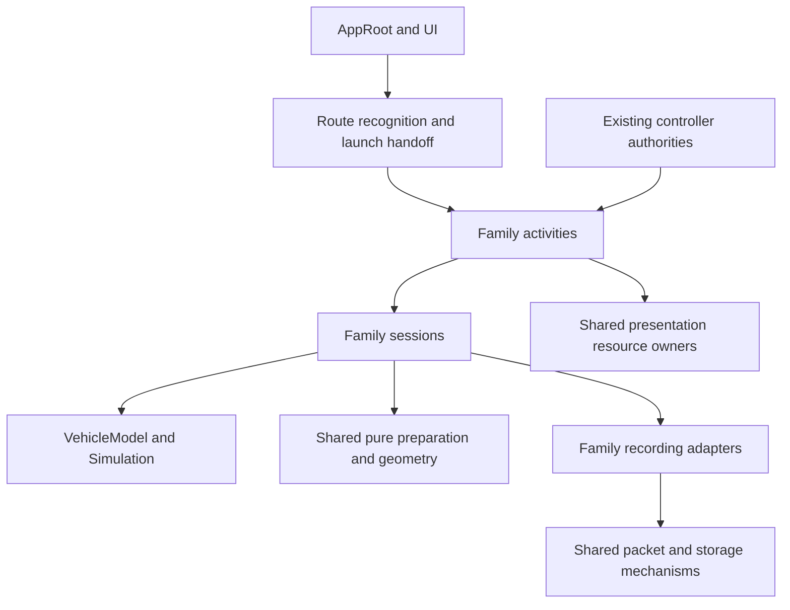

# OpenRC Simulator — vehicle system unification audit

| Review identity | Value |
| --- | --- |
| Date | 2026-11-22 (America/Bogota) |
| Repository | `bultodepapas/OpenRCsimulator` |
| Audited main | `7940a4081e10994f34c858c4acac3d7a1a271464` (v0.3.3 preparation) |
| Application tree | `fe6fdf080899707fab1a1dd4118a32481bca5e4c` |
| Scope | Source audit and implementation recommendations for fixed-wing aircraft, helicopter, airship, ground vehicles and multirotor. No production implementation, new runtime qualification or performance measurement. |

## 1. Executive decision

**Unify mechanisms with the same contract; keep vehicle laws and operational policies with their current owners.** OpenRC already has the important shared foundation: every family installs a `VehicleModel` into `Simulation`. The next investment should remove repeated coordination around that foundation, especially route selection, controller ownership, launch handoff, environment preparation, recording transport and presentation-resource lifetime. A universal vehicle superclass would turn existing differences into a growing collection of conditional branches. The current model boundary is a better foundation. [Shared architecture][architecture] [Model contract][vehicle-model]

This audit finds concrete duplication, rather than inferring it from similar method names. It also finds two control-flow problems that illustrate the maintenance cost of parallel ownership: an airship CLI request with another argument can fall through to the aircraft route; the ground activity's local controller registry does not inherit the separately selected Home menu role. Both are source-derived findings, not observations from a rendered session or physical controller. The latter also has a test that injects the missing local role, so that test does not establish the real Home-to-car handoff. Sections 4.1 and 4.2 trace the complete paths.

Recommended structural priorities are:

1. Give route recognition and each controller role one authority, repairing incorrect behavior in separate changes.
2. Extract the duplicated ORFL packet writer and the pure lake/collision checks, with two real consumers each.
3. Factor the common Home activity handoff for ground, blimp and quad after characterizing cancellation and rollback.
4. Consolidate controller candidate selection inside the existing service, retaining family recovery rules.
5. Extract repeated lens-resource lifetime mechanics when that removes a demonstrated maintenance burden.

Do not start with wholesale directory moves, a new simulation engine, a universal session, a universal checkpoint, or a universal battery/powertrain law. This review does not promise an FPS increase. Its immediate objective is fewer independent implementations of the same responsibility and fewer places to repair the same defect.

## 2. Relationship to existing work and evidence

The [existing VRC plan][prior-plan] and [migration matrix][prior-matrix] are already published on `audit/game-controls-2026-11-21`, pinned here at `3095afd95220232e8e659d53635acab5104ee94c`. Their runtime baseline is `57abea025f62b20233ca281d58d2acbee4ab8b8e`; they describe proposed work, not an implemented common API. This report refines that work against the newer main snapshot. It does not create a second master plan or mark VRC-00 through VRC-11 complete.

The controls plan's fixed-wing PauseMenu characterization remains its first controls slice. The packet and pure-environment extractions below are independent candidates under the existing VRC boundaries, not a reason to delay controls repairs. The prior five GCA findings and 40 acceptance cases are not rerun or closed here. Before moving their affected seams, reconcile their status and execute the appropriate existing witnesses. The [pending external audit ledger][audit-ledger] and completed ledger were reviewed to avoid treating old repaired findings as new defects.

Three bounded research helpers examined simulation/session boundaries, activity/presentation coordination, and input/catalog ownership. The lead checked the material source paths and integrated the recommendations; a separate adversarial review checked the integrated design and consequential findings. No engine, device, rendered, native-parity, package or full-CI campaign was run for this audit.

The initial readable checkout was the one-commit documentation-only child `8245859b3392eb08eea0d56dc07de0d834a12b5b`. Its `app` tree was verified identical to audited main. A fresh isolated checkout of `7940a408` was then used for inventory and final source checks. All source links below are pinned to audited main, not a moving branch.

### Measured source inventory

These are UTF-8 `splitlines()` counts, not complexity scores, removable-line estimates or performance measurements. The [machine-readable inventory](vehicle-system-unification-2026-11-22-source-inventory.json) includes all 16 inspected coordinator/recorder files, blob identities and the duplicate-scan method.

| Current owner | Lines | Top-level functions | Interpretation |
| --- | ---: | ---: | --- |
| `app/sim/flight_session.gd` | 6,697 | 339 | Broad fixed-wing coordination; isolate responsibilities incrementally |
| `app/app_root.gd` | 5,372 | 242 | Shell, routes, controller integration and transitions |
| `app/main.gd` | 4,303 | 151 | Fixed-wing presentation and activity coordination |
| `app/sim/ground_vehicle/session.gd` | 2,261 | 127 | Ground-specific run, recording, recovery and checkpoint ownership |
| `app/vehicles/multirotor/multirotor_scene.gd` | 1,663 | 94 | Quad activity, input recovery, presentation and race integration |
| `app/sim/helicopter_flight_session.gd` | 1,444 | 80 | Rotorcraft session and native/control admission |
| `app/vehicles/ground/ground_scene.gd` | 1,317 | 63 | Garage, driving, presentation and departure decisions |
| `app/sim/multirotor/session.gd` | 1,213 | 56 | Closed-loop plant, controller/race frame and accepted events |
| `app/vehicles/airship/airship_scene.gd` | 923 | 47 | Airship activity, controls, presentation and recording |

A bounded scan of those 16 files compared top-level functions after removing blank/comment-only lines, expanding tabs and trimming trailing whitespace. It did not rename identifiers or infer semantic equivalence. Four groups of at least eight retained lines were identical between airship and quad:

| Function | Airship | Multirotor | Retained lines per copy |
| --- | --- | --- | ---: |
| `_write_packet` | `sim/airship/flight_log.gd:187` | `sim/multirotor/flight_log.gd:212` | 18 |
| `_install_lake` | `sim/airship/session.gd:322` | `sim/multirotor/session.gd:366` | 15 |
| `_clearance` | `sim/airship/session.gd:502` | `sim/multirotor/session.gd:994` | 14 |
| `_failed` | `sim/airship/flight_log.gd:214` | `sim/multirotor/flight_log.gd:240` | 11 |

These exact matches establish specific extraction candidates. They are not the project's total duplication count. The larger launch and presentation routines contain common sequences mixed with real differences, so their full line counts must not be presented as duplicated or removable code.

## 3. What to share and what to preserve

| System | Shared responsibility | Responsibility that remains specific |
| --- | --- | --- |
| Simulation | Existing accepted-tick transaction, clock, state publication, model protocol and rollback | Each model's forces, state layout, events, sampling and integration policy |
| Controls | Device identity, profile storage, candidate ranking and shared input transport through existing owners | Throttle/collective/steering meaning, shaping, arm/hold/rearm and recovery |
| Launch | Route-family recognition and, where equivalent, Home handoff/rollback mechanics | Family argument validation, start configuration, prepared session and flight admission |
| Environment | Pure normalized-data checks and equivalent weather/surface construction | Weather domains, query timing, contact response, water behavior and native eligibility |
| Collision | Same-arithmetic proxy distance and shared world validation | Broad phase, candidate order, hull/rotor witnesses, contact timing and damage |
| Recording | Packet framing, digest chain, bounds, file-error handling and storage primitives | Record layout, checkpoint, accepted-event timing, replay and departure policy |
| Presentation | Resource construction/retirement and detached common observations | Cameras, HUD layout, rotor/propeller animation, audio meaning and effect events |
| Energy | Existing qualified primitives where their mathematical domain matches | Airship power demand, quad coupled bus, fixed-wing supply, nitro/glow and fuel laws |
| Data/catalog | Existing `VehicleRoster` projection backed by family catalogs | Family schemas, authored provenance, validation and admission |
| Tests | Common contract cases for the exact extracted mechanism | Family numerical, replay, recovery, device and physical qualification |

The existing [environment][environment], [controller service][controller-service], [recording transport][fixed-log-writer], [lens stack][lens-stack] and [model interface][vehicle-model] are the starting owners. Create a helper only when an existing owner cannot absorb the responsibility cleanly. A common name such as `resume`, `reset` or `checkpoint` is insufficient evidence of an interchangeable contract.

## 4. Findings and bounded remedies

The U identifiers below belong to this report. They are not a replacement implementation track. “High” means prioritize correctness or remove a consequential migration ambiguity; “medium” means a useful structural improvement. It is not a security severity scale.

### U01 — High: recognize requested vehicle routes before generic flight fallback

**Evidence.** `AppRoot._ready` recognizes the airship route only when the entire argument array has exactly one element. With `--airship=historico --quick-flight`, that branch is skipped, the quad recognizer reports no quad request, the unknown-ground-vehicle check does not match, and `wants_direct_flight` accepts any nonempty arguments. The call reaches `start_flight`; the aircraft parser stores arbitrary argument keys rather than rejecting the airship selector. By contrast, the quad recognizer explicitly rejects an additional argument. [AppRoot dispatch][route-dispatch] [Generic direct route][direct-route] [Aircraft parser][aircraft-args] [Quad route checks][quad-route-test]

**Consequence.** Source control flow permits a requested airship invocation to take the fixed-wing route. This is not a rendered reproduction, and no claim is made about the resulting visible flight on a particular installation.

**Remedy.** Add one route-recognition/refusal boundary in AppRoot or a small app-state helper. Recognize an explicit family selector independently of whether its arguments are valid; then delegate validation to that family's existing parser/catalog. Conflicting family selectors or an unsupported combination must produce a family-specific refusal before generic aircraft fallback. Keep direct-launch and Home preference semantics unchanged. Do not invent one global argument schema or automatically add options a family does not support.

**Acceptance.** Exercise a valid airship invocation, airship plus another option, malformed/unknown family IDs, duplicate selectors, conflicting families, both argument orders, valid aircraft technical arguments, no-argument Home and diagnostic routes. Preserve the higher-precedence input-report route and characterize the current `--airship=` empty-value fallback before changing it. Not every extra flag reaches fixed-wing: diagnostics and other recognized family selectors have earlier paths, and an explicit rotorcraft aircraft selector can choose helicopter. Include the production startup dispatch, not only a helper's returned dictionary. Extend `test_airship_activity.gd` or the appropriate startup check; retain `test_mr_activity.gd` direct-route cases.

### U02 — High: the ground activity duplicates menu-role authority and drops the selected Home menu pad

**Evidence.** Ground activity saves the supplied registry as `_source_controller_registry`, creates a new local registry, copies device observations, and selects only its local `flight` role. Its button acceptance checks local `ui` or `flight`, while GUI navigation is assigned to the local driving pad. AppRoot's UI-role callback calls the activity's refresh without forwarding the selected ID, and its ordinary controller event route exits while this activity slot is occupied. These paths do not supply the missing menu-role handoff. [Local registry and navigation][ground-registry] [Button acceptance][ground-button] [Shell UI callback][shell-ui-role] [Shell dispatch exclusion][shell-controller-exclusion]

`test_controller_car.gd` selects a menu pad in the source registry, launches the activity, and then manually selects that pad again in the activity's local registry before asserting that it can resume. The injected local assignment bypasses the production handoff being evaluated. The test also explicitly expects the driving pad to own garage navigation; preserve that distinction until an intentional product-policy change is specified. [Existing test][ground-role-test]

**Remedy.** Keep the garage's local driving selection and its neutral/reselection safety. Give the Home-selected menu role one authority: read it from the source registry or forward a detached role identity and its connection generation through the existing callback. Preserve the intended menu Start/Menu behavior separately from driving shortcuts. Decide explicitly whether separate-pad GUI navigation is supported; do not silently change the tested driving-pad navigation policy while repairing role propagation. Do not make the garage mutate the global aircraft flight role.

**Acceptance.** Launch through Home with distinct driving and menu pads, with no post-launch test injection. Check both pads' permitted Start/Menu actions, driving-only shortcut exclusion, UI-role changes, eligibility/revocation, disconnect/reconnect generation, loss of the driving pad, held buttons through garage transitions and Home restoration. The documented separate-pad Back action needs its own witness: copying a `ui` ID alone will not make `event.is_action_pressed("ui_cancel")` true while native GUI mapping still belongs to the driving pad. Route that action under an explicitly admitted owner; a connected raw device is insufficient evidence of menu eligibility. Use `test_controller_car.gd` and `test_controller_ground.gd` as starting points; synthetic success does not qualify physical devices. [Ground control guide][ground-controls]

### U03 — Medium: controller fallback ranking is copied and has a weaker consistency boundary

**Evidence.** `ControllerService` ranks saved-profile match, radio, known gamepad and other device under an outer store lease. Quad `_adopt_fallback_device` independently reproduces that priority and the ambiguous-Jeti rule, calling `match_profile` per device without a coherent outer lease. A failed store read is represented as no matches by the current store API. Selection can therefore be made from incomplete or separately read evidence. The subsequent managed profile resolution still fails closed: an empty profile does not grant a ready built-in pad mapping. This finding is about ownership and consistency, not evidence of unsafe flight. [Service selection][selection-service] [Quad copy][quad-fallback] [Store read and matching][store-matching] [Fail-closed connection][quad-profile-refusal]

**Remedy.** Put candidate ranking in the existing service, with one coherent observed-device/profile snapshot and an explicit busy/unknown result. Let the quad retain its lost-device exclusion, explicit keyboard choice, held state, confirmation and rearm decisions. Support its direct/standalone route deliberately; do not create a mandatory global singleton or duplicate persistent cache. Individual candidate reads already acquire leases; the missing boundary is one consistent ranking operation. Decide busy/corrupt-store behavior as an intentional owning-policy repair, separately from a behavior-preserving extraction.

**Acceptance.** Retain priority and ambiguity checks in `test_controller_auto_defaults.gd`, and activity fallback/keyboard checks in `test_mr_activity.gd`. Add store-busy/interleaved-profile-change, equal-priority, selected-device generation and reconnect cases. A helper selecting a device must not independently arm, resume or write profiles.

### U04 — Medium: three Home activity launches repeat one handoff transaction

**Evidence.** `start_ground_vehicle`, `start_airship` and `start_multirotor` repeat the Home preparation drain, post-await guard, activity exclusivity check, Home detach, candidate construction, startup check, successful publication, and failure restoration. Family configuration and controller injection differ. The three ranges contain 188 source lines in total; that includes distinct logic and is not a removable-line estimate. All three also occupy a variable named `ground_vehicle`, although two are airborne activities. [Launch sequences][activity-launches]

**Remedy.** First isolate the common handoff inside AppRoot, with family candidate construction/configuration and success hooks kept at the existing callers. A small private helper may be enough. If a separate class proves useful, it should own only this shell transaction. Preserve the current order: await Home preparation, revalidate the live origin, then capture the departing Home and construct the candidate. Retain those exact objects through commit/rollback and retire the failed candidate completely. Do not move candidate creation before the existing await or fold the more elaborate staged fixed-wing/helicopter loader into this initial change. Rename the misleading slot only in a later mechanical change after auditing callers; naming alone is not the structural fix.

**Acceptance.** Successful launches and failed construction/startup for each of the three activities; Home camera/focus restoration; duplicate launch while preparation drains; quit or screen change during the await; no orphan scene, signal or worker; direct-launch error behavior; returning Home after the activity. Use `test_airship_activity.gd`, `test_mr_activity.gd`, ground activity tests and existing Home-preparation tests.

### U05 — Medium: share lake and collision validation without sharing collision response

**Evidence.** Airship and quad `_install_lake` functions are identical after the bounded normalization described above. They check normalized geometry and its recomputed identity, detach the accepted lake, and remove an empty option. Related substantive checks appear in the fixed-wing and helicopter owners. The airship and quad capsule/oriented-box `_clearance` functions are also identical. Several sessions call the same private collision-world header/proxy validators in their own loops. [Airship lake and world checks][airship-lake] [Quad lake checks][quad-lake] [Airship clearance][airship-clearance] [Quad clearance][quad-clearance]

**Remedy.** Extend the existing lake/collision owners with pure normalized validation and same-arithmetic geometry queries. Return a detached checked candidate; each session decides when to install it and whether installation closes observers or invalidates readiness/native preparation. In particular, `_install_lake` currently mutates `env` and removes a key from `opts`; it must not be advertised as a pure function merely because its text matches. Preserve validation order, alias/deep-copy behavior and that canonicalization effect explicitly at the caller boundary. The existing collision header/proxy checks are structural; they do not recompute the whole world identity or prove spatial-bin coherence. Stricter integrity admission would be separate behavior work. [Existing collision checks][collision-validation]

Keep family broad phases, candidate order, witness geometry, water response and event timing. Airship records a boundary on a changed world after tick zero; quad also rebuilds its plant collision callbacks; helicopter has its own readiness/native effects. Empty-world handling and fixed-wing damage behavior are not automatically equivalent. [Airship world installation][airship-lake] [Quad world installation][quad-world]

**Acceptance.** Dry/empty data, malformed geometry, forged identity, detached-copy mutation, accepted/refused in-flight installation, boundary points and rotated boxes/capsules. Preserve float64 operation order, signed zero, proxy order and tie behavior. Retain `test_airship_collision_recording.gd`, `test_mr_fast_paths.gd`, `test_helicopter_lake_context.gd` and affected session checks. A new function call inside a collision hot path has unmeasured cost; measure it before claiming an optimization.

### U06 — Medium: share only the overlapping environment-preparation domain

**Evidence.** Airship and quad independently build the same default steady-wind configuration, construct a wind law, load/build the surface table and validate it before assembling `SimEnvironment`. The existing environment abstraction already supplies common providers and an adapter for ground courses. Airship admits up to 4 m/s; quad admits up to 8 m/s and has additional option/course handling. Fixed-wing supports broader weather and transactional pending selection; helicopter and ground have different admitted domains. [Airship preparation][airship-prepare] [Quad preparation][quad-prepare] [Existing environment][environment]

The scene layer also repeats field/lake/sky/night setup. Here failure policy already differs: ground rejects a lake-resolution error but tolerates an obstacle warning; airship/quad can warn and use no lake but reject obstacle setup. That is policy to characterize, not erase by selecting whichever implementation looks shorter. [Ground field preparation][ground-field] [Airship field preparation][airship-field] [Quad field preparation][quad-field]

**Remedy.** Prefer two small boundaries: pure simulation preparation for the actual common weather/surface subset, and a detached presentation configuration builder if it removes repeat work. Callers retain admissible bounds, error policy, course overlays, start and native gates. Do not introduce one policy-heavy `VehicleEnvironmentManager`, substitute steady wind for richer laws, or impose the quad's specialized terrain fast path on other vehicles.

**Acceptance.** Exact dry/calm baseline, different wind limits, invalid surfaces, lake/course overlays, deterministic environment identity and refused changes. Exercise `test_sf_environment.gd`, `test_airship_session.gd`, `test_mr_session.gd`, `test_heli_weather_admission.gd` and affected field/activity tests. Keep visual lighting independent of physical weather.

### U07 — Medium, strong first extraction: one ORFL packet transport, separate family recordings

**Evidence.** Fixed-wing, airship and quad write the same packet structure: serialized payload, bounded size, digest, file writes/flush, error checks and chained digest. Airship/quad `_write_packet` and `_failed` are exact matches under the scan; both already import the fixed-wing `flight_log.gd` for magic, hashing and packet reads. The common container exists, but writer ownership remains copied and the dependency points at a family-named recorder. [Fixed-wing writer and reader][fixed-log-writer] [Airship writer][airship-log-writer] [Quad writer][quad-log-writer]

**Remedy.** Extract a small packet I/O owner beside the existing logging code, preserving its framing, size/error contract and hash chain. Start with the two identical writers. Retain existing public recorder facades; migrate fixed-wing after checking its caller contract. Do not centralize session subscriptions or invent a common record row as part of this change. Shared transport may provide a bounded error result; each recorder still owns how to close its subscriptions and report incomplete capture.

Airship records clean sticks and body/continuous state. Quad carries a full controller/plant checkpoint, pilot frames, auxiliary/mode arrays, kernel events and race variants; replay reruns its controller. Fixed-wing has its own backend, intervention and closing-context logic. The helicopter's manual trace and car's CSV/JSON export are separate recording products. They already reuse some storage primitives and should not be converted merely to make the directory uniform. [Airship header][airship-log-header] [Quad header][quad-log-header] [Manual trace save][manual-save] [Ground export][ground-export]

**Acceptance.** Preserve byte framing and reader compatibility with existing fixtures. Exercise corrupted/truncated packets, bad digest, missing/inconsistent footer, row/event-only streams, packet/file limits, write/flush failures and stop reentry. Then run the real family recorder/replay consumers: `test_flight_log.gd`, `test_airship_flight_log.gd`, `test_mr_flight_log.gd`, relevant input and collision-recording cases. Existing fixtures and matching-source exact replay remain the baseline; changed source identity needs the documented comparison route.

### U08 — High migration constraint: reset, finalization and replay verdicts differ

**Evidence.** Fixed-wing uses explicit prepared-reset and commit receipts, with rejected preparation distinguished from a committed observer fault. Airship `prepare` assigns candidate session/model/environment state and then calls `reset`; `resetting` can be emitted before the kernel rejects reset. A nonfinite `heading_deg` is an unexecuted counterexample candidate: preparation does not validate it before quaternion construction. This needs a focused regression; it is not a claim of observed player data loss. Quad and ground have additional checkpoint, race/outbox, run-validity and recovery contracts. [Airship preparation/reset][airship-prepare] [Kernel prepared reset][prepared-reset] [Fixed-wing transaction][fixed-reset]

There is also a finalization question: airship/quad `_stop_recording` discard the `Error` from `flight_log.stop`, and their Home action can continue. The log reports incomplete writes, while the shell's guarded manual-recorder departure protocol is not automatically supplied for these logs. A fault-injected footer/flush test is needed to establish the user-visible outcome and decide the appropriate recovery. Do not assume that the ground trace's retry/discard policy applies to an already failed ORFL stream. [Airship stop wrapper][airship-stop] [Quad stop wrapper][quad-stop] [Shell departure][departure]

**Confirmed source-level replay divergence.** Airship `verify` computes `solver_changed` but can subsequently set both `exact` and `ok` true after all state/outcome comparisons, without refusing that flag. Quad explicitly refuses a changed solver in exact mode. The airship CLI uses `report.ok` for successful exit, and its guide tells the consumer to inspect `solver_changed`; changed-law candidate comparison is not implemented for the blimp. A common verifier that treats `ok` or `exact` alone as a matching-identity replay would therefore misread current results. This is a statically verified acceptance-contract difference, not a replay executed during this audit. [Airship verdict][airship-replay] [Airship CLI][airship-replay-cli] [Quad verdict][quad-replay] [Blimp logging guide][blimp-logging]

**Remedy.** Before moving a transition, record its full prepare/refuse/commit/fault/cancel behavior and observer timing. Repair an incorrect owning contract in a separate change. Reuse the kernel's existing prepared-reset capability where appropriate; retain family envelopes. Share mechanical subscription retirement only after proving the owner is finally retired. A temporarily detached Home/flight or a failed save is not permission for unconditional cleanup.

**Acceptance.** Failed prepare/reset/restore during recording; unchanged or deliberately changed model/environment/frame/tape identities; exactly ordered observer signals; postcommit faults; repeated close/stop; save failure; pending race results; accepted restore with correct credit policy. Add an airship negative control in which the source fingerprint changes while the recorded numerical trajectory still matches; the acceptance consumer must not call that matching-identity exact replay. Repair any desired CLI/verifier semantic change separately from packet extraction. Start with `test_flight_reset_transaction.gd`, `test_airship_flight_log.gd`, `test_mr_session.gd`, `test_race_session_replay.gd` and ground recovery/recording checks. These scenarios are proposed, not newly executed evidence.

### U09 — Medium: factor lens-resource lifetime, preserve presentation policy

**Evidence.** Five activities repeat removal/free of an old lens stack, settings resolution, construction/addition, configuration and failure cleanup. `LensStack` and `LensSettings` are already shared. The repeated construction is the remaining candidate, while contacts, reset subscriptions and event attribution differ. [Fixed-wing lens][plane-lens] [Helicopter lens][heli-lens] [Airship lens][airship-lens] [Ground lens][ground-lens] [Quad lens][quad-lens]

**Remedy.** Use a small owner for constructing/replacing/retiring a configured stack, or extend an existing presentation owner. Family scenes retain the events and context they supply. Do not combine all cameras, HUDs and effects into a universal presentation controller. Fixed-wing/heli use actual wind and simulation time in their world updates; the newer activities currently use a 37-second visual offset and zero render wind. Workshop also saves/restores shared world context. Those existing choices must stay explicit until separately changed. [World context][world-context] [Workshop restoration][workshop-world]

**Acceptance.** Repeated settings changes, reset, scene departure, unsupported settings and Workshop return; no duplicate callbacks or leaked stacks; expected camera/HUD and world clock behavior at the required display target. Use `test_lens_effects.gd`, `test_world_environment_lifetime.gd` and affected activity/presentation tests. Sharing a constructor does not qualify a rendered result.

### U10 — Medium/low: strengthen the existing roster; defer low-payoff helpers

**Catalogs.** `VehicleRoster` already provides the Home projection over aircraft and specialized family catalogs; extend that existing owner instead of creating another registry or descriptor system. Its activity table repeats installed IDs as literals. Its validator checks collision with aircraft IDs and listed-entry installation, but does not detect duplicate activity IDs; reverse coverage currently checks ground IDs only. No current duplicate entry was found. Use authoritative family constants where available, retain deliberate Home order/copy, and add negative duplicate/unknown-family/missing-player-entry cases to `test_home_vehicle_roster.gd`. If a ground ID lacks a named constant, add one at its owner or retain the validated literal; do not depend on a numeric position in `GroundCatalog.IDS`. Do not automatically expose every technical model in Home, repeat capability admission in the roster, or force all physical data into the aircraft v2 schema. [Existing roster][vehicle-roster] [Roster tests][roster-tests] [Prior ownership decisions][prior-matrix]

**Quantity readers.** Several family loaders repeat finite-number and `{value, unit, kind, source}` envelope checks, but allowed kinds, source rules, closed/open fields and legacy compatibility differ. A common primitive is optional after explicit accepted/refused-domain comparisons; a single vehicle schema is not recommended. Existing loaders retain unit interpretation, physical ranges, cross-field rules and derived quantities. This is a lower-priority opportunity than the actual routing and ownership gaps. [Airship quantities][airship-quantities] [Quad quantities][quad-quantities]

**Audio.** Airship and quad both duplicate a WAV resource before enabling looping and building positional players. A tiny asset/player helper could centralize that resource-safety pattern. Their motor count, spatial placement, accepted-tick mechanics and damaged-prop sounds remain separate. This is lower priority than route, role and recording ownership. [Airship audio][airship-audio] [Quad audio][quad-audio]

**OCV interpolation.** Airship, quad and fixed-wing supply contain similar piecewise SOC/voltage lookup, but the tables have different voltage units and endpoint policies. The quad's prepared-data domain does not impose every endpoint requirement of its file loader. Even returning an exact endpoint rather than recomputing it can change float64 bits. Defer consolidation unless independent boundary/parity and hot-path evidence justify it. Keep each coupled supply law. [Airship lookup][airship-ocv] [Quad lookup][quad-ocv] [Fixed-wing lookup][plane-ocv]

## 5. Architecture and code organization

The target is a set of narrow owners around the existing model boundary. These boxes are responsibilities, not a request to create one class for every box.

| Location | Responsibility after a justified extraction | Excluded responsibility |
| --- | --- | --- |
| `app/app_root.gd`, optionally a small `app/app_state/` helper | Shell transition and requested route recognition | Vehicle dynamics, cached readiness or universal session reset |
| Existing `app/input/controller_service.gd` and store/registry/profile owners | Coherent device/profile selection, persistence and role facts | Family arm/hold/recovery policy |
| Existing lake/environment/collision modules | Detached validation, common-subset preparation, pure geometry | Mutable session lifecycle or collision aftermath |
| Small helper beside existing logging code | Bounded ORFL packet I/O | Universal row schema, replay or departure decisions |
| Existing render/lens owners | Stack resource lifetime | One camera/HUD for every vehicle or authority over physics |
| Family session/activity modules | Explicit adapters, starts, controls, recovery and specialized presentation | Reimplementing a shared mechanism without a documented difference |

Keep the first extraction close to its current owner. Preserve existing public functions, resource paths and UIDs where practical. Establish two real consumers and remove the replaced implementation in the same bounded change. Do not keep a permanent old/new pair or publish a generic API with no actual second use.

Splitting `FlightSession` or `AppRoot` should follow an identified responsibility, such as packet transport or launch handoff. Moving 6,697 lines into several files without reducing ownership or dependency complexity would not meet this audit's objective. No wholesale relocation into new `core`, `managers` or `systems` directories is proposed.

### Physics and native boundaries that must survive

The fixed 240 Hz outer clock, float64 state and atomic accepted-tick protocol remain shared. This does **not** mean every family's complete state uses an identical RK4 procedure: ground nitro's existing whole-tick policy uses a midpoint engine/fuel update and the ground vehicle RK4 body step. Quad samples its controller once per tick and carries controller memory in the accepted checkpointed frame. Preserve these policies and their identities. [Ground integration callback][ground-tick] [Nitro composite step][nitro-step] [Quad sampled controller][quad-controller]

Qualified C++ evaluators and the selectable GDScript reference are deliberate implementations with distinct verification roles. Native acceleration replaces declared model evaluation callbacks while Simulation retains the transaction. Keep that architecture. A source-only consolidation audit supplies no reason to rewrite UI, orchestration or file I/O in C++, and no reason to delete reference laws or collapse independent test oracles. [Native policy][native-policy]

## 6. Reviewable work sequence and acceptance

Relative effort below is a planning assessment: small means a bounded owner or helper; medium means several lifecycle consumers. It is not a schedule or a measured cost estimate. Every proposed row remains unimplemented and its new acceptance cases unrun.

| Slice | Deliverable | Existing VRC/owner alignment | Proof before adoption |
| --- | --- | --- | --- |
| A: correctness | Repair U01 route refusal and U02 menu-role handoff in separate changes | UI/BL/RCV/D6; VRC-00 characterization and affected VRC-03/05 seams | Production-path regressions; no mixed structural migration |
| B: small | Shared ORFL packet writer with airship and quad first | FL; VRC-07 mechanical storage/observer boundary | Packet fixture/error tests and real recorder consumers; preserve family lifetime |
| C: small | Shared normalized lake checks, then same-arithmetic proxy primitive | LU/SC/GP/SF; VRC-06 | Equivalent accepted/refused inputs and numerical/collision boundaries |
| D: medium | Common-subset weather/surface preparation | M5/GP/SF and family owners; VRC-06 | Preserve caller bounds, identity, overlays and failure behavior |
| E: medium | Private shell handoff helper for the three newer activities | UI/RCV/BL/DR; VRC-01/05/07 as scoped | Await cancellation, success/failure restoration and retirement witnesses |
| F: medium | Coherent controller candidate selection in existing service | D6/DR/UI; VRC-03 and prior controls defect dependencies | Busy/unknown results, role/generation and first accepted command |
| G: small/medium | Lens resource-lifetime simplification | UI/render; VRC-08 | Subscription/resource checks plus actual rendered acceptance |
| H: conditional | Rename the activity slot, refine module boundaries and update owning docs | VRC-10 | References, scene resources, UIDs, package/import and dependency checks |

The existing controls plan remains the authority for its fixed-wing-first migration. Independent pure helpers may proceed when their own contracts are known; they do not require completing all optional work. Conversely, a repaired routing defect does not prove that reset, recording or native seams are safe to migrate.

For each structural slice, separate the behavior-preserving extraction from bug fixes, tuning, caching and format changes. Characterize the actual caller first, execute the extracted mechanism and its real consumers, and broaden validation only for the affected contracts or required CI. A test that constructs a corrected internal state after launch, as in U02, is insufficient evidence of production wiring.

### Identity, regression and performance rules

The source replay fingerprint traverses GDScript files under `physics`, `sim` and `failures`, plus selected additional sources. Moving or adding a helper in those directories can change the fingerprint even when accepted numerical behavior should remain the same. Do not suppress or falsify that identity change. Keep a matching-source/backend/engine baseline and preserve existing identity refusals where enforced. Use the supported fixed-wing/quad candidate workflows with their declared limits and applicable native parity/selection and package checks. For airship exact acceptance, require `complete && identity_match && exact && !solver_changed` as well as matching execution identity; `ok` or CLI exit zero alone is insufficient. A changed-source blimp comparison needs a separately defined family tape experiment: its public changed-law candidate mode is not implemented. The stricter acceptance requirement is not a claim that every current verifier already enforces it. [Fingerprint implementation][source-identity] [Flight logging workflow][flight-logging] [Airship divergence][airship-replay]

Meaningful contract cases include:

- The same accepted commands, state bytes, event order, tick and random-state behavior where the existing contract requires exactness.
- Refusal preserves precisely what the owning contract promises; a committed observer fault is reported as committed, not rollback.
- Exactly one owner for active device roles and subscriptions; stale activity/device generations cannot authorize actions.
- Storage failures remain visible and incomplete recordings never become complete/exact claims.
- World/Workshop clocks and detached rendering values do not feed back into physics.
- The extracted mechanism is actually used by both intended consumers, and the old duplicated code is removed.

For hot collision or physics helpers, measure the complete affected production workload on the target host before claiming a performance improvement. Fewer lines, fewer methods or an added cache do not establish lower CPU time, less memory, lower latency or higher FPS. A cold preparation helper and a per-stage callback have different cost profiles.

## 7. Completion criteria and audit limits

The future consolidation is successful when a fix to one shared mechanism reaches all adopted families through one implementation, while family-specific controls, trajectories, checkpoints and user recovery remain correct. A new vehicle should compose the existing kernel, transport and presentation facilities, then supply its own model, admitted data, controls and specialized behavior. It should not need another copy of route detection, packet writing or device ranking.

This audit completed source inspection, prior-plan reconciliation, a bounded reproducible inventory/duplicate scan, lead verification and adversarial review. It does not certify all source files or every path in this large repository. Findings about the route and role wiring are statically traced; the airship failed-prepare and finalization-error scenarios require execution before being described as reproduced incidents. The attached inventory is source evidence, not a test pass report.

No runtime repair, physics tuning, engine change, schema migration, golden regeneration or benchmark is delivered with this report. Proposed test names are starting points and do not mean their full new scenario coverage exists. Hardware, pilot, physical accuracy, package and full-CI qualification remain separate. The report and inventory are the only substantive deliverables; the audit ledger receives a discovery link without rewriting historical statuses.

[architecture]: https://github.com/bultodepapas/OpenRCsimulator/blob/7940a4081e10994f34c858c4acac3d7a1a271464/docs/STACK.md
[vehicle-model]: https://github.com/bultodepapas/OpenRCsimulator/blob/7940a4081e10994f34c858c4acac3d7a1a271464/app/sim/vehicle_model.gd#L1-L102
[prior-plan]: https://github.com/bultodepapas/OpenRCsimulator/blob/3095afd95220232e8e659d53635acab5104ee94c/docs/plans/vehicle-runtime-consolidation.md
[prior-matrix]: https://github.com/bultodepapas/OpenRCsimulator/blob/3095afd95220232e8e659d53635acab5104ee94c/docs/research/vehicle-runtime-consolidation-2026-11-21/MIGRATION-MATRIX.md
[audit-ledger]: ../../external%20Audits/CONSOLIDATED-AUDITS.md
[environment]: https://github.com/bultodepapas/OpenRCsimulator/blob/7940a4081e10994f34c858c4acac3d7a1a271464/app/sim/environment.gd#L17-L162
[controller-service]: https://github.com/bultodepapas/OpenRCsimulator/blob/7940a4081e10994f34c858c4acac3d7a1a271464/app/input/controller_service.gd
[lens-stack]: https://github.com/bultodepapas/OpenRCsimulator/blob/7940a4081e10994f34c858c4acac3d7a1a271464/app/render/lens/lens_stack.gd
[route-dispatch]: https://github.com/bultodepapas/OpenRCsimulator/blob/7940a4081e10994f34c858c4acac3d7a1a271464/app/app_root.gd#L363-L416
[direct-route]: https://github.com/bultodepapas/OpenRCsimulator/blob/7940a4081e10994f34c858c4acac3d7a1a271464/app/app_root.gd#L604-L614
[aircraft-args]: https://github.com/bultodepapas/OpenRCsimulator/blob/7940a4081e10994f34c858c4acac3d7a1a271464/app/main.gd#L3405-L3410
[quad-route-test]: https://github.com/bultodepapas/OpenRCsimulator/blob/7940a4081e10994f34c858c4acac3d7a1a271464/app/tests/test_mr_activity.gd#L450-L459
[ground-registry]: https://github.com/bultodepapas/OpenRCsimulator/blob/7940a4081e10994f34c858c4acac3d7a1a271464/app/vehicles/ground/ground_scene.gd#L362-L419
[ground-button]: https://github.com/bultodepapas/OpenRCsimulator/blob/7940a4081e10994f34c858c4acac3d7a1a271464/app/vehicles/ground/ground_scene.gd#L687-L705
[shell-ui-role]: https://github.com/bultodepapas/OpenRCsimulator/blob/7940a4081e10994f34c858c4acac3d7a1a271464/app/app_root.gd#L2447-L2456
[shell-controller-exclusion]: https://github.com/bultodepapas/OpenRCsimulator/blob/7940a4081e10994f34c858c4acac3d7a1a271464/app/app_root.gd#L2815-L2817
[ground-role-test]: https://github.com/bultodepapas/OpenRCsimulator/blob/7940a4081e10994f34c858c4acac3d7a1a271464/app/tests/test_controller_car.gd#L73-L107
[ground-controls]: https://github.com/bultodepapas/OpenRCsimulator/blob/7940a4081e10994f34c858c4acac3d7a1a271464/research/rc-monster-truck/README.md#L196-L205
[selection-service]: https://github.com/bultodepapas/OpenRCsimulator/blob/7940a4081e10994f34c858c4acac3d7a1a271464/app/input/controller_service.gd#L114-L159
[quad-fallback]: https://github.com/bultodepapas/OpenRCsimulator/blob/7940a4081e10994f34c858c4acac3d7a1a271464/app/vehicles/multirotor/multirotor_scene.gd#L476-L506
[store-matching]: https://github.com/bultodepapas/OpenRCsimulator/blob/7940a4081e10994f34c858c4acac3d7a1a271464/app/input/controller_profile_store.gd#L301-L320
[quad-profile-refusal]: https://github.com/bultodepapas/OpenRCsimulator/blob/7940a4081e10994f34c858c4acac3d7a1a271464/app/vehicles/multirotor/multirotor_scene.gd#L595-L625
[activity-launches]: https://github.com/bultodepapas/OpenRCsimulator/blob/7940a4081e10994f34c858c4acac3d7a1a271464/app/app_root.gd#L910-L1105
[airship-lake]: https://github.com/bultodepapas/OpenRCsimulator/blob/7940a4081e10994f34c858c4acac3d7a1a271464/app/sim/airship/session.gd#L320-L391
[quad-lake]: https://github.com/bultodepapas/OpenRCsimulator/blob/7940a4081e10994f34c858c4acac3d7a1a271464/app/sim/multirotor/session.gd#L366-L380
[airship-clearance]: https://github.com/bultodepapas/OpenRCsimulator/blob/7940a4081e10994f34c858c4acac3d7a1a271464/app/sim/airship/session.gd#L501-L515
[quad-clearance]: https://github.com/bultodepapas/OpenRCsimulator/blob/7940a4081e10994f34c858c4acac3d7a1a271464/app/sim/multirotor/session.gd#L994-L1007
[quad-world]: https://github.com/bultodepapas/OpenRCsimulator/blob/7940a4081e10994f34c858c4acac3d7a1a271464/app/sim/multirotor/session.gd#L716-L736
[collision-validation]: https://github.com/bultodepapas/OpenRCsimulator/blob/7940a4081e10994f34c858c4acac3d7a1a271464/app/scenery/collision_world.gd#L980-L1001
[airship-prepare]: https://github.com/bultodepapas/OpenRCsimulator/blob/7940a4081e10994f34c858c4acac3d7a1a271464/app/sim/airship/session.gd#L91-L236
[quad-prepare]: https://github.com/bultodepapas/OpenRCsimulator/blob/7940a4081e10994f34c858c4acac3d7a1a271464/app/sim/multirotor/session.gd#L162-L261
[ground-field]: https://github.com/bultodepapas/OpenRCsimulator/blob/7940a4081e10994f34c858c4acac3d7a1a271464/app/vehicles/ground/ground_scene.gd#L456-L485
[airship-field]: https://github.com/bultodepapas/OpenRCsimulator/blob/7940a4081e10994f34c858c4acac3d7a1a271464/app/vehicles/airship/airship_scene.gd#L319-L339
[quad-field]: https://github.com/bultodepapas/OpenRCsimulator/blob/7940a4081e10994f34c858c4acac3d7a1a271464/app/vehicles/multirotor/multirotor_scene.gd#L332-L351
[fixed-log-writer]: https://github.com/bultodepapas/OpenRCsimulator/blob/7940a4081e10994f34c858c4acac3d7a1a271464/app/sim/flight_log.gd#L350-L420
[airship-log-writer]: https://github.com/bultodepapas/OpenRCsimulator/blob/7940a4081e10994f34c858c4acac3d7a1a271464/app/sim/airship/flight_log.gd#L164-L227
[quad-log-writer]: https://github.com/bultodepapas/OpenRCsimulator/blob/7940a4081e10994f34c858c4acac3d7a1a271464/app/sim/multirotor/flight_log.gd#L186-L254
[airship-log-header]: https://github.com/bultodepapas/OpenRCsimulator/blob/7940a4081e10994f34c858c4acac3d7a1a271464/app/sim/airship/flight_log.gd#L1-L89
[quad-log-header]: https://github.com/bultodepapas/OpenRCsimulator/blob/7940a4081e10994f34c858c4acac3d7a1a271464/app/sim/multirotor/flight_log.gd#L1-L103
[airship-replay]: https://github.com/bultodepapas/OpenRCsimulator/blob/7940a4081e10994f34c858c4acac3d7a1a271464/app/sim/airship/flight_log.gd#L277-L351
[airship-replay-cli]: https://github.com/bultodepapas/OpenRCsimulator/blob/7940a4081e10994f34c858c4acac3d7a1a271464/app/tools/airship_flight_log_cli.gd#L34-L49
[quad-replay]: https://github.com/bultodepapas/OpenRCsimulator/blob/7940a4081e10994f34c858c4acac3d7a1a271464/app/sim/multirotor/flight_log.gd#L445-L456
[blimp-logging]: https://github.com/bultodepapas/OpenRCsimulator/blob/7940a4081e10994f34c858c4acac3d7a1a271464/docs/FLIGHT-LOGGING.md#rc-blimp-logs
[manual-save]: https://github.com/bultodepapas/OpenRCsimulator/blob/7940a4081e10994f34c858c4acac3d7a1a271464/app/sim/manual_trace_save.gd
[ground-export]: https://github.com/bultodepapas/OpenRCsimulator/blob/7940a4081e10994f34c858c4acac3d7a1a271464/app/sim/ground_vehicle/session.gd#L1020-L1086
[prepared-reset]: https://github.com/bultodepapas/OpenRCsimulator/blob/7940a4081e10994f34c858c4acac3d7a1a271464/app/sim/simulation.gd#L113-L205
[fixed-reset]: https://github.com/bultodepapas/OpenRCsimulator/blob/7940a4081e10994f34c858c4acac3d7a1a271464/app/sim/flight_session.gd#L3844-L3888
[airship-stop]: https://github.com/bultodepapas/OpenRCsimulator/blob/7940a4081e10994f34c858c4acac3d7a1a271464/app/vehicles/airship/airship_scene.gd#L834-L848
[quad-stop]: https://github.com/bultodepapas/OpenRCsimulator/blob/7940a4081e10994f34c858c4acac3d7a1a271464/app/vehicles/multirotor/multirotor_scene.gd#L1356-L1370
[departure]: https://github.com/bultodepapas/OpenRCsimulator/blob/7940a4081e10994f34c858c4acac3d7a1a271464/app/app_root.gd#L5091-L5127
[plane-lens]: https://github.com/bultodepapas/OpenRCsimulator/blob/7940a4081e10994f34c858c4acac3d7a1a271464/app/main.gd#L306-L351
[heli-lens]: https://github.com/bultodepapas/OpenRCsimulator/blob/7940a4081e10994f34c858c4acac3d7a1a271464/app/helicopter_main.gd#L304-L326
[airship-lens]: https://github.com/bultodepapas/OpenRCsimulator/blob/7940a4081e10994f34c858c4acac3d7a1a271464/app/vehicles/airship/airship_scene.gd#L238-L271
[ground-lens]: https://github.com/bultodepapas/OpenRCsimulator/blob/7940a4081e10994f34c858c4acac3d7a1a271464/app/vehicles/ground/ground_scene.gd#L785-L818
[quad-lens]: https://github.com/bultodepapas/OpenRCsimulator/blob/7940a4081e10994f34c858c4acac3d7a1a271464/app/vehicles/multirotor/multirotor_scene.gd#L985-L1021
[world-context]: https://github.com/bultodepapas/OpenRCsimulator/blob/7940a4081e10994f34c858c4acac3d7a1a271464/app/render/world/world.gd#L94-L153
[workshop-world]: https://github.com/bultodepapas/OpenRCsimulator/blob/7940a4081e10994f34c858c4acac3d7a1a271464/app/app_root.gd#L3893-L3995
[vehicle-roster]: https://github.com/bultodepapas/OpenRCsimulator/blob/7940a4081e10994f34c858c4acac3d7a1a271464/app/app_state/vehicle_roster.gd#L1-L140
[roster-tests]: https://github.com/bultodepapas/OpenRCsimulator/blob/7940a4081e10994f34c858c4acac3d7a1a271464/app/tests/test_home_vehicle_roster.gd#L29-L54
[airship-quantities]: https://github.com/bultodepapas/OpenRCsimulator/blob/7940a4081e10994f34c858c4acac3d7a1a271464/app/physics/airship/airship_data.gd#L564-L605
[quad-quantities]: https://github.com/bultodepapas/OpenRCsimulator/blob/7940a4081e10994f34c858c4acac3d7a1a271464/app/physics/multirotor_data.gd#L1036-L1068
[airship-audio]: https://github.com/bultodepapas/OpenRCsimulator/blob/7940a4081e10994f34c858c4acac3d7a1a271464/app/vehicles/airship/airship_scene.gd#L752-L802
[quad-audio]: https://github.com/bultodepapas/OpenRCsimulator/blob/7940a4081e10994f34c858c4acac3d7a1a271464/app/vehicles/multirotor/multirotor_scene.gd#L1279-L1352
[airship-ocv]: https://github.com/bultodepapas/OpenRCsimulator/blob/7940a4081e10994f34c858c4acac3d7a1a271464/app/physics/airship/airship_dynamics.gd#L588-L597
[quad-ocv]: https://github.com/bultodepapas/OpenRCsimulator/blob/7940a4081e10994f34c858c4acac3d7a1a271464/app/physics/multirotor/controlled_plant.gd#L344-L354
[plane-ocv]: https://github.com/bultodepapas/OpenRCsimulator/blob/7940a4081e10994f34c858c4acac3d7a1a271464/app/physics/electric_supply.gd#L199-L210
[ground-tick]: https://github.com/bultodepapas/OpenRCsimulator/blob/7940a4081e10994f34c858c4acac3d7a1a271464/app/sim/ground_vehicle/session.gd#L2172-L2240
[nitro-step]: https://github.com/bultodepapas/OpenRCsimulator/blob/7940a4081e10994f34c858c4acac3d7a1a271464/app/physics/ground_vehicle/nitro_dynamics.gd#L87-L141
[quad-controller]: https://github.com/bultodepapas/OpenRCsimulator/blob/7940a4081e10994f34c858c4acac3d7a1a271464/app/physics/multirotor/controlled_plant.gd#L294-L332
[native-policy]: https://github.com/bultodepapas/OpenRCsimulator/blob/7940a4081e10994f34c858c4acac3d7a1a271464/docs/STACK.md#native-backend-policy
[source-identity]: https://github.com/bultodepapas/OpenRCsimulator/blob/7940a4081e10994f34c858c4acac3d7a1a271464/app/sim/flight_log.gd#L425-L501
[flight-logging]: https://github.com/bultodepapas/OpenRCsimulator/blob/7940a4081e10994f34c858c4acac3d7a1a271464/docs/FLIGHT-LOGGING.md
