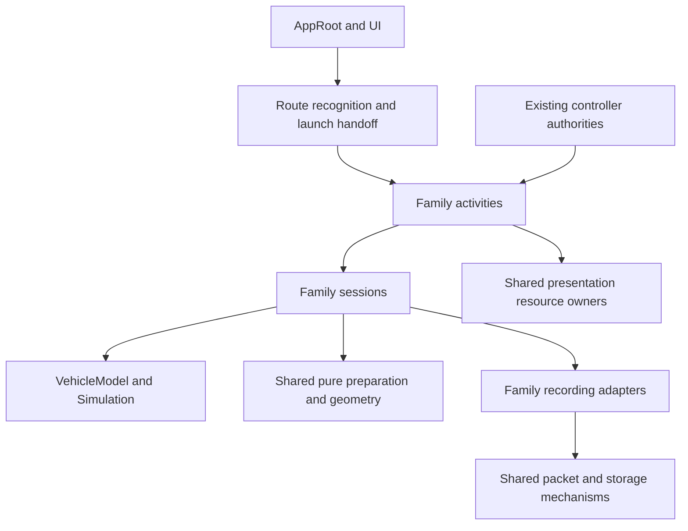
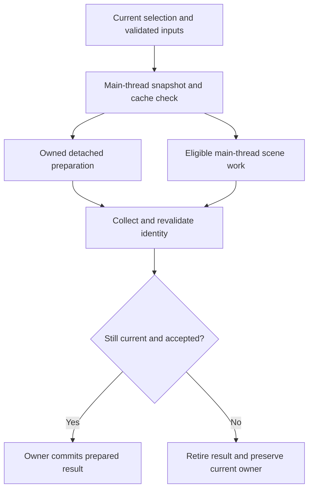

# OpenRC Simulator — vehicle and repository system unification audit

| Review identity | Value |
| --- | --- |
| Date | 2026-11-22 (America/Bogota) |
| Repository | `bultodepapas/OpenRCsimulator` |
| Audited main | `7940a4081e10994f34c858c4acac3d7a1a271464` (v0.3.3 preparation) |
| Application tree | `fe6fdf080899707fab1a1dd4118a32481bca5e4c` |
| Scope | Source audit and implementation recommendations for all vehicle families, followed by repository-wide runtime/UI, tools/CI, generation and legacy-boundary review, then semantic contracts, source identities and dependency-aware parallel work. No production implementation, new runtime qualification or performance measurement. |

## 1. Executive decision

**Execution authority:** [one consolidated repository/VRC plan](../plans/vehicle-runtime-consolidation.md) now absorbs the controls branches and all U01–U10/R01–R17 work. This document is the dated source-evidence home; its earlier execution sections are retained as navigation pointers.

**Continuation:** [section 8](#8-repository-wide-continuation-findings-beyond-vehicle-coordination) adds twelve repository-wide findings; [section 9](#9-what-to-retain-what-can-retire-and-how-to-organize-it) classifies retirement/retention; [section 10](#10-recommended-next-implementation-sequence) orders the proposed changes. Sections 1–7 preserve the first vehicle-focused pass. **Third pass:** [section 12](#12-third-pass-consolidate-contracts-and-retire-redundant-authority) adds R13–R17; [section 13](#13-parallelize-preparation-only-where-ownership-and-dependencies-permit-it) bounds runtime concurrency candidates; [section 14](#14-refined-implementation-plan-independent-lanes-explicit-integration-points) maps parallel development, prerequisites and integration ownership.

**Unify mechanisms with the same contract; keep vehicle laws and operational policies with their current owners.** OpenRC already has the important shared foundation: every family installs a `VehicleModel` into `Simulation`. The next investment should remove repeated coordination around that foundation, especially route selection, controller ownership, launch handoff, environment preparation, recording transport and presentation-resource lifetime. A universal vehicle superclass would turn existing differences into a growing collection of conditional branches. The current model boundary is a better foundation. [Shared architecture][architecture] [Model contract][vehicle-model]

This audit finds concrete duplication, rather than inferring it from similar method names. It also finds two control-flow problems that illustrate the maintenance cost of parallel ownership: an airship CLI request with another argument can fall through to the aircraft route; the ground activity's local controller registry does not inherit the separately selected Home menu role. Both are source-derived findings, not observations from a rendered session or physical controller. The latter also has a test that injects the missing local role, so that test does not establish the real Home-to-car handoff. Sections 4.1 and 4.2 trace the complete paths.

Current priorities and work ownership are maintained in the [consolidated plan](../plans/vehicle-runtime-consolidation.md). Sections 4, 8 and 12 retain the underlying source findings; section 16 records the cross-branch reconciliation.

Do not start with wholesale directory moves, a new simulation engine, a universal session, a universal checkpoint, or a universal battery/powertrain law. This review does not promise an FPS increase. Its immediate objective is fewer independent implementations of the same responsibility and fewer places to repair the same defect.

## 2. Relationship to existing work and evidence

The [existing VRC plan][prior-plan] and [migration matrix][prior-matrix] are already published on `audit/game-controls-2026-11-21`, pinned here at `3095afd95220232e8e659d53635acab5104ee94c`. Their runtime baseline is `57abea025f62b20233ca281d58d2acbee4ab8b8e`; they describe proposed work, not an implemented common API. The initial passes refined that work against the newer main snapshot. The cross-branch continuation now adopts and expands the same [canonical plan path](../plans/vehicle-runtime-consolidation.md) on this branch; VRC-00 through VRC-11 remain open.

The controls plan's fixed-wing PauseMenu characterization remains its first controls slice. The packet and pure-environment extractions below are independent candidates under the existing VRC boundaries, not a reason to delay controls repairs. The prior five GCA findings and 40 acceptance cases are not rerun or closed here. Before moving their affected seams, reconcile their status and execute the appropriate existing witnesses. The [pending external audit ledger][audit-ledger] and completed ledger were reviewed to avoid treating old repaired findings as new defects.

Three bounded research helpers examined simulation/session boundaries, activity/presentation coordination, and input/catalog ownership. The lead checked the material source paths and integrated the recommendations; a separate adversarial review checked the integrated design and consequential findings. No engine, device, rendered, native-parity, package or full-CI campaign was run for this audit.

The initial readable checkout was the one-commit documentation-only child `8245859b3392eb08eea0d56dc07de0d834a12b5b`. Its `app` tree was verified identical to audited main. A fresh isolated checkout of `7940a408` was then used for inventory and final source checks. All source links below are pinned to audited main, not a moving branch.

### Measured source inventory

These are UTF-8 `splitlines()` counts, not complexity scores, removable-line estimates or performance measurements. The [machine-readable inventory](vehicle-system-unification-2026-11-22-source-inventory.json) includes all 16 inspected coordinator/recorder files, blob identities and the duplicate-scan method.

| Current owner | Lines | Top-level functions | Interpretation |
| --- | ---: | ---: | --- |
| `app/sim/flight_session.gd` | 6,697 | 339 | Broad fixed-wing coordination; isolate responsibilities incrementally |
| `app/app_root.gd` | 5,372 | 242 | Shell, routes, controller integration and transitions |
| `app/main.gd` | 4,303 | 151 | Fixed-wing presentation and activity coordination |
| `app/sim/ground_vehicle/session.gd` | 2,261 | 127 | Ground-specific run, recording, recovery and checkpoint ownership |
| `app/vehicles/multirotor/multirotor_scene.gd` | 1,663 | 94 | Quad activity, input recovery, presentation and race integration |
| `app/sim/helicopter_flight_session.gd` | 1,444 | 80 | Rotorcraft session and native/control admission |
| `app/vehicles/ground/ground_scene.gd` | 1,317 | 63 | Garage, driving, presentation and departure decisions |
| `app/sim/multirotor/session.gd` | 1,213 | 56 | Closed-loop plant, controller/race frame and accepted events |
| `app/vehicles/airship/airship_scene.gd` | 923 | 47 | Airship activity, controls, presentation and recording |

A bounded scan of those 16 files compared top-level functions after removing blank/comment-only lines, expanding tabs and trimming trailing whitespace. It did not rename identifiers or infer semantic equivalence. Four groups of at least eight retained lines were identical between airship and quad:

| Function | Airship | Multirotor | Retained lines per copy |
| --- | --- | --- | ---: |
| `_write_packet` | `sim/airship/flight_log.gd:187` | `sim/multirotor/flight_log.gd:212` | 18 |
| `_install_lake` | `sim/airship/session.gd:322` | `sim/multirotor/session.gd:366` | 15 |
| `_clearance` | `sim/airship/session.gd:502` | `sim/multirotor/session.gd:994` | 14 |
| `_failed` | `sim/airship/flight_log.gd:214` | `sim/multirotor/flight_log.gd:240` | 11 |

These exact matches establish specific extraction candidates. They are not the project's total duplication count. The larger launch and presentation routines contain common sequences mixed with real differences, so their full line counts must not be presented as duplicated or removable code.

## 3. What to share and what to preserve

| System | Shared responsibility | Responsibility that remains specific |
| --- | --- | --- |
| Simulation | Existing accepted-tick transaction, clock, state publication, model protocol and rollback | Each model's forces, state layout, events, sampling and integration policy |
| Controls | Device identity, profile storage, candidate ranking and shared input transport through existing owners | Throttle/collective/steering meaning, shaping, arm/hold/rearm and recovery |
| Launch | Route-family recognition and, where equivalent, Home handoff/rollback mechanics | Family argument validation, start configuration, prepared session and flight admission |
| Environment | Pure normalized-data checks and equivalent weather/surface construction | Weather domains, query timing, contact response, water behavior and native eligibility |
| Collision | Same-arithmetic proxy distance and shared world validation | Broad phase, candidate order, hull/rotor witnesses, contact timing and damage |
| Recording | Packet framing, digest chain, bounds, file-error handling and storage primitives | Record layout, checkpoint, accepted-event timing, replay and departure policy |
| Presentation | Resource construction/retirement and detached common observations | Cameras, HUD layout, rotor/propeller animation, audio meaning and effect events |
| Energy | Existing qualified primitives where their mathematical domain matches | Airship power demand, quad coupled bus, fixed-wing supply, nitro/glow and fuel laws |
| Data/catalog | Existing `VehicleRoster` projection backed by family catalogs | Family schemas, authored provenance, validation and admission |
| Tests | Common contract cases for the exact extracted mechanism | Family numerical, replay, recovery, device and physical qualification |

The existing [environment][environment], [controller service][controller-service], [recording transport][fixed-log-writer], [lens stack][lens-stack] and [model interface][vehicle-model] are the starting owners. Create a helper only when an existing owner cannot absorb the responsibility cleanly. A common name such as `resume`, `reset` or `checkpoint` is insufficient evidence of an interchangeable contract.

## 4. Findings and bounded remedies

The U identifiers below belong to this report. They are not a replacement implementation track. “High” means prioritize correctness or remove a consequential migration ambiguity; “medium” means a useful structural improvement. It is not a security severity scale.

### U01 — High: recognize requested vehicle routes before generic flight fallback

**Evidence.** `AppRoot._ready` recognizes the airship route only when the entire argument array has exactly one element. With `--airship=historico --quick-flight`, that branch is skipped, the quad recognizer reports no quad request, the unknown-ground-vehicle check does not match, and `wants_direct_flight` accepts any nonempty arguments. The call reaches `start_flight`; the aircraft parser stores arbitrary argument keys rather than rejecting the airship selector. By contrast, the quad recognizer explicitly rejects an additional argument. [AppRoot dispatch][route-dispatch] [Generic direct route][direct-route] [Aircraft parser][aircraft-args] [Quad route checks][quad-route-test]

**Consequence.** Source control flow permits a requested airship invocation to take the fixed-wing route. This is not a rendered reproduction, and no claim is made about the resulting visible flight on a particular installation.

**Remedy.** Add one route-recognition/refusal boundary in AppRoot or a small app-state helper. Recognize an explicit family selector independently of whether its arguments are valid; then delegate validation to that family's existing parser/catalog. Conflicting family selectors or an unsupported combination must produce a family-specific refusal before generic aircraft fallback. Keep direct-launch and Home preference semantics unchanged. Do not invent one global argument schema or automatically add options a family does not support.

**Acceptance.** Exercise a valid airship invocation, airship plus another option, malformed/unknown family IDs, duplicate selectors, conflicting families, both argument orders, valid aircraft technical arguments, no-argument Home and diagnostic routes. Preserve the higher-precedence input-report route and characterize the current `--airship=` empty-value fallback before changing it. Not every extra flag reaches fixed-wing: diagnostics and other recognized family selectors have earlier paths, and an explicit rotorcraft aircraft selector can choose helicopter. Include the production startup dispatch, not only a helper's returned dictionary. Extend `test_airship_activity.gd` or the appropriate startup check; retain `test_mr_activity.gd` direct-route cases.

### U02 — High: the ground activity duplicates menu-role authority and drops the selected Home menu pad

**Evidence.** Ground activity saves the supplied registry as `_source_controller_registry`, creates a new local registry, copies device observations, and selects only its local `flight` role. Its button acceptance checks local `ui` or `flight`, while GUI navigation is assigned to the local driving pad. AppRoot's UI-role callback calls the activity's refresh without forwarding the selected ID, and its ordinary controller event route exits while this activity slot is occupied. These paths do not supply the missing menu-role handoff. [Local registry and navigation][ground-registry] [Button acceptance][ground-button] [Shell UI callback][shell-ui-role] [Shell dispatch exclusion][shell-controller-exclusion]

`test_controller_car.gd` selects a menu pad in the source registry, launches the activity, and then manually selects that pad again in the activity's local registry before asserting that it can resume. The injected local assignment bypasses the production handoff being evaluated. The test also explicitly expects the driving pad to own garage navigation; preserve that distinction until an intentional product-policy change is specified. [Existing test][ground-role-test]

**Remedy.** Keep the garage's local driving selection and its neutral/reselection safety. Give the Home-selected menu role one authority: read it from the source registry or forward a detached role identity and its connection generation through the existing callback. Preserve the intended menu Start/Menu behavior separately from driving shortcuts. Decide explicitly whether separate-pad GUI navigation is supported; do not silently change the tested driving-pad navigation policy while repairing role propagation. Do not make the garage mutate the global aircraft flight role.

**Acceptance.** Launch through Home with distinct driving and menu pads, with no post-launch test injection. Check both pads' permitted Start/Menu actions, driving-only shortcut exclusion, UI-role changes, eligibility/revocation, disconnect/reconnect generation, loss of the driving pad, held buttons through garage transitions and Home restoration. The documented separate-pad Back action needs its own witness: copying a `ui` ID alone will not make `event.is_action_pressed("ui_cancel")` true while native GUI mapping still belongs to the driving pad. Route that action under an explicitly admitted owner; a connected raw device is insufficient evidence of menu eligibility. Use `test_controller_car.gd` and `test_controller_ground.gd` as starting points; synthetic success does not qualify physical devices. [Ground control guide][ground-controls]

### U03 — Medium: controller fallback ranking is copied and has a weaker consistency boundary

**Evidence.** `ControllerService` ranks saved-profile match, radio, known gamepad and other device under an outer store lease. Quad `_adopt_fallback_device` independently reproduces that priority and the ambiguous-Jeti rule, calling `match_profile` per device without a coherent outer lease. A failed store read is represented as no matches by the current store API. Selection can therefore be made from incomplete or separately read evidence. The subsequent managed profile resolution still fails closed: an empty profile does not grant a ready built-in pad mapping. This finding is about ownership and consistency, not evidence of unsafe flight. [Service selection][selection-service] [Quad copy][quad-fallback] [Store read and matching][store-matching] [Fail-closed connection][quad-profile-refusal]

**Remedy.** Put candidate ranking in the existing service, with one coherent observed-device/profile snapshot and an explicit busy/unknown result. Let the quad retain its lost-device exclusion, explicit keyboard choice, held state, confirmation and rearm decisions. Support its direct/standalone route deliberately; do not create a mandatory global singleton or duplicate persistent cache. Individual candidate reads already acquire leases; the missing boundary is one consistent ranking operation. Decide busy/corrupt-store behavior as an intentional owning-policy repair, separately from a behavior-preserving extraction.

**Acceptance.** Retain priority and ambiguity checks in `test_controller_auto_defaults.gd`, and activity fallback/keyboard checks in `test_mr_activity.gd`. Add store-busy/interleaved-profile-change, equal-priority, selected-device generation and reconnect cases. A helper selecting a device must not independently arm, resume or write profiles.

### U04 — Medium: three Home activity launches repeat one handoff transaction

**Evidence.** `start_ground_vehicle`, `start_airship` and `start_multirotor` repeat the Home preparation drain, post-await guard, activity exclusivity check, Home detach, candidate construction, startup check, successful publication, and failure restoration. Family configuration and controller injection differ. The three ranges contain 188 source lines in total; that includes distinct logic and is not a removable-line estimate. All three also occupy a variable named `ground_vehicle`, although two are airborne activities. [Launch sequences][activity-launches]

**Remedy.** First isolate the common handoff inside AppRoot, with family candidate construction/configuration and success hooks kept at the existing callers. A small private helper may be enough. If a separate class proves useful, it should own only this shell transaction. Preserve the current order: await Home preparation, revalidate the live origin, then capture the departing Home and construct the candidate. Retain those exact objects through commit/rollback and retire the failed candidate completely. Do not move candidate creation before the existing await or fold the more elaborate staged fixed-wing/helicopter loader into this initial change. Rename the misleading slot only in a later mechanical change after auditing callers; naming alone is not the structural fix.

**Acceptance.** Successful launches and failed construction/startup for each of the three activities; Home camera/focus restoration; duplicate launch while preparation drains; quit or screen change during the await; no orphan scene, signal or worker; direct-launch error behavior; returning Home after the activity. Use `test_airship_activity.gd`, `test_mr_activity.gd`, ground activity tests and existing Home-preparation tests.

### U05 — Medium: share lake and collision validation without sharing collision response

**Evidence.** Airship and quad `_install_lake` functions are identical after the bounded normalization described above. They check normalized geometry and its recomputed identity, detach the accepted lake, and remove an empty option. Related substantive checks appear in the fixed-wing and helicopter owners. The airship and quad capsule/oriented-box `_clearance` functions are also identical. Several sessions call the same private collision-world header/proxy validators in their own loops. [Airship lake and world checks][airship-lake] [Quad lake checks][quad-lake] [Airship clearance][airship-clearance] [Quad clearance][quad-clearance]

**Remedy.** Extend the existing lake/collision owners with pure normalized validation and same-arithmetic geometry queries. Return a detached checked candidate; each session decides when to install it and whether installation closes observers or invalidates readiness/native preparation. In particular, `_install_lake` currently mutates `env` and removes a key from `opts`; it must not be advertised as a pure function merely because its text matches. Preserve validation order, alias/deep-copy behavior and that canonicalization effect explicitly at the caller boundary. The existing collision header/proxy checks are structural; they do not recompute the whole world identity or prove spatial-bin coherence. Stricter integrity admission would be separate behavior work. [Existing collision checks][collision-validation]

Keep family broad phases, candidate order, witness geometry, water response and event timing. Airship records a boundary on a changed world after tick zero; quad also rebuilds its plant collision callbacks; helicopter has its own readiness/native effects. Empty-world handling and fixed-wing damage behavior are not automatically equivalent. [Airship world installation][airship-lake] [Quad world installation][quad-world]

**Acceptance.** Dry/empty data, malformed geometry, forged identity, detached-copy mutation, accepted/refused in-flight installation, boundary points and rotated boxes/capsules. Preserve float64 operation order, signed zero, proxy order and tie behavior. Retain `test_airship_collision_recording.gd`, `test_mr_fast_paths.gd`, `test_helicopter_lake_context.gd` and affected session checks. A new function call inside a collision hot path has unmeasured cost; measure it before claiming an optimization.

### U06 — Medium: share only the overlapping environment-preparation domain

**Evidence.** Airship and quad independently build the same default steady-wind configuration, construct a wind law, load/build the surface table and validate it before assembling `SimEnvironment`. The existing environment abstraction already supplies common providers and an adapter for ground courses. Airship admits up to 4 m/s; quad admits up to 8 m/s and has additional option/course handling. Fixed-wing supports broader weather and transactional pending selection; helicopter and ground have different admitted domains. [Airship preparation][airship-prepare] [Quad preparation][quad-prepare] [Existing environment][environment]

The scene layer also repeats field/lake/sky/night setup. Here failure policy already differs: ground rejects a lake-resolution error but tolerates an obstacle warning; airship/quad can warn and use no lake but reject obstacle setup. That is policy to characterize, not erase by selecting whichever implementation looks shorter. [Ground field preparation][ground-field] [Airship field preparation][airship-field] [Quad field preparation][quad-field]

**Remedy.** Prefer two small boundaries: pure simulation preparation for the actual common weather/surface subset, and a detached presentation configuration builder if it removes repeat work. Callers retain admissible bounds, error policy, course overlays, start and native gates. Do not introduce one policy-heavy `VehicleEnvironmentManager`, substitute steady wind for richer laws, or impose the quad's specialized terrain fast path on other vehicles.

**Acceptance.** Exact dry/calm baseline, different wind limits, invalid surfaces, lake/course overlays, deterministic environment identity and refused changes. Exercise `test_sf_environment.gd`, `test_airship_session.gd`, `test_mr_session.gd`, `test_heli_weather_admission.gd` and affected field/activity tests. Keep visual lighting independent of physical weather.

### U07 — Medium, strong first extraction: one ORFL packet transport, separate family recordings

**Evidence.** Fixed-wing, airship and quad write the same packet structure: serialized payload, bounded size, digest, file writes/flush, error checks and chained digest. Airship/quad `_write_packet` and `_failed` are exact matches under the scan; both already import the fixed-wing `flight_log.gd` for magic, hashing and packet reads. The common container exists, but writer ownership remains copied and the dependency points at a family-named recorder. [Fixed-wing writer and reader][fixed-log-writer] [Airship writer][airship-log-writer] [Quad writer][quad-log-writer]

**Remedy.** Extract a small packet I/O owner beside the existing logging code, preserving its framing, size/error contract and hash chain. Start with the two identical writers. Retain existing public recorder facades; migrate fixed-wing after checking its caller contract. Do not centralize session subscriptions or invent a common record row as part of this change. Shared transport may provide a bounded error result; each recorder still owns how to close its subscriptions and report incomplete capture.

Airship records clean sticks and body/continuous state. Quad carries a full controller/plant checkpoint, pilot frames, auxiliary/mode arrays, kernel events and race variants; replay reruns its controller. Fixed-wing has its own backend, intervention and closing-context logic. The helicopter's manual trace and car's CSV/JSON export are separate recording products. They already reuse some storage primitives and should not be converted merely to make the directory uniform. [Airship header][airship-log-header] [Quad header][quad-log-header] [Manual trace save][manual-save] [Ground export][ground-export]

**Acceptance.** Preserve byte framing and reader compatibility with existing fixtures. Exercise corrupted/truncated packets, bad digest, missing/inconsistent footer, row/event-only streams, packet/file limits, write/flush failures and stop reentry. Then run the real family recorder/replay consumers: `test_flight_log.gd`, `test_airship_flight_log.gd`, `test_mr_flight_log.gd`, relevant input and collision-recording cases. Existing fixtures and matching-source exact replay remain the baseline; changed source identity needs the documented comparison route.

### U08 — High migration constraint: reset, finalization and replay verdicts differ

**Evidence.** Fixed-wing uses explicit prepared-reset and commit receipts, with rejected preparation distinguished from a committed observer fault. Airship `prepare` assigns candidate session/model/environment state and then calls `reset`; `resetting` can be emitted before the kernel rejects reset. A nonfinite `heading_deg` is an unexecuted counterexample candidate: preparation does not validate it before quaternion construction. This needs a focused regression; it is not a claim of observed player data loss. Quad and ground have additional checkpoint, race/outbox, run-validity and recovery contracts. [Airship preparation/reset][airship-prepare] [Kernel prepared reset][prepared-reset] [Fixed-wing transaction][fixed-reset]

There is also a finalization question: airship/quad `_stop_recording` discard the `Error` from `flight_log.stop`, and their Home action can continue. The log reports incomplete writes, while the shell's guarded manual-recorder departure protocol is not automatically supplied for these logs. A fault-injected footer/flush test is needed to establish the user-visible outcome and decide the appropriate recovery. Do not assume that the ground trace's retry/discard policy applies to an already failed ORFL stream. [Airship stop wrapper][airship-stop] [Quad stop wrapper][quad-stop] [Shell departure][departure]

**Confirmed source-level replay divergence.** Airship `verify` computes `solver_changed` but can subsequently set both `exact` and `ok` true after all state/outcome comparisons, without refusing that flag. Quad explicitly refuses a changed solver in exact mode. The airship CLI uses `report.ok` for successful exit, and its guide tells the consumer to inspect `solver_changed`; changed-law candidate comparison is not implemented for the blimp. A common verifier that treats `ok` or `exact` alone as a matching-identity replay would therefore misread current results. This is a statically verified acceptance-contract difference, not a replay executed during this audit. [Airship verdict][airship-replay] [Airship CLI][airship-replay-cli] [Quad verdict][quad-replay] [Blimp logging guide][blimp-logging]

**Remedy.** Before moving a transition, record its full prepare/refuse/commit/fault/cancel behavior and observer timing. Repair an incorrect owning contract in a separate change. Reuse the kernel's existing prepared-reset capability where appropriate; retain family envelopes. Share mechanical subscription retirement only after proving the owner is finally retired. A temporarily detached Home/flight or a failed save is not permission for unconditional cleanup.

**Acceptance.** Failed prepare/reset/restore during recording; unchanged or deliberately changed model/environment/frame/tape identities; exactly ordered observer signals; postcommit faults; repeated close/stop; save failure; pending race results; accepted restore with correct credit policy. Add an airship negative control in which the source fingerprint changes while the recorded numerical trajectory still matches; the acceptance consumer must not call that matching-identity exact replay. Repair any desired CLI/verifier semantic change separately from packet extraction. Start with `test_flight_reset_transaction.gd`, `test_airship_flight_log.gd`, `test_mr_session.gd`, `test_race_session_replay.gd` and ground recovery/recording checks. These scenarios are proposed, not newly executed evidence.

### U09 — Medium: factor lens-resource lifetime, preserve presentation policy

**Evidence.** Five activities repeat removal/free of an old lens stack, settings resolution, construction/addition, configuration and failure cleanup. `LensStack` and `LensSettings` are already shared. The repeated construction is the remaining candidate, while contacts, reset subscriptions and event attribution differ. [Fixed-wing lens][plane-lens] [Helicopter lens][heli-lens] [Airship lens][airship-lens] [Ground lens][ground-lens] [Quad lens][quad-lens]

**Remedy.** Use a small owner for constructing/replacing/retiring a configured stack, or extend an existing presentation owner. Family scenes retain the events and context they supply. Do not combine all cameras, HUDs and effects into a universal presentation controller. Fixed-wing/heli use actual wind and simulation time in their world updates; the newer activities currently use a 37-second visual offset and zero render wind. Workshop also saves/restores shared world context. Those existing choices must stay explicit until separately changed. [World context][world-context] [Workshop restoration][workshop-world]

**Acceptance.** Repeated settings changes, reset, scene departure, unsupported settings and Workshop return; no duplicate callbacks or leaked stacks; expected camera/HUD and world clock behavior at the required display target. Use `test_lens_effects.gd`, `test_world_environment_lifetime.gd` and affected activity/presentation tests. Sharing a constructor does not qualify a rendered result.

### U10 — Medium/low: strengthen the existing roster; defer low-payoff helpers

**Catalogs.** `VehicleRoster` already provides the Home projection over aircraft and specialized family catalogs; extend that existing owner instead of creating another registry or descriptor system. Its activity table repeats installed IDs as literals. Its validator checks collision with aircraft IDs and listed-entry installation, but does not detect duplicate activity IDs; reverse coverage currently checks ground IDs only. No current duplicate entry was found. Use authoritative family constants where available, retain deliberate Home order/copy, and add negative duplicate/unknown-family/missing-player-entry cases to `test_home_vehicle_roster.gd`. If a ground ID lacks a named constant, add one at its owner or retain the validated literal; do not depend on a numeric position in `GroundCatalog.IDS`. Do not automatically expose every technical model in Home, repeat capability admission in the roster, or force all physical data into the aircraft v2 schema. [Existing roster][vehicle-roster] [Roster tests][roster-tests] [Prior ownership decisions][prior-matrix]

**Quantity readers.** Several family loaders repeat finite-number and `{value, unit, kind, source}` envelope checks, but allowed kinds, source rules, closed/open fields and legacy compatibility differ. A common primitive is optional after explicit accepted/refused-domain comparisons; a single vehicle schema is not recommended. Existing loaders retain unit interpretation, physical ranges, cross-field rules and derived quantities. This is a lower-priority opportunity than the actual routing and ownership gaps. [Airship quantities][airship-quantities] [Quad quantities][quad-quantities]

**Audio.** Airship and quad both duplicate a WAV resource before enabling looping and building positional players. A tiny asset/player helper could centralize that resource-safety pattern. Their motor count, spatial placement, accepted-tick mechanics and damaged-prop sounds remain separate. This is lower priority than route, role and recording ownership. [Airship audio][airship-audio] [Quad audio][quad-audio]

**OCV interpolation.** Airship, quad and fixed-wing supply contain similar piecewise SOC/voltage lookup, but the tables have different voltage units and endpoint policies. The quad's prepared-data domain does not impose every endpoint requirement of its file loader. Even returning an exact endpoint rather than recomputing it can change float64 bits. Defer consolidation unless independent boundary/parity and hot-path evidence justify it. Keep each coupled supply law. [Airship lookup][airship-ocv] [Quad lookup][quad-ocv] [Fixed-wing lookup][plane-ocv]

## 5. Architecture and code organization

The target is a set of narrow owners around the existing model boundary. These boxes are responsibilities, not a request to create one class for every box.

| Location | Responsibility after a justified extraction | Excluded responsibility |
| --- | --- | --- |
| `app/app_root.gd`, optionally a small `app/app_state/` helper | Shell transition and requested route recognition | Vehicle dynamics, cached readiness or universal session reset |
| Existing `app/input/controller_service.gd` and store/registry/profile owners | Coherent device/profile selection, persistence and role facts | Family arm/hold/recovery policy |
| Existing lake/environment/collision modules | Detached validation, common-subset preparation, pure geometry | Mutable session lifecycle or collision aftermath |
| Small helper beside existing logging code | Bounded ORFL packet I/O | Universal row schema, replay or departure decisions |
| Existing render/lens owners | Stack resource lifetime | One camera/HUD for every vehicle or authority over physics |
| Family session/activity modules | Explicit adapters, starts, controls, recovery and specialized presentation | Reimplementing a shared mechanism without a documented difference |

Keep the first extraction close to its current owner. Preserve existing public functions, resource paths and UIDs where practical. Establish two real consumers and remove the replaced implementation in the same bounded change. Do not keep a permanent old/new pair or publish a generic API with no actual second use.

Splitting `FlightSession` or `AppRoot` should follow an identified responsibility, such as packet transport or launch handoff. Moving 6,697 lines into several files without reducing ownership or dependency complexity would not meet this audit's objective. No wholesale relocation into new `core`, `managers` or `systems` directories is proposed.

### Physics and native boundaries that must survive

The fixed 240 Hz outer clock, float64 state and atomic accepted-tick protocol remain shared. This does **not** mean every family's complete state uses an identical RK4 procedure: ground nitro's existing whole-tick policy uses a midpoint engine/fuel update and the ground vehicle RK4 body step. Quad samples its controller once per tick and carries controller memory in the accepted checkpointed frame. Preserve these policies and their identities. [Ground integration callback][ground-tick] [Nitro composite step][nitro-step] [Quad sampled controller][quad-controller]

Qualified C++ evaluators and the selectable GDScript reference are deliberate implementations with distinct verification roles. Native acceleration replaces declared model evaluation callbacks while Simulation retains the transaction. Keep that architecture. A source-only consolidation audit supplies no reason to rewrite UI, orchestration or file I/O in C++, and no reason to delete reference laws or collapse independent test oracles. [Native policy][native-policy]

## 6. Reviewable work sequence and acceptance

The current work packets, family order and acceptance now live in the [single consolidated plan](../plans/vehicle-runtime-consolidation.md#11-unified-consolidation-backlog-by-surviving-authority). Its [controls steps](../plans/vehicle-runtime-consolidation.md#6-step-plan-and-independent-changes), [acceptance](../plans/vehicle-runtime-consolidation.md#13-acceptance-and-status-without-duplicate-ledgers) and [retirement rules](../plans/vehicle-runtime-consolidation.md#14-retirement-and-completion-rules) absorb this audit's former sequence. Findings U01–U10 above retain their original source evidence and bounded remedies; prior versions of this section remain in Git history. No implementation or runtime acceptance was performed by moving the planning authority.

## 7. Completion criteria and audit limits

The future consolidation is successful when a fix to one shared mechanism reaches all adopted families through one implementation, while family-specific controls, trajectories, checkpoints and user recovery remain correct. A new vehicle should compose the existing kernel, transport and presentation facilities, then supply its own model, admitted data, controls and specialized behavior. It should not need another copy of route detection, packet writing or device ranking.

This audit completed source inspection, prior-plan reconciliation, a bounded reproducible inventory/duplicate scan, lead verification and adversarial review. It does not certify all source files or every path in this large repository. Findings about the route and role wiring are statically traced; the airship failed-prepare and finalization-error scenarios require execution before being described as reproduced incidents. The attached inventory is source evidence, not a test pass report.

No runtime repair, physics tuning, engine change, schema migration, golden regeneration or benchmark is delivered with this report. Proposed test names are starting points and do not mean their full new scenario coverage exists. Hardware, pilot, physical accuracy, package and full-CI qualification remain separate. The report and inventory are the only substantive deliverables; the audit ledger receives a discovery link without rewriting historical statuses.

## 8. Repository-wide continuation: findings beyond vehicle coordination

This continuation answers the request to scrutinize the whole repository. It retains the same main revision and extends the investigation to settings and startup, Creator and Workshop, UI diagnostics, developer tools, native qualification, source generation and legacy dependencies. Three additional research helpers inspected runtime consolidation, tools/CI, and retirement boundaries; the lead checked consequential source paths and requested an independent challenge. R identifiers below are local findings, not a new implementation track or a count of reproduced bugs.

### Coverage and what the measurements mean

The Git tree inventory covers **52,543 tracked entries on audited main**. The application scan inspected **839 tracked GDScript files outside app/tests and app/assets**, containing **369,946 splitlines() lines and 14,122 top-level function declarations**. It found **27 exact normalized-function groups**, including the four groups already reported in section 2. Signatures are retained; only blank/comment-only lines, trailing whitespace and tab expansion are normalized; the minimum is eight retained lines. The extended [source inventory](vehicle-system-unification-2026-11-22-source-inventory.json) records scope, identities and matches.

This is a whole-tree inventory and a broad application scan, followed by targeted source tracing. It is not a manual review of all 52,543 files, a full Python/C++/JavaScript clone scan, a call graph, or a removable-line estimate. The largest GDScript files include generated geometry: f4u_corsair_geometry.gd has 27,152 lines and avanti_s_blender_geometry.gd has 16,927, both with zero top-level function declarations under this scan. Their size does not establish a coordinator design problem. Exact wrappers can also call different implementations; matching text alone does not justify extraction. [Corsair geometry][r-corsair-geometry] [Vantage geometry][r-avanti-geometry]

### R01 — High: make successful settings publication mean verified publication

**Evidence.** DisplayPreferences.save_to builds a ConfigFile and directly returns its save result. DisplayPreferences.save then updates its accepted in-memory configuration on OK, and SettingsScreen.keep_changes publishes presentation_committed on the same result. RendererGuard.save_state already performs a complete readback comparison for the short-write failure described in its source comment. PreferencesFile has a more extensive leased, verified temporary/previous/current transaction. These owners currently provide different guarantees for an operation the UI treats as committed. [Display file write][r-display-file-write] [Display publication][r-display-write] [Settings acceptance][r-settings-keep] [Guard verification][r-guard-write] [Preferences transaction][r-preferences-file]

**Consequence and limit.** A false-OK or incomplete publication is a concrete fault-injection target at the display boundary. No full-disk or interrupted-write incident was reproduced here, and no claim is made that existing normal saves fail.

**Consolidation.** First characterize and repair verified publication within DisplayPreferences. Extract a shared write/readback primitive only after two real owners demonstrate the same transport contract; ConfigFile semantics and Workshop's byte-oriented records are not automatically equivalent. A helper can validate temporary bytes or decoded contents and report publication failure; it must not silently become a universal settings store. Display keeps its schema, future-version refusal, GPU-default ownership and trial Keep/Revert behavior. PreferencesFile keeps its accepted-state lease, weather witness and recovery rules. Statistics keeps its generation/journal protocol; Workshop keeps immutable records and manifests.

The duplication also extends to Workshop library preferences and drafts: both write/flush/verify temporary bytes and publish through their own transaction. Race records have a recoverable previous book, whereas PreferencesFile's previous copy marks an unacknowledged transaction. These are useful consumers for small byte-I/O primitives, not interchangeable recovery policies. [Library preferences][r-library-write] [Draft publication][r-draft-write] [Race records][r-race-write]

Telemetry consent is a decisive counterexample to universal backup recovery: its separate store deliberately has no restorable previous grant, and disabling first attempts to remove the earlier grant. Reusing a generic “restore last good settings” policy would conflict with that intention. This is not a guarantee that every current filesystem failure preserves opt-out: the initial removal result is ignored, so simultaneous removal and new-write failure needs its own consent-persistence investigation. A helper cannot promise durable revocation when every persistent write/removal is refused. Share only a mechanism whose contract actually matches. [Consent contract][r-consent-store]

**Acceptance.** Exercise short/truncated write, failed readback, destination removal/rename failure, corrupt or future-schema input, two writers where supported, and Keep/Revert with failed persistence. The UI must retain the appropriate draft/baseline and must not emit a successful commit for failed publication. Start with test_display_preferences.gd, test_settings_ui.gd, test_renderer_guard.gd and test_renderer_preference.gd, plus targeted injected failures. Consent tests must prove that backup recovery cannot resurrect an earlier enabled choice; separately start with an enabled grant and inject simultaneous removal and new-write failure, distinguishing current-session shutdown, the reported save error and the next-launch outcome. These are proposed checks, not results of this audit or a claim of power-loss durability.

### R02 — Medium: give startup a lightweight, transaction-aware presentation view

**Evidence.** Startup.read_presentation intentionally avoids the large Preferences preload graph, but reads settings.cfg and its display companion directly and repeats UI-scale validation. Normal Preferences.load_from obtains the PreferencesFile lease and performs recovery. If a supported current file and verified previous file remain from interrupted publication with no lingering lock, the intro can read the current language before the shell restores the previously accepted language. With a lingering lock, the shell instead fails closed; it does not automatically recover. [Intro reader][r-startup-reader] [Normal preference load][r-preferences-load] [Recovery rules][r-preferences-file]

**Consolidation.** Introduce a small read-only presentation projection at the existing app-state boundary. Reuse the display scale predicate and characterize the store's transaction states without loading aircraft/weather/presentation construction into the intro. Keep startup read-only; normal recovery remains with the store. Busy, corrupt and future-version inputs need explicit outcomes rather than a second independently maintained recovery algorithm. Recovery failure can leave normal Preferences reading valid fields from the current file with writable=false; it does not always select previous/default. A lock-existence check is not a snapshot protocol: a writer can intervene between reads, and preferences may legitimately change before Home loads. Define supported stable-state behavior and a safe best-effort fallback; promise cross-handoff equality only if an actual snapshot/lease protocol establishes it.

**Acceptance.** Compare intro and Home presentation under the defined stable-state contract for normal EN/ES settings, absent settings, interrupted current-plus-previous publication, held/stale lock, corrupt previous/current files, future schemas, reduced motion and every admitted UI-scale increment. Add deterministic writer interleavings and explicit best-effort outcomes. Preserve direct/headless startup behavior and verify that intro reads do not write or migrate player data. Extend startup/preferences/display tests; the mismatch is statically derived, not rendered evidence.

### R03 — High: finish adopting the checked engine runner in visual tools

**Evidence.** The required scenario phase in app/capture.sh calls tools/scenery/scenario.sh. That wrapper discards every engine/Xvfb/timeout exit with “|| true”, then accepts a completion marker unless its narrower line-start ERROR/SCRIPT ERROR expression matches. Scenery capture/budget and world parity/time wrappers contain variants of the same pattern. By contrast, tools/godot/run_checked.py already combines process exit, timeout, bounded logs, required markers, ANSI-normalized/indented SCRIPT and SHADER diagnostics, and admission integration. [Capture-suite caller][r-capture-caller] [Scenario wrapper][r-scenario-wrapper] [Scenery wrapper][r-scenery-wrapper] [World wrapper][r-world-wrapper] [Checked runner][r-checked-runner]

**Consequence and limit.** An engine that prints the marker and then exits nonzero, times out, or produces a diagnostic missed by that expression can pass the wrapper's engine-verdict step. Subsequent image/report checks can still fail independently. This is a source-derived conditional gap, not a reproduced successful CI run containing engine errors.

**Consolidation.** Migrate one wrapper at a time to the existing checked mechanism inside an admitted visual-capture owner. Preserve Xvfb/process-tree ownership, checked exit status, each marker, expected output files, image/synchronization checks, previous/latest/history behavior and the declared resolution/renderer. Do not add another generic launch framework or use this cleanup to change image baselines. This is not a universal drop-in shell replacement: without inherited admission, the focused enrolled-host adapter requires the worker's exact engine executable, rejects an Xvfb wrapper as the command and rejects application arguments after “--”. Route the whole capture through the appropriate reviewed admission path; never weaken it just to reuse the runner. [Focused admission boundary][r-checked-admission]

**Acceptance.** Use fake-engine fixtures for nonzero-after-marker, timeout-after-marker, missing marker, ANSI/indented/shader errors and successful execution; retain real scenario/image gates on an appropriate admitted host. Existing historical budget/version refusals must survive. CI-09's separate visual-skip issue is not closed by this change.

### R04 — High: consolidate cancellation around bounded ownership of unfinished import work

**Evidence.** AircraftCreator.cancel_import invalidates the generation, requests cancellation, puts the job into a static abandoned-job collection and returns the screen to an available state. The ordinary STL/GLB worker path calls read_bounded and inspect_bytes without consulting that cancellation token. A new import blocks abandoned non-ordinary package jobs but admits another ordinary job. A slow ordinary import can therefore remain alive while repeated Cancel → choose again creates further unfinished tasks. The Choose button is disabled during inspection, so an ordinary double-click is not the claimed UI sequence. [Creator worker/admission][r-creator-jobs] [Cancel and retirement][r-creator-cancel] [Choose eligibility][r-creator-choose]

Source bytes are capped per import; that is not an aggregate bound on active/abandoned work, decoded meshes or observations. The source demonstrates a missing owner-level bound, not a measured memory leak or OOM. Reaping completed jobs and rejecting stale results already work as explicit mechanisms and should be preserved. The Phoenix plan already calls for aggregate reservations and bounded work; this extends that invariant to the current ordinary route. [Import bounds][r-import-limits] [Existing import plan][r-phoenix-plan]

**Consolidation.** Reuse the ownership principle already visible in HomePreviewResources: one active operation, a bounded latest pending intent, and complete retirement of obsolete work before reuse. Keep this owner local to Creator initially, but bound work across Creator instances and every submission route. An _start_import-only guard is insufficient: saved-source _begin_open and ClearView conversion also call _start_task. Put admission at or before all submissions, preserving saved bytes, opening edit baselines and package-phase ownership. Add cooperative cancellation where the parser can support it, or drain a noncancelable operation before starting its replacement. Preserve generation checks even after introducing bounds. [Saved-source submission][r-creator-open] [Conversion submission][r-creator-convert]

A common policy does not make the worker implementations interchangeable: ResourceLoader jobs, private geometry jobs, Creator parsers and the flight scene loader have different completion/resource rules. Do not put them behind a universal JobManager merely to share method names. [Home bounded admission][r-home-resource-owner]

**Acceptance.** Inject a slow ordinary worker and repeatedly cancel/reselect; assert bounded admitted jobs and reserved bytes, newest-intent adoption, no stale publication, closing/reopening and saved-source re-admission without dangling UI references, complete reap/join, and mixed open/import/package-job coexistence. Measure memory and responsiveness separately if claiming an optimization. Existing Creator asynchronous import and Home preparation checks are starting points.

### R05 — Medium, concrete retirement: remove superseded controller UI nodes after moving their real consumers

**Evidence.** Controller setup creates four invisible ProgressBars with an explicit comment saying gimbals superseded them and tests still read them. Each preview update writes both the conditioned sample and those bars. A layout test even checks the hidden throttle bar's rectangle. The same screen creates a visible BindingChip plus hidden legacy binding Label/TextureRect nodes for every action; it computes prompts and updates the hidden nodes before updating the chip. Tests depend on the legacy names. The hidden label also supplies the real chip's radio-navigation override, so these nodes are not yet removable by simply deleting construction. [Hidden meters][r-hidden-meters] [Preview updates][r-preview-updates] [Legacy binding nodes][r-hidden-bindings] [Binding updates][r-binding-updates] [Legacy tests][r-hidden-tests]

**Consolidation and deletion.** Make the current presentation controls the tested contract. First move conditioned-value assertions to the sampled values plus the real labels/gimbals, and layout assertions to visible controls. Then delete the hidden bars, their map and repeated writes. In a separate small change, use BindingChip's existing label_text/has_glyph presentation interface, pass the calibrated roll/pitch override directly, migrate named-node callers and tests, then remove the old Label/TextureRect construction and the setup-only prompt-texture cache if nothing else uses it. Do not delete the row that still carries the visible source-axis label. [BindingChip interface][r-binding-chip]

**Acceptance.** Preserve absolute and centered throttle, inversion, disconnect state, Xbox/PlayStation/generic prompts, JETI named/unknown switch labels, radio menu wording, conflict and held-state presentation, focus, save/cancel and remapping. Verify actual visible controls at 1080p and required smaller-layout cases. This is both code retirement and test improvement: a hidden node's value or rectangle is not proof of what the player sees. Test migration must preserve behavioral expectations rather than merely stop old assertions failing.

### R06 — Medium: one field-diagnostic mechanism for the shared time/sky controls

**Evidence.** Home's Weather/Conditions dialog and the paused TimeOfDayDialog reuse TimeOfDayControls and SkyControls. WeatherDialog translates structured failures into a field-owned inline explanation, reveals the relevant tab/advanced section, and schedules guarded focus/scroll. TimeOfDayDialog discards the corresponding time/night/moon details for a generic input error; sky failure uses its generic apply-error path. The child controls already expose structured field/control/label/code information for relevant validation failures. [Weather diagnostics][r-weather-diagnostics] [Paused apply][r-time-dialog] [Existing field helper][r-field-helper]

**Consolidation.** Extend the small FieldDiagnostic boundary with reusable presentation/focus mechanics or an adjacent owner-local presenter. Callers supply the field issue and their tab/reveal actions. Keep Home's physical-weather draft separate from the paused dialog's visual-only commit; preserve real flight staging/commit errors and the draft after refusal. Do not copy the entire WeatherDialog or centralize every domain validator in the UI.

**Acceptance.** Invalid date, offset, location, sky number and missing option; correct tab/reveal/focus; translated, readable inline errors; stale deferred callback after closing or changing generation; real flight apply failure retains the modal and draft. Existing A13 Conditions work remains completed; this is adoption in a distinct paused route.

### R07 — Medium: share Workshop model bounds, retain distinct preview and thumbnail behavior

**Evidence.** WorkshopPreview and WorkshopThumbnail independently traverse descendant MeshInstance3D nodes, transform all eight local AABB corners along the current ancestor walk and merge bounds. Their root-transform helper is one of the exact scan matches. Both exclude the root itself from the descendant search and stop the walk at a non-Node3D ancestor; unrestricted root-relative geometry is not established for every possible hierarchy. Their empty behavior differs intentionally: live preview supplies a unit-cube fallback, while thumbnail creation refuses empty/tiny geometry. Live camera fitting also includes a moving pass and optionally a smoke plume; the still thumbnail does not. [Preview bounds/fitting][r-preview-bounds] [Thumbnail bounds/fitting][r-thumbnail-bounds]

**Consolidation.** Extract only the existing mesh-bounds traversal, returning an explicit found/bounds result so callers retain empty and degenerate policies. Keep current root inclusion rules, transform order and treatment of non-Node3D ancestors. Broader hierarchy support would be a separate rendering/identity correction. Preserve isolated worlds, materials, lighting, frozen variant identity, cancellation generations, thumbnail cache and each camera's framing.

**Acceptance.** Nested translations/rotations/nonuniform and negative scales, null mesh, non-Node3D ancestors, no mesh and tiny geometry. Follow existing Workshop preview/thumbnail tests with rendered live/still framing checks; headless cache/refusal tests alone do not validate a generated image. Never share a mutable scene/resource instance as the shortcut to sharing this calculation.

### R08 — Medium/high: declare native qualification cases once, keep qualification policies explicit

**Evidence.** The qualification script roster is repeated in research/native-kernel/package.py, the native export plugin, NativePackage's diagnostic list and app/tools/native_qualification.gd. Source CI and actual-package loops separately enumerate modes and required markers. There is a concrete coverage asymmetry: the Linux source-native job explicitly requires helicopter-radio, whereas the Windows source-native job's listed branch checks stop at helicopter. The Windows actual-package loop does require helicopter-radio. This is not a claim that Windows has no such qualification. Mac intentionally has a narrower fixed-wing scope. [Package roster][r-native-package-roster] [Export roster][r-native-export-roster] [Runtime roster][r-native-runtime-roster] [Mode mapping][r-native-modes] [Linux source job][r-native-source-jobs] [Windows source job][r-native-windows-source] [Windows package modes][r-native-windows-modes] [Linux package modes][r-native-linux-modes]

**Consolidation.** Have the existing native-package owner declare case ID, source, applicable platform/backend, source/package mode and expected marker, with small generated or checked projections for Python, GDScript and workflow consumers. Start with a consistency check if generating code would add more machinery than it removes. Keep script admission closed, actual-native selection, package receipts, “preloaded=false”, unsupported-domain refusal and negative controls.

The common roster must not make tests self-confirming: an accidentally removed case must fail an independently reviewed required-case expectation, not disappear from both execution and the expected set. Keep platform/source/package distinctions as explicit policy; decide the Windows source asymmetry deliberately rather than silently treating it as equivalent coverage.

**Acceptance.** Remove or rename each required case/marker in disposable fixtures and prove refusal; verify all generated/checked projections; retain source-native, packaged-native, reference-fallback and Mac-scope tests independently. No platform qualification was run here.

### R09 — Medium: expose one current engine-pin description to the tools

**Evidence.** RCV native verification, testqueue worker/pool admission, release preflight and release-manifest construction independently parse the shell engine pin with different regexes and different responsibilities. The worker records binary SHA-256/SHA-512 values but its direct digest pin comparison is Windows-specific and compares sets of hashes; pool admission reads the engine version from a verified snapshot; the RCV verifier binds expected hashes to named binary roles. These are different current checks, not proof of a Linux failure. Converting the worker's set comparison to named-pair enforcement is a separately reviewed hardening change, not mere parsing equivalence. [RCV pin reader][r-rcv-pin] [Worker reader][r-worker-pin] [Pool snapshot reader][r-pool-pin] [Release reader][r-release-pin] [Manifest reader][r-release-manifest-pin]

**Consolidation.** Provide a structured, validated description at the existing engine-pin owner, or first share one pure parser accepting supplied text/bytes. Keep one authority for versions and named hashes; avoid a second manually maintained manifest. Snapshot consumers must read their verified candidate bytes, not the live working tree, and must not execute candidate shell text to obtain metadata.

Keep engine download/installation, worker admission, template-member verification, historical benchmark identities and custom Mac-engine policy separate. This change should make their deliberate differences visible, not erase them.

**Acceptance.** Missing/duplicate assignments, malformed hashes, reordered fields, changed version, swapped Windows GUI/console binaries under the explicitly chosen policy, candidate snapshot differing from live checkout, each supported current platform, retained historical pins and custom-engine refusal. Source-pin/schema changes must preserve cache/snapshot and release-manifest SOURCE_INPUTS dependencies and fail closed. Extend existing pin/preflight/worker tests rather than introduce another installer.

### R10 — Medium: one maintained source for the live package/research flight-input adapter

**Evidence.** app/tools/package_flight_input.gd and research/performance/sustained_input.gd are byte-identical 5,555-byte blobs at this revision. Both are live: the package observer preloads the app path, and sustained_flight.gd dynamically loads its research sibling. GOD TEST and Mac promotion explicitly include the research path in their frozen source identities. Therefore the two files are not independently dead. [Package consumer][r-package-observer] [Research consumer][r-sustained-caller] [Frozen source roster][r-godtest-roster] [Mac source identity][r-macos-source-roster]

**Consolidation.** Choose one maintained implementation, preferably at the package-compatible app/tools boundary, and keep a thin research adapter if its entry point is still useful. A generated checked copy is an alternative when a self-contained snapshot genuinely requires one. Update active source manifests to include the implementation actually executed as well as wrappers; hashing only a newly thin wrapper would weaken provenance.

The identical app/tests/check_native_pack.gd and historical native_package_smoke.gd need the same caller/evidence classification before retirement. The RCV ground-effects test copy also matches current app code, but its surrounding research directory contains different historical implementation and recorded inputs. These matches establish investigation candidates, not permission to rewrite frozen evidence.

**Acceptance.** Exercise both source and actual exported observer routes, matching command schedule/tick behavior, completion and exit semantics; verify the canonical implementation is present in exports and frozen campaign inputs. Preserve old receipts as historical identities; regenerate only current manifests through their owners. Delete a redundant live copy only after all active callers and provenance move.

### R11 — Medium, bounded deletion candidates: retire code whose replacement is already explicit

Two stronger candidates have positive replacement evidence rather than merely old names:

| Candidate | Current replacement and proposed boundary | Required proof |
| --- | --- | --- |
| Glow two_stroke/four_stroke _finite_outputs | Both evaluators now check finite scalar outputs inline before allocating the result dictionary; the retained helper has no production/test caller in the inspected application source. Remove the two unused predicates and stale explanatory references, retaining the inline checks and failure results. Do not centralize an unused helper. | Check dynamic/tool callers, parse and existing two/four-stroke/oracle/coupling tests; preserve finite failure behavior, including constant-zero two-stroke valve torque; account for the changed physics source fingerprint. |
| ClearView Setup._model_type and HELICOPTER_TYPE | Setup.is_helicopter now delegates to Installation.rotorcraft using admitted provider/tag metadata. Converter still writes the original receipt and the rotorcraft tag. Remove only the unused private receipt reader and constant after consumer checks. | Preserve current tag/provider admission, fixed-wing refusal, helicopter donor selection, reopen and export. Keep receipt contents and converter tags. A receipt parser and a tag are not semantically interchangeable for metadata-stripped inputs. |

[Glow current check and retained helper][r-glow-two] [Four-stroke counterpart][r-glow-four] [ClearView replacement][r-clearview-setup] [Source installation identity][r-source-installation] [Converter receipt/tag][r-clearview-converter]

These are proposed small deletion changes, not deletions performed by this audit. The name-only candidate scan also flags many debug bridge methods, but DebugBridge dispatches them dynamically with a constructed method name. Those commands have current clients and must remain. Native package/admission routines with sparse apparent callers require platform and promotion review; they are not included in the deletion recommendation. [Dynamic debug dispatch][r-debug-dispatch]

### R12 — Low/medium: consolidate small pure primitives within their own domains

The broad scan provides several exact candidates beyond the first vehicle pass. They should follow the higher-value ownership and verification fixes.

| Domain | Exact shared mechanism | Preserve |
| --- | --- | --- |
| Time of day | SolarPosition and TimeOfDayConfig have identical Gregorian date and ASCII-digit checks | Existing 2000–2100 range, leap-year rules, independent validation at both public entry points and each error message. Config also uses digit checking for clock fields. |
| Glow engines | Two/four-stroke _read_number, _sample and _empty_result match | Distinct combustion laws, cycle frequency, table/domain requirements, native/reference contracts, prevalidated path and arithmetic order. _read_table is not identical: two-stroke has an additional query guard; characterize that difference before sharing it. |
| Scalar lake geometry | Three _polygon_bounds copies and two point-segment-distance copies match | Float64/scalar types, caller validation, empty/degenerate admission, contact/event ordering and source identity. Coordinate with U05 rather than create a parallel geometry subsystem. |

[Time config][r-time-validator] [Solar validation][r-solar-validator] [Glow helpers][r-glow-two] [Four-stroke helpers][r-glow-four] [Lake-loader geometry][r-lake-geometry] [Hull geometry][r-hull-geometry] [Lake collision geometry][r-lake-collision-geometry]

Prefer a domain-local helper or an existing lower-level owner. A global Common/Utils library would hide different admission contracts behind similarly named functions. Tiny duplicated wrappers that dispatch to different implementations are not worthwhile abstractions. For the glow sampler, preserve the expression/evaluation order and measure any hot-path overhead before claiming a performance benefit. Keep the mathematical oracle independent.

## 9. What to retain, what can retire, and how to organize it

The following dispositions prevent “cleaning” away active contracts:

| Area | Disposition at this revision | Reason / next step |
| --- | --- | --- |
| Hidden controller bars and legacy binding nodes | Retire after consumer/test migration | Explicit visible replacements exist, but tests and radio override still depend on the old path; R05. |
| Unused glow predicate and ClearView reader | Small deletion candidates after bounded checks | Explicit current replacement; R11. |
| Live duplicate flight-input implementation | Consolidate, then remove or generate the duplicate | Both current consumers and frozen source manifests must migrate; R10. |
| Frozen three.js prototype | Retain now; CI cost policy is a separate decision | It documents the platform comparison and is still built/typechecked/tested/captured in CI. Current shadow selection forces prototype and production coverage; path scoping has not made it inactive. Finish the owning CI rollout deliberately before retiring a job or source tree. |
| Authored research data and generated app data | Retain both roles with one authoring source | The repair-recipe generator validates/serializes authored data into the packaged file; runtime and tests depend on the generated projection. Identical bytes do not imply independent ownership or dead data. |
| Economy “legacy” catalog | Retain | Normal load_for calls load_legacy_for, and the v3 cost companion binds its generated catalog and physical-source hashes. Renaming/removing it requires a schema/provenance migration, not a text cleanup. |
| Timber/Vantage legacy inspector facades | Retain current contracts; move callers before retirement | Timber still has inspection, clearance, imported-model and crash consumers; source/geometry identities are recorded. Shared production construction does not eliminate metrology/CLI compatibility. |
| GDScript reference physics, native backend and old replay/schema readers | Retain required supported paths | These provide independent specification, unsupported-platform fallback and recorded identity/compatibility; deleting them changes product and verification scope. |
| Frozen research snapshots, original sources and campaign evidence | Retain provenance | Consolidate active commands and indexes, but do not edit old snapshots to match new runtime or remove a baseline merely because its bytes match today. |
| DebugBridge command methods | Retain | Constructed dynamic dispatch defeats a simple literal-call scan; R11. |

[Prototype CI][r-prototype-ci] [Shadow policy][r-ci-shadow] [Economy generator][r-economy-generator] [Economy consumer/test][r-economy-consumer] [Current catalog chain][r-economy-catalog] [Cost identity][r-economy-cost] [Timber facade][r-timber-facade] [Inspector identity][r-timber-inspector]

**Organization should follow responsibility and dependency.** Keep shell routes and accepted settings in app_state/UI; keep data/schema rules at their domain owners; put Workshop-only geometry and importer ownership with Workshop/Creator; retain engine process verdicts under tools/godot and native package definitions under the native-package owner. Use a small mapping of source → generator → runtime projection → validation in the existing owning guides. Do not move the repository en masse into a new “core” folder, scatter generic managers, or replace the current owner registry with another master plan.

The website, telemetry service and simulator have different deploy/runtime boundaries. Share reviewed schemas, generated metadata or fixtures where the contract matches; do not make the website or service import Godot runtime code, and do not force telemetry consent/retention into general game statistics persistence. No unsupported site/service refactor is proposed from inventory alone.

## 10. Recommended next implementation sequence

Use the [consolidated backlog](../plans/vehicle-runtime-consolidation.md#11-unified-consolidation-backlog-by-surviving-authority) and [dependency-aware execution order](../plans/vehicle-runtime-consolidation.md#12-one-implementation-order-parallel-where-dependencies-permit). They preserve R01–R17 and incorporate controls, current-main status and related branch findings. This audit no longer maintains a separate ordered implementation table. The findings and their original acceptance evidence remain in sections 8 and 12.

## 11. Continuation verification and limits

The continuation ran repository/tree and source inventory, exact-function/blob comparisons, current caller/configuration inspection and documentation checks. Material findings were checked against original source, and retirement candidates were distinguished from generated projections, dynamic entry points and frozen evidence. The independent challenge led to explicit limits for startup interleavings, every Creator task-submission route, enrolled visual-runner admission, named versus set-based engine hashes, consent persistence failures and the exact preview hierarchy traversal. The review retained small existing owners and rejected universal store/job/camera abstractions. Final documentation verification is summarized in the publication commit.

No game source, tool implementation, test, generated physics, schema, engine pin, CI policy or evidence baseline was changed. No engine, native build, capture, device, performance, package or full-CI campaign was executed. The capture false-pass sequence, failed display publication, canceled-import resource accumulation and startup presentation mismatch are source-supported verification targets, not reproduced incidents. The proposed work is ready to scope into reviewable changes; runtime acceptance remains to be executed for each actual change.

## 12. Third pass: consolidate contracts and retire redundant authority

This pass continues on the same audited source baseline and application tree. It adds five bounded decisions below, then turns the combined findings into a dependency-aware implementation plan. The existing VRC and domain plans retain their step IDs, status and acceptance authority. These are source-supported proposals; none is an implemented repair or a measured speedup.

**Publication base check:** `main` advanced to [c20a074de](https://github.com/bultodepapas/OpenRCsimulator/commit/c20a074ded808c650b56cb19495d1a42fd12d877) during this pass. Its delta from the audited `7940a4081` changes only `README.md` and website release presentation (22 paths). The application tree and all 156 distinct files cited against the audited baseline are unchanged. Source citations remain pinned to that baseline; this comparison does not add runtime qualification.

### R13 — Medium: check telemetry's numeric semantics across all three implementations

The telemetry schema generator, GDScript client and Python receiver repeat the same eight histogram upper bounds. The values currently agree. The client uses them to classify frame intervals, the receiver uses them to reject impossible histogram durations, and reports interpret bucket positions as specific time thresholds. However, the generated JSON schema describes an array of eight bounded integers without encoding its time boundaries. The client's schema-parity test compares keys, enums and versions, but does not compare the edges. A future edit can therefore preserve the JSON shape while changing measurement meaning. This is a maintenance and verification gap, not an observed telemetry mismatch. [Generator semantics][t-telem-generator] [Client classification][t-telem-window] [Receiver validation][t-telem-receiver] [Current parity scope][t-telem-parity]

**Smallest useful consolidation:** keep `research/telemetry/generate_contracts.py` authoritative and first add an explicit consistency check of the ordered numeric edges and microsecond units in its two language projections. A versioned generated semantic table is justified only if it simplifies that check or other real consumers. Keep the GDScript sender, Python receiver and offline reference as separate behavioral implementations; a shared runtime dependency is unnecessary. The reference already imports the generator's edge list and generated schema, so it is not an independent oracle for those constants. Retain a fixed, separately specified edge/threshold witness. [Reference dependency][t-telem-reference] The earlier telemetry audit already recognized the cost of three contract implementations. This finding narrows that existing concern to a concrete invariant that the current schema comparison cannot express. [Earlier telemetry assessment][t-telem-audit]

**Acceptance:** independently specified cases at every edge and edge ±1 must check sender bucket classification and, separately, receiver feasibility of the resulting payload over their common v2 domain. The 5,000,001-microsecond sample is excluded, not assigned to a ninth bucket. Retain count/possible-duration rejection, the 30-second complete window, 60-second hard window and exclusion of gaps above 5 seconds. A deliberately altered edge must fail the consistency witness, and fixed expected outcomes must prevent generator and consumers from agreeing on an accidental semantic change. Preserve receiver v1/v2 acceptance, client-v2-only emission, notice/backend conditions, and existing byte/validation distinctions. Stored `hist0`…`hist7` values and report thresholds retain their historical meaning: changing boundaries is a separate versioned data migration. Extend `test_telemetry_contract.gd`, the receiver's `test_equivalence.py`, report/storage tests and operator-insight aggregation/formatting cases under TELEM/PT ownership. Operator insights also consume these bucket positions; retain both public report and private stored-cell expectations. [Stored meaning and report interpretation][t-telem-storage] [Report thresholds][t-telem-report] [Receiver/reference cases][t-telem-equivalence] [Operator insights][t-telem-insights]

### R14 — Low/medium: share statistics display labels without rewriting historical identity

`statistics/service.gd::aircraft_choices` and `ui/statistics_screen.gd::_display_aircraft_name` independently select the installed MoonRunner/Skywalker label and append a `stock:` namespace suffix. `statistics/aircraft_identity.gd` already owns the two explicit historical alias pairs, while `AircraftCatalog.canonical_id` serves a different stock-selection/compatibility purpose. Consolidating those identities globally would be incorrect: bare stock IDs, `stock:` IDs and Workshop IDs do not all share a proven origin. [Service choices][t-stats-choices] [UI labels][t-stats-labels] [Statistics identity][t-stats-identity] [Catalog compatibility][t-catalog-alias]

**Recommended seam:** one small statistics-domain label projection that takes the exact scope/record ID and recorded fallback name. Reuse the existing alias owner for eligibility and the catalog for the installed display name. Keep picker alias selection in its current owner, and do not make a presentation helper rewrite IDs. The difference is observable today: the service first chooses a current picker scope, whereas an old history row must still show `stock:skywalker-x8` in its suffix. A helper that canonicalizes both would change current behavior. Avoid a new cross-game identity registry or changing `related()`/`matches()` semantics merely to remove the label copy.

**Acceptance:** preserve the actual picker labels, historical row suffixes, unknown/removed-aircraft fallback and unrelated variant names; prove that rendering never edits stored records. Bare and prefixed scopes must remain independently queryable/resettable, and deletion must send the exact acknowledged scope and preserve stale-preview fencing. Existing `test_flight_statistics_resets.gd` and `test_ui_statistics.gd` contain these witnesses. This is a UI-FS presentation extraction, not a statistics migration. [Scope separation][t-stats-reset-tests] [Real UI expectations][t-stats-ui-tests]

### R15 — Low, concrete cleanup: remove the descriptor generator's redundant ID recheck

`research/aircraft-editor/build_descriptors.py::inventory_binding_contract` first calls the authoritative `validate_physical_identity(base)`, then rechecks each inventory ID with its own regex and length limit. The called validator already rejects missing/non-string/empty/malformed/oversize IDs and duplicates across all relevant identity groups. The second ID check adds another production rule to maintain without admitting or refusing an additional ordinary JSON input after successful validation. Its regex has no other consumer in that generator. [Repeated check][t-descriptor-check] [Authoritative validation][t-physical-identity]

**Bounded change:** preserve the earlier inventory/name checks, version check, contextual error wrapping and legacy/stable format selection. After full validation, project `{"key": item["id"]}` in the original order and remove only the redundant regex/check. Keep `_has_physical_identity_metadata`, legacy v2 index/name bindings and the SHA-pinned Skywalker descriptor. This is a useful deletion because the surviving authority and its actual consumer are explicit; it does not justify deleting the runtime validator or independent schema/reference checks. [Generated and historical outputs][t-descriptor-output]

**Acceptance:** use the existing descriptor checkout and offline identity cases, extending only missing edge cases such as empty/trailing-newline IDs where needed. Preserve 80/81-character, cross-group duplicate, reordered inventory, renamed item and `1`/`1.0`/`true`/unsupported-version behavior. The owning generator's `--check`, fresh LF/CRLF checkout verification and real Workshop descriptor consumers must establish byte-identical outputs and original source-data pins. The generator's own source identity still changes; record it separately rather than inferring it from the existing conformance fingerprint, whose selected source list does not include this generator. A Python-only edit with byte-identical outputs need not become a physics-source change. [Descriptor fixtures][t-descriptor-tests] [Conformance fingerprint scope][t-conformance-identity]

The existing aircraft schema/Godot case corpus can also exercise the offline validator on its applicable complete-identity cases. Give each layer explicit expected outcomes: schema validation cannot express every cross-group physical condition, and the runtime has historical reference-only acceptance that the complete-identity Python validator intentionally lacks. Shared cases are useful; universal three-way equivalence is not the contract. Coordinate this fixture extension with R15 rather than creating another corpus. [Existing differentiated corpus][t-schema-corpus]

### R16 — Medium: close tool dependency identities, then consolidate snapshot failure cases

GOD TEST, the test queue and graphics preparation all verify copied bytes, but their operations differ materially. The queue checks path/file-descriptor identity, metadata, inventories and every source file again after copying; GOD TEST freezes a declared source set plus prepared imports; graphics preparation can use a native macOS clone, deliberately changes project settings, and retains a sibling author-assets link. Their receipts do not claim an atomic or semantically coherent multi-file snapshot. A universal snapshot function would hide these distinctions. [GOD TEST source/copy contract][t-godtest-copy] [Queue stream and capture][t-queue-copy] [Graphics preparation][t-graphics-copy]

**First consolidation:** reuse adversarial case definitions with owner-specific expectations: source replacement during copy; earlier-file change during a later copy; new/deleted inputs; source/destination links and native Windows reparse/short paths; pre-existing destination; corrupted copy/clone; disk/receipt failure; mutated frozen output; and prepared-import changes. Preserve the different outcomes instead of forcing all tools through one expected-result table. The queue rejects linked path components above the checkout; GOD TEST explicitly permits operating-system links above it. Graphics' intentional assets link and transformed project must remain visible in its receipt. Failed partial directories are retained according to the existing owner, never interpreted as successful snapshots. [Queue cases][t-queue-copy-tests] [GOD TEST cases][t-godtest-copy-tests] [Graphics cases][t-graphics-copy-tests]

**Conditional extraction:** only after two consumers demonstrate the same ordinary-file contract should they share a small verified-copy primitive. Reject an options/callback framework that recreates every policy in a new utility. Keep inventory selection, imports, metadata, APFS behavior, transformations, final verification and receipt publication in their current owners. Strengthening GOD TEST's import or unexpected-file checks is a separately characterized hardening change. The valid outcome of this investigation may be common fixtures with separate copy engines.

**Existing identity gap:** macOS GOD TEST already calls `tools.graphics.launch._research_project_settings` and `tools.graphics.prepare_research._macos_clonefile` from `tools/godtest/isolation.py`. The observed GOD TEST source digest, Python orchestrator roster and tour observer/resume roster omit these two live helper files. A Git commit identifies tracked historical content, but those selected byte digests do not bind the helpers actually loaded from a dirty supervisor checkout. This is a platform-specific provenance closure to characterize and repair independently of any copy extraction, not evidence that a prior run was invalid. [Live helper calls][t-macos-isolation] [Orchestrator scope][t-godtest-orchestrator] [Observer and resume scope][t-godtest-observers]

**First R16 packet:** identify the actual loaded supervisor/helper code and needed transitive imports, or execute the selected immutable copy; merely copying helper files into the app snapshot while importing the live package is insufficient. Record/verify the complete declared identity consistently at launch and resume, accounting for Python import timing so a later disk hash is not mislabeled as the code already loaded. A same-HEAD test that changes only helper bytes while keeping the same dirty status must invalidate the relevant identity/reuse decision. Exercise retained-receipt compatibility and explicit refusal of insufficient old provenance; preserve old receipts.

**Identity prerequisite for later extraction:** GOD TEST's source collection explicitly includes `app`, `tools/godtest`, its performance inputs and `sustained_input.gd`; it does not automatically freeze a helper moved elsewhere in `tools`. Add the actual executed helper and required transitive code to the relevant source/orchestrator identity and reuse checks before adoption. The queue's default tools inventory is broader, but its explicit adapter-digest prefixes are a separate contract. Keep historical receipts unchanged. No copy refactor should execute an unpinned helper while reporting only its old wrapper's identity. [Identity boundaries][t-copy-identities]

### R17 — Low priority: one overlay family declaration is possible, but its migration cost matters

`ModelRegistry.OVERLAY_FAMILIES` and `ModelOverlayRegistry.FAMILIES` repeat the same two entries. The overlay registry already preloads the base registry, so a checked alias/accessor to the existing base constant is simpler than a third registry. Preserve the base registry's dynamic overlay lookup: adding a reverse static preload would change dependency and missing-resolver behavior. Existing tests already check equality and the literal required families; there is no present drift. The descriptor generator and Workshop customization router also name these two IDs independently. Their base-ID and visual-family roles must be checked explicitly; deduplicating the two GDScript constants alone would not finish repository-wide registration consistency. [Two declarations][t-overlay-registries] [Base dispatch][t-overlay-dispatch] [Existing closed-set witness][t-overlay-tests] [Descriptor route][t-overlay-descriptor] [Workshop route][t-overlay-workshop]

**Disposition: defer until a justified overlay change can carry the full identity migration.** Both overlay source proofs pin these registry scripts. Even a one-line change propagates through both families' source proofs, model manifests, customization and Workshop descriptors; package proofs and saved-record compatibility also matter. The existing Ugly Stik plan explicitly permits that proof chain and requires stale saved documents to remain readable while strict trial admission refuses stale identities. Removing one duplicated constant alone is a weak reason to impose that cost now. [Source-proof closure][t-overlay-proof] [Owning regeneration and compatibility policy][t-overlay-plan]

When adopted, use the existing proof/model/customization/descriptor generators in dependency order, retain independent literal required-family expectations, verify unknown/missing/colliding families and absent resolver behavior, and exercise both real Workshop consumers and exported proof packages. Do not replace the closed set with arbitrary directory discovery or silently rebase saved variants. Coordinate AS/US/AE and export owners, including R08's export-plugin changes. [Export consumers][t-overlay-export] [Package proof cases][t-overlay-package-tests]

## 13. Parallelize preparation only where ownership and dependencies permit it

There are two separate opportunities: independent developer workstreams, and concurrent work inside the game. This section addresses the latter. OpenRC already has background trim solving, preview geometry, loading, audio synthesis and persistence. The goal is to reuse proven ownership patterns and remove repeated work, not to introduce another general scheduler. The existing runtime boundaries remain authoritative. [Runtime boundaries][t-runtime-boundaries] [Detached trim owner][t-trim-job] [Preview snapshot/worker boundary][t-preview-worker]

### Concrete runtime candidates and their stop conditions

| Candidate | Source-backed observation | Smallest useful next step | What remains serial / reason to stop |
| --- | --- | --- | --- |
| Cold collision inventory | Main still builds the collision inventory synchronously after field/model preparation. `CollisionWorld` already separates scalar building and a bounded main-thread cache, but its public `build()` resolves parked-aircraft metadata **before** its thread check. | Profile the cold slice; audit the complete helper closure, then prepare detached normalized field/scenery/lights/track/parked metadata on main. A new private pure entry could build proxies/bins concurrently with eligible loading/trim work. Preserve the warm fast path; any earlier speculative cache probe must be non-mutating, with authoritative lookup/recheck and diagnostic effects at the current point. | Adapter selection, mutable options/caches, fresh file resolution, final identity recheck, cache insertion and session install remain owned. Inputs that cannot safely detach, including currently accepted recursive/Object-bearing values, retain the existing synchronous uncached path. Oversized values may also take that path as a conservative admission bound; size alone does not prove thread unsafety. Preserve the current error/cache publication point after session/field/lake/rendered-track checks and their failure precedence. Stop if snapshot/revalidation cost or contention erases the benefit. Never call the current public builder wholesale from a worker. |
| Workshop thumbnail preparation | `request()` calls `Trial.freeze()` and computes identity/cache result synchronously before deferring rendering. Workshop consumes that returned identity immediately. | Measure freeze separately; either retain the API or characterize an explicit asynchronous identity-ready result and migrate its caller. Move only audited detached CPU subwork into one bounded owner. | `Trial.freeze()` currently loads/verifies dependencies and rechecks them after compile; it is not proved worker-safe. Renderer identity, textures, nodes/viewports, frame capture and disposal stay on main. An async API is a behavior change, separate from R07 bounds extraction. |
| Flag texture request ownership | Each flag creates a root-owned collector, and a test deliberately exercises overlapping same-country requests. Replaced scenes can leave collectors draining until completion. | Characterize slow-load/replacement bounds; consider a flag-local shared in-flight request per path only if the measured workload justifies it. Keep weak current subscribers, bounded distinct-path admission and exact request collection. | This does not prove duplicate physical engine loads, a leak or a player-visible stall. Keep materials, motion, locale policy and main-thread publication separate. Preserve pinned-engine lifecycle behavior rather than adopting a universal loader. |
| Ambience cold misses | The completed one-seed cache intentionally synthesizes outside its mutex; concurrent cold requests may compute the same seed twice. This is already recorded in UI-34c-R5. | Only if contention matters, characterize an ambience-local one-producer-per-seed owner, with bounded admission/retention and independent mutable WAVs for players. | No lock held during synthesis/join; preserve exact PCM, seed eviction, pause/detach/re-entry and final join. Keep the current simpler owner if shared lifetime adds more risk than value. Historical microbenchmark figures are not current performance evidence. |

Evidence: [Current collision call][t-main-collision], [builder/cache split][t-collision-builder], [input resolution][t-collision-inputs], [narrow off-main fixture][t-collision-test]; [thumbnail request contract][t-thumbnail-request], [freeze dependency boundary][t-thumbnail-freeze], [actual caller][t-thumbnail-caller], [request tests][t-thumbnail-tests]; [flag collectors][t-flag-requests], [overlap witness][t-flag-tests]; [ambience implementation][t-ambience], [sequential cache tests][t-ambience-tests], [existing limits][t-ambience-history]. These references establish candidates, not a current speed or resource-loss measurement.

For a new preparation job, the reusable design is a **bounded lifecycle contract**: capture detached inputs and owner/selection generation; admit a bounded amount of work; retain the job through completion even after cancellation; collect it exactly once; revalidate current identity before publishing; and release abandoned results. Do not implement this as a base class until two real owners demonstrably share the same completion, failure and disposal behavior. A generation token suppresses stale publication; it does not stop a worker or bound retained memory. R04's aggregate unfinished-work bound remains the higher-priority correctness repair.

This is a proposed shape for the cold-preparation case, not a replacement for every loader or session. Extend the actual `test_collision_world_cache.gd`, `test_landscape_collision_world.gd`, `test_main_startup_overlap.gd` and `test_main_startup_cleanup.gd` where collision work changes. Required witnesses include byte/hash/proxy/bin equality, changed source metadata, track/render identity, warm/cold/oversize cache behavior, cancellation, worker-start failure, concurrent trim and no premature session installation. Thumbnail/flag/ambience changes require their real caller/lifecycle tests and actual rendered/audio evidence where affected. If flag ownership is coalesced, deliberately replace the existing two-collector implementation assertion while preserving its two-client survivor, failure and final-drain behavior. Measure cold/warm latency, input responsiveness, peak outstanding work and target-host contention separately.

### Keep different execution policies separate

The 240 Hz float64 kernel transaction, ordered model stages/events, accepted state publication and rollback remain serial under `Simulation`; qualified native evaluation stays inside its callbacks. Sharing a preparation lifecycle does not authorize parallel RK stages or independently committing pieces of a physical tick. [Kernel ownership][t-kernel-transaction]

Keep the glow streaming pump's deadlines and playback ownership separate from ambience synthesis; keep statistics' one-store writer, durable revision/delete fence and retry policy separate from the trace recorder's bounded ordered queue/backpressure/finalization. Keep the dedicated scene loader's version-scoped engine workaround and nonblocking join discipline. Economy valuation/archive lanes already distinguish latest work from ordered publication; do not collapse them into a generic telemetry queue. These owners can share documented failure scenarios and small proven primitives without inheriting one another's scheduling policy. [Glow pump][t-glow-pump] [Statistics writer][t-stats-writer] [Trace queue][t-trace-writer] [Dedicated loader][t-scene-loader] [Economy job lanes][t-economy-jobs]

## 14. Refined implementation plan: independent lanes, explicit integration points

The current [integration lanes, shared-file ownership and CI dependencies](../plans/vehicle-runtime-consolidation.md#12-one-implementation-order-parallel-where-dependencies-permit) are consolidated into the existing VRC plan. Its [acceptance rules](../plans/vehicle-runtime-consolidation.md#13-acceptance-and-status-without-duplicate-ledgers) distinguish behavior repair, extraction, provenance/consistency work and measured optimization. The runtime candidates and stop conditions in section 13 remain dated source analysis, not a second execution queue. Domain status and qualification stay with their existing owners.

## 15. Third-pass verification and decision record

Three bounded specialists inspected runtime ownership, provenance/generator contracts and structural responsibilities; the lead checked consequential claims against original source and combined the results into the existing audit. A separate Good Enemy reviewed the integrated candidate; its accepted refinements include synchronous collision fallback and failure precedence, the raw-history label distinction, all known overlay dispatch sites, downstream telemetry insights and deliberate migration of collector-count assertions. The third-pass inventory records source blobs, finding dispositions, runtime candidates and integration conflicts; it is audit evidence, not an execution-status ledger.

Accepted directions are small shared semantic checks, removal of demonstrably redundant validation, a statistics-local display projection, closure of the observed macOS supervisor identities and contract-first snapshot work. Overlay-list cleanup is deliberately deferred because the existing drift guard is cheap and the proof migration is broad. Flag/ambience coalescing and asynchronous thumbnail/collision preparation are profile-gated proposals. Universal identity, cache, event, job, copy and vehicle frameworks were rejected as unnecessary for the demonstrated seams.

This continuation changes documentation and its evidence inventory only. No game, tool, test, schema, generator, engine pin, CI policy or generated asset was changed; no game/engine/native/capture/device/package/performance campaign or full CI was executed. Existing tests were inspected as prospective witnesses, not reported as passing. Exact documentation/source-link, inventory and Git identity checks are recorded with the publication. Runtime readiness remains to be established on each actual implementation candidate.

## 16. Cross-branch reconciliation and single execution plan

**Planning source:** main 2bfb4dc7b6176a643a0a31d020a5c9f75571a024, application tree 1fd33c6016fd0f6b117c3736b26f4c134808d08b. The branch survey recorded 76 remote heads and inspected metadata for 38 selected pinned refs. Three bounded specialists reviewed controls lineage, related audit findings and future shared contracts; the lead inspected consequential source and reconciled their output. A separate adversarial review of the integrated plan tightened radio recovery, save/restore lease, legacy coexistence, exact launch ordering and CI-prerequisite wording; no material blocker remained after those corrections. The branch selection and source identities are in the existing inventory. This is targeted source and document reconciliation, not full runtime qualification of every branch.

**One execution home:** [the consolidated repository/VRC plan](../plans/vehicle-runtime-consolidation.md) now owns consolidation priorities, work packets, dependencies and integration ownership. Its existing VRC-00…11 identifiers remain open; domain owners keep their technical gates/status. This dated audit retains source findings and evidence. Its earlier sequence sections now point to that plan rather than maintaining competing instructions. No runtime code or branches were merged or deleted.

### Controls lineage: absorb the refinement once

The final [controls audit delivery](https://github.com/bultodepapas/OpenRCsimulator/blob/3095afd95220232e8e659d53635acab5104ee94c/docs/research/game-controls-audit-2026-11-21/README.md) already contains the plan, contract, acceptance and blueprint from the [adversarial branch](https://github.com/bultodepapas/OpenRCsimulator/blob/2e812ef2b8184733f7dd45b7bfd50e119c5ae82c/docs/research/vehicle-runtime-consolidation-2026-11-21/EXTERNAL-AUDIT.md). Their refined artifacts are byte-identical. The initial 542d92b proposal is superseded; a universal session port, reset or close contract must not be reintroduced from it.

Preserve the controls audit's five GCA findings separately from its historical 22/27 regression result. Current source still contains the five causal paths: quad configurable Pause dispatch, stale airship UI mapping, unresolved airship profile retry, legacy concurrent read/modify/write, and admitted tiny normalization spans. Their old witnesses were not rerun here. The [40 proposed cases](vehicle-system-unification-2026-11-22-control-cases.json) are preserved byte-for-byte and all remain UNRUN. Source checks and exact current anchors are recorded in the consolidated plan/inventory; qualifying an implementation requires the real route and its first accepted command, not only a helper or menu disappearance.

The older controller-profile-error-reset branch addresses a different issue. Main already resets validation styling when changing a draft and retains the regression assertion. The older PR1 integration branch likewise does not repair the five GCA findings or establish current controls qualification. The [current draft reset](https://github.com/bultodepapas/OpenRCsimulator/blob/2bfb4dc7b6176a643a0a31d020a5c9f75571a024/app/ui/controller_setup.gd#L2482-L2497) is retained, not reimplemented.

### Cross-branch conclusions that change the plan

1. **Separate a parity extraction from a new launch contract.** U04 preserves current Home-drain/read/construct order. The [selector plan](https://github.com/bultodepapas/OpenRCsimulator/blob/add7ddaeaa47c333ca15fa79d5edb25bbb8778e1/docs/plans/vehicle-selection-performance.md#L48-L58) requires an immutable accepted source/vehicle/skin/settings tuple before any await. They are different changes. Current [ground handoff](https://github.com/bultodepapas/OpenRCsimulator/blob/2bfb4dc7b6176a643a0a31d020a5c9f75571a024/app/app_root.gd#L910-L945) reads some selection after waiting. Loading F46/F47 add pending-Home-rebuild and post-cancel construction obligations. One shell integrator must sequence current-behavior characterization, required repairs, useful extraction and the explicit UI-VS behavior change.
2. **Use current activity input facts for multiple consumers.** U02/GCA role handling and telemetry TA22-R2-F02 touch related ownership but are different defects. Ground keeps a local driver registry, while [telemetry attribution](https://github.com/bultodepapas/OpenRCsimulator/blob/2bfb4dc7b6176a643a0a31d020a5c9f75571a024/app/app_root.gd#L3307-L3319) reads the shared flight role. Share a truthful coarse projection from the actual activity; keep flight/menu eligibility and privacy explicit. Future handheld, radio and continuous camera inputs extend existing D6/action owners, with family-owned safety and exactly one conditioning path.
3. **Reuse accepted presentation facts with correct finality.** Shared FPV and radio LCD can reuse units/battery/alert formatting and bounded detached family projections. The current fixed-wing HUD snapshot is not a universal session object, and app analytics is a separate domain. Ground may roll back after the kernel step and emits [tick_advanced](https://github.com/bultodepapas/OpenRCsimulator/blob/2bfb4dc7b6176a643a0a31d020a5c9f75571a024/app/sim/ground_vehicle/session.gd#L515-L558) only after its final checks; subscribing a gimbal to a provisional step would violate the proposed accepted-state contract.
4. **Coordinate source/profile/proof migrations once.** Selector, Creator and attachments should reuse VehicleRoster and existing source/store/trial pipelines. Main now verifies bound v2 derivation in the [source resolver](https://github.com/bultodepapas/OpenRCsimulator/blob/2bfb4dc7b6176a643a0a31d020a5c9f75571a024/app/workshop/creator/source_resolver.gd#L188-L210), which still is not flight admission. Attachment/decal/light/smoke version allocation and generated proof changes need one migration owner. R17 concerns model overlay registries, not HUD widgets; keep it deferred unless a justified complete proof cohort absorbs its cost.
5. **Collapse duplicate repair proposals without weakening their gates.** Performance F37 and physics R2-F02 refer to the same Angle-mode boundary. Performance F07 and VQ-07h A5 belong to one calibration identity/acquisition effort. Source-related loading/cancellation proposals share AppRoot integration. Use the existing DR, VQ and UI owners; keep numerical repair, behavior change, extraction and optimization as separate reviewable packets.
6. **Carry branch-local candidates as candidates.** The [physics audit](https://github.com/bultodepapas/OpenRCsimulator/blob/09d6fc6b716a714b85d4b04f5f40363cc49d140c/docs/research/project-audit-2026-11-21/README.md#L97-L130) reports implementations on its branch that are absent on planning main, including relevant DR/HELI control/numerical changes. Main still admits unbounded BETAFLIGHT expo; the historical 200 fixture is a bounded imported-profile defect, not a stock-radio demonstration. R9 wall-load/tyre solving and heading-dependent rest shortcuts remain separate RCV/GP/NK work. Review actual candidates, source/law identities and reference/native/replay gates before integration.
7. **Repair measurement semantics before using them as optimization proof.** The [GOD-12 audit](https://github.com/bultodepapas/OpenRCsimulator/blob/cf939b82922ea3ae93e2293d67361640fc476e35/docs/research/god-test/2026-11-22-main-audit.md) adds phase, drawability and focus-eligibility findings distinct from R16. At planning main 2bfb4dc, November 22 [telemetry audit integration](https://github.com/bultodepapas/OpenRCsimulator/blob/2bfb4dc7b6176a643a0a31d020a5c9f75571a024/docs/plans/telemetry.md) imported reports/compact evidence, not repairs. Its rollup/health/context/queue work remains under TELEM; R13 adds a numeric invariant rather than replacing that programme.

### Retain completed work and evidence limits

**Publication update:** main subsequently advanced to 0f859b5f358f4807877ec8bd7fe8009bc3856d3f. Two telemetry commits now implement TA22-R01 integral-counter aggregation and TA22-O01 shared receiver alerts for machine health. The [single plan's publication reconciliation](../plans/vehicle-runtime-consolidation.md#107-publication-time-main-update-retain-two-newly-integrated-telemetry-repairs) records the exact source changes and remaining notification/client/receiver gates. Their scoped tests are reported by the commits, not rerun here. The application tree is unchanged from planning main, and R13's histogram-edge consistency remains open. These repairs are retained, not reopened as pending implementation.

The [current DR plan](https://github.com/bultodepapas/OpenRCsimulator/blob/2bfb4dc7b6176a643a0a31d020a5c9f75571a024/docs/plans/drone-racing.md#165-repair-status-2026-11-17) records software repairs for all 19 November 16 findings. Do not reopen that entire audit because its branch still shows the old baseline. GCA-01 and later custom-terrain F43 remain separate scoped follow-ups. Similarly retain the original comparator/restore/graphics-size/reversal/reset/view/cloud repairs identified by the [performance reconciliation](https://github.com/bultodepapas/OpenRCsimulator/blob/3967f0020145821ea12c357b2f64745aff1a1a7b/docs/research/performance-audit-2026-11-19/round-3.md#L163-L182); only specified residuals move into the current sequence.

The radio and attachment branches contain limited implementation increments absent on planning main; FPV, selector and handheld contracts remain proposals. Existing closeout/import work is reused without treating visual conversion, catalog presence or source resolution as flight qualification. The single plan records these distinctions and keeps all previous U01–U10/R01–R17 dispositions, including conditional runtime optimization and deliberate R17 deferral.

The application tree changed since the third pass. Of 156 distinct files cited against 7940a408, 155 are unchanged at planning main; only the cited GOD TEST runner changed. Its Linux audio-output addition leaves the R16 identity selections unchanged and changes the effective configuration that future benchmark comparisons must record. No source delta was ignored by assuming identical whole-app trees.

Documentation/source-identity verification and publication checks are recorded with this update. No engine, device, native, rendered, package, replay, performance or full-CI run was executed. Historical evidence, source inspection, branch-local implementation and current qualification remain separate claims.

[r-corsair-geometry]: https://github.com/bultodepapas/OpenRCsimulator/blob/7940a4081e10994f34c858c4acac3d7a1a271464/app/aircraft/f4u_corsair_geometry.gd
[r-avanti-geometry]: https://github.com/bultodepapas/OpenRCsimulator/blob/7940a4081e10994f34c858c4acac3d7a1a271464/app/aircraft/avanti_s_blender_geometry.gd
[r-display-write]: https://github.com/bultodepapas/OpenRCsimulator/blob/7940a4081e10994f34c858c4acac3d7a1a271464/app/app_state/display_preferences.gd#L158-L171
[r-settings-keep]: https://github.com/bultodepapas/OpenRCsimulator/blob/7940a4081e10994f34c858c4acac3d7a1a271464/app/ui/settings_screen.gd#L1352-L1374
[r-guard-write]: https://github.com/bultodepapas/OpenRCsimulator/blob/7940a4081e10994f34c858c4acac3d7a1a271464/app/app_state/renderer_guard.gd#L84-L107
[r-preferences-file]: https://github.com/bultodepapas/OpenRCsimulator/blob/7940a4081e10994f34c858c4acac3d7a1a271464/app/app_state/preferences_file.gd#L117-L218
[r-consent-store]: https://github.com/bultodepapas/OpenRCsimulator/blob/7940a4081e10994f34c858c4acac3d7a1a271464/app/telemetry/telemetry_consent_store.gd#L1-L72
[r-startup-reader]: https://github.com/bultodepapas/OpenRCsimulator/blob/7940a4081e10994f34c858c4acac3d7a1a271464/app/ui/startup.gd#L505-L532
[r-preferences-load]: https://github.com/bultodepapas/OpenRCsimulator/blob/7940a4081e10994f34c858c4acac3d7a1a271464/app/app_state/preferences.gd#L95-L133
[r-capture-caller]: https://github.com/bultodepapas/OpenRCsimulator/blob/7940a4081e10994f34c858c4acac3d7a1a271464/app/capture.sh#L331-L338
[r-scenario-wrapper]: https://github.com/bultodepapas/OpenRCsimulator/blob/7940a4081e10994f34c858c4acac3d7a1a271464/tools/scenery/scenario.sh#L12-L40
[r-scenery-wrapper]: https://github.com/bultodepapas/OpenRCsimulator/blob/7940a4081e10994f34c858c4acac3d7a1a271464/tools/scenery/capture.sh#L13-L24
[r-world-wrapper]: https://github.com/bultodepapas/OpenRCsimulator/blob/7940a4081e10994f34c858c4acac3d7a1a271464/tools/world/parity.sh#L18-L40
[r-checked-runner]: https://github.com/bultodepapas/OpenRCsimulator/blob/7940a4081e10994f34c858c4acac3d7a1a271464/tools/godot/run_checked.py#L25-L143
[r-creator-jobs]: https://github.com/bultodepapas/OpenRCsimulator/blob/7940a4081e10994f34c858c4acac3d7a1a271464/app/ui/aircraft_creator.gd#L571-L647
[r-creator-cancel]: https://github.com/bultodepapas/OpenRCsimulator/blob/7940a4081e10994f34c858c4acac3d7a1a271464/app/ui/aircraft_creator.gd#L709-L725
[r-creator-choose]: https://github.com/bultodepapas/OpenRCsimulator/blob/7940a4081e10994f34c858c4acac3d7a1a271464/app/ui/aircraft_creator.gd#L2338-L2346
[r-import-limits]: https://github.com/bultodepapas/OpenRCsimulator/blob/7940a4081e10994f34c858c4acac3d7a1a271464/app/workshop/creator/limits.gd
[r-phoenix-plan]: https://github.com/bultodepapas/OpenRCsimulator/blob/7940a4081e10994f34c858c4acac3d7a1a271464/docs/plans/phoenix-aircraft-import/implementation.md
[r-home-resource-owner]: https://github.com/bultodepapas/OpenRCsimulator/blob/7940a4081e10994f34c858c4acac3d7a1a271464/app/ui/home_preview_resources.gd#L48-L68
[r-hidden-meters]: https://github.com/bultodepapas/OpenRCsimulator/blob/7940a4081e10994f34c858c4acac3d7a1a271464/app/ui/controller_setup.gd#L1375-L1396
[r-preview-updates]: https://github.com/bultodepapas/OpenRCsimulator/blob/7940a4081e10994f34c858c4acac3d7a1a271464/app/ui/controller_setup.gd#L3400-L3432
[r-hidden-bindings]: https://github.com/bultodepapas/OpenRCsimulator/blob/7940a4081e10994f34c858c4acac3d7a1a271464/app/ui/controller_setup.gd#L1451-L1476
[r-binding-updates]: https://github.com/bultodepapas/OpenRCsimulator/blob/7940a4081e10994f34c858c4acac3d7a1a271464/app/ui/controller_setup.gd#L3508-L3539
[r-hidden-tests]: https://github.com/bultodepapas/OpenRCsimulator/blob/7940a4081e10994f34c858c4acac3d7a1a271464/app/tests/test_controller_sections.gd#L279-L290
[r-binding-chip]: https://github.com/bultodepapas/OpenRCsimulator/blob/7940a4081e10994f34c858c4acac3d7a1a271464/app/ui/controls/binding_chip.gd#L69-L139
[r-weather-diagnostics]: https://github.com/bultodepapas/OpenRCsimulator/blob/7940a4081e10994f34c858c4acac3d7a1a271464/app/ui/weather_dialog.gd#L925-L1047
[r-time-dialog]: https://github.com/bultodepapas/OpenRCsimulator/blob/7940a4081e10994f34c858c4acac3d7a1a271464/app/ui/time_of_day_dialog.gd#L244-L275
[r-field-helper]: https://github.com/bultodepapas/OpenRCsimulator/blob/7940a4081e10994f34c858c4acac3d7a1a271464/app/ui/field_diagnostic.gd#L1-L26
[r-preview-bounds]: https://github.com/bultodepapas/OpenRCsimulator/blob/7940a4081e10994f34c858c4acac3d7a1a271464/app/ui/workshop_preview.gd#L471-L551
[r-thumbnail-bounds]: https://github.com/bultodepapas/OpenRCsimulator/blob/7940a4081e10994f34c858c4acac3d7a1a271464/app/ui/workshop_thumbnail.gd#L390-L444
[r-native-package-roster]: https://github.com/bultodepapas/OpenRCsimulator/blob/7940a4081e10994f34c858c4acac3d7a1a271464/research/native-kernel/package.py#L25-L46
[r-native-export-roster]: https://github.com/bultodepapas/OpenRCsimulator/blob/7940a4081e10994f34c858c4acac3d7a1a271464/app/addons/native_kernel/export_plugin.gd#L12-L23
[r-native-runtime-roster]: https://github.com/bultodepapas/OpenRCsimulator/blob/7940a4081e10994f34c858c4acac3d7a1a271464/app/app_state/native_package.gd#L6-L12
[r-native-modes]: https://github.com/bultodepapas/OpenRCsimulator/blob/7940a4081e10994f34c858c4acac3d7a1a271464/app/tools/native_qualification.gd#L7-L16
[r-native-source-jobs]: https://github.com/bultodepapas/OpenRCsimulator/blob/7940a4081e10994f34c858c4acac3d7a1a271464/.github/workflows/ci.yml#L412-L429
[r-native-windows-modes]: https://github.com/bultodepapas/OpenRCsimulator/blob/7940a4081e10994f34c858c4acac3d7a1a271464/.github/workflows/ci.yml#L1231-L1240
[r-native-linux-modes]: https://github.com/bultodepapas/OpenRCsimulator/blob/7940a4081e10994f34c858c4acac3d7a1a271464/app/export.sh#L302-L311
[r-rcv-pin]: https://github.com/bultodepapas/OpenRCsimulator/blob/7940a4081e10994f34c858c4acac3d7a1a271464/tools/ci/check_rcv_native.py#L31-L69
[r-worker-pin]: https://github.com/bultodepapas/OpenRCsimulator/blob/7940a4081e10994f34c858c4acac3d7a1a271464/tools/testqueue/worker.py#L248-L284
[r-pool-pin]: https://github.com/bultodepapas/OpenRCsimulator/blob/7940a4081e10994f34c858c4acac3d7a1a271464/tools/testqueue/pool.py#L636-L650
[r-release-pin]: https://github.com/bultodepapas/OpenRCsimulator/blob/7940a4081e10994f34c858c4acac3d7a1a271464/tools/ci/release_preflight.py#L67-L86
[r-package-observer]: https://github.com/bultodepapas/OpenRCsimulator/blob/7940a4081e10994f34c858c4acac3d7a1a271464/app/tools/package_flight_observer.gd#L1-L25
[r-sustained-caller]: https://github.com/bultodepapas/OpenRCsimulator/blob/7940a4081e10994f34c858c4acac3d7a1a271464/research/performance/sustained_flight.gd#L190-L208
[r-godtest-roster]: https://github.com/bultodepapas/OpenRCsimulator/blob/7940a4081e10994f34c858c4acac3d7a1a271464/tools/godtest/runner.py#L38-L65
[r-macos-source-roster]: https://github.com/bultodepapas/OpenRCsimulator/blob/7940a4081e10994f34c858c4acac3d7a1a271464/research/native-kernel/macos_promotion.py#L191-L210
[r-glow-two]: https://github.com/bultodepapas/OpenRCsimulator/blob/7940a4081e10994f34c858c4acac3d7a1a271464/app/physics/glow/two_stroke.gd#L218-L399
[r-glow-four]: https://github.com/bultodepapas/OpenRCsimulator/blob/7940a4081e10994f34c858c4acac3d7a1a271464/app/physics/glow/four_stroke.gd#L237-L417
[r-clearview-setup]: https://github.com/bultodepapas/OpenRCsimulator/blob/7940a4081e10994f34c858c4acac3d7a1a271464/app/workshop/creator/clearview/setup.gd#L396-L419
[r-source-installation]: https://github.com/bultodepapas/OpenRCsimulator/blob/7940a4081e10994f34c858c4acac3d7a1a271464/app/workshop/creator/source_installation.gd#L20-L61
[r-clearview-converter]: https://github.com/bultodepapas/OpenRCsimulator/blob/7940a4081e10994f34c858c4acac3d7a1a271464/app/workshop/creator/clearview/converter.gd#L203-L240
[r-debug-dispatch]: https://github.com/bultodepapas/OpenRCsimulator/blob/7940a4081e10994f34c858c4acac3d7a1a271464/app/debug/debug_bridge.gd#L586-L596
[r-time-validator]: https://github.com/bultodepapas/OpenRCsimulator/blob/7940a4081e10994f34c858c4acac3d7a1a271464/app/environment/time_of_day_config.gd#L397-L440
[r-solar-validator]: https://github.com/bultodepapas/OpenRCsimulator/blob/7940a4081e10994f34c858c4acac3d7a1a271464/app/environment/solar_position.gd#L118-L161
[r-lake-geometry]: https://github.com/bultodepapas/OpenRCsimulator/blob/7940a4081e10994f34c858c4acac3d7a1a271464/app/data/lake_loader.gd#L270-L329
[r-hull-geometry]: https://github.com/bultodepapas/OpenRCsimulator/blob/7940a4081e10994f34c858c4acac3d7a1a271464/app/physics/hull_contact.gd#L839-L849
[r-lake-collision-geometry]: https://github.com/bultodepapas/OpenRCsimulator/blob/7940a4081e10994f34c858c4acac3d7a1a271464/app/sim/lake_collision.gd#L580-L590
[r-prototype-ci]: https://github.com/bultodepapas/OpenRCsimulator/blob/7940a4081e10994f34c858c4acac3d7a1a271464/.github/workflows/ci.yml#L89-L113
[r-ci-shadow]: https://github.com/bultodepapas/OpenRCsimulator/blob/7940a4081e10994f34c858c4acac3d7a1a271464/tools/ci/policy.py#L125-L139
[r-economy-generator]: https://github.com/bultodepapas/OpenRCsimulator/blob/7940a4081e10994f34c858c4acac3d7a1a271464/research/crash-economics/build_runtime.py#L1121-L1175
[r-economy-consumer]: https://github.com/bultodepapas/OpenRCsimulator/blob/7940a4081e10994f34c858c4acac3d7a1a271464/app/tests/test_economy_repair_planner.gd#L1-L22
[r-economy-catalog]: https://github.com/bultodepapas/OpenRCsimulator/blob/7940a4081e10994f34c858c4acac3d7a1a271464/app/economy/catalog.gd#L16-L37
[r-economy-cost]: https://github.com/bultodepapas/OpenRCsimulator/blob/7940a4081e10994f34c858c4acac3d7a1a271464/app/economy/cost_profile.gd#L21-L39
[r-timber-facade]: https://github.com/bultodepapas/OpenRCsimulator/blob/7940a4081e10994f34c858c4acac3d7a1a271464/app/aircraft/timber_model.gd#L1-L51
[r-timber-inspector]: https://github.com/bultodepapas/OpenRCsimulator/blob/7940a4081e10994f34c858c4acac3d7a1a271464/app/aircraft/inspect_timber.gd#L197-L216
[r-library-write]: https://github.com/bultodepapas/OpenRCsimulator/blob/7940a4081e10994f34c858c4acac3d7a1a271464/app/workshop/library_preferences.gd#L144-L245
[r-draft-write]: https://github.com/bultodepapas/OpenRCsimulator/blob/7940a4081e10994f34c858c4acac3d7a1a271464/app/workshop/draft_store.gd#L428-L495
[r-race-write]: https://github.com/bultodepapas/OpenRCsimulator/blob/7940a4081e10994f34c858c4acac3d7a1a271464/app/vehicles/multirotor/race_records.gd#L81-L117
[r-checked-admission]: https://github.com/bultodepapas/OpenRCsimulator/blob/7940a4081e10994f34c858c4acac3d7a1a271464/tools/testqueue/integration.py#L204-L235
[r-creator-open]: https://github.com/bultodepapas/OpenRCsimulator/blob/7940a4081e10994f34c858c4acac3d7a1a271464/app/ui/aircraft_creator.gd#L3185-L3207
[r-creator-convert]: https://github.com/bultodepapas/OpenRCsimulator/blob/7940a4081e10994f34c858c4acac3d7a1a271464/app/ui/aircraft_creator.gd#L760-L772
[r-release-manifest-pin]: https://github.com/bultodepapas/OpenRCsimulator/blob/7940a4081e10994f34c858c4acac3d7a1a271464/tools/release/manifest.py#L220-L234
[r-display-file-write]: https://github.com/bultodepapas/OpenRCsimulator/blob/7940a4081e10994f34c858c4acac3d7a1a271464/app/app_state/display_preferences.gd#L367-L413
[r-native-windows-source]: https://github.com/bultodepapas/OpenRCsimulator/blob/7940a4081e10994f34c858c4acac3d7a1a271464/.github/workflows/ci.yml#L610-L624

[architecture]: https://github.com/bultodepapas/OpenRCsimulator/blob/7940a4081e10994f34c858c4acac3d7a1a271464/docs/STACK.md
[vehicle-model]: https://github.com/bultodepapas/OpenRCsimulator/blob/7940a4081e10994f34c858c4acac3d7a1a271464/app/sim/vehicle_model.gd#L1-L102
[prior-plan]: https://github.com/bultodepapas/OpenRCsimulator/blob/3095afd95220232e8e659d53635acab5104ee94c/docs/plans/vehicle-runtime-consolidation.md
[prior-matrix]: https://github.com/bultodepapas/OpenRCsimulator/blob/3095afd95220232e8e659d53635acab5104ee94c/docs/research/vehicle-runtime-consolidation-2026-11-21/MIGRATION-MATRIX.md
[audit-ledger]: ../../external%20Audits/CONSOLIDATED-AUDITS.md
[environment]: https://github.com/bultodepapas/OpenRCsimulator/blob/7940a4081e10994f34c858c4acac3d7a1a271464/app/sim/environment.gd#L17-L162
[controller-service]: https://github.com/bultodepapas/OpenRCsimulator/blob/7940a4081e10994f34c858c4acac3d7a1a271464/app/input/controller_service.gd
[lens-stack]: https://github.com/bultodepapas/OpenRCsimulator/blob/7940a4081e10994f34c858c4acac3d7a1a271464/app/render/lens/lens_stack.gd
[route-dispatch]: https://github.com/bultodepapas/OpenRCsimulator/blob/7940a4081e10994f34c858c4acac3d7a1a271464/app/app_root.gd#L363-L416
[direct-route]: https://github.com/bultodepapas/OpenRCsimulator/blob/7940a4081e10994f34c858c4acac3d7a1a271464/app/app_root.gd#L604-L614
[aircraft-args]: https://github.com/bultodepapas/OpenRCsimulator/blob/7940a4081e10994f34c858c4acac3d7a1a271464/app/main.gd#L3405-L3410
[quad-route-test]: https://github.com/bultodepapas/OpenRCsimulator/blob/7940a4081e10994f34c858c4acac3d7a1a271464/app/tests/test_mr_activity.gd#L450-L459
[ground-registry]: https://github.com/bultodepapas/OpenRCsimulator/blob/7940a4081e10994f34c858c4acac3d7a1a271464/app/vehicles/ground/ground_scene.gd#L362-L419
[ground-button]: https://github.com/bultodepapas/OpenRCsimulator/blob/7940a4081e10994f34c858c4acac3d7a1a271464/app/vehicles/ground/ground_scene.gd#L687-L705
[shell-ui-role]: https://github.com/bultodepapas/OpenRCsimulator/blob/7940a4081e10994f34c858c4acac3d7a1a271464/app/app_root.gd#L2447-L2456
[shell-controller-exclusion]: https://github.com/bultodepapas/OpenRCsimulator/blob/7940a4081e10994f34c858c4acac3d7a1a271464/app/app_root.gd#L2815-L2817
[ground-role-test]: https://github.com/bultodepapas/OpenRCsimulator/blob/7940a4081e10994f34c858c4acac3d7a1a271464/app/tests/test_controller_car.gd#L73-L107
[ground-controls]: https://github.com/bultodepapas/OpenRCsimulator/blob/7940a4081e10994f34c858c4acac3d7a1a271464/research/rc-monster-truck/README.md#L196-L205
[selection-service]: https://github.com/bultodepapas/OpenRCsimulator/blob/7940a4081e10994f34c858c4acac3d7a1a271464/app/input/controller_service.gd#L114-L159
[quad-fallback]: https://github.com/bultodepapas/OpenRCsimulator/blob/7940a4081e10994f34c858c4acac3d7a1a271464/app/vehicles/multirotor/multirotor_scene.gd#L476-L506
[store-matching]: https://github.com/bultodepapas/OpenRCsimulator/blob/7940a4081e10994f34c858c4acac3d7a1a271464/app/input/controller_profile_store.gd#L301-L320
[quad-profile-refusal]: https://github.com/bultodepapas/OpenRCsimulator/blob/7940a4081e10994f34c858c4acac3d7a1a271464/app/vehicles/multirotor/multirotor_scene.gd#L595-L625
[activity-launches]: https://github.com/bultodepapas/OpenRCsimulator/blob/7940a4081e10994f34c858c4acac3d7a1a271464/app/app_root.gd#L910-L1105
[airship-lake]: https://github.com/bultodepapas/OpenRCsimulator/blob/7940a4081e10994f34c858c4acac3d7a1a271464/app/sim/airship/session.gd#L320-L391
[quad-lake]: https://github.com/bultodepapas/OpenRCsimulator/blob/7940a4081e10994f34c858c4acac3d7a1a271464/app/sim/multirotor/session.gd#L366-L380
[airship-clearance]: https://github.com/bultodepapas/OpenRCsimulator/blob/7940a4081e10994f34c858c4acac3d7a1a271464/app/sim/airship/session.gd#L501-L515
[quad-clearance]: https://github.com/bultodepapas/OpenRCsimulator/blob/7940a4081e10994f34c858c4acac3d7a1a271464/app/sim/multirotor/session.gd#L994-L1007
[quad-world]: https://github.com/bultodepapas/OpenRCsimulator/blob/7940a4081e10994f34c858c4acac3d7a1a271464/app/sim/multirotor/session.gd#L716-L736
[collision-validation]: https://github.com/bultodepapas/OpenRCsimulator/blob/7940a4081e10994f34c858c4acac3d7a1a271464/app/scenery/collision_world.gd#L980-L1001
[airship-prepare]: https://github.com/bultodepapas/OpenRCsimulator/blob/7940a4081e10994f34c858c4acac3d7a1a271464/app/sim/airship/session.gd#L91-L236
[quad-prepare]: https://github.com/bultodepapas/OpenRCsimulator/blob/7940a4081e10994f34c858c4acac3d7a1a271464/app/sim/multirotor/session.gd#L162-L261
[ground-field]: https://github.com/bultodepapas/OpenRCsimulator/blob/7940a4081e10994f34c858c4acac3d7a1a271464/app/vehicles/ground/ground_scene.gd#L456-L485
[airship-field]: https://github.com/bultodepapas/OpenRCsimulator/blob/7940a4081e10994f34c858c4acac3d7a1a271464/app/vehicles/airship/airship_scene.gd#L319-L339
[quad-field]: https://github.com/bultodepapas/OpenRCsimulator/blob/7940a4081e10994f34c858c4acac3d7a1a271464/app/vehicles/multirotor/multirotor_scene.gd#L332-L351
[fixed-log-writer]: https://github.com/bultodepapas/OpenRCsimulator/blob/7940a4081e10994f34c858c4acac3d7a1a271464/app/sim/flight_log.gd#L350-L420
[airship-log-writer]: https://github.com/bultodepapas/OpenRCsimulator/blob/7940a4081e10994f34c858c4acac3d7a1a271464/app/sim/airship/flight_log.gd#L164-L227
[quad-log-writer]: https://github.com/bultodepapas/OpenRCsimulator/blob/7940a4081e10994f34c858c4acac3d7a1a271464/app/sim/multirotor/flight_log.gd#L186-L254
[airship-log-header]: https://github.com/bultodepapas/OpenRCsimulator/blob/7940a4081e10994f34c858c4acac3d7a1a271464/app/sim/airship/flight_log.gd#L1-L89
[quad-log-header]: https://github.com/bultodepapas/OpenRCsimulator/blob/7940a4081e10994f34c858c4acac3d7a1a271464/app/sim/multirotor/flight_log.gd#L1-L103
[airship-replay]: https://github.com/bultodepapas/OpenRCsimulator/blob/7940a4081e10994f34c858c4acac3d7a1a271464/app/sim/airship/flight_log.gd#L277-L351
[airship-replay-cli]: https://github.com/bultodepapas/OpenRCsimulator/blob/7940a4081e10994f34c858c4acac3d7a1a271464/app/tools/airship_flight_log_cli.gd#L34-L49
[quad-replay]: https://github.com/bultodepapas/OpenRCsimulator/blob/7940a4081e10994f34c858c4acac3d7a1a271464/app/sim/multirotor/flight_log.gd#L445-L456
[blimp-logging]: https://github.com/bultodepapas/OpenRCsimulator/blob/7940a4081e10994f34c858c4acac3d7a1a271464/docs/FLIGHT-LOGGING.md#rc-blimp-logs
[manual-save]: https://github.com/bultodepapas/OpenRCsimulator/blob/7940a4081e10994f34c858c4acac3d7a1a271464/app/sim/manual_trace_save.gd
[ground-export]: https://github.com/bultodepapas/OpenRCsimulator/blob/7940a4081e10994f34c858c4acac3d7a1a271464/app/sim/ground_vehicle/session.gd#L1020-L1086
[prepared-reset]: https://github.com/bultodepapas/OpenRCsimulator/blob/7940a4081e10994f34c858c4acac3d7a1a271464/app/sim/simulation.gd#L113-L205
[fixed-reset]: https://github.com/bultodepapas/OpenRCsimulator/blob/7940a4081e10994f34c858c4acac3d7a1a271464/app/sim/flight_session.gd#L3844-L3888
[airship-stop]: https://github.com/bultodepapas/OpenRCsimulator/blob/7940a4081e10994f34c858c4acac3d7a1a271464/app/vehicles/airship/airship_scene.gd#L834-L848
[quad-stop]: https://github.com/bultodepapas/OpenRCsimulator/blob/7940a4081e10994f34c858c4acac3d7a1a271464/app/vehicles/multirotor/multirotor_scene.gd#L1356-L1370
[departure]: https://github.com/bultodepapas/OpenRCsimulator/blob/7940a4081e10994f34c858c4acac3d7a1a271464/app/app_root.gd#L5091-L5127
[plane-lens]: https://github.com/bultodepapas/OpenRCsimulator/blob/7940a4081e10994f34c858c4acac3d7a1a271464/app/main.gd#L306-L351
[heli-lens]: https://github.com/bultodepapas/OpenRCsimulator/blob/7940a4081e10994f34c858c4acac3d7a1a271464/app/helicopter_main.gd#L304-L326
[airship-lens]: https://github.com/bultodepapas/OpenRCsimulator/blob/7940a4081e10994f34c858c4acac3d7a1a271464/app/vehicles/airship/airship_scene.gd#L238-L271
[ground-lens]: https://github.com/bultodepapas/OpenRCsimulator/blob/7940a4081e10994f34c858c4acac3d7a1a271464/app/vehicles/ground/ground_scene.gd#L785-L818
[quad-lens]: https://github.com/bultodepapas/OpenRCsimulator/blob/7940a4081e10994f34c858c4acac3d7a1a271464/app/vehicles/multirotor/multirotor_scene.gd#L985-L1021
[world-context]: https://github.com/bultodepapas/OpenRCsimulator/blob/7940a4081e10994f34c858c4acac3d7a1a271464/app/render/world/world.gd#L94-L153
[workshop-world]: https://github.com/bultodepapas/OpenRCsimulator/blob/7940a4081e10994f34c858c4acac3d7a1a271464/app/app_root.gd#L3893-L3995
[vehicle-roster]: https://github.com/bultodepapas/OpenRCsimulator/blob/7940a4081e10994f34c858c4acac3d7a1a271464/app/app_state/vehicle_roster.gd#L1-L140
[roster-tests]: https://github.com/bultodepapas/OpenRCsimulator/blob/7940a4081e10994f34c858c4acac3d7a1a271464/app/tests/test_home_vehicle_roster.gd#L29-L54
[airship-quantities]: https://github.com/bultodepapas/OpenRCsimulator/blob/7940a4081e10994f34c858c4acac3d7a1a271464/app/physics/airship/airship_data.gd#L564-L605
[quad-quantities]: https://github.com/bultodepapas/OpenRCsimulator/blob/7940a4081e10994f34c858c4acac3d7a1a271464/app/physics/multirotor_data.gd#L1036-L1068
[airship-audio]: https://github.com/bultodepapas/OpenRCsimulator/blob/7940a4081e10994f34c858c4acac3d7a1a271464/app/vehicles/airship/airship_scene.gd#L752-L802
[quad-audio]: https://github.com/bultodepapas/OpenRCsimulator/blob/7940a4081e10994f34c858c4acac3d7a1a271464/app/vehicles/multirotor/multirotor_scene.gd#L1279-L1352
[airship-ocv]: https://github.com/bultodepapas/OpenRCsimulator/blob/7940a4081e10994f34c858c4acac3d7a1a271464/app/physics/airship/airship_dynamics.gd#L588-L597
[quad-ocv]: https://github.com/bultodepapas/OpenRCsimulator/blob/7940a4081e10994f34c858c4acac3d7a1a271464/app/physics/multirotor/controlled_plant.gd#L344-L354
[plane-ocv]: https://github.com/bultodepapas/OpenRCsimulator/blob/7940a4081e10994f34c858c4acac3d7a1a271464/app/physics/electric_supply.gd#L199-L210
[ground-tick]: https://github.com/bultodepapas/OpenRCsimulator/blob/7940a4081e10994f34c858c4acac3d7a1a271464/app/sim/ground_vehicle/session.gd#L2172-L2240
[nitro-step]: https://github.com/bultodepapas/OpenRCsimulator/blob/7940a4081e10994f34c858c4acac3d7a1a271464/app/physics/ground_vehicle/nitro_dynamics.gd#L87-L141
[quad-controller]: https://github.com/bultodepapas/OpenRCsimulator/blob/7940a4081e10994f34c858c4acac3d7a1a271464/app/physics/multirotor/controlled_plant.gd#L294-L332
[native-policy]: https://github.com/bultodepapas/OpenRCsimulator/blob/7940a4081e10994f34c858c4acac3d7a1a271464/docs/STACK.md#native-backend-policy
[source-identity]: https://github.com/bultodepapas/OpenRCsimulator/blob/7940a4081e10994f34c858c4acac3d7a1a271464/app/sim/flight_log.gd#L425-L501
[flight-logging]: https://github.com/bultodepapas/OpenRCsimulator/blob/7940a4081e10994f34c858c4acac3d7a1a271464/docs/FLIGHT-LOGGING.md

[t-ambience]: https://github.com/bultodepapas/OpenRCsimulator/blob/7940a4081e10994f34c858c4acac3d7a1a271464/app/scenery/ambience_player.gd#L16-L62
[t-ambience-history]: https://github.com/bultodepapas/OpenRCsimulator/blob/7940a4081e10994f34c858c4acac3d7a1a271464/docs/research/menu-investigations/UI-34c-R5/README.md#L67-L80
[t-ambience-tests]: https://github.com/bultodepapas/OpenRCsimulator/blob/7940a4081e10994f34c858c4acac3d7a1a271464/app/tests/test_scenery_ambience.gd#L47-L71
[t-capture-groups]: https://github.com/bultodepapas/OpenRCsimulator/blob/7940a4081e10994f34c858c4acac3d7a1a271464/tools/ci/capture_groups.py#L1-L43
[t-catalog-alias]: https://github.com/bultodepapas/OpenRCsimulator/blob/7940a4081e10994f34c858c4acac3d7a1a271464/app/app_state/aircraft_catalog.gd#L172-L178
[t-ci-plan]: https://github.com/bultodepapas/OpenRCsimulator/blob/7940a4081e10994f34c858c4acac3d7a1a271464/docs/plans/release-ci-efficiency.md#L51-L80
[t-ci-status]: https://github.com/bultodepapas/OpenRCsimulator/blob/7940a4081e10994f34c858c4acac3d7a1a271464/tools/ci/README.md#L45-L59
[t-collision-builder]: https://github.com/bultodepapas/OpenRCsimulator/blob/7940a4081e10994f34c858c4acac3d7a1a271464/app/scenery/collision_world.gd#L64-L209
[t-collision-inputs]: https://github.com/bultodepapas/OpenRCsimulator/blob/7940a4081e10994f34c858c4acac3d7a1a271464/app/scenery/collision_setup.gd#L10-L25
[t-collision-test]: https://github.com/bultodepapas/OpenRCsimulator/blob/7940a4081e10994f34c858c4acac3d7a1a271464/app/tests/test_collision_world_cache.gd#L211-L269
[t-conformance-identity]: https://github.com/bultodepapas/OpenRCsimulator/blob/7940a4081e10994f34c858c4acac3d7a1a271464/research/aircraft-standardization/conformance.py#L21-L31
[t-copy-identities]: https://github.com/bultodepapas/OpenRCsimulator/blob/7940a4081e10994f34c858c4acac3d7a1a271464/tools/testqueue/snapshots.py#L18-L23
[t-descriptor-check]: https://github.com/bultodepapas/OpenRCsimulator/blob/7940a4081e10994f34c858c4acac3d7a1a271464/research/aircraft-editor/build_descriptors.py#L97-L133
[t-descriptor-output]: https://github.com/bultodepapas/OpenRCsimulator/blob/7940a4081e10994f34c858c4acac3d7a1a271464/research/aircraft-editor/build_descriptors.py#L151-L191
[t-descriptor-tests]: https://github.com/bultodepapas/OpenRCsimulator/blob/7940a4081e10994f34c858c4acac3d7a1a271464/research/aircraft-editor/test_descriptor_checkout.py#L15-L153
[t-economy-jobs]: https://github.com/bultodepapas/OpenRCsimulator/blob/7940a4081e10994f34c858c4acac3d7a1a271464/app/economy/incident.gd#L952-L1472
[t-flag-requests]: https://github.com/bultodepapas/OpenRCsimulator/blob/7940a4081e10994f34c858c4acac3d7a1a271464/app/render/flag.gd#L45-L131
[t-flag-tests]: https://github.com/bultodepapas/OpenRCsimulator/blob/7940a4081e10994f34c858c4acac3d7a1a271464/app/tests/test_flag_render.gd#L126-L150
[t-glow-pump]: https://github.com/bultodepapas/OpenRCsimulator/blob/7940a4081e10994f34c858c4acac3d7a1a271464/app/audio/glow_audio_pump.gd#L1-L150
[t-godtest-copy]: https://github.com/bultodepapas/OpenRCsimulator/blob/7940a4081e10994f34c858c4acac3d7a1a271464/tools/godtest/runner.py#L51-L163
[t-godtest-copy-tests]: https://github.com/bultodepapas/OpenRCsimulator/blob/7940a4081e10994f34c858c4acac3d7a1a271464/tools/godtest/test_godtest.py#L345-L406
[t-godtest-observers]: https://github.com/bultodepapas/OpenRCsimulator/blob/7940a4081e10994f34c858c4acac3d7a1a271464/tools/godtest/godtest.py#L70-L211
[t-godtest-orchestrator]: https://github.com/bultodepapas/OpenRCsimulator/blob/7940a4081e10994f34c858c4acac3d7a1a271464/tools/godtest/runner.py#L18-L25
[t-graphics-copy]: https://github.com/bultodepapas/OpenRCsimulator/blob/7940a4081e10994f34c858c4acac3d7a1a271464/tools/graphics/prepare_research.py#L163-L289
[t-graphics-copy-tests]: https://github.com/bultodepapas/OpenRCsimulator/blob/7940a4081e10994f34c858c4acac3d7a1a271464/tools/graphics/test_prepare_research.py#L63-L376
[t-kernel-transaction]: https://github.com/bultodepapas/OpenRCsimulator/blob/7940a4081e10994f34c858c4acac3d7a1a271464/app/sim/simulation.gd#L387-L704
[t-macos-isolation]: https://github.com/bultodepapas/OpenRCsimulator/blob/7940a4081e10994f34c858c4acac3d7a1a271464/tools/godtest/isolation.py#L17-L91
[t-main-collision]: https://github.com/bultodepapas/OpenRCsimulator/blob/7940a4081e10994f34c858c4acac3d7a1a271464/app/main.gd#L964-L1125
[t-overlay-descriptor]: https://github.com/bultodepapas/OpenRCsimulator/blob/7940a4081e10994f34c858c4acac3d7a1a271464/research/aircraft-editor/build_descriptors.py#L82-L94
[t-overlay-dispatch]: https://github.com/bultodepapas/OpenRCsimulator/blob/7940a4081e10994f34c858c4acac3d7a1a271464/app/aircraft/model_registry.gd#L10-L25
[t-overlay-export]: https://github.com/bultodepapas/OpenRCsimulator/blob/7940a4081e10994f34c858c4acac3d7a1a271464/app/addons/aircraft_contract/export_plugin.gd#L40-L122
[t-overlay-package-tests]: https://github.com/bultodepapas/OpenRCsimulator/blob/7940a4081e10994f34c858c4acac3d7a1a271464/app/tests/test_aircraft_package_proofs.gd#L50-L74
[t-overlay-plan]: https://github.com/bultodepapas/OpenRCsimulator/blob/7940a4081e10994f34c858c4acac3d7a1a271464/docs/plans/ugly-stik-two-variants.md#L146-L166
[t-overlay-proof]: https://github.com/bultodepapas/OpenRCsimulator/blob/7940a4081e10994f34c858c4acac3d7a1a271464/app/aircraft/overlay_source_proof.gd#L6-L67
[t-overlay-registries]: https://github.com/bultodepapas/OpenRCsimulator/blob/7940a4081e10994f34c858c4acac3d7a1a271464/app/aircraft/model_overlay_registry.gd#L3-L41
[t-overlay-tests]: https://github.com/bultodepapas/OpenRCsimulator/blob/7940a4081e10994f34c858c4acac3d7a1a271464/app/tests/test_stik_electric_overlay.gd#L15-L68
[t-overlay-workshop]: https://github.com/bultodepapas/OpenRCsimulator/blob/7940a4081e10994f34c858c4acac3d7a1a271464/app/ui/workshop.gd#L3777-L3788
[t-phase-roster]: https://github.com/bultodepapas/OpenRCsimulator/blob/7940a4081e10994f34c858c4acac3d7a1a271464/tools/ci/phase_roster.py#L1-L199
[t-physical-identity]: https://github.com/bultodepapas/OpenRCsimulator/blob/7940a4081e10994f34c858c4acac3d7a1a271464/research/aircraft-standardization/physical_identity.py#L15-L61
[t-preview-worker]: https://github.com/bultodepapas/OpenRCsimulator/blob/7940a4081e10994f34c858c4acac3d7a1a271464/app/ui/home_preview_geometry.gd#L21-L152
[t-queue-copy]: https://github.com/bultodepapas/OpenRCsimulator/blob/7940a4081e10994f34c858c4acac3d7a1a271464/tools/testqueue/snapshots.py#L269-L399
[t-queue-copy-tests]: https://github.com/bultodepapas/OpenRCsimulator/blob/7940a4081e10994f34c858c4acac3d7a1a271464/tools/testqueue/test_snapshots.py#L59-L282
[t-runtime-boundaries]: https://github.com/bultodepapas/OpenRCsimulator/blob/7940a4081e10994f34c858c4acac3d7a1a271464/docs/STACK.md#godot-runtime-boundaries
[t-scene-loader]: https://github.com/bultodepapas/OpenRCsimulator/blob/7940a4081e10994f34c858c4acac3d7a1a271464/app/ui/flight_scene_load.gd#L1-L58
[t-schema-corpus]: https://github.com/bultodepapas/OpenRCsimulator/blob/7940a4081e10994f34c858c4acac3d7a1a271464/research/aircraft-standardization/test_schema_v2.py#L208-L293
[t-stats-choices]: https://github.com/bultodepapas/OpenRCsimulator/blob/7940a4081e10994f34c858c4acac3d7a1a271464/app/statistics/service.gd#L685-L705
[t-stats-identity]: https://github.com/bultodepapas/OpenRCsimulator/blob/7940a4081e10994f34c858c4acac3d7a1a271464/app/statistics/aircraft_identity.gd#L1-L14
[t-stats-labels]: https://github.com/bultodepapas/OpenRCsimulator/blob/7940a4081e10994f34c858c4acac3d7a1a271464/app/ui/statistics_screen.gd#L937-L954
[t-stats-reset-tests]: https://github.com/bultodepapas/OpenRCsimulator/blob/7940a4081e10994f34c858c4acac3d7a1a271464/app/tests/test_flight_statistics_resets.gd#L21-L102
[t-stats-ui-tests]: https://github.com/bultodepapas/OpenRCsimulator/blob/7940a4081e10994f34c858c4acac3d7a1a271464/app/tests/test_ui_statistics.gd#L395-L448
[t-stats-writer]: https://github.com/bultodepapas/OpenRCsimulator/blob/7940a4081e10994f34c858c4acac3d7a1a271464/app/statistics/writer.gd#L1-L65
[t-telem-audit]: https://github.com/bultodepapas/OpenRCsimulator/blob/7940a4081e10994f34c858c4acac3d7a1a271464/docs/research/telemetry/TELEM-AUDIT-2026-11-19/README.md#L51-L55
[t-telem-equivalence]: https://github.com/bultodepapas/OpenRCsimulator/blob/7940a4081e10994f34c858c4acac3d7a1a271464/services/telemetry/tests/test_equivalence.py#L45-L123
[t-telem-generator]: https://github.com/bultodepapas/OpenRCsimulator/blob/7940a4081e10994f34c858c4acac3d7a1a271464/research/telemetry/generate_contracts.py#L19-L90
[t-telem-insights]: https://github.com/bultodepapas/OpenRCsimulator/blob/7940a4081e10994f34c858c4acac3d7a1a271464/services/telemetry/openrc_telemetry/insights.py#L21-L262
[t-telem-parity]: https://github.com/bultodepapas/OpenRCsimulator/blob/7940a4081e10994f34c858c4acac3d7a1a271464/app/tests/test_telemetry_contract.gd#L39-L77
[t-telem-receiver]: https://github.com/bultodepapas/OpenRCsimulator/blob/7940a4081e10994f34c858c4acac3d7a1a271464/services/telemetry/openrc_telemetry/contract.py#L16-L119
[t-telem-reference]: https://github.com/bultodepapas/OpenRCsimulator/blob/7940a4081e10994f34c858c4acac3d7a1a271464/research/telemetry/reference.py#L18-L43
[t-telem-report]: https://github.com/bultodepapas/OpenRCsimulator/blob/7940a4081e10994f34c858c4acac3d7a1a271464/services/telemetry/openrc_telemetry/report.py#L15-L18
[t-telem-storage]: https://github.com/bultodepapas/OpenRCsimulator/blob/7940a4081e10994f34c858c4acac3d7a1a271464/services/telemetry/openrc_telemetry/storage.py#L228-L254
[t-telem-window]: https://github.com/bultodepapas/OpenRCsimulator/blob/7940a4081e10994f34c858c4acac3d7a1a271464/app/telemetry/telemetry_frame_window.gd#L22-L45
[t-test-invocations]: https://github.com/bultodepapas/OpenRCsimulator/blob/7940a4081e10994f34c858c4acac3d7a1a271464/app/test.sh#L471-L550
[t-thumbnail-caller]: https://github.com/bultodepapas/OpenRCsimulator/blob/7940a4081e10994f34c858c4acac3d7a1a271464/app/ui/workshop.gd#L1352-L1375
[t-thumbnail-freeze]: https://github.com/bultodepapas/OpenRCsimulator/blob/7940a4081e10994f34c858c4acac3d7a1a271464/app/workshop/trial.gd#L8-L168
[t-thumbnail-request]: https://github.com/bultodepapas/OpenRCsimulator/blob/7940a4081e10994f34c858c4acac3d7a1a271464/app/ui/workshop_thumbnail.gd#L45-L71
[t-thumbnail-tests]: https://github.com/bultodepapas/OpenRCsimulator/blob/7940a4081e10994f34c858c4acac3d7a1a271464/app/tests/test_workshop_thumbnails.gd#L107-L149
[t-trace-writer]: https://github.com/bultodepapas/OpenRCsimulator/blob/7940a4081e10994f34c858c4acac3d7a1a271464/app/sim/trace_chunk_store.gd#L1-L54
[t-trim-job]: https://github.com/bultodepapas/OpenRCsimulator/blob/7940a4081e10994f34c858c4acac3d7a1a271464/app/sim/launch_trim_job.gd#L1-L48
