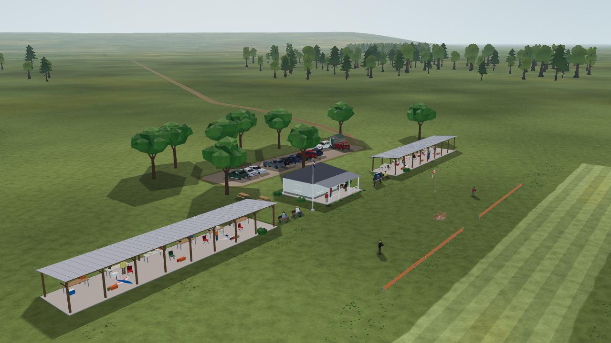

# L10c — flightline barrier and complete-field review

## 2026-10-16 — L10c-R2 planting and weathering

The barrier now has silvered, unevenly faded timber, textured steel corrosion, darker damp bases, and small irregular soil collars. Four unmodified 1K [ambientCG Metal026](https://ambientcg.com/view?id=Metal026) maps supply colour, normal, roughness and metalness; [provenance](../../../../app/assets/landscape/flightline/PROVENANCE.json) retains URLs, CC0 licensing and hashes. Exposure and aging amounts are visual estimates, not a measured corrosion model.

The default field has **99 clumps** of downloaded Quaternius grass and clover beside its 20 posts. The existing vegetation catalog and dirt texture are reused without altering their source files or other consumers. Three instanced plant batches use a local olive foliage material and slight dry-tip colouring. Seeded height, yaw and placement vary each cluster; source bounds keep every leaf outside the walking opening and below 0.23 m. Plants and soil are independent of removable fence parts and introduce no collision proxies or per-frame CPU processing. Plant motion and separate plant shadows are not added.

[Before](weathering-2026-10-16/before.png) · [After](weathering-2026-10-16/detail.png) · [Post-foot close-up](weathering-2026-10-16/foot.png) · [Reverse side](weathering-2026-10-16/rear.png) · [Pilot view](weathering-2026-10-16/pilot.png) · [Full flightline](weathering-2026-10-16/flightline.png).

**505 focused checks pass**: 206 barrier/material/planting, 144 data, 20 contact shadows, 78 destruction/reset and 57 projected-shadow assertions. The barrier checks include source-box grounding, opening/width containment at boundary field dimensions, deterministic layout and mipmaps. Logs and [source identities](weathering-2026-10-16/sources.json) are retained beside the captures. Native Compatibility rendering on an RTX 3090 produces no shader/runtime errors. [Ablation](weathering-2026-10-16/ablation.json) preserves 22,740 protected runway pixels in each pilot direction, rejects the existing occlusion/bounds mutations and has no clipped-white cue pixels.

The barrier plus plants and soil now takes **five draws**, versus one for R1. Source plants contain 42,761 triangles; the imported automatic LODs reduce the whole visible cue to 19,206–19,396 primitives in the five 960×540 ablation views. The opaque fence itself remains 17,520 triangles. These counters are not a whole-flight frame-time or low-end GPU qualification. Full-suite and packaged-build checks were not rerun. The existing capture command below also includes the new post-foot view; [accepted manifest](weathering-2026-10-16/accepted-capture.json) and [baseline manifest](weathering-2026-10-16/before-capture.json) retain native camera and source context.

## 2026-10-15 — L10c-R1 close-view finish

The flightline barrier now uses bevelled timber rails, inset steel posts with caps and ground shoes, and two-sided splice plates, washers and hex fasteners. The horizontal grain, normal and roughness maps reuse [ambientCG Wood049](https://ambientcg.com/view?id=Wood049), licensed CC0; [runtime provenance](../../../../app/assets/landscape/flightline/PROVENANCE.json) records the original files and archive hashes. Runtime tint, dimensions and weathering remain artistic estimates.

[Before](detail-2026-10-15/before.png) · [After](detail-2026-10-15/after.png) · [Reverse side](detail-2026-10-15/rear.png) · [Pilot view](detail-2026-10-15/pilot.png).

The detail builder retains the shared collision parts, dimensions, walking opening and damage IDs. Every fitting belongs to its rail's removable geometry. Model-space texture mapping survives damage-batch rebuilds without adding UV dependencies to the shared scenery code; vertex alpha stays opaque for detached debris. The separate pilot station is unchanged.

Native Godot 4.7.2 Compatibility captures on an RTX 3090 show one added draw and **17,520 triangles**, versus the original 1,320. The intentional detail budget is below 20,000 triangles for the default and 34,000 for the maximum supported width. Three 1024² textures use lossless imports, mipmaps and anisotropic filtering. This is a geometry/material tradeoff, not a measured frame-time improvement or low-end GPU acceptance.

All **485 focused checks** pass: [186 geometry/material](detail-2026-10-15/test-barrier.log), [144 data](detail-2026-10-15/test_flightline_barrier_data.log), [20 contact shadows](detail-2026-10-15/test_flight_cue_shadows.log), [78 destruction/reset](detail-2026-10-15/test_scenery_destruction.log), and [57 projected shadows](detail-2026-10-15/test_field_projected_shadows.log). The native [ten-image ablation result](detail-2026-10-15/ablation.json) passes the existing runway-clearance and outside-bounds mutation guards, with zero clipped-white cue pixels; both pilot views preserve 22,740 protected runway pixels. [Source identities](detail-2026-10-15/sources.json), [before capture manifest](detail-2026-10-15/before-capture.json), [after capture manifest](detail-2026-10-15/after-capture.json).

Reproduce the fixed full-field detail views with the pinned native Godot binary:

```powershell
& .tools/Godot_v4.7.2-stable_win64_console.exe --path app --audio-driver Dummy --rendering-driver opengl3 --script ../tools/ground/capture_barrier_detail.gd -- --out=C:/new-empty-location/barrier-review
```

The capture uses an offscreen 1280×720 4×MSAA viewport and explicit native draws. Full-suite, packaged-build, low-end frame-time and human flight-readability acceptance were not rerun for this visual change. The following section preserves the original delivery evidence.

## Original 2026-10-08 delivery

**Status (2026-10-08): engineering verification passed. Gate L and Gate SC remain open.**

The default field now has a low orange-and-grey flightline barrier: 48 m across, 0.65 m high, with a 6 m central opening. Twenty posts, pale caps, footings and four open slats per bay match the pilot station. All dimensions and colours are estimated original procedural artwork, informed by the existing [field-layout references](../../scenery-investigations/03-rc-field-layout-references.md). This is a visual cue, with no collision or claim of physical protection. Aircraft, pilot datum, runway and physics are unchanged.



The barrier uses one opaque mesh, **1 draw and 1,320 triangles** in the default field. Closed box geometry preserves faces from every viewing direction; the largest supported custom barrier remains below 3,000 triangles. The field loader checks provenance, uniqueness, dimensions, the central opening, rough-ground containment and separation from the station, runway, mown areas and windsock. It also keeps the barrier top plus a 5 cm estimated margin below the pilot-to-near-runway-ground sightline. A 0.9 m barrier at the default position is refused; moving it to north 3.5 m restores clearance. Custom flat fields retain their own footprint; only the exact 40 km horizon ground imposes the 1.5 km flat-radius constraint. See [data contract](data-contract.md).

## Visual evidence

Thirty barrier on/off captures cover front, rear, overview and both threshold directions from the pilot eye: a default run, an independent repeat and scenery enabled. Images and GPU counters repeat exactly. Both threshold views preserve all **22,740 protected runway pixels**, including a two-pixel margin. A deliberately changed runway pixel fails the guard; an unrelated pixel changed outside the projected barrier also fails. The polygon is clipped against the camera near plane before projection, because the opposite threshold can be behind the eye. This is a pixel-difference control, not a rendered occluder or a guarantee for every custom camera/field.

The [barrier report](evidence/barrier-summary.json) records one added draw, 1,320 triangles, visible cue pixels confined to projected bounds in inspection views, and no clipped whites. Existing windsock and station modes pass another 48 captures. [L10d](../L10d/README.md) adds 18 shadow captures: **96 cue captures total**, rechecked with the [final checker and its source hash](evidence/capture-check.json). Cue ablation toggles geometry only; the shared contact-shadow mesh stays present. The separate L10d ablation isolates those shadows.

Eight existing scenery postcard/review cameras were rendered twice with a frozen clock: club, pits, pavilion, meadow, north/south pilot views, runway threshold and car park. All 16 PNGs and per-view counters repeat exactly. The [contact sheet](scene-review.png), [first manifest](evidence/scene-first.json), [repeat manifest](evidence/scene-repeat.json) and [image hashes](evidence/scene-first-hashes.json) preserve the review. The club, cars, tables, people, flowers and distant scenery belong to the existing SC track; this step integrates and reviews them without duplicating their assets.

[Default pilot looking left](pilot-left.png). L8 close tree meshes remain pending: current field trees begin around 270 m, outside the proposed 150 m close-mesh zone, and the detailed source trees are not approved ≤1k-triangle runtime LODs.

## Verification and limits

Focused checks pass: **144 barrier-data, 48 barrier-geometry, 121 windsock-data, 163 station-data and 20 contact-shadow checks**. The [three-second trace comparison](evidence/trace-comparison.json) preserves all 721 numeric samples. [Empty-root Linux pack loading](evidence/pack-check.log) verifies the barrier, shadows, field data, grass and tree resources without source-tree fallback. The explicit scenery launcher boots Home headlessly. Static lint retains zero errors and the same 12 existing warnings.

All **145 headless check sections** completed with exit 0, including golden flights, model contracts and identical state hashes at 30/60/144 FPS. The repository runner was unchanged; a [shared-host timeout wrapper](evidence/timeout-wrapper.sh) extended 60-second deadlines to 180 seconds without changing assertions. The final sightline guard was added after this run started, so all affected field/cue tests were repeated against final sources. Concurrent uncommitted physics work was excluded. [Full log](evidence/app-test.log) · [Verification scope](evidence/verification.json) · [Final source hashes](evidence/snapshot.json).

The [final L6c comparison](evidence/readability-comparison.json) repeats 64 captures in a frozen source tree. All metrics in eight groups and 48 attitude cases are exactly equal to the baseline; the blinded 24-image kit remains available for the owner’s playtest.

Human attitude recognition, landing perception and frame-time measurements on the owner's slowest GPU remain Gate L work. Software-renderer counters and deterministic captures do not close those gates. Wind response still depends on L15a/M5; terrain/contact work remains separate. The full capture pipeline and native Windows/macOS execution are not claimed.

## Open the complete field

```bash
app/run-landscape.sh
# Or enter flight directly:
app/run-landscape.sh -- --quick-flight
```

This explicit launcher enables the existing optional scenery and forwards normal Godot arguments; ordinary app startup retains its current scenery policy. Home's selected aircraft and language still work normally.

Reproduce cue verification:

```bash
"$(app/tests/visual-env.sh)" tools/ground/check_windsock.py \
  --cue flightline_barrier --app app --godot "$(app/get-godot.sh)" --out /tmp/l10c-review
```

`app/capture.sh` now runs all four cue modes and hashes their completion reports. No external asset or dependency was added.

The complete-field review reuses the scenery team's cameras unchanged:

```bash
LP_NUM_THREADS=1 xvfb-run -a -s '-screen 0 1280x720x24' \
  "$(app/get-godot.sh)" --path app --resolution 1280x720 \
  --rendering-driver opengl3 --audio-driver Dummy \
  --script res://scenery/capture_views.gd -- --scenery=on \
  --scenery_audio=off --scenery_birds=off --t=0 \
  --views=postcard_club,postcard_pits,postcard_pavilion,postcard_meadow,pilot_north,pilot_south,runway_threshold,car_park \
  --out=/tmp/l10c-complete-field
```
