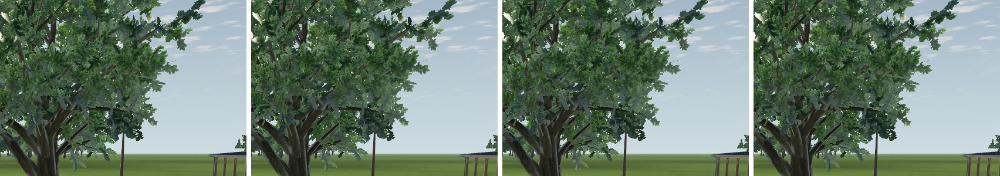

# L15b-R2 close downloaded-tree wind

2026-10-21 · Landscape **L**, coordinated with SC/LU (collision envelopes) and M5 (wind). Render-only; no simulation, aircraft, placement or collision change.

The 13 downloaded LandscapeLab Quercus and pine trees around the club and farm now move in the session wind. Before this step they were static: the L15b-R1 wind shader could not reproduce their back-face-culled bark, clamped leaf textures and glTF roughness/metallic/occlusion channels, so the material gate kept them on their source materials. The protected clubhouse maple, the other three maples and the BLEND oak stay static by design.



## What changed

| Area | Change |
| --- | --- |
| Shaders | New [`imported_tree_wind.gdshaderinc`](../../../../app/scenery/imported_tree_wind.gdshaderinc) mirrors Godot 4.7.2's StandardMaterial3D generator for the accepted features: albedo/vertex colour, UV1 transform, metallic and roughness maps with channel masks, normal map, ambient occlusion with light affect, alpha scissor. Three variants set the cull mode and texture repeat: [double-sided/repeat](../../../../app/scenery/imported_tree_wind.gdshader), [back-face-culled/repeat](../../../../app/scenery/imported_tree_wind_cull_back.gdshader), [double-sided/clamped](../../../../app/scenery/imported_tree_wind_clamp.gdshader). |
| Sway law | Same as the field cards (`render/tree_wind.gdshaderinc`): speed-squared saturation at 10 m/s, 0.20–0.50 Hz by height, 0.75–1.0 sway cycle, stable per-tree phase. The crown-top displacement is in **metres**, bounded per asset. L15b-R1 applied 0.01 *mesh-local units*, which is 1.7 mm on a 10 m Quercus (source height 59.6 units). |
| Foliage | Alpha-scissor surfaces without a normal map get a shading-only flutter: a normal tilt up to 0.12 at 8 m/s, 1.2/1.7 Hz, phases varying over about 3 m. It moves no vertex, so it cannot change any envelope. |
| Gate | [`ImportedVegetation`](../../../../app/scenery/imported_vegetation.gd) qualifies a tree only if it has a measured limit in `TREE_WIND_LEAN_LIMITS_M`: Quercus 0.12 m, pine 0.22 m. The material gate now accepts back-face culling, clamped textures, roughness/metallic maps and occlusion on UV1, and rejects front culling, back-culled clamped textures, ORM materials, occlusion on UV2, forced-sRGB albedo, particle trails and FOV override. Unlisted trees keep their source materials. |
| Legacy path | The shared all-role shader [`imported_vegetation_wind.gdshader`](../../../../app/scenery/imported_vegetation_wind.gdshader) loses its dead tree branch; its grass/shrub expressions are unchanged. `set_wind()` now affects only legacy batches. Tree materials have no per-build uniforms and are shared across builds. |
| Bounds | Each tree's render bound grows horizontally by its limit divided by its scale; height is unchanged because the bend is horizontal. |

The library-only Quaternius forms lose the L15b-R1 qualification: none is placed with tree wind (the hedge builder uses them statically), and their proxies were not measured.

## Collision stays unchanged

Close-tree crown proxies are oriented boxes over the full source bounds plus a 0.06 m wind margin. A bend whose worst-case vertex stays inside that box needs no new collision world. [`proxy_slack_probe.gd`](fixtures/proxy_slack_probe.gd) evaluates every imported vertex of the smallest placed tree (3.20 m; the allowance grows with height) for both trunk-height extremes, using the `VegetationPlacement` spec and `CollisionWorld` constants:

| Asset | Vertices | Largest crown-top sway | Limiting vertex | Runtime limit |
| --- | ---: | ---: | --- | ---: |
| Quercus | 9,098 | 0.1235 m | box-extreme leaf at 0.70 H | 0.12 m |
| Pine | 6,210 | 0.2292 m | box-extreme branch at 0.51 H | 0.22 m |

Below the crown box, the saturated sway is at most 0.006 m (Quercus, crown bottom 0.22 H) and 0.032 m (pine, crown bottom up to 0.38 H), inside the trunk capsule's 0.06 m margin. [Raw output](proxy-slack.json). `test_imported_tree_rendering.gd` recomputes the containment at the runtime limits. A disposable copy of that test with 0.13 m and 0.23 m fails, by 3.2 mm and 0.2 mm.

The probe also confirms a pre-existing gap of 7 mm vertically and 1.7 cm radially: a few Quercus branch vertices sit just below the 0.22 H crown bottom and just outside the trunk capsule. Wind moves them by at most 6 mm.

## Native captures (llvmpipe)

All captures use Godot 4.7.2 Compatibility under Xvfb with Mesa llvmpipe at 1280 × 720 and 4× MSAA. They are visual evidence, not performance. [Source identity](source-identity.json), [run reports](runs/), [comparison fixture](fixtures/compare_captures.py).

| Check | Result |
| --- | --- |
| Gallery motion, Quercus first and pine first ([`check_quality_capture.py`](../../../../tools/trees/check_quality_capture.py)) | wind moves, 1 s repeat pixel-exact, 0 s and 1024 s pixel-exact, reversal changes the image, wind-off clock control static: all pass ([Quercus](check-gallery-quercus-first.json), [pine](check-gallery-pine-first.json)) |
| Calm parity, gallery | static maple and back views exact in both orders; other views differ by 0–294 px, mostly by 1–2 levels ([Quercus first](calm-gallery-quercus-first.json), [pine first](calm-gallery-pine-first.json)) |
| Calm parity, production field | pilot, meadow and forest views exact; car park 604 px, oak close-up 117 px, aerial 54 px. Isolated single pixels on Quercus/pine crowns; no shifted geometry, shadow or ground ([summary](calm-field.json)) |
| Fixed car-park camera, 8 m/s, 48 frames | 20,584–26,499 px change between consecutive frames. Motion is confined to the Quercus/pine crowns, their upper trunks and their moving shadows; cars, ground and lower trunks stay still ([summary](motion-car-park-8mps.json), [motion overlay](images/motion_union.jpg)) |

The strict `all_calm_sources_pixel_exact` gate fails on llvmpipe. Bisection shows the calm image changes only through compiled shader structure. With the wind block removed, the Quercus and pine views are exact and the underside differs by 4 pixels. Removing the occlusion and normal-map mirror instead produces 5,826–23,677 px differences, so that mirror is required. Every variant that keeps the displacement (conditional, branch-free, position-only, or without `MODEL_MATRIX`) gives the same small pattern, while removing the flutter and vertex-colour code changes nothing. The accepted L15b-R1 shader is no closer under the same fixture: 21–77 px per view, up to 212 levels ([HEAD comparison](calm-gallery-l15b-r1-llvmpipe.json)). Exact calm parity therefore remains a native-GPU check (see the [tree guide](../../../../tools/trees/README.md#native-imported-tree-comparisons)).

## Reproduction

```sh
"$(app/get-godot.sh)" --headless --path app --script "$PWD/docs/research/visual-quality-implementation/L15b-R2/fixtures/proxy_slack_probe.gd" -- --out=/tmp/proxy-slack.json
xvfb-run -a "$(app/get-godot.sh)" --path app --rendering-driver opengl3 --audio-driver Dummy --script "$PWD/tools/trees/quality_capture.gd" -- --mode=gallery --wind=off --ids=landscapelab_quercus,landscapelab_pine,maple_tree --out=/tmp/l15b-r2-off
# repeat with --wind=on and a new --out, then check_quality_capture.py --source ... --wind ...
xvfb-run -a "$(app/get-godot.sh)" --path app --rendering-driver opengl3 --audio-driver Dummy --script "$PWD/tools/trees/quality_capture.gd" -- --mode=field --wind=on --motion=car-park-wind --frames=48 --wind_mps=8 --out=/tmp/l15b-r2-car-park
```

## Open

- Exact calm parity and alternating A/B frame timing on the native Windows/RTX host (`profile_compare.py`, `flight_quality.py`). Nothing here measures performance. The moving trees carry 63,508 source triangles (3 Quercus, 10 pine) whose vertex stage now evaluates the sway and two flutter sines.
- Owner review of the motion amplitude and flutter in live flight; both are artistic estimates, not botanical dynamics.
- The maples remain static (protected). Adding them needs an owner decision and a measured limit.
