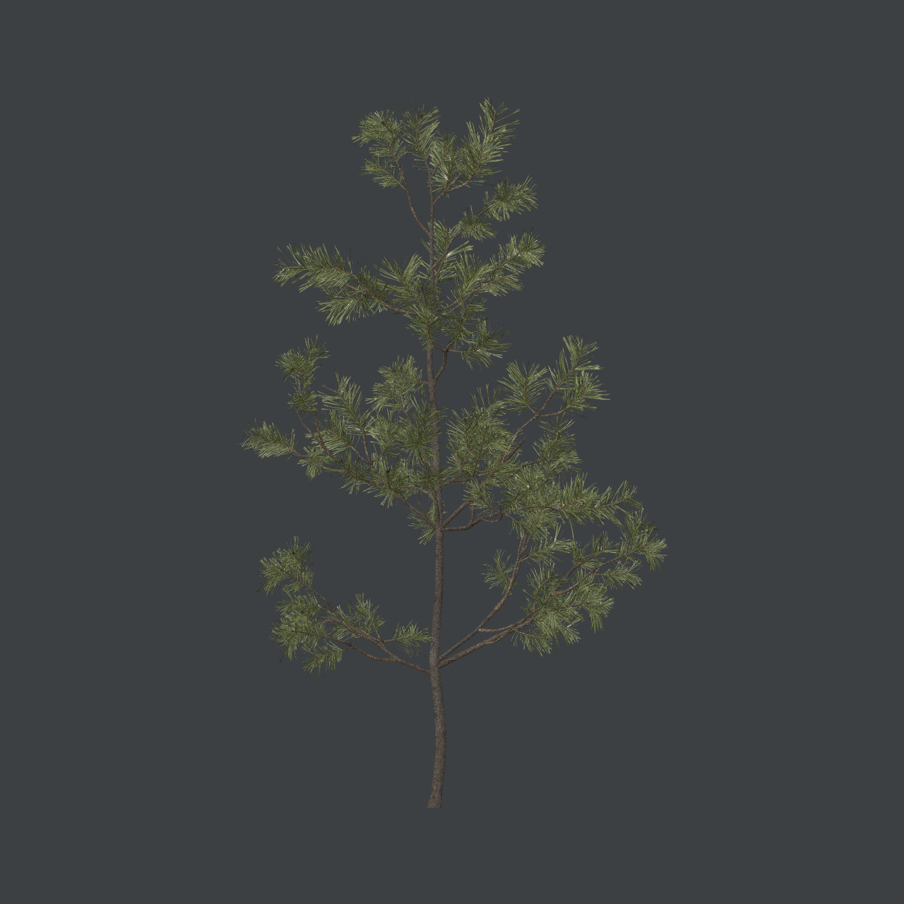
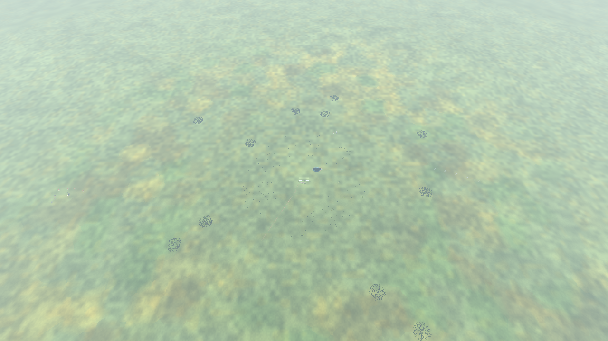
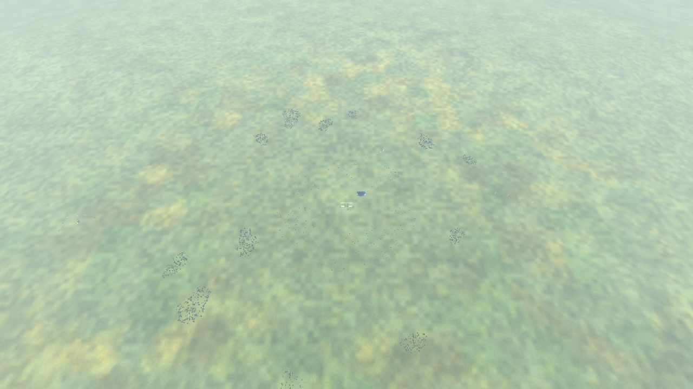
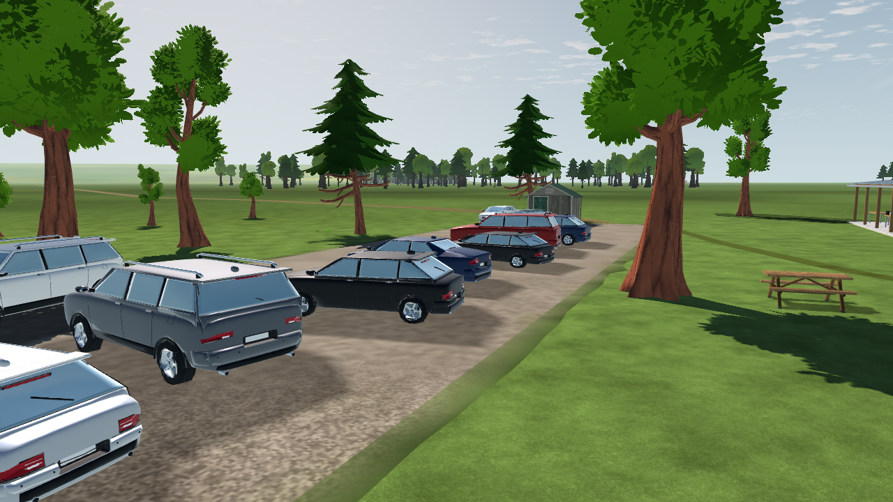
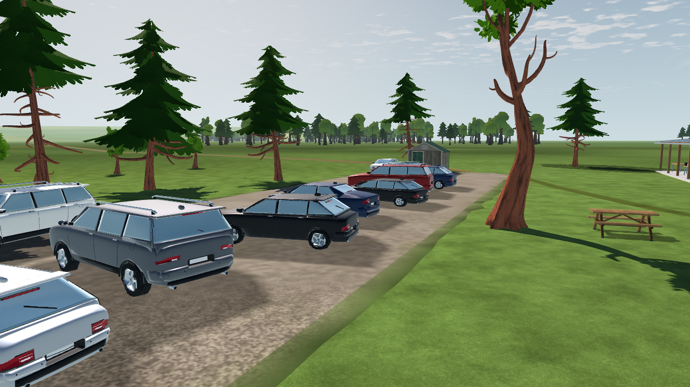

# Downloaded trees, woodland placement and imported-tree wind

2026-10-17 local / 2026-10-18 UTC. Implementation evidence for L6a-R1, the source-fidelity slice of L6b-R2, L7-R1, the batching experiment in L7-R2 and L15b-R1. [Plan](../../../plans/tree-forest-quality.md), [research](../../tree-forest-quality-2026-10-17.md), [source pipeline](../../../../tools/landscape/vegetation/README.md).

The production scene now selects seven downloaded mature tree forms, uses irregular far-woodland patches at the existing population, and animates the qualified imported trees with session wind. No tree geometry was modeled. This is an incremental improvement of the established stylized family; it is not a photorealism or pilot-readability acceptance claim.

## Implemented selection

| Item | Result |
| --- | --- |
| Close source forms | `CommonTree_1/2/3/4`, `Pine_1/2/3` from the retained Quaternius Standard CC0 archive |
| Library | 19 assets, seven trees; 39,966 triangles for one copy of each library asset |
| Placed close trees | Same 17 positions, headings, seeds and heights; seven source forms instead of three; the seven scaled broadleaf saplings retain their previous two forms |
| Close-tree source geometry | 80,673 → 80,177 triangles across the 17 instances |
| Complete scenery | 648,925 source triangles, below the existing 650,000 ceiling; no budget increase |
| Field forest | Same 480 near + 1,200 far cards; same three card identities and eight sector MultiMeshes |
| Far composition | `habitat-v1`, seed 610617; twelve unequal anisotropic patches, irregular margins and gaps; 55–173 trees per patch |
| Wind | Imported trees use shared `sim_clock` / `wind_vec`; separate field-card behavior and physical wind are unchanged |
| Spatial cells | 0/64/128/256 m available for imported trees; default remains 0; no density increase |

The new forms add branching/full, sparse-crowned, broad-conical and open-trunk silhouettes. Existing bark/leaf textures are shared; the four additional forms require no additional texture images. Source meshes, indices, positions, normals, UVs, units and transforms are retained.

The original glTF colors contain 43,282 components slightly above one, up to `1.0001678466796875`. The existing card adapter already recognizes this upstream precision defect. The vegetation generator now applies the same narrow policy to runtime tree buffers: clamp only float `COLOR_0` values in `(1, 1.0002]`; reject unsupported excursions. It leaves every other buffer byte and the original archive unchanged. Each catalog row records changed-component counts and source/output buffer hashes. This is a reproducible data repair, not new geometry or a painted texture.

[Khronos validation](validation.json): eight glTFs, **zero errors**, zero unresolved resources, 13 unsuppressed tangent-generation warnings. Seven warnings concern the retained trees; six concern the Poly Haven comparison source. Native import generates the missing tangent basis; the gallery and shader tests explicitly retain the bark normal maps. Validator success alone does not establish visual suitability.

## Realistic source comparison

[Poly Haven Pine Sapling Small](https://polyhaven.com/a/pine_sapling_small) was actually downloaded under [CC0](https://polyhaven.com/license): 21,891,339 bytes, eight verified source files, three intact forms and 398,144 source triangles. Original URLs, authors, API MD5 and local SHA-256 are retained in the [source manifest](../../../../assets/landscape/vegetation/source/polyhaven_pine_sapling_small/download-manifest.json) and [inspection](../../../../assets/landscape/vegetation/source/polyhaven_pine_sapling_small/INSPECTION.md).

The [source gallery](captures/realistic-source/source_gallery.json) isolates each supplied A/B/C node, keeps source materials and metre scale, and captures front/back/underside at fixed 1.65 m orthographic framing. These are roughly one-metre saplings, not mature trees. Their geometry stays outside `app/`; placing the full-resolution set would consume most of the complete scenery budget before any other scenery. No supplier LOD or wind channel was found.

The planned LOLIPOP Pine/Maple download could not be completed through the available unauthenticated Sketchfab access; no download token or archive was available. Pine Tree 01 was rejected before download after its official metadata showed about 958 MB and 17.18 million triangles; Jacaranda metadata also exceeded its listing's quoted count. The small verified Poly Haven source provides a real material/silhouette comparison while mature realistic-source/LOD qualification remains open.

## Placement, contact and identity

The generator preserves the frozen 480-point near prefix (`9b42b61f…c722875`), total count, 0.25 m grid, 600–1,500 m far range, minimum 4.5 m far spacing, crown-cleared sight gaps and runway/mown flight corridor. Patch counts are 55, 64, 72, 82, 88, 92, 96, 102, 110, 124, 142 and 173. [The pipeline](../../../../tools/trees/README.md#l6bl7-placement-and-rendering) documents the canonical recipe and explicit historical control. These are artistic habitat estimates, not ecological simulation or surveyed geography.

Changed placement and selected mesh envelopes intentionally produce a new collision world. With the same normalized field/scenery inputs and lights omitted, the identity changes from `faef6caa…6fddcce` to `5dd45231…f62b3ca`, at the same 4,958 proxies. [Full candidate inventory](candidate-inventory.json) records exact identities, source choices and dimensions. This delivery must not be labeled an exact replay of the old world. Contact tests derive sweep lengths from actual crown bounds and exercise all seven sources. All 17 close trees remain visible at low, balanced and high scenery quality.

## Wind and material evidence

The tree-only shader supports the reviewed single-mesh, two-surface trees. It preserves albedo, normal maps, UV transforms, vertex colors, roughness/metallic/specular scalars and alpha scissor. Unsupported packed maps, material features, transforms or independently modeled stem/crown parts retain source materials. A separate shared bend frame is required before multi-part trees can opt in.

The height-squared displacement fixes the root, limits source-space sway, follows the horizontal session wind and corrects normals and the tangent frame analytically. Culling and reported bounds include maximum displacement. Per-build material copies isolate wind controls; tree regrouping preserves source transforms, phase, tint and damage IDs. No per-instance shader uniform is required by Compatibility. The legacy all-role wind entry point remains available; the production call enables trees only.

[Native checks](capture-checks.json) pass on all seven forms: calm source/wind images are byte-identical, the wind-off clock control is static, a repeated time is byte-identical, 1024-second clock wrap matches time zero, and forward/reversed wind produces different images. These checks establish deterministic rendering, not botanical motion realism. Source and wind-on capture manifests retain image hashes and renderer identities.

## Verification and performance scope

Native renderer: Godot `4.7.2.stable.official.ed1daf0bf`, OpenGL Compatibility, RTX 3090, NVIDIA 617.42. Matched field/gallery captures use 1280×720 and 4× MSAA. Baseline runtime is frozen from `5b1773fe76a21ba1bedb06421e15b3238377660e`; the candidate is that imported copy with only this tree implementation overlaid. [Build identities](build-identities.json) distinguish it from concurrent grass work.

The eleven focused native headless tree/vegetation/collision suites pass, including 28,626 treeline checks. The first isolated lifecycle attempt lacked the external aircraft authoring identities; restoring those exact baseline files resolved it. The final native [20-cycle Home/Fly/End-flight probe](candidate-native-lifecycle.json) completes with zero orphan nodes and stable Home/flight node counts. This checks lifecycle behavior; timings were collected while other CPU verification ran and are not loading-performance acceptance.

The unmodified full Linux `app/test.sh` was attempted in a fresh clone. It stops at the unrelated AUD-12 audio-bus freshness check: editor import adds a resource UID while the checker compares exact serialized text. The same check fails on the untouched baseline. The original failure log is retained; it is not reported as a passing full suite.

Static paired measurement results and any remainder-suite outcome are recorded in the accompanying reports. Static viewport samples exclude aircraft physics, UI, audio, live camera inputs and simulation/wall acceptance. They cannot close the shared +0.5 ms visual budget or the 60 Hz flight gate by themselves.

## Remaining gates and controls

- Keep spatial batching at 0 and population unchanged until measurements justify a different setting. Density and the 650k source-geometry ceiling are not silently increased.
- Mature realistic-source integration, near/far palette qualification, temporal 720p/1080p fly-throughs, independent aircraft-attitude readability and owner preference remain open.
- Optional L8 mesh/card transitions and octahedral impostors are not implemented merely because a library exists. The current card and imported populations have no new LOD transition between them.
- Native flight profiling requires the existing `--frametimes` workflow and a controlled live-input route. The existing `.orfl` replay is headless numerical replay; it cannot render the old route against the changed forest.
- Full release/export, RC views and the shared visual/performance owner gates remain separate. No physical flight validation is claimed.

Disable only the new imported-tree motion with `--tree_wind=off`. Restore the prior layout only with the historical generator recipe, and restore source selection/catalog/buffers together if rolling back the close trees; the corresponding collision identity changes again. Current operational commands live in the two linked pipeline READMEs.
