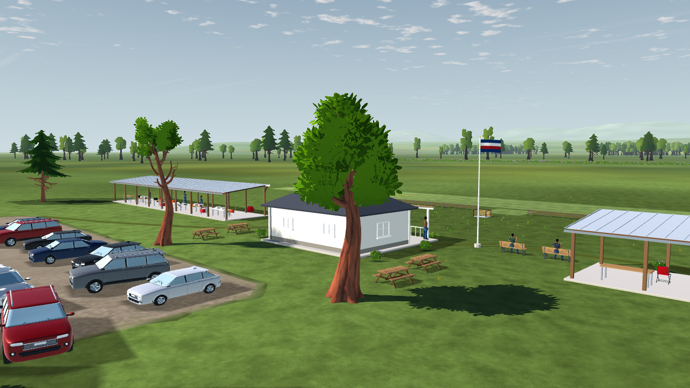
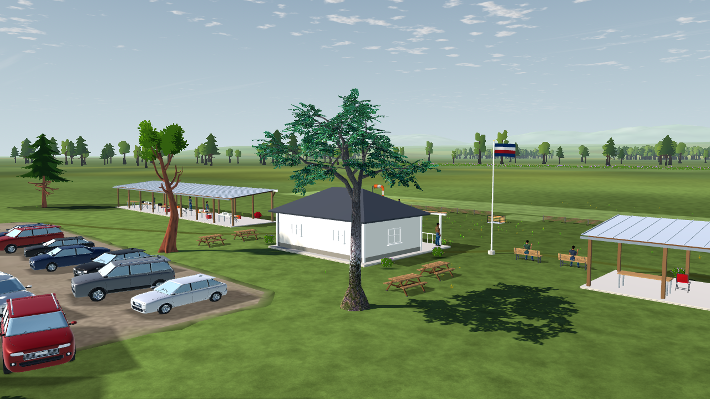

# L6a-R1: Mature oak continuation

2026-10-18. Integrates one downloaded mature oak and the independently qualified [bark-only filtering change](../../L6b-R2/README.md). [Tree/forest plan](../../../../plans/tree-forest-quality.md), [asset pipeline](../../../../../tools/landscape/vegetation/README.md), [source/material evidence](source-intake/README.md). This is a bounded continuation; it does not establish a photorealistic forest or close flight/owner acceptance.

## Implemented behavior

The library now contains **20 assets, eight tree forms and four pinned sources**. The new `oak_tree` is lauris71's [Oak Tree](https://opengameart.org/content/oak-tree), selected under CC BY-SA 3.0. The original ZIP/BLEND and atlas remain intact in the source pipeline. A reproducible Blender 5.2.2 conversion consolidates the 36 supplied LOD0 parts into one surface with **5,303 source triangles**; no tree was modeled or decimated. Source positions and UVs are exact in the baked proof; the maximum unit-normal delta is 0.000384625. Khronos validation reports zero errors, warnings and unresolved resources. A repeat export with the current converter reproduces all three runtime files byte-for-byte.

The original 1024² diffuse/alpha atlas remains lossless and un-mipped. The legacy material is explicitly translated to metallic 0, scalar roughness 1, double-sided BLEND. Roughness 0.5 caused white highlights on back/underside views. Roughness 1 removes them; this is a reviewed scalar adaptation, not an authored roughness map. Godot 4.7.2 imports BLEND as `TRANSPARENCY_ALPHA_DEPTH_PRE_PASS`. The source's zero legacy specular scalar is not represented by Godot's supported glTF route; native specular remains 0.5. The unsupported specular extension was tested and omitted. No runtime material override is added.

The wind adapter continues to reject this alpha mode and retains the oak's static source material. The other seven tree assets retain their qualified wind. Supplier LOD1/LOD2 are excluded: their alternate envelopes and prerendered foliage representations have not been qualified. Godot automatic mesh LODs remain enabled for imported LOD0.

Only the first slot of the two mature aliases changes. The sapling aliases remain unchanged. Exactly one placement changes source: `prop:shade-trees:06`, E 10.5 m, N −32 m, heading 247.1°, seed 793949324. Its target height remains 9.94902649 m. The 17 close-tree placements, positions, headings and seeds are identical. The field forest remains 480 near + 1,200 far cards.

| Inventory | Before | After |
| --- | ---: | ---: |
| Close tree source triangles | 80,177 | 79,215 |
| Complete scenery source triangles | 648,925 | 647,963 |
| Source scenery cap | 650,000 | 650,000 |
| Collision proxies | 4,958 | 4,958 |
| Replaced tree envelope width × depth | 5.904 × 6.269 m | 9.249 × 7.854 m |

The broader crown changes the normalized world identity from `5dd45231f977010fc272bb1c34dd82210c92fbdde68a7d5dba4e7c868f62b3ca` to `3fab9b2d3696d00bd50f1be534a56f08afb9fc582334dcb6be8c251201d85b89`. These identities omit lighting. This is not an exact replay of the previous collision world. Existing source-derived trunk/crown proxies remain coarse gameplay envelopes, not measured physical tree geometry.

## Native comparison and verification

Native Godot `4.7.2.stable.official.ed1daf0bf`, OpenGL Compatibility, RTX 3090 / NVIDIA 617.42, 1280×720, 4× MSAA. The frozen comparison isolates this tree continuation from concurrent grass/audio work. It includes the previous seven-tree delivery, a bark-only control and the final bark-plus-oak candidate. The fixed `oak_close` camera frames the replaced tree; the older car-park camera leaves it outside the view.

Eight-source galleries pass calm source/material fidelity, deterministic time and wrap checks. The wind checks demonstrate movement for the established first fixture source, not every species independently. A separate oak-only pair verifies all nine camera/time captures are byte-identical with wind requested and disabled, proving its static fallback. Back, underside and overhead views are retained. These static samples do not establish transition quality or long-distance temporal stability.

Five focused production suites pass: imported vegetation, imported-tree rendering, collision proxies (43 checks), complete vegetation (36 checks, including the 650k cap) and tree bounds (192 seeded/theme builds). A native rendering-test run also passes. Collision sweeps cover all eight tree forms through their actual mature/sapling aliases. The fresh Git-index checkout check verifies the pinned source pipeline and generated library without cached imports; it is scoped to the vegetation subtree, not a full application release.

The Windows PCK checks run from an empty project root. Catalog, both license notices and all five imported texture payloads match the source project. PCK size is 168,537,880 bytes and SHA-256 is `27a04ac140b873d948bacc5a42951486d63166183cce422e77109a6f380aa29c`. The PCK is not duplicated in this evidence directory. Every export preset now includes `assets/landscape/vegetation/LICENSE*.txt`; macOS/Linux target-host qualification remains in the release workflow.

## Static profile and lifecycle

[Five alternating pairs](profiles/summary.json) use 10 s warmup and 60 s measurement per process, native 1280×720/4× MSAA and the fixed `oak_close` camera. The baseline is the first seven-tree delivery without bark mipmaps; the candidate adds bark-only mips and the single oak replacement. Every sample, engine log and source/import identity is retained. No other GPU work ran during measurement.

| Time (ms), median of five run percentiles | Baseline p50 | Baseline p95 | Baseline p99 | Candidate p50 | Candidate p95 | Candidate p99 |
| --- | ---: | ---: | ---: | ---: | ---: | ---: |
| Wall | 5.242 | 15.918 | 17.349 | 5.024 | 16.164 | 18.209 |
| Render CPU | 1.122 | 1.887 | 2.151 | 1.117 | 1.901 | 2.135 |
| GPU | 1.544 | 3.452 | 4.805 | 1.555 | 3.076 | 4.555 |

The median **paired** p95 change is **+0.2696 ms wall** and **−0.3726 ms GPU**. Individual wall-p95 differences range from +0.2015 to +0.2920 ms. Visible draws change 148 → 145 and visible primitives 280,413 → 279,451 in this view. Raw shadow counters report zero despite enabled directional shadows; they do not prove absence of shadow work. GPU residency remains unmeasured. These results describe this static view and do not close the shared visual or flight budget.

The [native Home/Fly/End-flight probe](checks/native-lifecycle.json) completes 20 cycles with 1,052 nodes in flight, 604 at Home, zero orphan nodes throughout, and released audio/temporary settings on shutdown. Loading times were collected during separate source verification and are not performance acceptance. The production world inventory exactly matches the frozen measured candidate.

After measurement, the packaged credits received an attribution-only update before the final PCK export. Rendering inputs stayed unchanged. The preserved identity files describe the measured tree settings; full application copies and their import caches remain excluded.

## Scope and remaining gates

The two shared Quaternius bark maps gain 10.667 MiB of decoded image data from mip chains; the oak adds 4 MiB of decoded atlas data. These figures are not GPU residency. Leaf-card mip generation remains rejected by L6b-R2. The oak's distinct hue, finer branches and open crown increase variety, while the remaining source families are still stylized.

Flight throughput, simulation/wall ratio, pilot attitude readability, temporal approach/retreat, day/night review, supplier LOD transitions, the shared +0.5 ms visual budget and owner acceptance remain open. The static profile uses a minimized window and a manually drawn SubViewport; wall samples include process scheduling and possible background throttling. The static profile and loading probe do not close the flight gates. The previous full strict-suite AUD-12 baseline UID mismatch remains documented in [the first delivery](../README.md); this continuation makes no new full-suite pass claim.

Reproduce source generation with the [vegetation guide](../../../../../tools/landscape/vegetation/README.md). Exact fixture snapshots, settings, reports and hashes are listed in `manifest.json`; full application copies, imported caches, PCK and duplicated model binaries are excluded.
