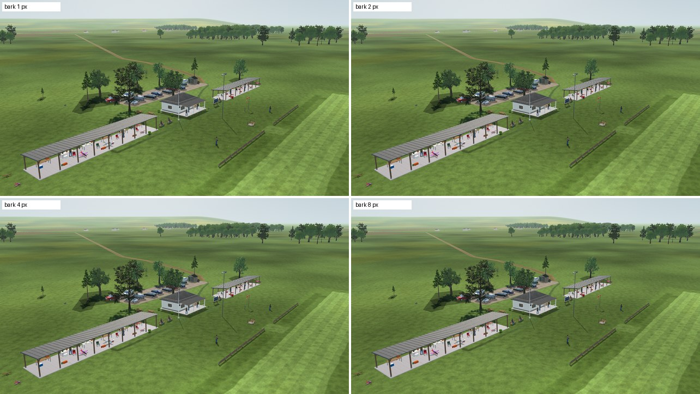
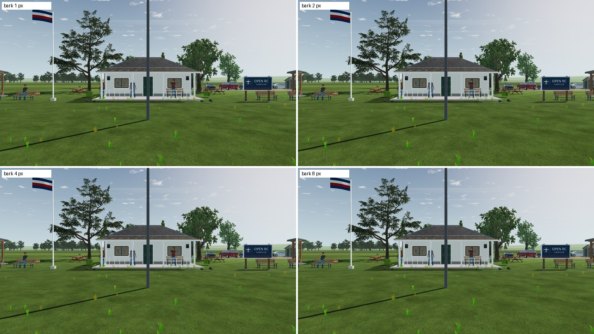
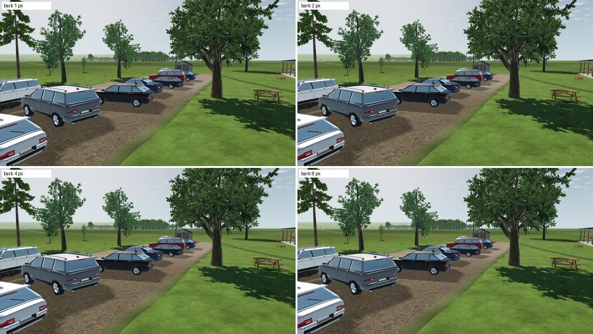
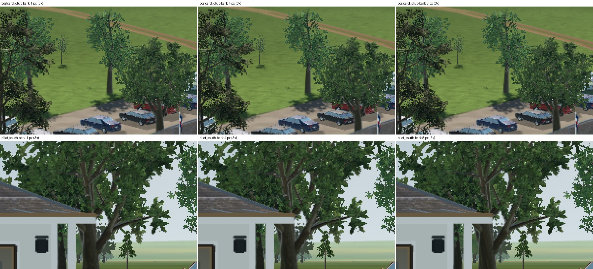

# L6c-R2 Club tree bark LOD

2026-10-22 · Landscape **L** ([tree plan](../../../plans/tree-forest-quality.md#follow-ups-2026-10-21)). Counted per instance, the club's imported trees are the largest pilot-view subsystem (354,332 primitives) and 43% of the Low preset's worst view ([VQ-06b](../VQ-06b-scene-detail/README.md#cost-per-level)). Their bark still switched LOD only below 1 px of error. Club LandscapeLab trees now pass the L8a-R1 `bark_lod_error_px` option at 4 px. Foliage, the maples, placement and collision are unchanged.

## Measurement

[`fixtures/club_bark_probe.gd`](fixtures/club_bark_probe.gd) sets the bark error of the four club LandscapeLab batches (Quercus, beech, pine, young oak) and measures them alone, per instance, in the visible pass. Shadow passes use the same LOD and scale alike.

| View | 1 px (before) | 2 px | **4 px** | 8 px |
| --- | ---: | ---: | ---: | ---: |
| Pilot looking at the club | 94,798 | 89,778 | **84,853** (−10%) | 66,433 |
| Club postcard | 86,582 | 77,182 | **58,217** (−33%) | 46,643 |
| `postcard_pits` | 94,798 | 89,778 | **85,398** (−10%) | 66,433 |
| Runway telephoto, 300 m | 94,798 | 94,798 | **66,433** (−30%) | 57,249 |
| Runway telephoto, 100 m | 94,798 | 94,798 | **94,798** | 94,798 |
| Car park | 94,798 | 94,798 | **89,778** (−5%) | 89,778 |
| `fleet_close` | 94,798 | 89,778 | **89,778** (−5%) | 80,473 |

The 100 m telephoto keeps full detail at every setting: magnified trees still exceed the error.

## Look

| View | 1 / 2 / 4 / 8 px |
| --- | --- |
| Club postcard |  |
| Pilot looking at the club |  |
| Car park |  |

Enlarged 3× where pixels changed most (1, 4 and 8 px):

At most 1,913 pixels change at 8 px in the club postcard and 885 at 4 px. Main limbs and branch structure are identical at 4 px. At 8 px a few fine branches of the tree nearest the cars change shape. The step uses 4 px (`Scenery.CLUB_BARK_LOD_ERROR_PX`): club trees are seen from 10–60 m, so they get half the field trees' 8 px.

## Scene budget

`tools/scenery/budget.sh` on main with this step, the matte foliage (L8a-R2) and Automatic (VQ-06b-R1), High preset ([summary](budget/summary-720.md)); all limits pass. Against the [L8a-R1 run](../L8a-R1/budget/summary-720.md):

| | Before | After |
| --- | ---: | ---: |
| Pilot worst view (100 m runway telephoto) | 1,295,621 | 1,295,621 |
| Pilot median | 816,151 | 803,744 (−1.5%) |
| Ground worst view | 1,058,511 | 1,039,711 (−1.8%) |
| Aerial worst view | 774,886 | 742,866 (−4.1%) |
| Club imported vegetation, aerial worst | 187,050 | 155,030 (−17%) |

The pilot worst view does not move: in the 100 m telephoto the club trees stay at full detail by design. The saving shows in club, ground and aerial views.

## Checks

`test_club_bark_lod.gd` builds the club scenery and compares each tree batch with a default ImportedVegetation build of the same model. LandscapeLab bark errors are divided by 4, foliage keeps its chain, and the protected maple keeps its whole chain. Mutations on a disposable copy, each caught: the club option dropped; the bark scaling reaching non-LandscapeLab trees (the maple). `test_scenery_build.gd` and `test_imported_tree_rendering.gd` pass.

## Open

- Native-GPU review of the club trees at 4 px, including motion.
